# 3DCraft examples

Twenty-six models built in [3DCraft](https://github.com/johancoppens/3dcraft), the open-source parametric
CAD modeller built for AI, from simple to fairly complex: machine parts, sheet metal, 3D prints, laser and
CNC work, furniture, packaging, jewellery, architecture, boats and art. Every one is real (sized to the
standards of its trade), makeable (its process checks are part of the model), parametric (a few public
parameters to play with) and light (it opens in seconds).

Each example lives in its own numbered folder under [`examples/`](examples/), from simple to complex, with:

- **`<id>.3dcraft`**: the model; open it in 3DCraft.
- **`build.json`**: the 3DCraft commands that build it, step by step, ending with the checks that prove it.
- **`README.md`**: what it shows, the real thing behind it, how to make it.
- **`prompt.md`**: a conversation you can have with an AI connected to 3DCraft to build it yourself.
- **`exports/`**: files for the workshop (STEP, 3MF, DXF, SVG) where they make sense.

## Gallery

From simple to complex, each with the difficulty an independent reviewer scored out of 10. Every example
was checked by a reviewer of its trade and rebuilt from its `prompt.md` alone by a second AI model. The
briefs they were built from are in [`CATALOGUE.md`](CATALOGUE.md).

<!-- gallery:start -->
| | Example | Domain | Difficulty |
|---|---|---|---|
| 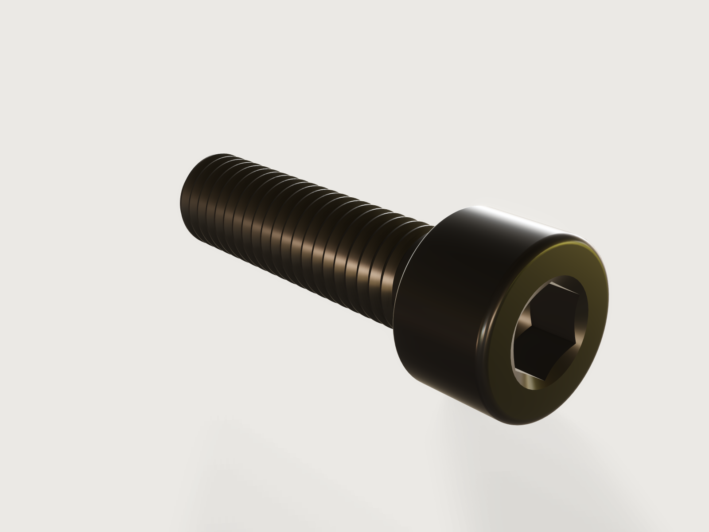 | **[Socket head cap screw](examples/01-socket-head-cap-screw/)**<br>An ISO 4762 socket head cap screw, M3 to M12 in the standard's lengths, with a rolled thread, in black-oxide steel. | Machine building | 4/10 |
| 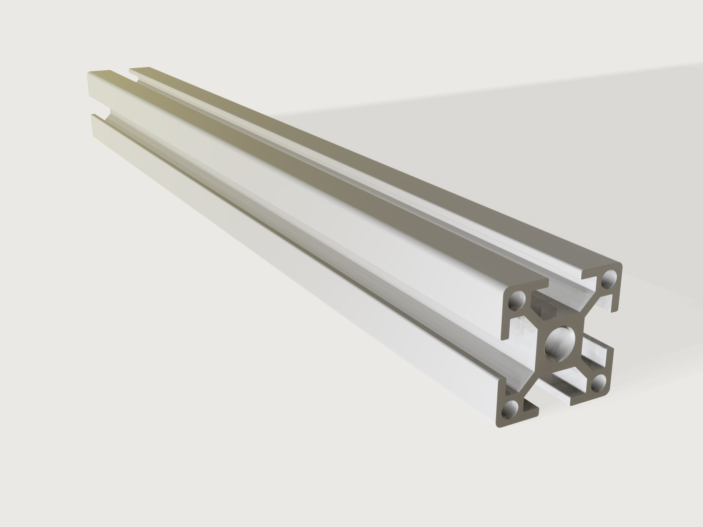 | **[T-slot aluminium profile](examples/02-t-slot-profile/)**<br>A 30 x 30 mm B-type aluminium profile with four 8 mm T-slots and a core bore tapped M8 at both ends, cut to length, in clear anodised EN AW-6063. | Machine building | 4/10 |
| 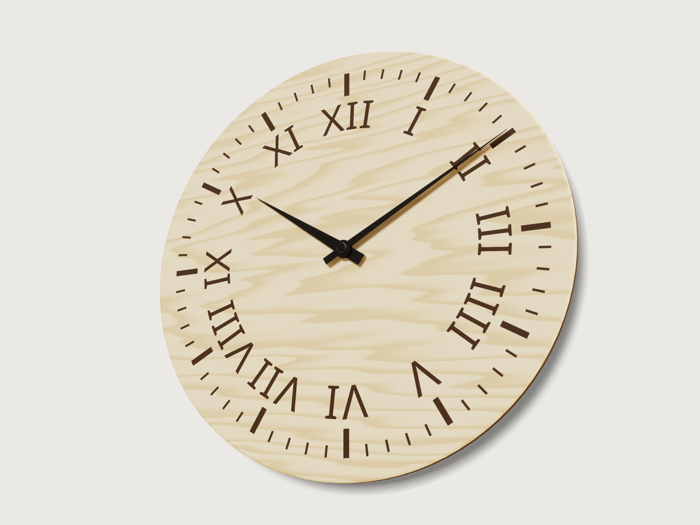 | **[Plywood wall clock](examples/03-wall-clock/)**<br>A Ø 300 mm wall clock laser cut and engraved from 6 mm birch plywood for a quartz sweep movement, Roman or Arabic numerals, a laminated keyhole hanger and foot at the back and black hands set to the time. | Laser cutting, art | 4/10 |
| 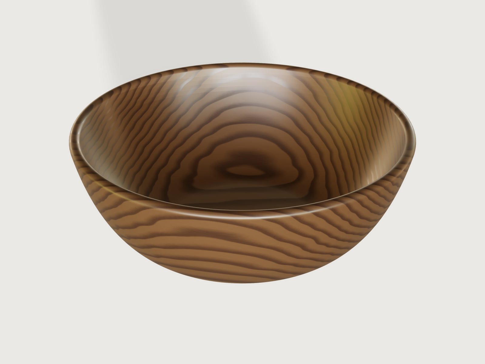 | **[Turned walnut bowl](examples/04-turned-bowl/)**<br>A face-grain serving bowl turned from a 10 × 4 inch walnut blank: an even 7 mm wall from a rounded rim to a foot ring with a dovetailed chuck recess, with its capacity in millilitres. | Woodturning | 4/10 |
| 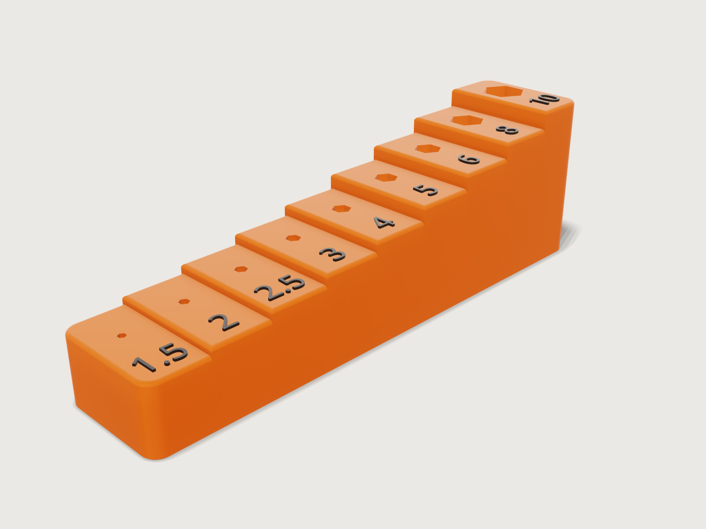 | **[Hex key stand](examples/05-hex-key-stand/)**<br>A stepped desk stand for a metric hex key set to ISO 2936, 1.5 to 10 mm, printed in PLA without supports, sizes embossed in black. | 3D printing | 4/10 |
| 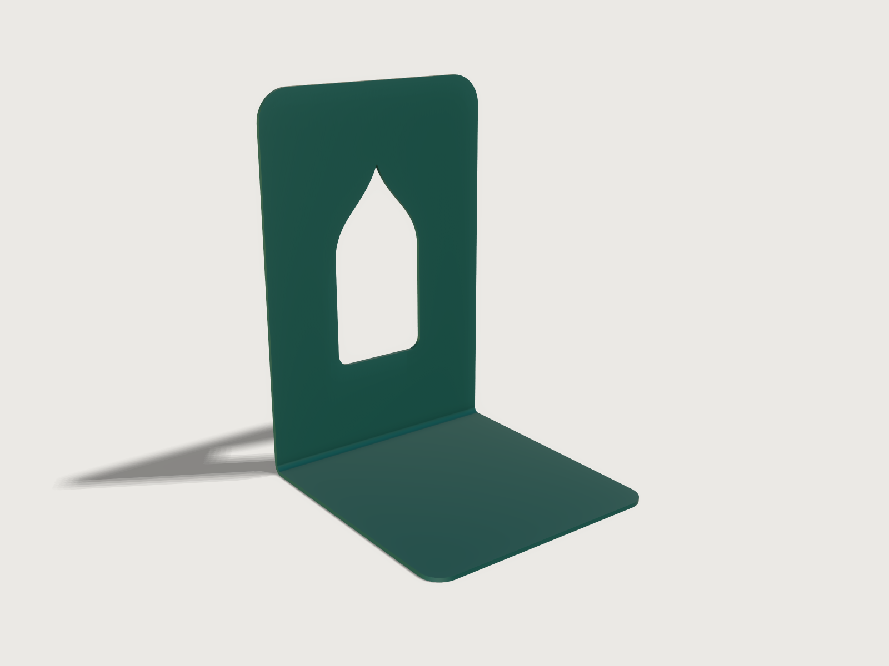 | **[Steel bookend](examples/06-steel-bookend/)**<br>A bookend laser cut from 2 mm DC01 cold-rolled steel with an ogee-arch window, bent once on a press brake and powder coated deep teal. | Sheet metal | 3/10 |
| 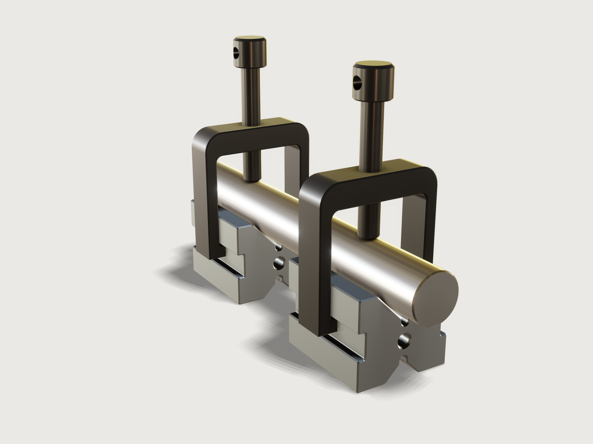 | **[V-block pair with clamps](examples/07-v-block-pair/)**<br>A matched pair of hardened and ground 90° V-blocks, 45 × 40 × 35 mm, for shafts of 6 to 30 mm, with black-oxide U-clamps holding a ground test pin. | Toolmaking | 5/10 |
| 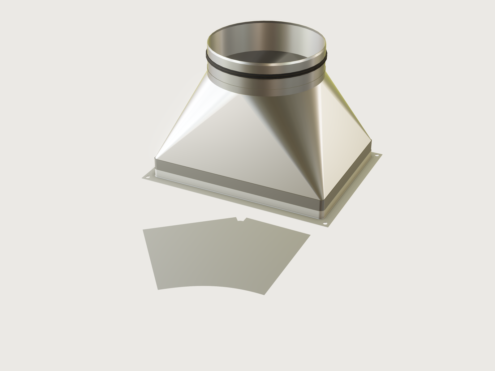 | **[Square-to-round transition](examples/08-square-to-round-transition/)**<br>A four-piece transition from a 400 x 300 mm rectangular duct to a 250 mm round duct in 0.8 mm galvanised steel: flat triangles and developable cone corners with straight ends, one piece unfolded into the flat pattern cut four times, with a lapped collar, a P20 angle frame and a sealed spigot. | Sheet metal, HVAC | 7/10 |
| 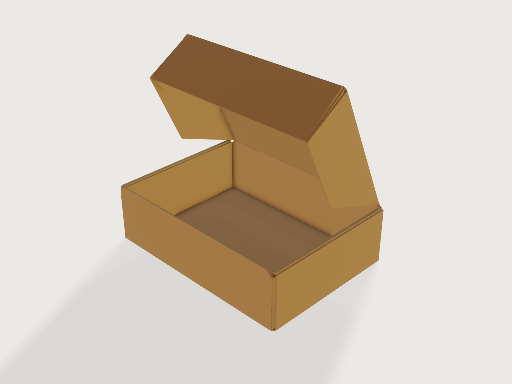 | **[Mailer box](examples/09-mailer-box/)**<br>A FEFCO 0427 mailer of single-wall E-flute kraft board, 200 × 150 × 60 mm inside, folded from its die-cut blank: rolled end walls locked by tabs, dust flaps and a tuck-in lid. | Packaging | 7/10 |
| 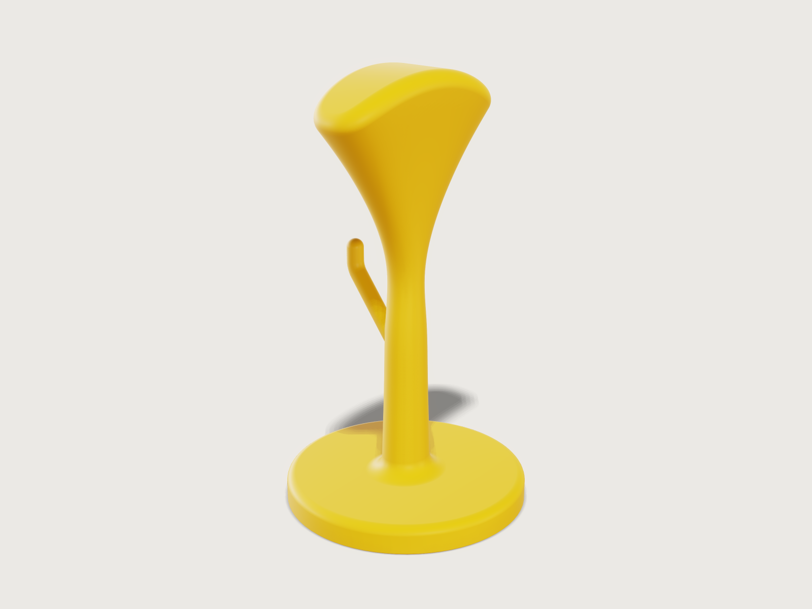 | **[Headphone stand](examples/10-headphone-stand/)**<br>A one-piece headphone stand printed upright in PETG without supports: a slim lofted column flaring into a wide saddle curved like a headband, a swept cable hook, and a round base weighted by an embedded steel disc. | 3D printing, product design | 6/10 |
| 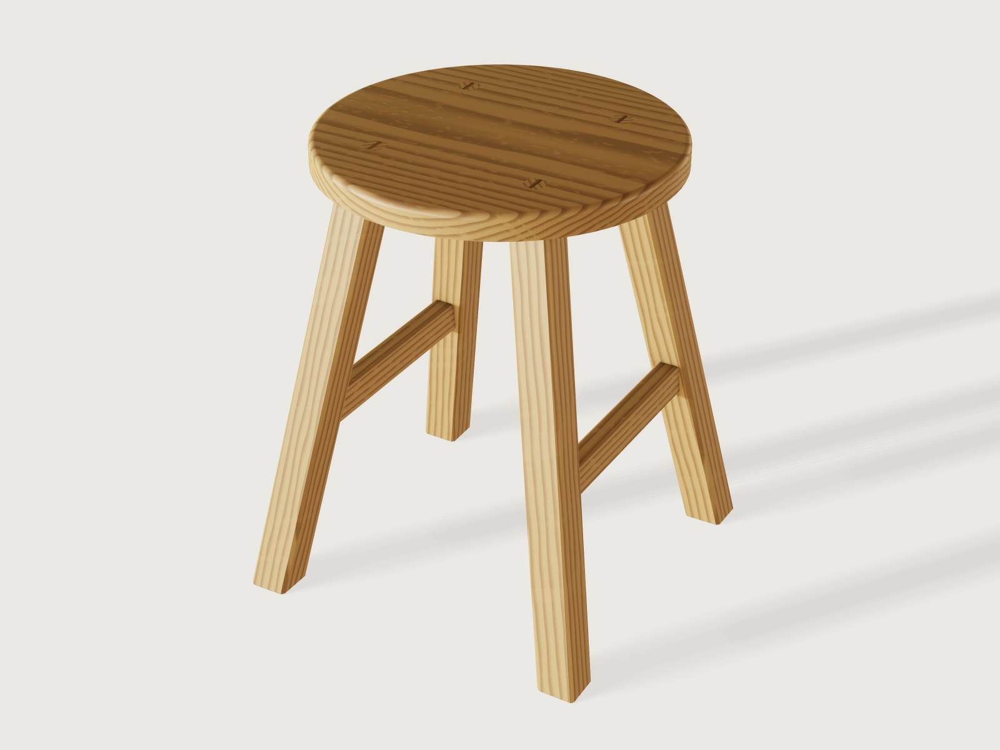 | **[Splayed-leg stool](examples/11-splayed-stool/)**<br>An oak sitting stool, Ø 340 mm seat at 450 mm, on four legs splayed and raked 10°, tenoned through the seat and wedged with walnut, with two shouldered side stretchers; proven in closed form and against the stool stability test of IS 5416-2. | Woodworking | 6/10 |
| 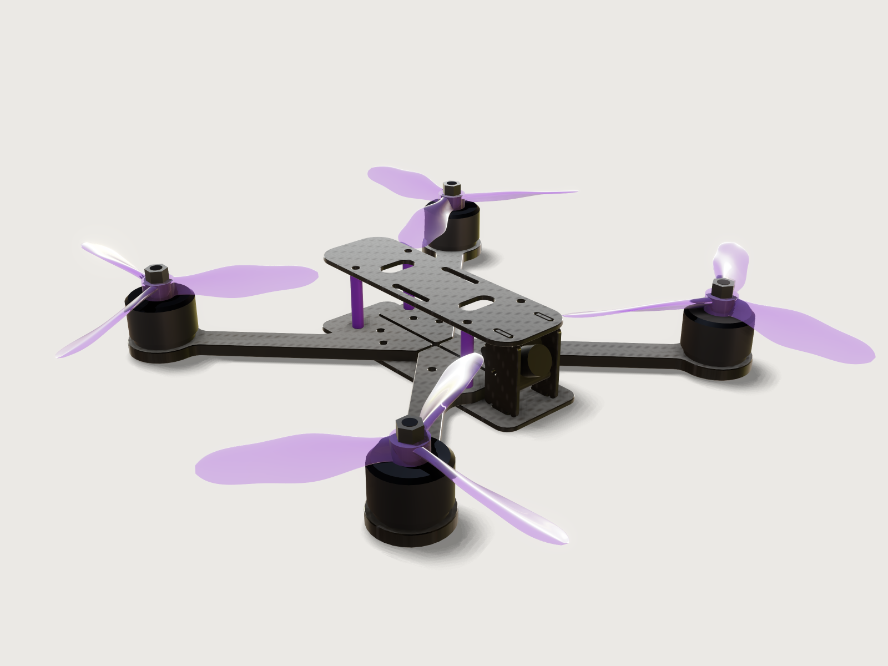 | **[5-inch FPV drone frame](examples/12-fpv-drone-frame/)**<br>A true-X freestyle quadcopter frame for 5 to 5.3 inch props, CNC routed from 2 mm and 5 mm carbon fibre sheet, with purple anodised standoffs, a 30.5 mm stack, a cage for a 19 mm camera and real 5.1 x 4.3 x 3 props lofted at their pitch. | CNC, RC | 7/10 |
| 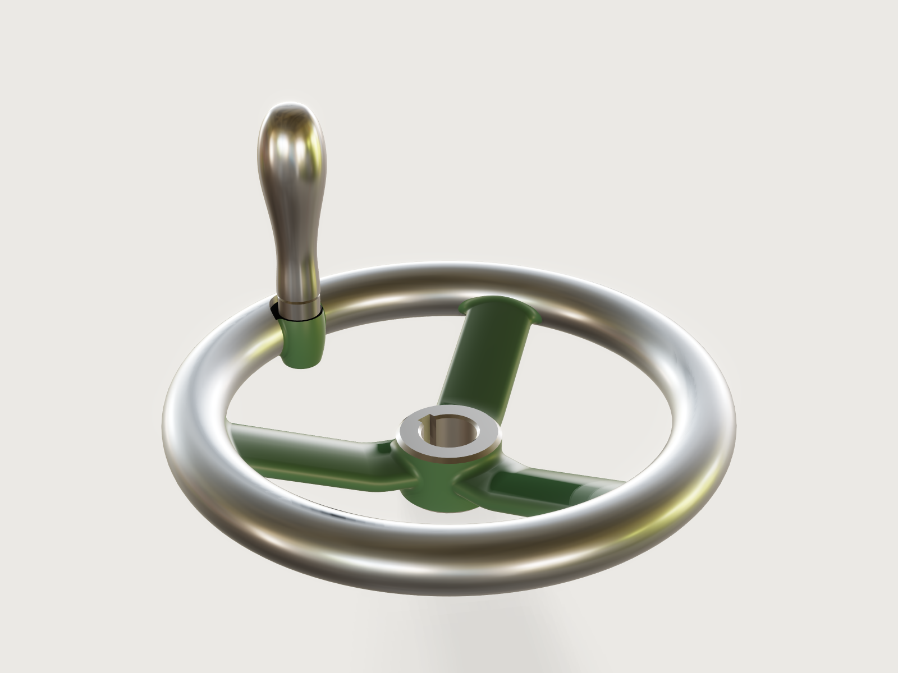 | **[Cast handwheel](examples/13-cast-handwheel/)**<br>A DIN 950 spoked handwheel in grey cast iron, 80 to 500 mm, with cranked oval spokes, a turned and polished rim, a keyed bore and a DIN 98 revolving handle on a boss at the standard's radius, painted machine green. | Machine building | 6/10 |
| 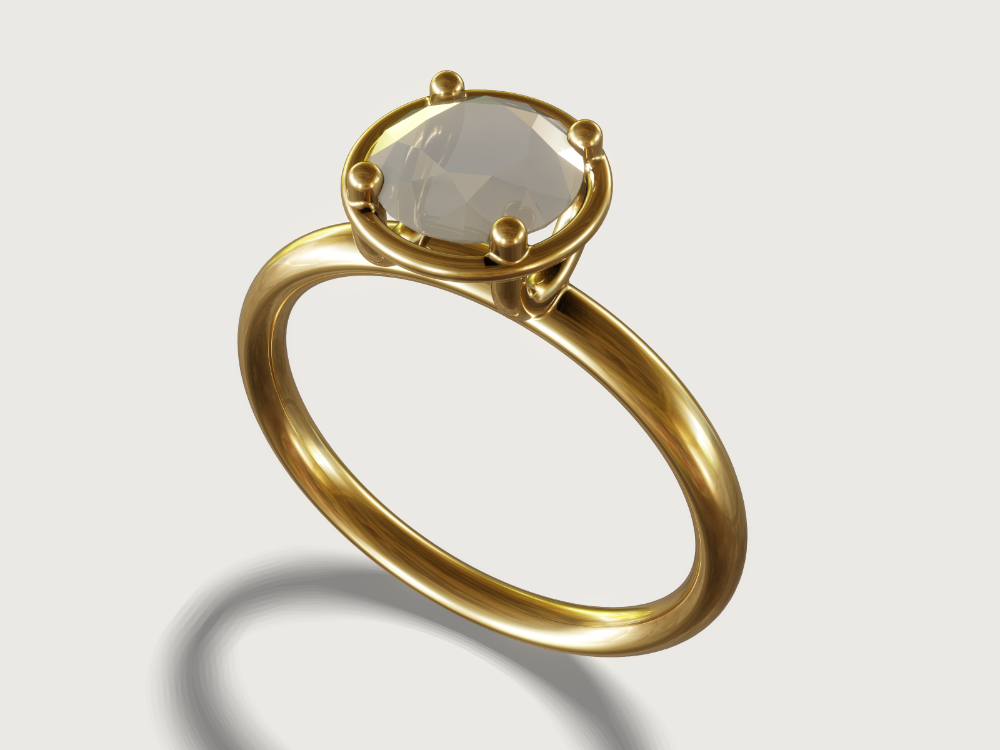 | **[Solitaire ring](examples/14-solitaire-ring/)**<br>An 18 ct yellow-gold solitaire in ISO 8653 ring sizes 44 to 72: a comfort-fit court shank and a four-prong basket head holding a round brilliant of 0.25 to 2 ct, cut to Tolkowsky's proportions and sized from its weight. | Jewellery | 6/10 |
| 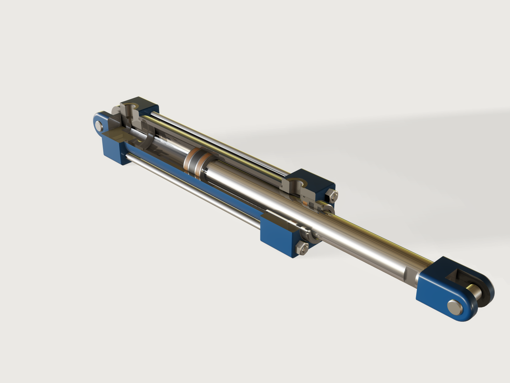 | **[Hydraulic cylinder](examples/15-hydraulic-cylinder/)**<br>A double-acting ISO 6020-2 tie-rod cylinder, bore 40, rod 28, with clevises at both ends, a rod that moves with a parameter and a cutaway that shows the piston, the seals and the gland. | Hydraulics | 8/10 |
| 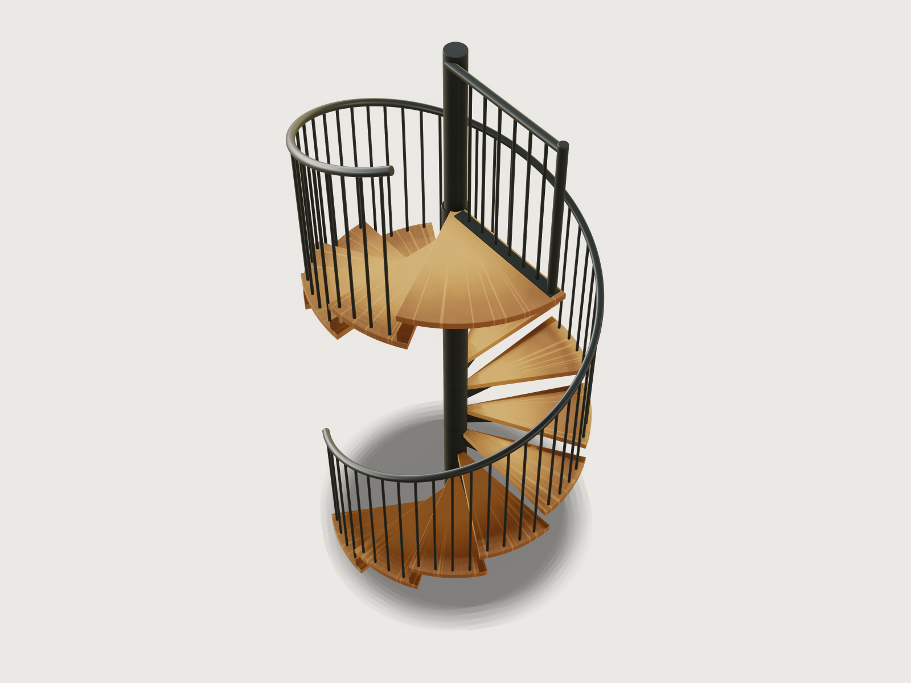 | **[Spiral staircase](examples/16-spiral-staircase/)**<br>A steel spiral staircase with oak treads, Ø 1600 mm and 2800 mm floor to floor, on a Ø 114.3 mm column, with a helical handrail and a landing, checked against DIN 18065. | Architecture, steel construction | 8/10 |
| 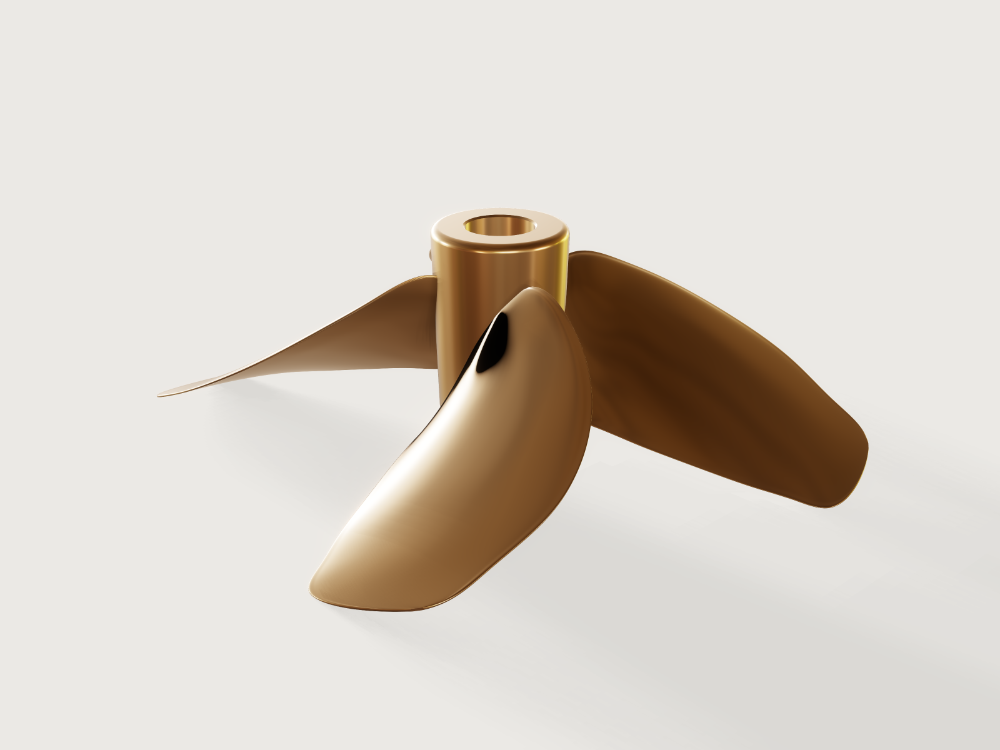 | **[Ship propeller](examples/17-ship-propeller/)**<br>A four-blade Wageningen B4-55 ship propeller, Ø 600 mm, pitch ratio 0.8, 15° rake, its blades from the series' published tables, in polished nickel-aluminium bronze. | Marine | 8/10 |
| 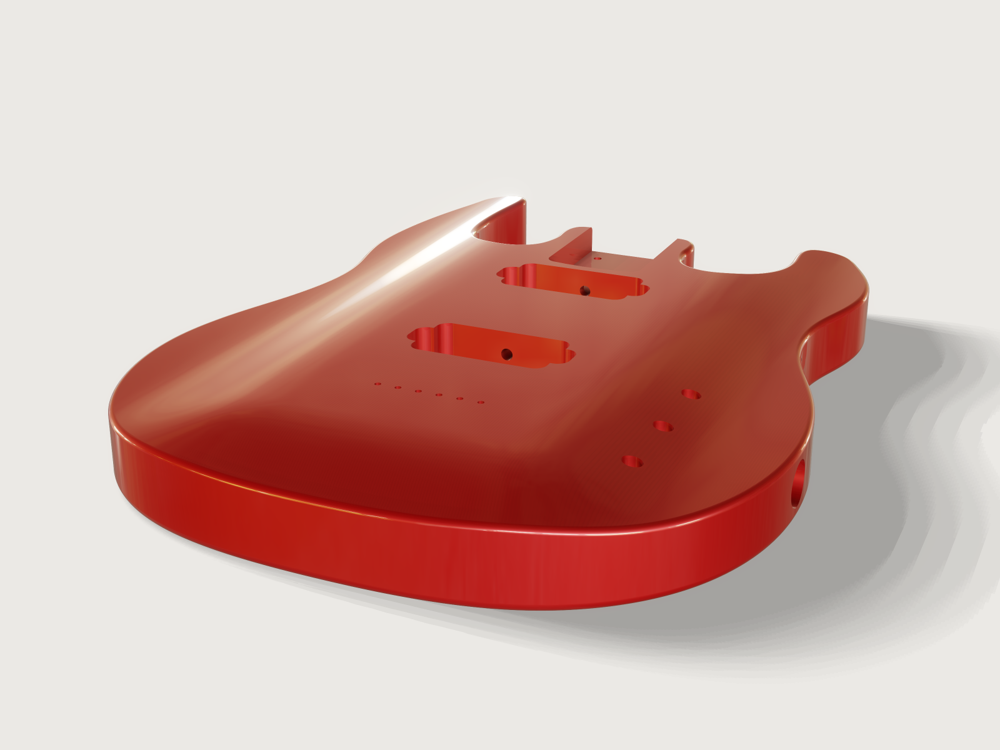 | **[Electric guitar body](examples/18-guitar-body/)**<br>An original double-cutaway solid body in red alder with a carved top, a bolt-on neck pocket, two humbucker routes, a rear control cavity and a string-through bridge placed by the scale length, finished in candy-apple red. | Lutherie | 7/10 |
| 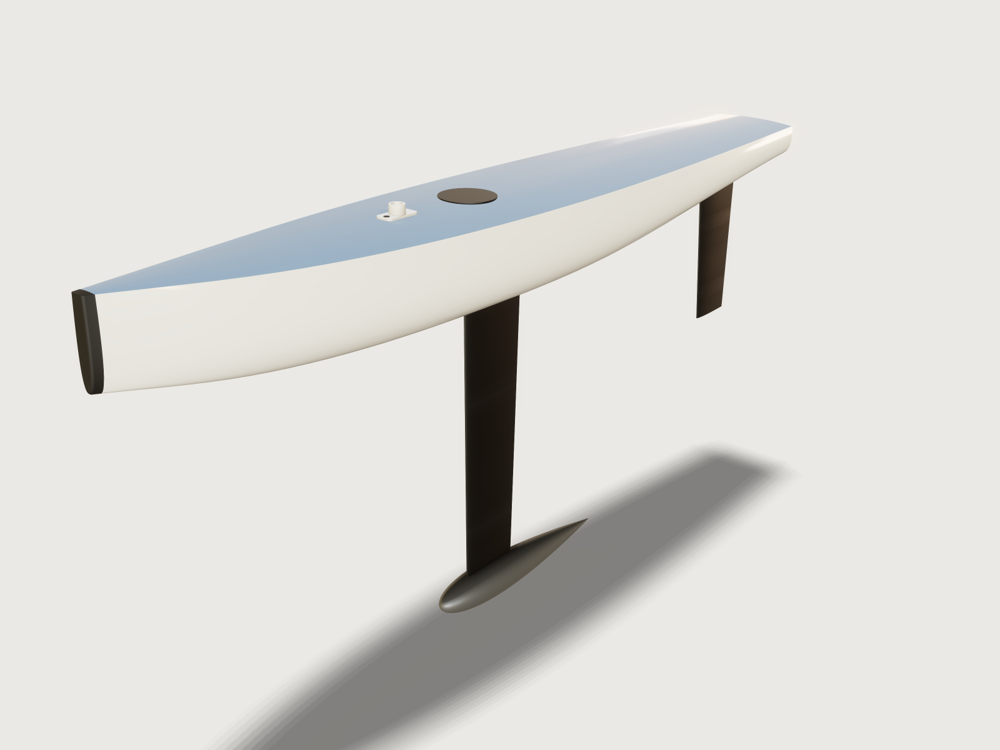 | **[RC yacht hull](examples/19-rc-yacht-hull/)**<br>An International One Metre radio-sailing yacht to the IOM Class Rules 2026: a glass hull lofted from a table of stations with a painted deck, a tapered carbon fin, a lead bulb sized by its mass and a carbon rudder, floated at the class's 4 kg in fresh water. | Naval design | 8/10 |
| 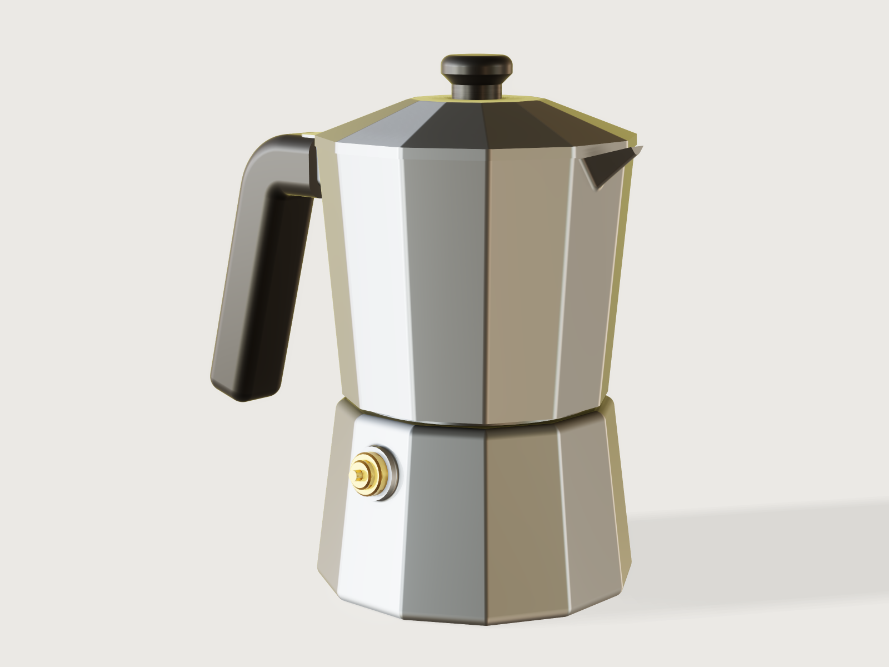 | **[Moka pot](examples/20-moka-pot/)**<br>An original twelve-sided stovetop espresso maker in cast aluminium for 3, 4 or 6 cups, sized by its physics: the safety valve sits where the water for the cups ends, the funnel holds the coffee for that water, the lid opens on a working hinge, and the pot stands on a 10° slope full or empty. | Product design | 8/10 |
| 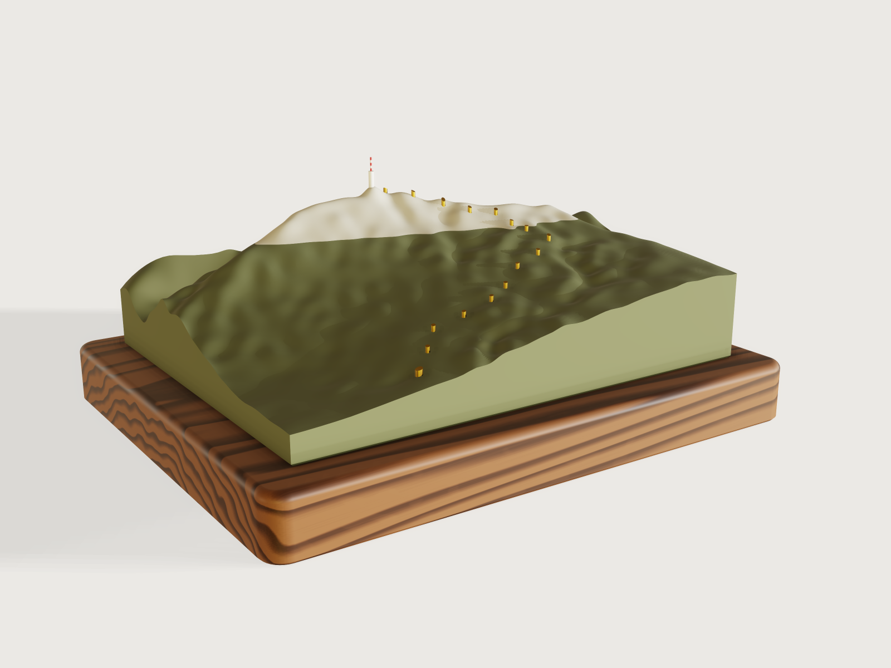 | **[Mont Ventoux relief](examples/21-ventoux-relief/)**<br>Mont Ventoux and the Bédoin climb of the Tour de France Femmes 2026 (stage 7) at 1:70 000: a relief printed in forest green and limestone white with brass kilometre pins and the summit tower on a walnut base, or laser-cut contour layers. | Topography, art | 8/10 |
| 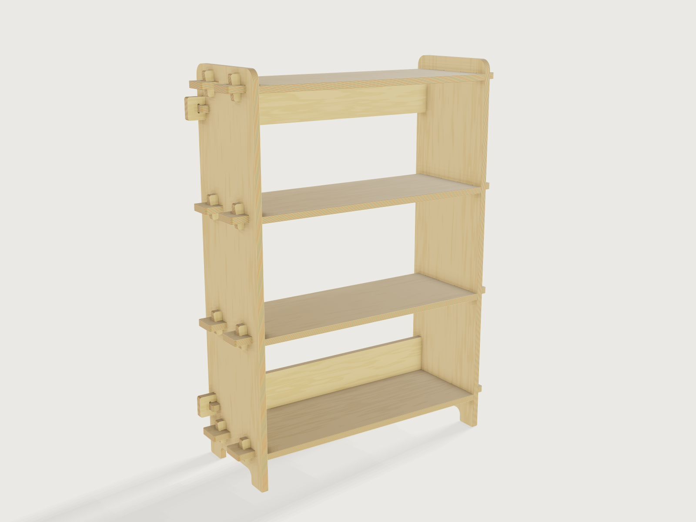 | **[Flat-pack bookcase](examples/22-flat-pack-bookcase/)**<br>An open bookcase of 18 mm birch plywood, CNC-routed from one 2500 x 1250 mm sheet and put together without screws, glue or tools: shelves and back rails pass through the sides in tusk tenons locked by tapered wedges. | CNC, furniture | 7/10 |
| 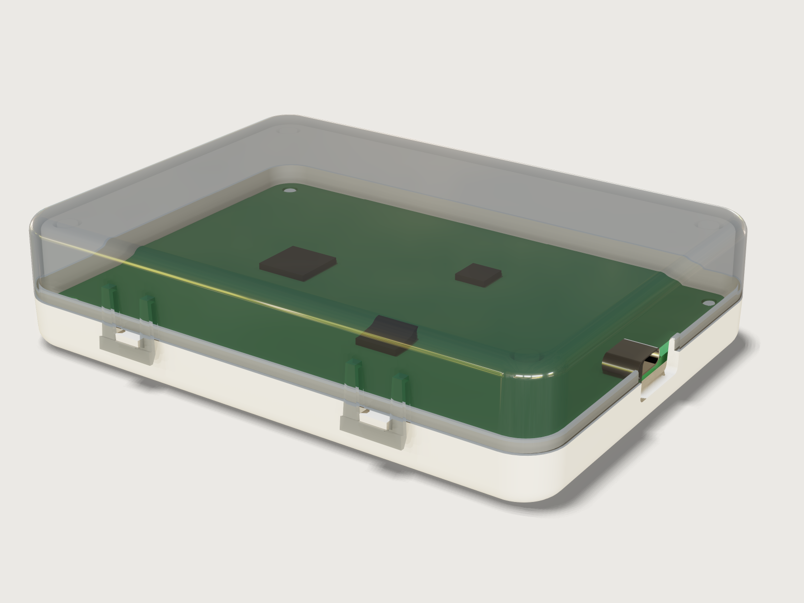 | **[Snap-fit enclosure](examples/23-snap-fit-enclosure/)**<br>An injection-moulded enclosure for a 100 x 70 mm circuit board: a matt white ABS base and a translucent smoke-grey polycarbonate lid, closed by four external U-shaped snap latches, both parts moulded in straight-pull tools without slides. | Injection moulding | 8/10 |
| 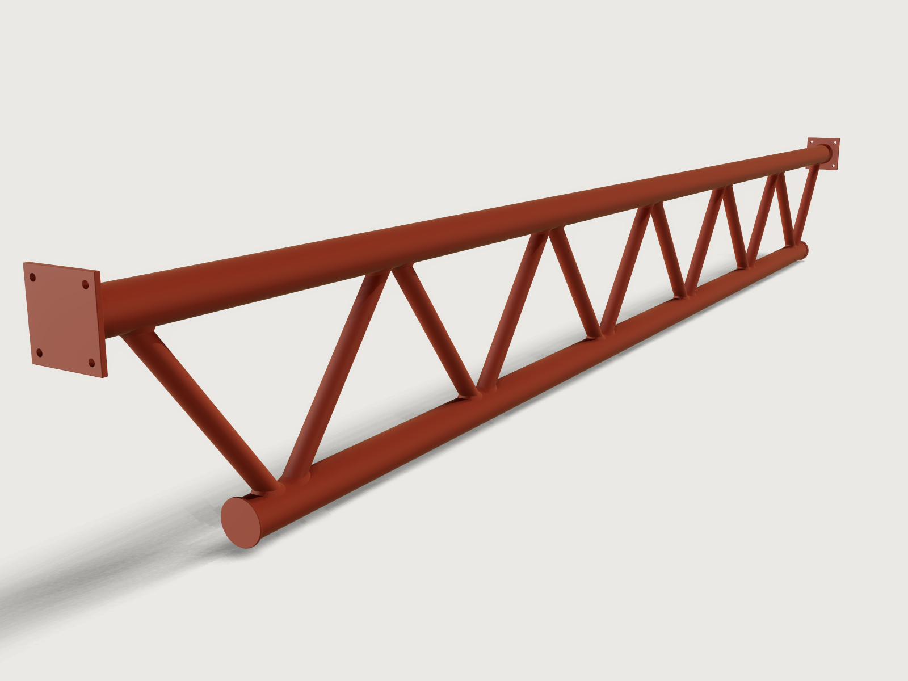 | **[Welded tube truss](examples/24-welded-truss/)**<br>An original 6 m Warren truss of EN 10219-2 circular hollow sections in S355J2H, with gap K-joints to EN 1993-1-8, coped diagonals fillet-welded all round and end plates, in red-oxide primer. | Steel construction, welding | 7/10 |
| 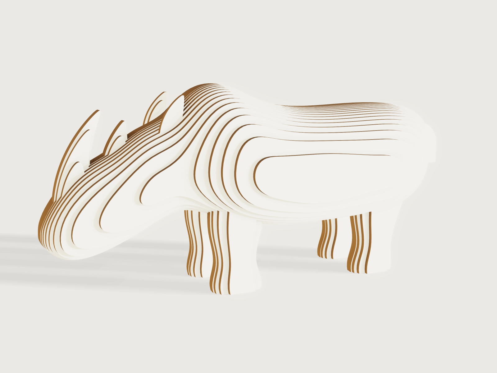 | **[Layered cardboard rhino](examples/25-layered-cardboard-rhino/)**<br>An original stylised rhinoceros, 300 mm from rump to lip, laser-cut from white-faced corrugated board in 30 straight-walled layers of its sections; each layer but the middle pair goes onto its neighbour's engraved outline. | Laser cutting, art | 8/10 |
| 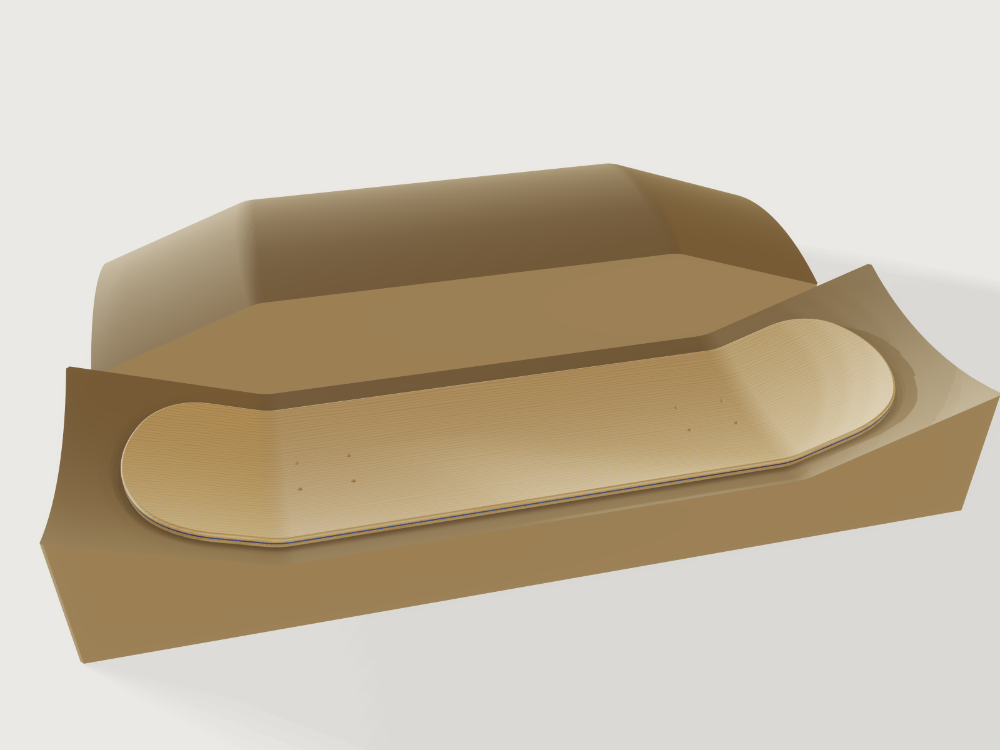 | **[Skateboard deck and press mould](examples/26-skateboard-deck/)**<br>An original 8.0 x 31.75 in street deck of seven 1/16 in hard-maple plies with a dyed core, radial concave and 20 degree kicks, cut and drilled from the pressed stack, with the two MDF halves of its press mould. | Woodworking | 7/10 |
<!-- gallery:end -->

## Rebuild and check

The committed `<id>.3dcraft` files and `exports/` are the finished models: open them in 3DCraft, in the app or
with `craft3d-cli`, without rebuilding anything. A `build.json` runs in any 3DCraft and builds the model into a
document of your own:

```sh
craft3d-cli run --new '{"units":"mm"}' --script examples/01-socket-head-cap-screw/build.json --out screw.3dcraft
```

The tool that made and checked them, `tools/examples.py` (Python 3, standard library only, on Linux or macOS),
needs the exact 3DCraft build this repository is pinned to, the commit in [`tools/pin.json`](tools/pin.json),
and refuses any other: it compares what it rebuilds byte for byte with the committed files, which only that
build reproduces. When the repository is released the pin is the 3DCraft 0.1.0 release itself, so the
`craft3d-cli` that its installer puts on your `PATH` runs it (or name the binary in `CRAFT3D_CLI`).

```sh
tools/examples.py build socket-head-cap-screw          # build.json -> .3dcraft and exports; rewrites meta.json
tools/examples.py check --quick socket-head-cap-screw  # rebuild in a scratch folder and compare
tools/examples.py check socket-head-cap-screw          # the same, plus check-range over the public parameters
```

`build` rewrites the `stats` (timings measured on your machine) and `craft3d` fields of the example's
`meta.json`. Give `check` an id: without one it rebuilds and checks all 26 examples, which takes hours. Where
`systemd-run` exists, every run is capped in memory.

## For contributors and agents

Read [`AGENTS.md`](AGENTS.md). Things 3DCraft could do better, found while building these, are collected in
[`3DCRAFT-FEEDBACK.md`](3DCRAFT-FEEDBACK.md).

## Licence

Everything in this repository is under the MIT licence ([`LICENSE`](LICENSE)): the models and their exports,
the pages and previews, `CATALOGUE.md`, `AGENTS.md`, the feedback, the reproducers under `findings/` and the
tool. Every model page says so, and every `meta.json` carries it as `licence`. When you reuse an example, keep
the copyright notice and credit it as:

> "Socket head cap screw" by Johan Coppens, from the 3DCraft examples (MIT)

with the example's title. Third-party data, and the font embedded in two of the models, keep their own
licences: see [`ATTRIBUTION.md`](ATTRIBUTION.md).
