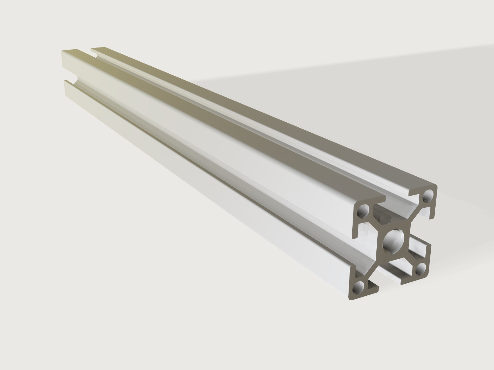

# T-slot aluminium profile

The building block of machine frames, guards and 3D-printer chassis: a 30 × 30 mm B-type aluminium profile
with four 8 mm T-slots and a core bore tapped M8 at both ends, sawn to length. One quarter of the outline is
drawn once, fully held by its variables, and turned round the axis four times; one extrusion makes the
profile. The model then measures its own cross-section, area and second moment of area, and proves both
exactly against closed forms worked out by hand.



## What it shows

- **A sketch built once and repeated by symmetry.** `sketch.path` draws one face of the outline: half of
  each rounded outer corner, the slot's mouth with its rounded lips, the undercut under the lips and the
  45° flanks down to the slot floor. Every corner is held at a formula of the variables, so the sketch has
  no degrees of freedom left. `sketch.pattern` with `chain` and `angle` turns this run round the axis into
  a ring of four runs whose joints are shared, so the outline closes. The core bore is a `sketch.circle`,
  and the corner chambers are one `sketch.circle` repeated four times by `sketch.pattern`.
- **One extrusion to length.** `feature.extrude` of the cross section by the *Length* parameter.
- **Die corners.** One `feature.fillet` rounds the 32 inner corners of the slot cavities along the whole
  length, as the extrusion die does; the edges are named from the pattern's instances (`F2:side(e13[2])`).
- **Tapped ends.** `feature.thread` puts a cosmetic M8 internal thread into the core bore from each end;
  the size is found from the bore, which is M8's tap drill. `feature.chamfer` countersinks both entries at
  90° to the thread's major diameter.
- **Section properties as outputs.** `variable.measure` with `sectionArea` and `sectionInertia` cuts the
  profile half way along its length and reports the area and the second moment of area. `variable.output`
  turns the area into the mass per metre with the alloy's density, shown in kg/m.
- **Material.** `material.preset` (`aluminium-brushed`, density 2700 kg/m³) recoloured to the cool grey of
  clear anodising, less metallic and a little rougher than bare brushed metal: the oxide layer dulls it.
- **Checks.** `assert.add` with closed forms, a catalogue comparison and a wall check (below).

## The real thing

- **Profile.** A 30 × 30 mm "B-type" profile with 8 mm slots, the system that several makers share so their
  slot nuts, connectors and profiles fit together. The model draws its nominal shape:

  | Dimension | Model | Source |
  |---|---|---|
  | Outside | 30 × 30 mm | all makers |
  | Slot opening | 8.2 mm | B-type slot 8 (roboter-bausatz.de RBS16559; Alux and Misumi give 8 mm, Alux +0.3) |
  | Slot depth, face to floor | 9 mm | roboter-bausatz.de RBS16559, Alux 3030 |
  | Lips and diagonal ribs | 2.0 mm, one wall thickness | within the 1.5 to 2.2 mm walls of 30-series profiles (hugh-aluminum.com) |
  | Undercut width | 16.5 mm | the usual undercut of B-type slot 8; not given on the pages cited here |
  | Core bore | Ø 6.8 mm | roboter-bausatz.de RBS16559: the M8 tap drill (ISO 2306) |
  | Corner chambers | Ø 4.15 mm, 1.3 mm walls | a choice of this model (see below) |
  | Outer corner radius | 1.5 mm | |
  | Lip radius at the slot mouth | 0.5 mm | |
  | Die corner radius in the slot cavities | 0.3 mm | the small end of the 0.3 to 0.5 mm a 6063 die wants |

  The walls that carry the load, the lips and the four diagonal ribs, have one thickness, 2.0 mm, as a die
  designer keeps the main walls even so the metal flows evenly through the die. The flanks under the
  undercut run at 45° to the slot floor, which is 9.172 mm wide so that the rib between two neighbouring
  slots is 2.0 mm thick. Each corner block is lightened by a round chamber that leaves a 1.3 mm wall to the
  undercut and to the outside: a short secondary wall, the thinnest of the section.
- **Material.** EN AW-6063 (EN 573-3) in temper T66, the usual alloy for profiles with fine detail; EN 755-2
  gives at least 245 MPa tensile and 200 MPa proof strength for it. Density 2700 kg/m³.
- **Making it.** The profile is extruded in bar lengths, press-quenched and artificially aged to T66,
  anodised clear (ISO 7599, about 10 µm, the makers' E6/EV1), then sawn to length. The core is tapped M8
  20 mm deep at each end (the *Thread depth* parameter), with a 90° countersink to Ø 8 mm, so a cap screw
  can join the profile end-on to another. Profile tolerances are those of EN 12020-2; the model is nominal.
- **Section properties.** Area 333.353 mm², second moment of area Ix = Iy = 28 674.9 mm⁴ (2.87 cm⁴, the same
  about every axis through the centre by its fourfold symmetry), mass 0.900 kg/m. The 300 mm piece weighs
  0.270 kg.
- **Against the catalogues.** Published values for 30 × 30 slot-8 profiles with four open slots differ by
  maker, by up to 7 % in area and 6 % in Ix among the three below. The model is close to Misumi's
  HFS6-3030, the heaviest of them.

  | Profile | Area (mm²) | Ix (mm⁴) | Mass (kg/m) |
  |---|---|---|---|
  | This model | 333.4 | 28 675 | 0.900 |
  | Misumi HFS6-3030 | 332 | 28 300 | 0.93 |
  | Alux aluminium slot profile 3030 (6063 T66) | 311 | 26 797 | 0.835 |
  | Framing Technology 30 × 30 (6063 T6) | 310 | 27 500 | 0.80 |

  Against Misumi HFS6-3030 the model's area is 0.4 % higher and its Ix 1.3 % higher.
- **Simplified, or left out.**
  - The corner chambers are round; makers shape theirs differently (some leave the corner solid), which is
    most of why their areas differ.
  - The thread is cosmetic: the bore is drawn at the tap drill's diameter, and the thread is a mark on it
    (size, pitch, depth) that STEP and drawings carry, as for a tapped hole in most modellers.

## Parameters

| Parameter | Range | Default |
|---|---|---|
| Length | 100 to 3000 mm, in 1 mm steps | 300 mm |
| Thread depth | 12 to 30 mm, in 1 mm steps | 20 mm |

## Checks

- **Section area in closed form.** The measured area of the section must equal the 30 mm square, less the
  four outer roundings and eight lip roundings (r²(1 − π/4) each), the core bore, the four corner chambers
  and four slot cavities (the mouth, the undercut and the 45° trapezoid down to the floor), plus the die
  corner rounds, to 0.0001 mm². Of these, the 90° ones cancel (two at the lip tips take r²(1 − π/4) away,
  two at the undercut add it), and the four at the 135° flank corners add r²(tan 22.5° − π/8) each.
  At the defaults: 333.353314 mm².
- **Second moment of area in closed form.** With the section's fourfold symmetry, Ix = J/2, where J is
  the polar moment about the axis. J is summed from the same pieces: the square, the rounded corners
  (each spandrel, the kite of its two tangent points less the arc's sector, taken about its arc's centre
  and moved to the axis with its first moment and area: for a 90° corner 2r⁴(1/3 − π/16) and r³/6 along
  each side; the 135° die corners by the same construction with half-angle 22.5°), the bore, the corner
  chambers (moved by their offset), and the slot cavities (rectangles in closed form, the trapezoid
  integrated over its 45° sides). Measured and worked out agree to 0.01 mm⁴: 28 674.8602 mm⁴. A section
  with a wrong slot, a missing chamber, a missing die round or a shifted run fails it.
- **Area and second moment within 3 % of the catalogue profile.** The larger of the two relative
  differences from Misumi HFS6-3030 (332 mm², 28 300 mm⁴) is at most 0.03. At the defaults: 0.0132, from Ix.
- **Core wall round the M8 thread.** The core bore lies 2.6 mm from the slot floor; less the thread's
  depth ((8 − 6.8)/2 = 0.6 mm), at least the section's 1.3 mm minimum wall must be left. It leaves 2 mm.

`craft3d-cli check-range` proves all four at 13 points: the defaults, the four corners of the two ranges
and eight random points. The section does not change with the parameters, so the four checks hold at
every length and thread depth.

## Files

- `t-slot-profile.3dcraft`: the model.
- `build.json`: the 50 steps that build it.
- `exports/t-slot-profile.step`: the exact geometry, for other CAD programs.

## Rebuild

```sh
tools/examples.py build t-slot-profile
# or
craft3d-cli run --new '{"units":"mm"}' --script examples/02-t-slot-profile/build.json --out t-slot-profile.3dcraft
```

## Difficulty

**4 / 10** (the reviewer): one closed sketch held by formulas and repeated by a symmetric pattern, one extrusion,
a 32-edge fillet named by pattern instance, and closed forms for the area and the second moment that include
the 135° fillet spandrels.

## Platform notes

- **Wall thickness.** `measure.thickness` finds the 1.3 mm wall of the corner chambers exactly, but proves
  only 0 mm of it, so an assertion on the thinnest wall stays not proven. The model checks the wall that matters for the thread with a face distance
  instead ([F-020](../../3DCRAFT-FEEDBACK.md#f-020)).
- **Corner rounds.** A sketch has no corner round that follows the variables, so the die corners are
  rounded by a `feature.fillet` of the extruded edges, not in the cross section
  ([F-023](../../3DCRAFT-FEEDBACK.md#f-023)).
- **The body's name.** A body takes the name of the last feature that made it, here the countersinks
  (`Countersunk thread entries`), and there is no command that names a body; a step named after the part
  would have to be an extra feature.
