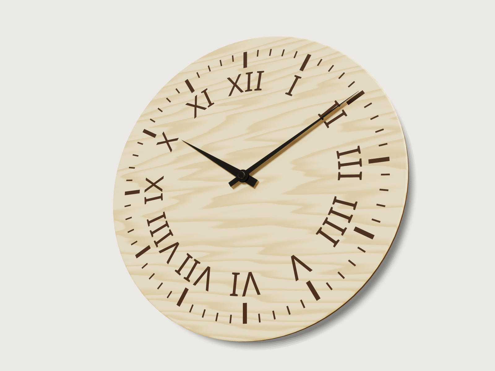

# Plywood wall clock

A wall clock to make on a laser cutter in an afternoon: a Ø 300 mm dial of 6 mm birch plywood with its
minute track and numerals engraved, a laminated keyhole hanger and a matching foot glued to the back, and
a quartz sweep movement with black hands. Choose Roman or Arabic numerals, the diameter and the time the
hands show; the model gives the cut and engrave files for that choice and proves its tick and numeral
counts, the hand angles and the laser's rules.



## What it shows

- **A minute track from two patterns.** One minute tick, drawn turned 6° off twelve with `sketch.polyline`,
  is repeated 59 times 6° apart by `sketch.pattern`, which `skip`s the 11 instances that fall on an hour:
  48 minute ticks. The seed is drawn off twelve because a pattern cannot skip its seed
  ([F-039](../../3DCRAFT-FEEDBACK.md#f-039)). One hour tick (`sketch.rect`) repeated twelve times adds
  the other 12.
- **Text on a circle.** The Roman numerals are set with `sketch.textOnCurve` on a construction circle, each
  centred at its hour (`start` is the arc length to it), standing outside the circle so their bases point
  at the centre, as on a classic dial. The Arabic numerals stand upright, placed with `sketch.text` at
  points worked out from the hour's angle.
- **A choice switches features.** `variable.publish` with `kind: choice` makes *Numerals* a choice of Roman
  or Arabic; the two engravings carry `when` conditions (`numerals == 1`, `numerals == 2`), so only one is
  built.
- **Hands from a time formula.** `minute_angle = minute * 6 deg` and
  `hour_angle = mod(hour, 12) * 30 deg + minute * 0.5 deg`; each hand is drawn pointing at twelve
  (`sketch.path`, lines and arcs round its hub) and turned into place by `feature.transform`.
- **Engraving drawn as burnt wood.** The faces a cut makes take the target's colour, and `face.appearance`
  takes only single face names, so the dial's 60 ticks and its numerals (652 faces) cannot be coloured
  one by one. The model engraves a dark "stencil" instead (a `feature.cylinder` larger than the dial,
  coloured with `body.appearance`, cut by the three engravings) and intersects the dial with it
  (`feature.boolean`, `intersect`): the faces the dial takes from the stencil keep its colour. The dial's
  laser-cut rim and the hanger's edges are coloured as charred with `face.appearance`.
- **Laser files.** `file.export` writes the dial's cut line (DXF) and each engraving (SVG) from their
  sketches, all in the dial's axes; `cut.export` lays out the six plates of the hanger and the foot (DXF).
- **Copies that stay apart.** `feature.transform` with `keep` makes the second spacer, and turned 180°
  about the dial's axis, the foot's three spacers from the hanger's.
- **Checks.** `variable.measure` and `assert.add` (below); the counts are queries on the dial's faces.

## The real thing

- **Dial.** Ø 300 mm (200 to 360 mm), cut from 6 mm birch plywood. The front edge gets a 2 mm round-over
  (a small round-over bit or sanding) after cutting; the rest of the rim stays as the laser leaves it,
  dark. No standard governs a clock dial; its proportions scale with the diameter: the minute track ends
  at 0.45 D (135 mm), minute ticks 7.5 × 1.5 mm, hour ticks 18 × 3.9 mm, numerals 21 mm tall (0.07 D).
  The diameter stops at 360 mm because the minute hand grows with it: at 360 mm it is 157.5 mm long, and
  makers of standard quartz movements give about 160 mm (or 8 g) as the most a standard movement drives;
  a larger dial needs a high-torque movement.
- **Numerals.** Roman numerals with the clockmaker's IIII for four, set radially (VI reads upside down, as
  on classic dials); Arabic numerals upright. Both in Noto Sans, 3DCraft's built-in sans font, whose
  capital I has slab serifs while V and X have none; a serif face would suit Roman numerals better, but
  none is bundled ([F-038](../../3DCRAFT-FEEDBACK.md#f-038)).
- **Movement.** A common quartz sweep (continuous, silent) movement, 56 × 56 × 16 mm, whose threaded
  bushing is 5/16 in (7.94 mm): the dial has an 8.5 mm hole. That is 0.28 mm clear all round rather than
  the bare 8 mm a drill would make, so the bushing goes in whatever the laser's kerf and the plywood's
  swelling; the washer and nut cover the hole and centre nothing, the bushing's thread does. Buy the
  movement with a shaft for a 6 mm dial (its thread must take the dial, the washer and the nut) and check
  its data sheet before cutting.
- **Hands.** Black lacquered steel, 0.5 mm, bought to these lengths from the centre: minute hand 131 mm
  (its tip over the middle of the minute track), hour hand 84 mm with Roman numerals (6 mm short of their
  bases) and 78.75 mm with Arabic ones (a quarter of the numeral height shorter, because the two-figure
  10 and 11 reach that far inside the ring), both with a 15 mm tail; their bushings must fit the movement.
  The hour hand sits 4 mm above the dial, the minute hand 6.5 mm, under the cap nut.
- **Keyhole hanger.** Three 32 × 62 mm plates of the same plywood, glued into an 18 mm stack on the back,
  the keyhole 90 mm (0.3 D) above the centre: the wall-side plate has the keyhole (an 11 mm hole for the
  screw head and a 6 mm wide slot 10 mm up from it), the two spacers a 13 mm slot that gives the head room.
  The stack is deeper than the movement (16 mm). Hang it on a screw of about 4 to 5 mm with a head of at
  most 10 mm, left standing 8 to 10 mm proud of the wall.
- **Foot.** A second stack of three spacers, the same part, glued as far below the centre as the hanger is
  above it. With the hanger alone the clock would tip about 1.2° until the movement touched the wall; on
  hanger and foot it hangs square, the movement's back 2 mm off the wall. The hanger and the foot together
  are five identical spacers and one keyhole plate. The foot's spacers keep the hanger's 13 mm through-slot,
  which shows on the back: it is harmless and keeps all five spacers the same part.
- **Making it.** Engrave first, then cut, inner cuts before the outline, so the dial stays in place:
  raster engrave the minute track and the numerals about 0.4 mm deep (mask the face with paper tape, or
  sand it after, against smoke stains), then cut the 8.5 mm hole and the outline. The files are at true
  size with no kerf compensation; a CO2 laser's kerf in 6 mm birch, about 0.2 mm, only loosens the hole
  and the keyhole a little. Round over the front edge, sand, glue up the hanger and the foot, finish with
  hardwax oil or a matt lacquer, fit the movement and set the hands.
- **Mass.** The dial weighs 286.6 g at 680 kg/m³ (birch plywood).
- **Simplified, or left out.**
  - The movement is drawn only as its bushing (one cylinder from the back of the dial to the hour hand),
    its minute shaft (about 3.5 mm, from the hour hand to the minute hand) and the cap nut on the minute
    hand; its body, the dial washer and nut, and a second hand are left out.
  - The hands are drawn without the holes of their bushings.
  - Plywood is drawn as one material; its plies are not drawn.

## Parameters

| Parameter | Range | Default |
|---|---|---|
| Numerals | Roman, Arabic | Roman |
| Diameter | 200 to 360 mm, in steps of 10 mm | 300 mm |
| Hour | 1 to 12 | 10 |
| Minute | 0 to 59 | 10 |

## Checks

- **Round-over in closed form.** The dial's volume below the plane halfway up the round-over
  (z = t − r/2, under the engraving) must equal the holed disc, π (R² − r_h²)(t − r/2), less what the
  round-over takes off up to that plane, integrated slice by slice:
  π [2 r (R − r) a − (R − r)(a √(r² − a²) + r² asin(a/r)) + a³/3] with a = r/2. At the defaults
  353 063.706 mm³, exact to 0.01 mm³.
- **Sixty minute ticks.** The engraved floors the tick engraving left on the dial: 60.
- **Twelve numerals.** The floor of each numeral's first glyph: 12, Roman or Arabic.
- **Hour hand clears the numerals.** Seen from the front, the hour hand keeps at least half the numeral
  gap (3 mm at Ø 300) from every numeral. The measure is the 3D distance from the hand to the numerals'
  engraved floors, which lie hour_hand_lift + engrave_depth (4.4 mm) below it, so the bound is
  √((gap/2)² + 4.4²). At the defaults 7.70 mm, 6.32 mm in plan; with Arabic numerals at 10:00, the
  closest case, 5.86 mm in plan. Checked also at every hour, at minutes 0, 10 and 50, for Ø 200, 300 and
  360 mm with Arabic numerals.
- **The hands point at the time.** The angle between each hand's measured centre of mass and the direction
  the time formula gives is 0 within 0.01°. At 10:10 the minute hand stands at 60° and the hour hand at
  305° from twelve.
- **Keyhole slot at least the sheet thickness.** The slot's walls are 6.0 mm apart, at least the 6 mm
  sheet, as a laser cut asks.
- **No hole narrower than the sheet thickness.** No full round hole in any part is 6 mm across or less
  (the only one is the 8.5 mm shaft hole; the keyhole is held by the slot check).
- **Hanger and foot stand off the movement.** The backs of the hanger and of the foot, the two places
  the clock touches the wall, are both 18 mm behind the dial, deeper than the movement's 16 mm: the
  movement clears the wall.
- **Hanger clears the movement.** The hanger's lowest edge is 64 mm above the centre, above the movement's
  top edge at 28 mm.
- **Shaft hole clears the bushing.** 0.281 mm all round.

`craft3d-cli check-range` proves all twelve at 26 points: the defaults, all 16 corners of the four
parameters, the other numerals and eight random points.

## Files

- `wall-clock.3dcraft`: the model. It carries the font of its numerals, Noto Sans Regular, under the SIL
  Open Font License 1.1: [`NotoSans-OFL.txt`](NotoSans-OFL.txt).
- `build.json`: the 149 steps that build it.
- `exports/wall-clock-dial-cut.dxf`: the dial's cut lines, the outline and the shaft hole.
- `exports/wall-clock-engrave-ticks.svg`, `exports/wall-clock-engrave-roman.svg`,
  `exports/wall-clock-engrave-arabic.svg`: the engravings, outlines to fill. Each carries the dial's
  outline on its construction layer, so all four dial files stack exactly; set that layer to no output.
- `exports/wall-clock-hanger-cut.dxf`: the keyhole plate and the five spacers of the hanger and the foot,
  side by side.

## Rebuild

```sh
tools/examples.py build wall-clock
# or
craft3d-cli run --new '{"units":"mm"}' --script examples/03-wall-clock/build.json --out wall-clock.3dcraft
```

## Difficulty

**4 / 10** (the reviewer): patterns round a centre, text on a curve, a choice parameter switching conditional
features, hand angles from time formulas through transforms, and a coloured intersect stencil that needs
careful face names; no freeform.

## Platform notes

- **Engraving colour.** The dark engraving is drawn through an intersection with a coloured stencil,
  because `face.appearance` takes only literal face names and the faces a cut makes take the target's
  colour ([F-025](../../3DCRAFT-FEEDBACK.md#f-025)).
- **Closed form plane.** The closed-form check measures halfway up the round-over: `volumeBelow` at the
  plane of the engraving's floor is refused ("a face in the plane whose loops enclose no area";
  [F-024](../../3DCRAFT-FEEDBACK.md#f-024)).
- **Steps.** 149 steps, far over the guide of 50 for a simple example: 24 of them place the numerals one by
  one, since a text cannot be repeated round a dial with its value changing per copy
  ([F-027](../../3DCRAFT-FEEDBACK.md#f-027)), and 45 set or publish variables.
- **Shadows.** The contact shadows draw the hands' shadows on the dial as stepped bands
  ([F-026](../../3DCRAFT-FEEDBACK.md#f-026)); the preview's light, from high above ([100, 80]), keeps them
  to a trace at the minute hand's tip.
- **File size.** 460 KB, of which 332 KB is the embedded font
  ([F-037](../../3DCRAFT-FEEDBACK.md#f-037)).
- **Names.** The three engravings' extrusions keep their automatic names `Extrude1` to `Extrude3`
  ([F-002](../../3DCRAFT-FEEDBACK.md#f-002)).

## Licence

[MIT](../../LICENSE), like everything in this repository; credit line in the
[README](../../README.md#licence). The embedded font keeps its own licence (*Files*).
