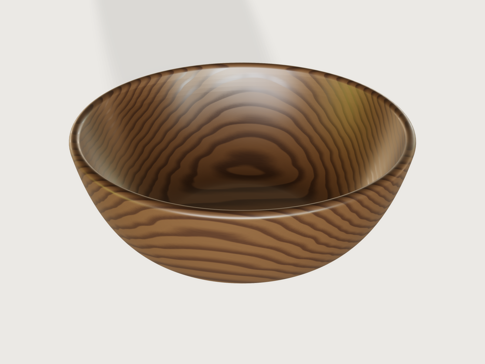

# Turned walnut bowl

A serving bowl as a woodturner makes it: Ø 220 × 85 mm, turned from a 10 × 4 inch walnut blank, with an
even 7 mm wall from a fully rounded rim down to a foot ring. One revolved half section makes the whole
bowl: a spline shaped by constraints for the outside, the exact offset of that spline for the inside, so
the wall is even everywhere. The bowl works out its own capacity (1.84 litres brimful) and proves its wall
with Steiner's formula for parallel surfaces.



## What it shows

- **A spline shaped by constraints.** The outside of the bowl is one cubic spline (`sketch.spline`) from
  the flat of the base to the rim. Its first handle is held at a radius and made tangent to the base
  (`sketch.constrain` `tangent`), which sets its height; its second handle is held at a height and made
  tangent to the rim's bead, which sets its radius. The base runs into the wall without a crease, and the
  wall into the rim.
- **An even wall from a formula curve.** The inside is the true offset of that spline, 7 mm square to it
  at every point: `sketch.curve` with the spline's own Bézier formula less the wall thickness times its
  unit normal. It follows the three parameters as the spline does.
- **A full round rim.** `sketch.arc`: a half circle of the wall's thickness across the end of the wall,
  tangent to both faces. The wall flares out 12° at the rim.
- **One revolve.** The closed half section (inside, outside, rim, the foot ring and the recess inside it)
  turns into the bowl in one `feature.revolve`.
- **Fillets on the foot.** `feature.fillet` rounds the outer bottom edge of the foot ring (2 mm) and
  coves the corner where it meets the base (3 mm). The chuck recess inside the ring is left as a turner
  cuts it: a 10° dovetail wall and sharp corners. The last fillet names the body, so it is called *Bowl*.
- **Material.** `material.preset` `walnut` with its solid texture placed as in a face-grain blank (the
  pith above the bowl, the rings 4.5 mm apart), cooled to oiled walnut's chocolate brown and given a thin
  satin coat; its density, 640 kg/m³, gives the mass.
- **Outputs.** `variable.measure` gives the volume of wood, the volume of the foot ring, the areas of the
  outer and inner wall and the mass; `variable.output` the capacity in millilitres and the blank in
  whole inches.
- **Checks.** `assert.add` with closed forms, bounds and the measured size (below).
- **A turning template.** `file.export` writes the half section at 1:1 as SVG.

## The real thing

- **Size.** Ø 220 × 85 mm, a small serving bowl: 1.84 L brimful, about 1.3 L in use, a side salad for
  two to four. No standard governs a bowl; the proportions are those of a common salad bowl: the foot
  ring 0.36 of the rim's diameter (Ø 79.2 mm; never less than the recess plus 8 mm of ring at its
  floor), the flat of the base 0.04 of the diameter wider than the foot on each side (Ø 96.8 mm), both
  handles of the curve at 0.55 of the run (the lower one 0.55 of the way out from the base's edge to
  where the wall meets the rim's bead, the upper one 0.55 of the wall's rise below that point, on the
  line of the flare).
- **Blank.** Walnut bowl blanks are sold in whole inches. The model adds a turning allowance of 6 mm on
  every face (for truing up a blank that is out of round and checked at the ends) and rounds up to the
  inch: 10 × 4 in (254 × 101.6 mm) at the default size (the outputs *Blank diameter* and *Blank
  thickness*). Face grain: the blank is cut from a plank with the grain running across the bowl and the
  pith above it, left out, so the rings show as nested ovals in the bottom (the eye) and sweep up the
  walls.
- **Wall.** 7 mm, even from rim to bottom, the bottom as thick as the sides; a utility bowl's wall that
  stands washing and wetting. The rim is rounded over its full thickness; the foot ring is 6 mm high,
  rounded at its outer bottom edge and coved into the base.
- **Turning it.**
  1. Rough turn: mount the blank on a faceplate or screw chuck on its top face, true it up and shape the
     outside with a bowl gouge, held against the template. Cut the foot ring and the recess inside it:
     Ø 56 mm at the mouth, 6 mm deep, its wall dovetailed 10° (Ø 58.1 mm at the floor) with sharp
     corners, a fixed size for the common 50 mm dovetail jaws in expansion (check your jaws' range); it
     stays the same at every diameter, and the foot grows round it.
  2. Reverse it into the chuck, face the top and hollow the inside to an even 7 mm, checking the wall
     with double-ended callipers; round over the rim.
  3. Sand to 320 grit with the lathe running, then across the grain with it stopped, and oil it.
  Turned from wet wood, the bowl is first rough turned with a wall of about a tenth of its diameter,
  left to dry and then turned to size.
- **Finish.** A food-safe drying oil, several thin coats, drawn as a satin layer over the wood.
- **Mass.** 290.4 g of walnut, 453 735 mm³ of wood; it holds 1839.7 mL brimful.
- **Simplified, or left out.**
  - The wood is drawn by a solid texture, not a scan of a board, and it neither moves nor checks.

## Parameters

| Parameter | Range | Default |
|---|---|---|
| Diameter | 160 to 300 mm, in 5 mm | 220 mm |
| Height | 55 to 120 mm, in 5 mm | 85 mm |
| Wall thickness | 5 to 10 mm, in 0.5 mm | 7 mm |

The foot ring, the base, the curve's handles and the blank follow from them; the rim bead's radius is
half the wall, and the recess is fixed.

## Checks

- **Foot ring in closed form.** The wood below the base (`volumeBelow` the plane at the foot's height)
  must equal the ring round the dovetailed recess, π (R² h − a² h − a k h² − k² h³/3) with a the
  recess's radius at its mouth and k = tan 10°, less the rounded edge and plus the cove (Pappus, each
  (1 − π/4) r² turned at its centroid, (10 − 3π)/(12 − 3π) r from the corner). 14 493.177 mm³ at the
  default, exact to 0.01 mm³.
- **Even wall by Steiner's formula.** A wall made by moving every point of a surface a distance t along
  its normal has the volume t (A<sub>out</sub> + A<sub>in</sub>) / 2 − t³/6 ∫K dA (Steiner's formula for
  parallel surfaces), and ∫K dA over the outside is 2π (1 − sin 12°), because its normals turn from
  straight down to 12° below the horizontal at the rim (Gauss–Bonnet). The flat of the base adds its area
  to both sides, and the bead adds a half disc turned about the axis (Pappus). The wood above the foot
  must equal that sum, with A<sub>out</sub> and A<sub>in</sub> the measured areas of the outer and inner
  wall, within the inner curve's fitting tolerance: half the document's tolerance over the inner wall,
  24.9 mm³ at the default. It matches to 0.03 mm³ (439 241.585 mm³ against 439 241.553 mm³). An inner
  wall 1 µm off the true offset on average misses it by about 50 mm³ and fails.
- **Capacity between its cone and its cylinder.** The brimful capacity (the solid of revolution under the
  outer profile and the rim's top, in closed form from the spline's control points and the bead's arc,
  less the wood above the foot) must lie between the cone from the inside of the base to the inside of
  the rim (with the column above it) and the cylinder of the bead's centre radius over the inside depth:
  1394 to 2566 mL at the default; it is 1839.7 mL. The inside is convex, so the cone lies inside it.
- **Diameter as drawn** and **Height as drawn.** The measured extents (219.993 mm and 84.998 mm,
  measured on a fine mesh) are the bowl's diameter and height within 0.01 mm, so the blank worked out
  from them holds the bowl with its allowance.

`craft3d-cli check-range` proves all five at 17 points: the defaults, the eight corners of the ranges and
eight random points.

The wall's thickness is not asserted with `measure.thickness`, as the catalogue asked: on this wall it
takes 5.6 s and proves nothing (at least 0 mm) while it finds 7.000 mm. `measure.distance` between the
outer and the inner wall finds 7.000 mm but proves only 6.23 mm. Steiner's formula is the proof used.

## Files

- `turned-bowl.3dcraft`: the model.
- `build.json`: the 54 steps that build it.
- `exports/turned-bowl-section.svg`: the half section at 1:1, to cut a profile template for the outside
  from card or hardboard.

## Rebuild

```sh
tools/examples.py build turned-bowl
# or
craft3d-cli run --new '{"units":"mm"}' --script examples/04-turned-bowl/build.json --out bowl.3dcraft
```

## Difficulty

**4 / 10** (the reviewer): one spline held by tangency constraints and revolved, its inside the exact offset
written as a curve from formulas, two fillets, and closed-form checks (Pappus, Steiner and Gauss–Bonnet, the
Bézier's volume of revolution) that take real maths.

## Platform notes

- **Tolerance.** The document's tolerance is set to 0.001 mm (`document.setTolerance`), a thousand times
  finer than a lathe turns wood. At the default 1e-6 mm the inner curve is fitted with 78 control points
  instead of 35 and the bowl, with its checks, opens in 1.2 s instead of 0.5 s.
- **Shell.** `feature.shell` makes the same wall from a solid of revolution, but takes 3.6 to 4.7 s on a
  revolved spline profile (the revolve alone 0.04 s), and joining a foot ring to the result 1.6 s more:
  far over this example's 1 s budget. The inside is therefore written as the offset curve in the sketch.
  Reproducer: [F-028](../../3DCRAFT-FEEDBACK.md#f-028).
- **Offset of a spline.** `feature.offsetProfile` refuses a profile with a spline ("not supported yet"),
  so the offset is written out as a formula curve, the spline's Bézier and its normal in full: exact, but
  long. Reproducer: [F-029](../../3DCRAFT-FEEDBACK.md#f-029).
- **Thickness.** `measure.thickness` on a revolved spline wall takes 5.6 s here and 50 s on a shelled
  bowl, and proves at least 0 mm on a wall it finds to be 7 mm (see also
  [F-020](../../3DCRAFT-FEEDBACK.md#f-020)). Reproducer:
  [F-020](../../3DCRAFT-FEEDBACK.md#f-020).
- **Distance.** `measure.distance` between the faces of a parallel wall finds 7.000 mm but proves only
  6.23 to 6.78 mm, so an assertion of the wall to a micrometre stays unproven. Reproducer:
  [F-030](../../3DCRAFT-FEEDBACK.md#f-030).

## Licence

[MIT](../../LICENSE), like everything in this repository; credit line in the
[README](../../README.md#licence).
