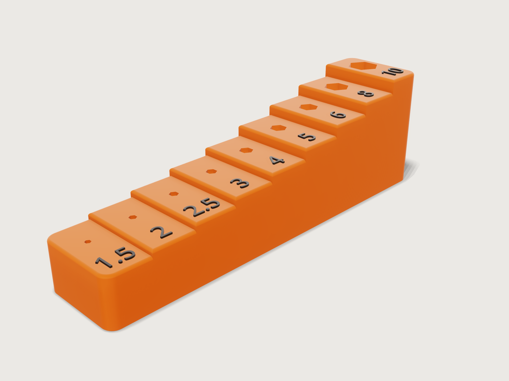

# Hex key stand

A desk stand for a metric hex key set, 1.5 to 10 mm, printed in PLA without supports. Nine steps rise
with the keys' lengths, each with a hexagonal socket sized from ISO 2936 plus a print clearance, and each
size embossed in front of its socket in a second colour. A table of the standard drives every socket, the
heights of the steps and the labels; the stand proves its walls, its overhangs and its sockets itself.



## What it shows

- **A table of a standard drives the model.** `table.set` holds the nine keys of ISO 2936 with their width
  across flats (the table's key) and the length of their long arm. Every socket, every step height and every label reads
  `hex_keys[k]`.
- **Positions and depths from formulas.** One `sketch.polyline` draws the side profile of the nine steps;
  step k is `floor_thickness + insertion_share * hex_keys[k].long_arm` high, and `feature.extrude` turns it
  into the block. All nine sockets are cut from one sketch on the floor plane (`feature.extrude` with
  `throughAll` and `cut`), so each socket ends at the floor and its depth is its key's share of the long
  arm, whatever *Insertion* is set to.
- **Hexagons from formulas.** Each socket is a `sketch.polyline` hexagon whose corners are
  `(hex_keys[k].across_flats + 2 * clearance) / sqrt(3)` from its centre, so the clearance follows the
  *Clearance* parameter.
- **Text from formulas.** `sketch.text` writes `{hex_keys[k].across_flats}`, so the labels read the table.
  Each label sits on its own step (`sketch.create` on a plane at the step's height) and is extruded
  `label_relief` high; the nine are joined into one body, `Size labels`.
- **Fillets and chamfers.** `feature.fillet` rounds the four vertical corners (4 mm) and the top rims of
  every step (1 mm); `feature.chamfer` with `chain` puts a 0.4 mm first-layer chamfer round the whole
  bottom edge in one pair of faces.
- **Print checks as assertions.** `measure.thickness` on the sockets' walls and floors, `measure.draft`
  against the build direction on every face but the one on the bed, a section in closed form and a count
  (below). `variable.measure` reports the volume and the mass.
- **Material and export.** `material.preset` (`abs`, recoloured orange and matte, black for the labels) with
  `body.material` for PLA's density; `file.export` writes a 3MF with both bodies in their colours, in the
  print orientation.

## The real thing

- **Standard.** Dimensions according to ISO 2936:2014, hexagon socket screw keys, the normal series. The model's table holds the nominal
  width across flats s (the key's largest; a key is never over it) and the length of the long arm l1:

  | s | 1.5 | 2 | 2.5 | 3 | 4 | 5 | 6 | 8 | 10 |
  |---|---|---|---|---|---|---|---|---|---|
  | long arm l1 | 46.5 | 52 | 58.5 | 66 | 74 | 85 | 96 | 108 | 122 |
  | socket across flats (clearance 0.15) | 1.8 | 2.3 | 2.8 | 3.3 | 4.3 | 5.3 | 6.3 | 8.3 | 10.3 |
  | socket depth (insertion 0.35) | 16.28 | 18.2 | 20.48 | 23.1 | 25.9 | 29.75 | 33.6 | 37.8 | 42.7 |

- **Use.** Each key stands in its socket on its long arm; the short arm is the handle on top, and the tops
  climb from 48.5 mm to 124 mm above the desk, so every key can be read and taken. Turn each key so its
  short arm points to the left, over the shorter keys (the six flats always give it a place within 30° of
  that). Each arm then passes above every key it reaches: the 10 mm key's arm, about 119 mm up, over the
  8 mm key's top at 110 mm, and so on down to the 2 mm key's at 53 mm over the 1.5 mm key's top at
  48.5 mm. Pointed to the back instead, a full set (about 257 g of keys, on a stand printed at 15 % infill,
  about 70 g: estimates, not measured by the model) puts its centre of gravity about 24 mm back on the
  32 mm deep stand and 60 mm up, and the stand tips at about 7°; to the left the weight stays over the
  middle of the footprint.
- **Size.** 144 × 32 mm on the desk, 44.7 mm high at the 10 mm step (45.3 mm with its label). Steps are
  16 mm wide; the sockets stand on one line 20 mm from the front, the labels 6.5 mm from it, 6 mm high.
- **Printing.** FDM, PLA, as modelled: flat on the bed, the sockets upright. Nothing overhangs: every wall
  is vertical, every other face looks up, and the 0.4 mm × 45° first-layer chamfer round the bottom takes up
  the elephant's foot of the first layer. The floors under the sockets are 2 mm, the thinnest found; the side
  walls are 2.85 mm or more at the defaults (beside the 10 mm socket), less only within the 1 mm rounded
  rims; the proof's bound is at least 1.4 mm everywhere. The labels are a body of their own: on a printer with two
  filaments, give the stand orange and the labels black (`exports/hex-key-stand.3mf` carries both bodies in
  their colours, as two separate objects; how to make them one object of two parts depends on the slicer:
  in PrusaSlicer and OrcaSlicer select both and choose *Assemble*); on a single filament, print both in
  one colour. 0.2 mm layers, 3 walls and 15 % infill suit the stand. The figures are Noto Sans Regular,
  the only outline font 3DCraft bundles, 6 mm high: their strokes are about 0.75 mm wide and the dots
  0.9 mm, one to two lines of a 0.4 mm nozzle, so print the labels with 2 walls and no infill.
- **Clearance.** 0.15 mm per side is a sliding fit on a well-tuned printer; holes print undersize on many
  printers, the small ones most, so raise *Clearance* if the 1.5 and 2 mm keys stick.
- **Mass.** The model as a solid weighs 157.0 g in PLA (stand 126 545 mm³, labels 64 mm³); a print with
  infill weighs less.
- **Simplified, or left out.**
  - The socket mouths have no lead-in chamfer and the short vertical edges where a step rises from the one
    before are sharp: 3DCraft refuses both (*Platform notes*).
  - The table's sizes are the keys' nominal s; the slightly smaller s min and the corner rounding of a
    real key are left to the clearance.

## Parameters

| Parameter | Range | Default | What it does |
|---|---|---|---|
| Clearance | 0.1 to 0.4 mm, step 0.05 | 0.15 mm | gap per side between a key's flats and its socket |
| Label relief | 0.4 to 1.2 mm, step 0.2 | 0.6 mm | how far the sizes stand proud of the steps |
| Insertion | 0.25 to 0.45, step 0.05 | 0.35 | share of each long arm in the stand: socket depths and step heights |

## Checks

- **Nine key sockets.** The sockets' floors are counted: there are `key_count` (9).
- **Socket walls and floors at least 1.2 mm.** `measure.thickness` from every socket face: 2 mm found (the
  floors), at least 1.4 mm proven (the side walls are thicker, 2.85 mm or more at the defaults).
- **No overhang below 45 degrees.** `measure.draft` along +z on every face of the stand but the bottom: the
  least is −45°, the first-layer chamfer. The labels stand on the steps, so their undersides are not
  overhangs. The check is *not proven*: on the four vertical corner rounds, which the chamfer trims,
  `measure.draft` finds 0° but bounds them only at −47.1°, and the chamfer sits exactly at the limit, so no
  slack is left for that bound ([F-102](../../3DCRAFT-FEEDBACK.md#f-102)).
- **Socket section in closed form.** The stand cut halfway up its lowest step must be the footprint, less
  its four rounded corners, less the nine hexagons: 144 × 32 − (4 − π) 4² − (√3/2) Σ (s + 2 c)²
  = 4344.408 mm². It proves each socket's size and clearance.
- **Top step seats the 10 mm key.** The stand's top is `floor_thickness + insertion_share * l1` of the
  10 mm key: 44.7 mm.

`craft3d-cli check-range` passes four and finds the overhang check holding (not proven, as above) at the defaults, the corners of the three ranges and eight
random points.

## Files

- `hex-key-stand.3dcraft`: the model (opens in 0.41 s). It carries the font of its labels, Noto Sans Regular,
  under the SIL Open Font License 1.1: [`NotoSans-OFL.txt`](NotoSans-OFL.txt).
- `build.json`: the 75 steps that build it.
- `exports/hex-key-stand.3mf`: the stand and its labels, in their colours and in the print orientation.

## Rebuild

```sh
tools/examples.py build hex-key-stand
# or
craft3d-cli run --new '{"units":"mm"}' --script examples/05-hex-key-stand/build.json --out stand.3dcraft
```

## Difficulty

**4 / 10** (the reviewer): one table drives every formula, nine hexagons and nine labels come from it, and a
32-edge rim fillet needed careful edge naming to get past the kernel's refusals; no freeform, no booleans
between several bodies.

## Platform notes

- **Socket lead-ins and step edges.** A chamfer or fillet round the mouth of a pocket (here a hexagonal
  socket) is refused at its corners, where the rim's convex edges meet the pocket's concave ones; so is a
  fillet up the short vertical edge where one step rises from another. Reproducer:
  [F-033](../../3DCRAFT-FEEDBACK.md#f-033).
- **One sketch per label.** The labels stand at nine heights, and a sketch is flat, so each needs a sketch
  and an extrusion of its own: 27 of the 75 steps, over the 50 a simple example aims at. The alternative,
  one sketch of all nine labels extruded and intersected with a copy of the steps raised by the relief,
  takes 12 steps but costs about 1 s more to open: booleans with extruded text cost 20 to 35 ms a glyph,
  and cutting text by a plane more ([F-034](../../3DCRAFT-FEEDBACK.md#f-034)). Joining the
  labels to the stand would cost another 0.4 s; they are a body of their own, which a two-colour print
  wants anyway. An extrusion that ends on the faces under each profile would make all nine labels one
  feature ([F-036](../../3DCRAFT-FEEDBACK.md#f-036)).
- **Label text.** The labels write the width column (`{hex_keys[k].across_flats}`): a text column of a
  table cannot be written in a text ([F-035](../../3DCRAFT-FEEDBACK.md#f-035)), so the table has no text
  column of sizes; its key is the width.
- **Names.** The extrusions under the label joins and the socket cut keep automatic names (`Extrude1` to
  `Extrude9`, [F-002](../../3DCRAFT-FEEDBACK.md#f-002)).
- **Preview light.** The preview's key light comes from [200, 70]: from the default direction its shadow
  draws stair-stepped bands across the treads ([F-043](../../3DCRAFT-FEEDBACK.md#f-043)).
- **Two objects in the 3MF.** The stand and the labels are two build items, not two parts of one object,
  hence the Assemble step in the slicer ([F-045](../../3DCRAFT-FEEDBACK.md#f-045)).

## Licence

[MIT](../../LICENSE), like everything in this repository; credit line in the
[README](../../README.md#licence). The embedded font keeps its own licence (*Files*).
