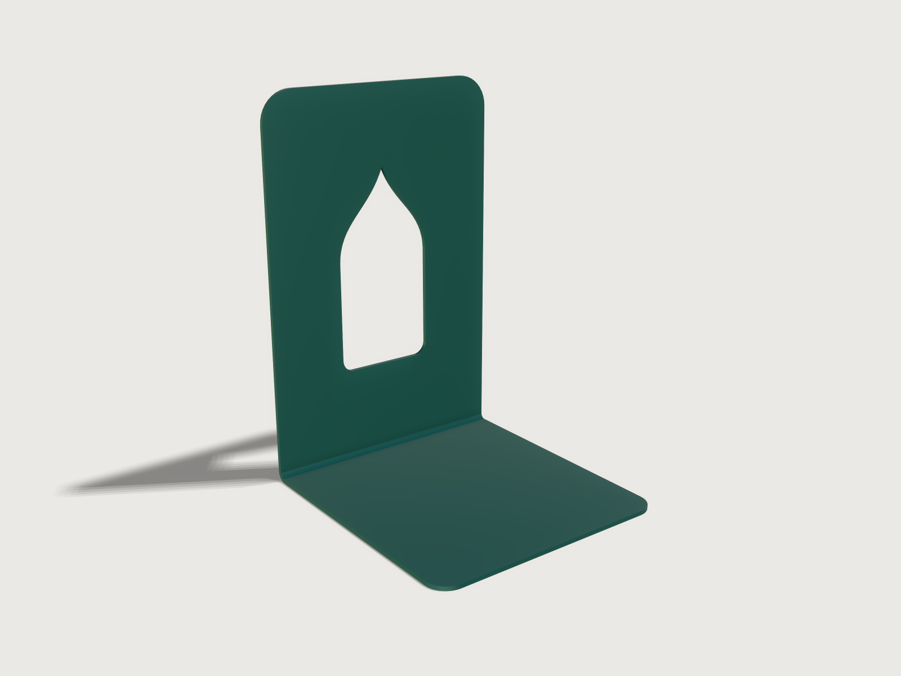

# Steel bookend

A bookend as a sheet-metal shop makes it: laser cut from one blank of 2 mm DC01 cold-rolled steel, bent
once to 90° on a press brake and powder coated deep teal. An ogee-arch window lightens the upright, its
two halves cubic splines; the corners are rounded. The bend's radius and K-factor come from the tooling
and DIN 6935, the flat pattern is exported as DXF with its bend line, and the model proves its blank's
area, its volume, its bend radius, the window's distance from the bend and that a press brake can bend it.



## What it shows

- **One sheet-metal part, one bend.** `feature.sheetMetal` makes the foot the base (its sketch, `Foot`,
  drawn with `sketch.path`: three straight sides and two R10 front corners) and bends the upright up from
  its back edge by 90°, with the inner radius and K-factor given as formulas.
- **An outlined flange.** The upright is a flange with `outline`: its own sketch, `Upright`, drawn in the
  plane of the flat pattern beyond the foot's edge as if the bend had no width, with its R15 top corners
  and the window as a hole. The bend is laid out between the two at its bend allowance.
- **A spline cut-out.** The window's straight sides and rounded sill are one `sketch.path`; the arch is
  two `sketch.spline` curves of degree 3 whose control points are formulas, so the arch keeps its shape
  when the bookend's size changes. The window is cut through the upright in the folded part and in the
  flat pattern alike.
- **The flat pattern.** `sheetMetal.bends` gives the bend table (allowance, setback, deduction, blank size);
  `file.export` with `sheetMetal` writes the flat pattern as DXF: the outline on the layer `outline`, the bend
  line on `bendUp`.
- **Process checks as assertions.** `bendRadius`, `holeToBend`, `flatArea` and `bendable` (the press-brake
  check with a punch and a die given as outlines), with a volume and the overall sizes (below).
- **Material and outputs.** `material.preset` gives steel's density; the finish is a satin powder coat,
  drawn as the dielectric layer it is (`metallic` 0). `variable.measure` reports the mass.
- **Two public parameters.** `variable.publish` makes *Height* and *Width* the knobs; every other size
  follows from them by formulas.

## The real thing

- **Material.** DC01 (1.0330), cold-rolled low-carbon steel for cold forming to EN 10130: Rm 270 to
  410 MPa, Re at most 280 MPa, elongation A80 at least 28 %. Thickness 2 mm, with the thickness and
  flatness tolerances of EN 10131.
- **Bend.** Air bent in an 88° V-die whose opening is 8 times the thickness, V = 16 mm, the usual choice
  for a radius about the thickness (6 to 12 t is the working range, 8 t the optimum: The Fabricator,
  *Air forming and V-die selection*). In air bending the die opening sets the radius: cold-rolled mild steel
  takes an inner radius of 15 to 17 % of V, 16 % as the working value (The Fabricator, *How to predict an
  air-formed inside bend radius*), so r = 0.16 × 16 = 2.56 mm. That is above the 0.5 to 1 t that cold-rolled
  steel needs (Fictiv, *Sheet metal design guide*), and the model asserts r ≥ t.
- **K-factor.** DIN 6935's correction factor k = 0.65 + 0.5 lg(r/s), valid for r/s < 5, puts the neutral
  fibre at k · s/2 from the inside, so the K-factor is k/2 = 0.3518 at r/s = 1.28. The bend allowance is
  π/2 · (r + K t) = 5.126 mm, the outside setback (r + t) = 4.56 mm, the bend deduction 3.994 mm.
- **Sizes.** *Height* is the overall height, from the shelf to the top of the upright (180 mm); the foot
  is height / √2 deep outside (127.28 mm), the depth of an ISO 216 page as tall as the upright, so a book
  of that height covers it. The blank is 120 × 303.29 mm.
- **Window.** An ogee arch, centred, of a fixed shape: twice as tall as it is wide, its arch 1.8 half-widths
  high, so it reads as an arch over the whole range. It is 0.4 × the width wide (48 mm) and 96 mm tall,
  unless the upright is too short for that: its height is at most 58 % of the upright's flat, and the width
  follows. Its middle is at 51 % of the upright's flat above the bend's tangent line, so the sill, with R6
  corners, is 41.47 mm above that line (46.03 mm above the shelf) and the apex 142.03 mm above the shelf;
  the straight sides rise to the springing line, 43.2 mm below the apex. Each half of the arch is a cubic
  Bézier that leaves the side vertically and meets the other at the apex at 40.6° (2 atan(0.3 / 0.81),
  from its control points). In a low, wide bookend (120 × 200 mm) the window is limited by the height and
  stays small (33 × 67 mm); in a tall, narrow one (240 × 80 mm) it is 32 × 64 mm. Its least distance from
  the bend is 41.47 mm, against the rule of 2.5 t + r = 7.56 mm for a hole near a bend (Fictiv), so the bend
  does not distort it. No bend reliefs are needed: the bend runs across the blank's full width, so it
  has no end inside an edge.
- **Making it.** Cut the blank on a fibre laser from the DXF, the layer `outline` only; `bendUp` is the bend
  line, for the brake operator (or a light etch). The kerf in 2 mm mild steel is a few tenths of a
  millimetre, and the machine's kerf compensation keeps the outline to size. The window narrows only at its
  apex,
  a point the laser cuts as a corner of its path. The arch's halves go out as DXF `SPLINE` entities, which
  current laser CAM reads; older software may need them converted to arcs or polylines first. Deburr, then
  bend once, the upright up, with an
  88° punch with a standard R2 tip (at least 0.63 t, and no more than the 2.56 mm the die floats: Mate,
  *Choosing the correct punch tip radius for air bending*) in a V16 88° die with R2 shoulders. Nest the
  blank with the bend across the rolling direction where the
  sheet allows. Then degrease, phosphate and powder coat:
  RAL 6004 blue green, fine texture, satin. The window is where it hangs on the coating line, so it needs
  no hang hole.
- **Mass.** 511.98 g (volume 65 221 mm³ of steel at 7850 kg/m³).
- **Simplified, or left out.**
  - The powder coat's thickness and the slightly rounded edges it leaves are not modelled; nor is the
    springback the operator over-bends for.
  - Self-adhesive felt or rubber pads under the foot, which keep it from scratching a shelf, are an
    accessory, not modelled.

## Parameters

| Parameter | Range | Default | What it does |
|---|---|---|---|
| Height | 120 to 240 mm, step 10 | 180 mm | overall height; the foot is height / √2 deep and the window follows within its limit |
| Width | 80 to 200 mm, step 10 | 120 mm | width of the upright and the foot; the window is 0.4 × the width wide, within its limit |

## Checks

- **Overall height.** The top of the upright is at *Height* above the shelf (179.999999 mm measured).
- **Foot depth.** The part is height / √2 deep, outside: 127.2792 mm.
- **Flat pattern area in closed form.** The blank's area, as the flat pattern lays it out, must equal the
  width times the flat length (foot flat + bend allowance + upright flat), less the four rounded corners
  ((1 − π/4) r² each), less the window: its rectangle less two rounded corners, plus the two Bézier halves
  of the arch (the area under a cubic Bézier, ∫ x dy, in closed form from its four control points), exact
  to 0.01 mm². At the defaults: 32 554.4081 mm².
- **Folded volume from the flat pattern.** The folded part's volume must be the flat area times the
  thickness, plus π/2 · width · t² · (½ − K), the extra a bend holds when its neutral fibre is not in the
  middle: 65 220.5544 mm³, to 0.01 mm³.
- **Bend radius for cold-rolled steel.** The inner bend radius is at least the thickness: 2.56 mm.
- **Window clear of the bend.** The window is at least 2.5 t + r = 7.56 mm from the bend's tangent line:
  41.47 mm.
- **Bendable on a press brake.** With an 88° punch of R2 tip, its flanks 30 mm high on a body 100 mm high,
  and an 88° V16 die with R2 shoulders, the bend is proven to clear both tools over its whole stroke.

`craft3d-cli check-range` proves all seven at 37 points: the defaults, the four corners of the ranges
and 32 random points (a run with 400 random points passed too). The flat pattern's length is proven
through its area, not on its own (*Platform notes*).

## Files

- `steel-bookend.3dcraft`: the model (opens in 0.07 s).
- `build.json`: the 49 steps that build it.
- `exports/steel-bookend.dxf`: the flat pattern for the laser, outline and bend line on their own layers.

## Rebuild

```sh
tools/examples.py build steel-bookend
# or
craft3d-cli run --new '{"units":"mm"}' --script examples/06-steel-bookend/build.json --out bookend.3dcraft
```

The tool needs the 3DCraft build this repository is pinned to: see [Rebuild and check](../../README.md#rebuild-and-check)
in the README.

## Difficulty

**3 / 10** (the reviewer): one sheet-metal feature with one bend and an outlined flange, Bézier control points
as formulas, and a closed-form area with a Bézier integral and the bend's process checks.

## Platform notes

- **Blank length.** The `flatExtent` measure does not prove the flat pattern's width or length when the
  pattern has a spline in it, even one wholly inside it as the window's arch is: it finds 303.29 mm and
  proves only "at least 0 mm", so the assertion is never more than *not proven*. The bend table gives the
  size (`flatSize`), and the area check above pins the length; a direct check of the blank's length was
  left out (reproducer: `F-050`).
- **Preview light.** The key light comes from [150, 60]: from [90, 55], the light tried first, the shadow's
  soft edge on the ground draws four or five stepped bands
  ([F-043](../../3DCRAFT-FEEDBACK.md#f-043)). From [150, 60] the shadow is long and narrow, keeps the
  window's light patch in it, and shows only two faint steps at its far tip; higher lights that remove
  them hide the window's shadow behind the upright.

## Licence

[MIT](../../LICENSE), like everything in this repository; credit line in the
[README](../../README.md#licence).
