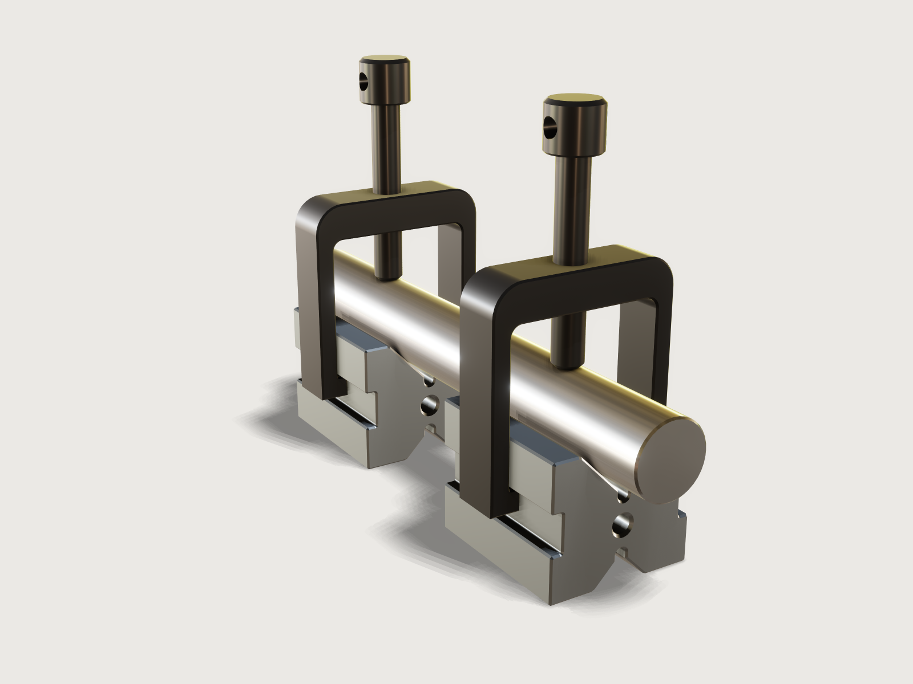

# V-block pair with clamps

A matched pair of hardened and ground 90° V-blocks, the toolmaker's way to hold round work for inspection,
marking out and drilling, in the common 45 × 40 × 35 mm size for shafts of 6 to 30 mm. Each block has a
large and a small V with relief grooves at their apexes, side slots for its U-clamp, and an M6 tapped hole
in each end; the black-oxide clamps hold a ground test pin with M8 tommy-bar screws. The pin is placed by
the closed form for its height in a V, and the model proves the form right: the pin rests on both ground
flanks of both blocks and enters neither.



## What it shows

- **One profile, drawn once.** `sketch.path` draws the whole cross-section with its two Vs, the round-bottomed
  relief grooves, the side slots with 0.5 mm radii in their inside corners and the 0.5 mm chamfers of the
  long edges; `feature.extrude` makes the block, and `feature.chamfer` breaks all 80 edges of its two end
  faces (the 40 sides of the profile, at both ends).
- **Tapped holes.** A tap drill with its 118° point and a 90° countersink is one `feature.revolve`;
  `feature.mirror` copies it to the far end of the block, two `feature.boolean` subtractions drill both
  ends. `feature.thread` marks each M6 hole, and the M8 holes of the clamps and the M8 screws, as ISO
  metric threads (cosmetic).
- **A matched pair by pattern.** `feature.pattern` (linear) makes the second block, the second clamp and
  the second screw, one `pair_pitch` along the axis.
- **A named set.** `set.define` keeps *Tapped holes*: the hole faces the two drills made, counted by an
  assertion and kept by the document as the design changes.
- **Contact as a proof.** The pin is placed by the closed form; `measure.distance` to each bounded flank
  face and `overlap` prove that it touches all four flanks without entering a block (below).
- **References by feature name.** Faces are named after the features that made them
  (`Two blocks:copy(0)/Block blank:startCap`), and the checks find faces with `madeBy`, so they hold
  whatever feature ids the history gives. The edge ids of the profiles (`side(e33)`, `side(e42)` …) come
  from their sketches and are pinned there: redraw a profile and read them again.
- **Drawings.** `file.export` writes the end, side and top views as SVG to scale, hidden lines dashed in the
  end and side views, and the exact geometry as STEP.
- **Outputs.** `variable.measure` reports the mass of the two blocks and the height over the pin, the
  measure a toolmaker takes with a height gauge.

## The real thing

- **Reference.** The blocks follow Haas Tooling's
  [09-0550 V-block and clamp set](https://www.haastooling.com/p/09-0550): 45 mm long, 40 mm wide, 35 mm
  high, 90° V, for work of Ø 6 to 30 mm; a V 25 mm wide and 14 mm deep and a secondary V 15 mm wide and
  9 mm deep, clamp slots 10 mm wide; 40Cr steel hardened to 52–58 HRC, the V flat to 0.003 mm, parallel
  within 0.01 mm. The model reads the two depths as the V's own (12.5 and 7.5 mm for a 90° V of those
  widths) plus a relief groove 1.5 mm below the apex. Other makers sell the same type at about this size:
  Holex (Hoffmann Group) 447010, 50 × 40 × 40 mm for Ø 5 to 30 mm
  ([data sheet](https://cdn.hoffmann-group.com/dsh/de-DE/dsh_de-de_48287.pdf)), and STEINLE model 6503,
  40 × 35 × 35 to 70 × 63 × 44 mm
  ([data sheet](http://www.pruefmittel24.com/documents/6503-STEINLE-Datenblatt.pdf)).
- **This example's own sizes.** Haas gives no more than the above, so these are chosen, and stated:
  relief grooves 3 mm wide with a round bottom; slots 3 mm deep, centred on the height, so the clamp
  hooks in with either V on top; 0.5 mm radii in the slots' inside corners; 0.5 mm chamfers on the outer
  corners, the slot and V mouths and all round both end faces; an M6 tapped hole in the middle of each
  end face (tap drill Ø 5 mm, ISO 2306), 14 mm deep at full diameter with a 118° point, 90° countersink to
  Ø 6.4 mm, threaded 10 mm, which leaves 4 pitches below the thread for a plug tap's lead; it is for
  bolting the block to an angle plate or a fixture. The hole sits midway between the two apexes, 15 mm
  up. Its bore leaves 3.5 mm to each relief groove; the thinnest wall round it, 2.30 mm, lies at the
  end face, between the countersink and the end chamfer of the top relief groove.
- **The clamps.** Cut from 14 mm steel plate: legs 5 mm thick, 0.5 mm clear of the block's sides, with hooks
  6 mm high that reach into the slots to 0.5 mm from their bottom and bear up against the slots' upper face;
  a crossbar 10 mm thick whose underside lies 3 mm above the largest pin (Ø 30 mm); corner radii of 3 mm
  inside and 8 mm outside; drilled Ø 6.8 mm (ISO 2306) and tapped M8 × 1.25 (ISO 261) through the middle
  of the crossbar. The screw is M8, 50 mm from its tip to its head, with a flat tip chamfered 1 mm, a
  Ø 14 × 12 mm head and a Ø 5 mm cross hole for a tommy bar; its full thread stops 3.2 mm under the head,
  the normal run-out x max of ISO 3508 for M8. Its tip bears on the pin.
- **The test pin.** A ground pin of the *Pin diameter*, as long as both blocks and the 40 mm between them
  plus 15 mm at each end, its ends chamfered 0.5 mm.
- **Why the relief grooves.** The wheel grinds each flank over its whole width without having to reach a
  sharp apex, and burrs or dirt in the corner cannot hold the work off the flanks.
- **Making it.** The blocks are milled from bar along their length (the Vs with an angle cutter, the slots
  and grooves with formed cutters), drilled and tapped at the ends, hardened and tempered, then ground as a
  pair on every face so that both stand at the same height. The clamps are cut from plate (laser or
  waterjet), drilled, tapped and black oxided; the screws are turned, cross drilled, rolled and black
  oxided. The two blocks weigh 0.778 kg in steel; Haas lists 0.8 kg for its set.
- **Simplified, or left out.**
  - The threads are cosmetic: the holes are drawn at their tap drill and the screws at their major
    diameter, as drawings show threads, so each screw overlaps its clamp by the thread's depth (the checks
    leave that pair out).
  - No matched-pair numbers are engraved on the blocks, and the screws have no swivel pad.
  - The test pin stands for the work; a real set is sold without it.

## Parameters

| Parameter | Range | Default | What it does |
|---|---|---|---|
| Pin diameter | 6 to 30 mm, step 1 mm | 20 mm | the pin in the large Vs; it rises by d/√2 + d/2 at its top, and the screws follow it down |
| Block length | 40 to 100 mm, step 5 mm | 45 mm | each block's length along its V; the clamps stay at the blocks' middles and the pin grows with them |

## Checks

- **Block section in closed form.** A block cut at its middle must have the area B·H − (W₁² + W₂²)/4 −
  (2 + π)/4·g² − 2·s·h + (4 − π)·r² − (4 + √2)·c²: the rectangle, less the two 90° Vs (W₁ = 25, W₂ = 15),
  the two round-bottomed relief grooves beyond them (g = 3), the two slots (s = 3 deep, h = 10 high), plus the
  four inside radii (r = 0.5), less the eight 45° chamfers and the four chamfers at the V mouths
  (c = 0.5). It is 1114.79246 mm², exact to 0.000001 mm².
- **Pin centre r√2 above the apex.** The pin's centre of mass lies `top_apex_z + d/√2` up: 36.6421356 mm
  at Ø 20 mm (26.7426407 mm at Ø 6, 43.7132034 mm at Ø 30). The height over the pin is 46.6421356 mm.
- **Pin on both flanks of both blocks.** Four checks: the distance from the pin to each top flank of each
  block is at most 0.000001 mm (8.2 × 10⁻⁹ mm found). The flanks are bounded faces that stop at the relief
  groove and at the mouth chamfer, so the pin touches the ground flank itself. With the next check this
  proves the closed form: a pin placed 0.01 mm higher fails all four (0.00707 mm), and so does a pin too
  large for the V (Ø 36 mm: 0.0188 mm, it would sit on the mouth chamfers) or too small (Ø 4 mm:
  0.00368 mm, it would sit on the groove's edges).
- **Blocks, clamps and pin do not overlap**, and **screws overlap neither pin nor blocks.**
- **Screws bear on the pin.** Distance 0 mm.
- **Clamp hooks bear on the slots.** The hooks' tops lie on the slots' upper faces: distance 0 mm.
- **Pin clear of the clamps.** At least the 3 mm headroom: 10.5 mm at Ø 20 (to the legs), 15.0069431 mm
  at Ø 6, 3 mm at Ø 30 (to the crossbar).
- **Screw heads clear of the crossbars.** At least 1 mm: 24.9289322 mm at Ø 20, 8.02943725 mm at Ø 6,
  37 mm at Ø 30.
- **Six tapped holes.** The named set *Tapped holes* holds four M6 holes in the blocks and two M8 holes in
  the clamps.
- **Walls round the tapped holes at least 2 mm.** The distance from every face the tap drills made
  (countersink, bore and point) to every other face of the blocks but their end faces: 2.30 mm found
  (at least 2.05 mm proven), at the countersink's rim beside the end chamfer of the top relief groove (the
  bore itself is 3.5 mm from the groove).

`craft3d-cli check-range` proves all fourteen at 13 points: the defaults, the four corners of the two
ranges (Ø 6 and Ø 30 with 40 and 100 mm blocks) and eight random points.

## Files

- `v-block-pair.3dcraft`: the model (opens in 0.3 to 0.4 s).
- `build.json`: the 116 steps that build it.
- `exports/v-block-pair.step`: the exact geometry of all seven parts, for machining.
- `exports/v-block-pair-end.svg`, `-side.svg`, `-top.svg`: the end, side and top views, 1:1, lines
  0.25 mm; hidden lines dashed in the end and side views.

## Rebuild

```sh
tools/examples.py build v-block-pair
# or
craft3d-cli run --new '{"units":"mm"}' --script examples/07-v-block-pair/build.json --out v-blocks.3dcraft
```

## Difficulty

**5 / 10** (the reviewer): a 40-segment constrained profile with arcs, 80 chamfered edges, a revolved drill
with mirror and booleans, three patterns, eight threads, four bodies, and contact proofs that need careful edge
naming.

## Platform notes

- **End chamfers and inside corners.** Chamfering all the edges of an end face whose outline has a sharp
  inside corner (the slots' and the relief grooves' corners) is refused at the first edge that reaches
  one, with advice that does not help (chamfer the edges it continues in: they are all chamfered). With
  0.5 mm radii in those corners every edge chamfers; the radii are what a hardened part wants anyway
  ([F-033](../../3DCRAFT-FEEDBACK.md#f-033)).
- **One thread feature per hole.** `feature.pattern` copies a hole but not its cosmetic thread, and
  `feature.thread` takes one face: eight thread features for four identical tapped holes, two clamps and two
  screws ([F-052](../../3DCRAFT-FEEDBACK.md#f-052)).
- **A thread through the crossbar.** `feature.thread` ends every thread in a run-out (0.94 mm for M8) that
  must lie inside the hole, so a hole cannot be threaded through: the crossbar's thread is drawn 9 mm of its
  10 (`clamp_thread_length`); the real crossbar is tapped through ([F-056](../../3DCRAFT-FEEDBACK.md#f-056)).
- **Cosmetic threads.** The screws are drawn smooth: a modelled thread costs seconds per body
  ([F-004](../../3DCRAFT-FEEDBACK.md#f-004)), and a mating pair could not be shown clear
  ([F-014](../../3DCRAFT-FEEDBACK.md#f-014)).
- **Preview.** Drawn with `reflections: false`: the screen-space reflections smear dark patches onto the
  polished pin ([F-013](../../3DCRAFT-FEEDBACK.md#f-013)). The environment is turned 180° (`rotation`) so
  the warm key light does not tint the pin and the screws brass, and the key light comes from [20, 70]:
  from the default direction its shadow draws stepped bands on the pin beside the near clamp and on the
  floor ([F-043](../../3DCRAFT-FEEDBACK.md#f-043)).
- **Names.** The last thread feature of each part is named for the part (`V-block pair`, `U-clamps`,
  `Clamp screws`), since a body takes its last feature's name ([F-042](../../3DCRAFT-FEEDBACK.md#f-042)).
- **Drawings.** The SVG views are outlines to scale, without dimensions, centre lines or a title block
  ([F-053](../../3DCRAFT-FEEDBACK.md#f-053)).

## Licence

[MIT](../../LICENSE), like everything in this repository; credit line in the
[README](../../README.md#licence).
