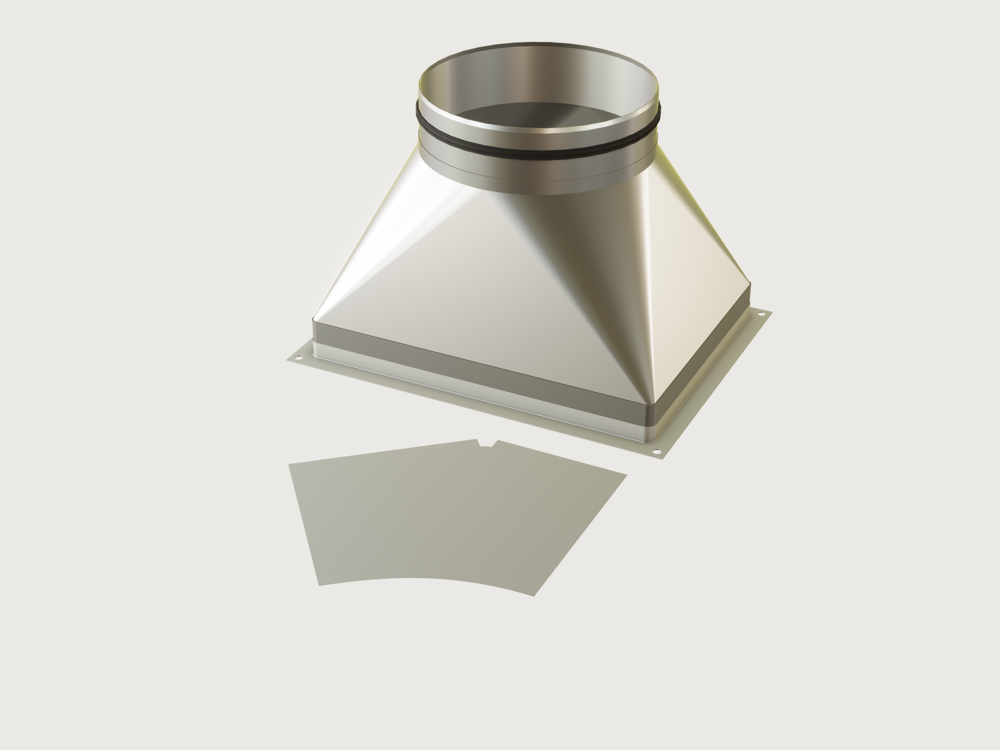

# Square-to-round transition

The classic sheet-metal fitting of every ventilation system: a transition from a 400 × 300 mm rectangular
duct to a Ø 250 mm round duct, 300 mm long, in 0.8 mm galvanised steel. Its sheet is flat triangles and
cone corners, a surface a flat sheet bends onto without stretching, with a straight at each end. It is
made in four identical pieces with seams down the middles of the sides. The model unfolds one piece into
the net flat pattern the shop cuts four times, and proves that the pattern has exactly the area of the sheet.
A collar and a P20 angle frame lap over the rectangular straight; a spigot with a lip seal laps into the
round one.



## What it shows

- **A developable surface.** The cone corner is `feature.developable` between two arcs: the rectangle's
  rounded corner at the bottom and a quarter of the round end at the top. Its rulings join the points
  where both arcs run the same way, so the sheet bends without stretching.
- **Flat triangles on inclined planes.** `datum.plane` through three points (the middle of a side, the end
  of its straight part, and the point of the round end above the middle) and `feature.fill` give the
  half triangles on either side of the corner exactly.
- **One piece, sewn.** `feature.boolean` with `sew` joins half an end triangle, the corner and half a side
  triangle into one sheet: one piece of the fitting.
- **A plate, and its copies.** `feature.plate` gives the piece its 0.8 mm; `feature.mirror` makes the
  other three pieces, which meet the first face to face at the seams.
- **The flat pattern.** The piece's middle surface, with the straight's flaps along its two flat sides
  (`feature.boolean` with `union` across the fold), is laid flat by `feature.unfold`. That is the neutral
  layer the pattern is developed from. It lies on the floor in front of the fitting, and `file.export`
  writes it as DXF.
- **Developability as a check.** `measure.developability` as assertions: the sheet is developable and its
  Gaussian curvature is zero.
- **Tables of two standards.** `table.set` holds the EN 1505 side lengths and the EN 1506 round sizes with
  their spigot tolerances and lengths; *Width*, *Height* and *Round size* are choices from them
  (`variable.publish` with `choicesFrom`), and the round size sets the smallest side.
- **The ends.** `feature.offsetProfile` grows one rectangle into the straight's, the collar's and the
  frame's outlines (round corners, or sharp for the frame's outer edge); `feature.extrude` with `cut` and
  `join` makes the rectangular straight, the collar and the frame, `feature.fillet` the frame's bend,
  `sketch.pattern` the four bolt holes, `feature.revolve` the round straight, the spigot and the seal.

## The real thing

- **Sizes.** EN 1505 sizes rectangular ducts and fittings by their inside dimensions a × b (as Lindab's
  rectangular system states, "a and b are the internal duct or fitting dimensions"), in the series 100,
  150, 200, 250, 300, 400, 500, 600, 800, 1000 and 1200 mm (Alnor's system description, Table 3, to
  EN 1505:2001). EN 1506 sizes round ducts by their nominal diameter d. The spigot slides into the spiral
  duct, so its outside diameter lies below d: per DIN EN 1506 as tabled by airleben (*Toleranzen nach
  DIN EN 1506*, 2024). The spigot's length e is the one the same sheet gives for the spigots of its
  add-on pieces (*Anbaustücke*).

  | Round size d | 125 | 160 | 200 | 250 | 315 |
  |---|---|---|---|---|---|
  | Spigot outside diameter, min to max | 123.8–124.3 | 158.7–159.3 | 198.6–199.3 | 248.5–249.3 | 313.4–314.3 |
  | Duct inside diameter, max | 125.5 | 160.6 | 200.7 | 250.8 | 315.9 |
  | Spigot length e | 36 | 36 | 36 | 55 | 55 |
  | Smallest side (d + 50 mm, on the EN 1505 series) | 200 | 250 | 250 | 300 | 400 |

  The spigot is modelled in the middle of its band: 248.90 mm at d = 250.
- **Sheet.** 0.8 mm hot-dip galvanised steel (Z275, as Lindab's ducts). Alnor's table for EN 1507 asks at
  least 0.6 mm (class N) or 0.7 mm (class S, medium pressure, −1000 to 2500 Pa) for a long side of 100 to
  500 mm, which is why the sides stop at 500 mm.
- **Four pieces.** Square-to-rounds are made in one, two or four pieces. At 400 × 300 one or two would do;
  four pieces with their seams down the middles of the sides were chosen here for the model's load time
  as well ([F-072](../../3DCRAFT-FEEDBACK.md#f-072)): one piece is unfolded and the others are mirrored.
  The pieces are mirror images of each other, so one pattern serves all four: two are formed with the
  blank turned over. The seams are not modelled (the pieces meet edge to edge); in the shop they are
  Pittsburgh locks or riveted laps, whose allowance is added to the pattern.
- **Corners.** The rectangle's corners are rounded to 8 mm inside. Shop square-to-rounds have sharp
  corners, with the bump lines fanning out from the corner point. 3DCraft cannot give a cone that runs
  into a point a thickness ([F-070](../../3DCRAFT-FEEDBACK.md#f-070)), and at 5 mm its plate is refused at
  500 × 500 to 315 (Platform notes).
- **Straights and laps.** Each piece has a 15 mm straight at both ends, so that the collar and the spigot
  lap it on parallel faces, 15 mm long with 0.3 mm clearance, and can be riveted and sealed. The collar
  runs up over the rectangular straight and the spigot down inside the round one. Along the flat sides
  the rectangular straight is a flap folded on a straight line, which a press brake forms, and it is part
  of the pattern. Round the 8 mm corners, and all along the round end, the bend line is curved: a brake
  cannot form it and no flat blank holds it. Laid flat, the corner's flap would have to stretch by
  0.98 mm over its 15 mm. These straights are wheeled or hand-formed from extra stock; it is one more cost
  of the rounded corners ([F-070](../../3DCRAFT-FEEDBACK.md#f-070)). The model draws the straights as one
  ring at each end. The collar is 0.8 mm sheet, its inside the duct's a × b with 8 mm corners, 30 mm from
  the flange face to the straight's end.
- **Flange.** Alnor joins rectangular ducts with frames of sheet angles and corner straps, P20 for sides
  up to 1000 mm (to PN-B-76002). The frame here is a 20 × 20 mm angle bent from 1 mm sheet (the thickness
  is assumed) with an inside bend radius of 1 mm. It has a Ø 9 mm hole for an M8 bolt in each corner
  (ISO 273, medium series), 12.33 mm from the bend, well over the rule's 2.5 t + r = 3.5 mm. The real P20
  profile is roll-formed with a groove for sealant and takes pressed corner pieces; neither is modelled.
- **Spigot and seal.** A rolled band of 0.8 mm sheet, 55 mm long at d = 250 plus the 15 mm lap, its last
  5 mm swaged in by 1 mm as a lead-in. On it sits a double-lip EPDM seal 10 mm wide whose lips reach 2 mm
  beyond the duct's largest inside diameter (254.80 mm against 250.8). The seal's proportions are
  illustrative, not to a standard. EPDM is taken at 1160 kg/m³ (Parker's black compound E3676).
- **Making it.** Cut four blanks from the DXF (laser or plasma), adding the seam allowances and the stock
  for the curved straights. Fold the flaps, then bump-form each corner on the press brake along its
  rulings, the straight lines from the rounded corner to the round end; the triangles stay flat. Form the
  corner and round straights, close the four seams, slide the collar over the rectangular straight and
  the spigot into the round one, and rivet both. Rivet the frame to the collar, then push on the seal.
- **The pattern.** It is the development of the sheet's middle surface, as patterns for sheet metal are
  (the mean diameter), cut at the straights. The model carries two sheets for this. The plate grows
  outward from the piece's inside surface, which sits inside the collar and outside the spigot with the
  clearance. The middle surface, 0.4 mm further out, is the one unfolded.
- **Mass.** 2.72 kg for the steel parts at 7850 kg/m³: the four pieces (each about 43 072 mm³), the two
  straights, the collar, the frame and the spigot.
- **Left out.** The seams and their allowance, the stock for the curved straights, rivets and bolts, the
  frame's corner pieces and sealant, and the stiffening a larger fitting would need.

## Parameters

| Parameter | Choices or range | Default |
|---|---|---|
| Width (a) | 100 to 500 mm from the EN 1505 series, at least the round size's smallest side | 400 mm |
| Height (b) | as the width | 300 mm |
| Round size (d) | 125, 160, 200, 250, 315 mm | 250 mm |
| Length (l) | 300 to 800 mm, in 10 mm steps | 300 mm |

The length is overall, from the flange face to the end of the spigot. The slanted part of the transition
is l less the collar (30 mm), the spigot's length e and the two straights (15 mm each).

## Checks

On one piece, the one that is cut and formed:

- **Transition is developable** and **Zero Gaussian curvature**: `measure.developability` of the middle
  surface finds it developable, the largest |K| sampled 1.1e-26 mm⁻². **Plated sheet is the same
  developable**: so is the inside surface the plate grows from.
- **Flat pattern keeps the area**: the pattern's area equals the middle surface's, 58 832.868 mm² within
  0.01 mm².
- **Flat triangles and flaps in closed form**: the two half triangles and the two flaps have the area
  (c_y s_e + c_x s_s)/2 + (c_x + c_y) h_s. Here c_x and c_y are the straight halves of the rectangle's
  sides, s_e and s_s the slant heights of the end and side triangles, h_s the straight's 15 mm:
  37 071.470 mm² within 0.01 mm².
- **Cone corner by quadrature**: a corner whose rulings join the points of equal angle θ on its two arcs
  (radii r and R, the lower arc's centre at (c_x, c_y), height h) has the area
  (r + R)/2 ∫ √(h² + (c_x cos θ + c_y sin θ − R + r)²) dθ over a quarter turn. The corner's area,
  21 761.398 mm², equals that integral by five-point Gauss–Legendre quadrature, 21 761.404 mm², within
  0.05 mm².
- **Pattern is the plate's middle layer**: a plate on a developable sheet has the volume t × A_m, with A_m
  the area of its middle layer (Steiner's formula; the Gaussian term vanishes). The piece's volume over
  0.8 mm, 53 840.357 mm², matches the pattern's area less its flaps, 53 822.868 mm², within 0.2 %. It
  differs by 0.03 % because the pattern is cut at the straights while the plate's rims stand square to the
  sheet.
- **Sheet meets EN 1507 class S**: 0.8 mm against Alnor's 0.7 mm minimum.

On the whole fitting:

- **Collar laps the straight** and **Spigot laps inside the straight**: neither overlaps the straight it
  laps.
- **Spigot within EN 1506**: the spigot's outside diameter lies in its band (248.90 mm in 248.5 to 249.3).
- **Seal reaches the duct wall**: the seal's outside diameter is at least 2 mm over the duct's largest
  inside diameter (254.80 mm).
- **Overall length**: from the flange face to the spigot's end, l (300.000 mm).
- **Four corner bolt holes** in the frame, and **Bolt holes clear of the bend**: 12.33 mm from the angle's
  leg, at least 2.5 t + r = 3.5 mm.
- **Flat pattern clear of the frame**: the pattern on the floor ends at −210.80 mm, in front of the frame's
  edge at −170.8 mm.

Not asserted: that the pieces and the straights do not overlap at the folds. The round straight's lower
edge is bevelled to the end triangle's lean for that (the corner leans more steeply and leaves a small gap),
but an overlap check across the coincident
fold line is refused ("an imprinted curve that does not fit the edges") and costs 12 s of CPU.

`craft3d-cli check-range` proves the sixteen at 33 points: the defaults, all sixteen corners of the
ranges, eight choices and eight random points (a side below the round size's smallest is raised to it);
not at every combination.

## Files

- `square-to-round-transition.3dcraft`: the model.
- `build.json`: the 162 steps that build it.
- `exports/square-to-round-transition-flat-pattern.dxf`: one piece's flat pattern with its two flaps,
  from its lower left corner: the net outline only, cut four times. It has no seam allowance, no stock for
  the curved straights, no fold, bump or tangent lines, so add those before it goes to the cutter.

## Rebuild

```sh
tools/examples.py build square-to-round-transition
# or
craft3d-cli run --new '{"units":"mm"}' --script examples/08-square-to-round-transition/build.json --out transition.3dcraft
```

## Difficulty

**7 / 10** (the reviewer): a developable sheet and a ruled loft proven to be the same surface, a flapped
unfold, quadrature and Steiner proofs, and five kernel limits worked around.

## Platform notes

- **The transition is not one developable.** `feature.developable` from the rectangle to the circle is
  refused: where a straight side faces one point of the circle (a flat triangle) the faces cannot be
  fitted ("still 995.98 off"), and the whole square-to-round is refused at its last corner. So the corner
  is a developable of its own and the triangles are fills, sewn together
  ([F-069](../../3DCRAFT-FEEDBACK.md#f-069)).
- **Rounded corners.** `feature.plate` refuses a cone that runs into a point (the fan of a developable):
  "the freeform face has a pole" ([F-070](../../3DCRAFT-FEEDBACK.md#f-070)). At 5 mm the plate of the
  corner is refused at 500 × 500 to 315 ("the rim could not be traced … still 2.52 off"); 8 mm passes
  every size. Reproducer: [F-092](../../3DCRAFT-FEEDBACK.md#f-092).
- **The plated pieces are a ruled loft.** `feature.developable` fits the corner with 184 rulings whatever
  the tolerance. A ruled `feature.loft` between the same two arcs is the same surface, since its rulings
  also join the points of equal angle; it is exact with two rulings, and *Plated sheet is the same
  developable* proves it. Plating it costs a quarter of the CPU (0.73 s against 2.59 s), and so does each
  mirrored copy. The model opens in 2.0 s wall and 3.3 s of CPU, against 3.2 s and 11.5 s with the
  developable plated. The developable stays where it is shown and checked: the pattern's sheet.
  Reproducer: [F-091](../../3DCRAFT-FEEDBACK.md#f-091).
- **Curved folds.** `feature.unfold` refuses the corner's flap with the piece ("its two images in the
  plane are up to 0.98 mm apart"). That is right for a curved fold whose sides bend differently, but no
  development with the stretch reported is offered either. Reproducer:
  [F-090](../../3DCRAFT-FEEDBACK.md#f-090).
- **Tolerance.** The document's tolerance is 0.0001 mm (`document.setTolerance`), eight thousand times
  finer than the sheet. At the default 1e-6 mm the plate of a narrow corner is refused after 10 s
  ([F-071](../../3DCRAFT-FEEDBACK.md#f-071)).
- **Load time.** One piece is unfolded, about 1 s ([F-072](../../3DCRAFT-FEEDBACK.md#f-072)); the
  twelve-face one-piece pattern of the first version opened in 8.7 s, 27 s of CPU.
- **Laps instead of planes.** `feature.plate` cannot end a piece on a plane (`onto`) along an edge where
  a flat triangle runs on into the corner cone ([F-089](../../3DCRAFT-FEEDBACK.md#f-089)). The rims stand
  square to the sheet; the straights meet them at the folds.
- **DXF of splines.** Every edge of the pattern, the straight ones too, is written as a cubic spline of
  385 control points ([F-074](../../3DCRAFT-FEEDBACK.md#f-074)).
- **Pattern size.** `extent` of the pattern is not proven as a value, only as a bound
  ([F-057](../../3DCRAFT-FEEDBACK.md#f-057)), so its place is asserted as a bound.
- **Preview.** Drawn with `reflections: false` (stepped bands on the flat triangles,
  [F-013](../../3DCRAFT-FEEDBACK.md#f-013)), the environment turned 150° and the key light behind the
  fitting. No turn draws both the fitting and the floor-level parts neutral
  ([F-054](../../3DCRAFT-FEEDBACK.md#f-054)); at 150° the fitting is neutral and the frame and the blank
  (#bfc7cf, roughness 0.6) a light grey. The light behind keeps the ground's shadow free of steps.
- **Names.** The extrusions that cut and join the straight, the collar and the frame keep their automatic
  names (`Extrude1` to `Extrude5`, [F-002](../../3DCRAFT-FEEDBACK.md#f-002)).
