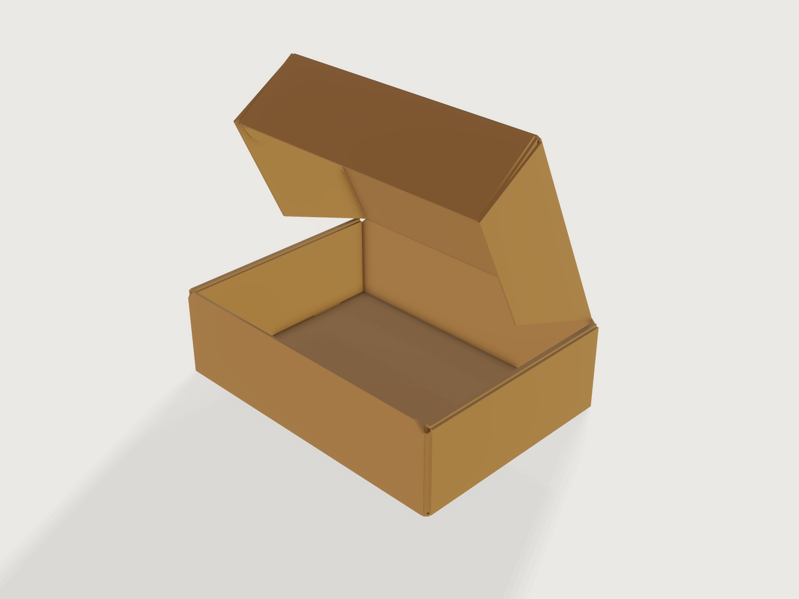

# Mailer box

The box e-commerce ships in: a FEFCO 0427 mailer die-cut from one sheet of single-wall E-flute kraft board,
200 × 150 × 60 mm inside. Its ends are rolled double walls locked by tabs in slots in the base, the front
and back walls' ears are trapped inside them, and the lid closes with dust flaps and a tuck-in front. One
*Fold* parameter takes it from the flat blank to the closed box, and the blank's cut and crease lines come
out as a DXF for a cutting plotter or a die maker.



## What it shows

- **A die-cut blank as one sketch.** `sketch.polyline` draws the outline (66 corners, every one a formula
  of the size and the board), four more closed polylines are the slots, cut through the base as holes, and
  18 construction `sketch.line`s are the creases.
- **Folding thick board.** `feature.fold` with `panels` turns every facet into a 1.6 mm panel hinged on
  the board's inside face, so the box folds exactly as the crease pattern says, and it refuses any two
  panels that meet: a flap that would pass through a wall is an error, not a picture.
- **A folding sequence as data.** `table.set` holds the sequence (`fold_sequence`: walls, end walls,
  each end's roll, inner wall and lock, tuck flap, dust flaps, lid). Every crease angle is a formula of
  the one public `fold_amount`, `clamp`ed to its row of the table, so the slider plays the whole sequence.
- **Rigid-body choreography.** The rolled ends and the tuck flap need more than one angle per crease to
  get past each other; the formulas move them the way hands do (see *The real thing*).
- **Proving the closed box while showing it open.** A second `feature.fold` of the same blank, at the
  closed angles and hidden with `feature.visible`, is measured whatever the Fold shows; a hidden
  `feature.fill` of the blank is the flat sheet the board is cut from.
- **Ranges that follow each other.** `variable.publish` limits the width to the length (FEFCO's L is the
  longer side) and the height to the length (taller, and the rolled ends would meet while they fold).
- **Outputs and checks.** `variable.measure` and `variable.output` give the board per box and its mass;
  `assert.add` with `extent`, `area`, `distance` and `count` (below).
- **Cut and crease file.** `file.export` with `fold` writes the blank as DXF: the outline and the slots on
  the layer `boundary` (cut), the creases on `valley` (crease).

## The real thing

- **Style.** FEFCO Code, 12th edition (2022), style 0427, in the series 04, *folder boxes and trays*:
  "usually made from one piece of board. The bottom of the box is hinged to form two or all side walls and
  the cover. Locking tabs, handles, display panels, etc. can be incorporated in some designs." FEFCO gives
  a case's size as its inside dimensions L × W × H, L the longer and W the shorter side at the opening, H
  from the opening to the base. The blank here follows the 0427 drawing: the base; the front and back
  walls on its long sides, each with two ears; the end walls rolled over into double walls with two
  locking tabs that go into slots in the base; the lid on the back wall, with a dust flap at each end and a
  tuck flap at the front that has rounded ears.
- **Board.** Single wall, E flute, natural kraft liners on both sides, 340 g/m² combined: the E-flute board
  a mailer maker uses for its standard mailers (Packhelp, "What paperboard do you use to manufacture
  mailer boxes?": "three-layer corrugated cardboard – natural or one-sided bleached", "E flute (approx.
  2 mm) and grammage of 340 g/m2"). Packhelp publishes only the combined weight; the liner, fluting and
  liner weights and the edge crush value are the corrugator's to state, and the model does not invent
  them. Thickness 1.6 mm, the E flute's 1/16 in (Foster, "Boxes, Corrugated", *The Wiley Encyclopedia of
  Packaging Technology*, 2nd ed., 1997, flute table, as reproduced in Wikipedia's *Corrugated fiberboard*:
  E flute 90 ± 4 flutes per foot, 1/16 in). Finished board measures up to about 2 mm: set
  `board_thickness` to the caliper of your board and every offset follows (the model also passes
  `check-range` at 2 mm).
- **Flute direction.** Run the flutes along the blank's x axis, the box's length, so that they cross the
  end walls' creases. The rolled end's top panel is 3.1 mm wide, less than one E-flute pitch (1 ft / 90 ≈
  3.39 mm, from Foster's 90 flutes per foot): creases along the flutes there could both land on one flute,
  while creases across the flutes crush several each.
- **The layers.** Each layer folds inside the one before it, 0.5 mm apart (`layer_gap`), so the creases
  are set in or out by the board's thickness and the gap. Seen from inside the box, at each end: the outer
  end wall (crease 4.7 mm beyond the inside length), the front and back walls' ears (creases 2.6 mm beyond
  it), the inner end wall, whose inside face is the inside length, then, with the lid closed, the lid's
  dust flap (crease 2.1 mm inside) and the tuck flap's ear (crease 4.2 mm inside). The rolled end's top
  panel is 3.1 mm wide, the outer end wall 57.9 mm high under it, the inner wall 57.4 mm, standing 0.5 mm
  above the base, with two tabs 25 mm wide (W / 6) at a quarter and three quarters of the width that reach
  2.1 mm down through slots 3.1 × 26 mm to the base's underside. The ears are 74.5 × 55.3 mm, half the
  width each, so the front and back ears meet in the middle of the end.
- **The front.** FEFCO's 0427 drawing has one crease between the lid and the tuck flap and a single front
  wall, so the tuck flap goes in behind the front wall and the front wall's top edge stays beside the
  lid's front fold, not under it. FEFCO draws the front wall as high as the back wall (H); here it is
  61.6 mm, one board thickness more, so its top edge is flush with the closed lid's top rather than a
  step below it. The lid's front fold stands 2.1 mm behind the front wall's inside face: real board
  closes most of that gap with the round of its fold, rigid panels show it as a seam (see the first item
  under *Simplified*).
- **Sizes at the defaults.** Inside 200 × 150 × 60 mm; outside, closed, 212.6 × 153.2 × 63.2 mm. The blank
  is 450.4 × 474.8 mm, 0.161 m² of board, 54.84 g.
- **Making it.** Short runs and samples: a flatbed cutting plotter with a knife and a creasing wheel; long
  runs: a die with cut and crease rules. In `exports/mailer-box-blank.dxf` the layer `boundary` is cut
  (outline and slots) and `valley` is creased (18 lines); the drawing is seen from the board's inside face,
  and every crease folds towards it. Fold by hand in the order of the Fold parameter:

  | Fold | What folds |
  |---|---|
  | 0 to 0.15 | front and back walls up, their ears in |
  | 0.15 to 0.25 | both end walls up |
  | 0.25 to 0.37 | left end rolled: top panel to 50°, inner wall swung down, then both together, the tabs dropping straight into the slots |
  | 0.37 to 0.5 | right end, the same |
  | 0.5 to 0.55 | the tuck flap and its ears |
  | 0.55 to 0.6 | the lid's dust flaps |
  | 0.6 to 1 | the lid closes; the tuck flap tilts back past square by half the lid's angle over its first 60°, then hangs plumb, so it drops in behind the front wall |

  The two ends roll one after the other: rolled together, the inner walls would meet in the middle of a box
  whose height is more than about half its length.
- **Crease allowance.** The creases are drawn where the panels hinge here, on the board's inside face, and
  the DXF carries no allowance. Real board bends about its middle layer instead: if that layer keeps its
  length, each 90° fold takes about half a board thickness (0.8 mm) off the inside of each panel beside
  it, so a panel between two folds comes out about one thickness (1.6 mm) shorter inside than its crease
  spacing, and a sample cut from this DXF comes out undersize by about that much per span. Add that
  allowance to each span before cutting, or size the box up by it; a die maker adds the allowances of its
  own rules and board. (FEFCO measures dimensions on the flat blank "from the centre of crease bearing the
  thickness of the material in mind".) This is an estimate, not a measured value: fold a sample.
- **What goes in.** The lid's dust flaps hang 2.1 mm inside the ends and the tuck flap 2.1 mm inside the
  front wall, so the clear space under the closed lid is 195.8 mm long between the dust flaps and 147.9 mm
  wide behind the tuck flap (both asserted). Size the box a few millimetres over its contents.
- **Simplified, or left out.**
  - The board is rigid panels hinged on its inside face, 0.05 mm back from each crease. Real board bends
    round a crease; here every folded corner shows a square notch of the board's thickness on the outside,
    with a small hole at the foot of each outer corner, under the ear and beside the base's cut corner.
  - The tuck flap holds by friction between the front wall and the dust flaps only. A roll-end
    tuck-front closes with self-locking "cherry locks" (newprint.ca, "What is a Roll End Tuck Front Box?"),
    which catch in slits; thick panels refuse a slit ([F-015](../../3DCRAFT-FEEDBACK.md#f-015)), so they
    are left out.
  - The tuck flap is 55.3 mm high rather than the full height, and its ears are half that wide with a 45°
    lead at the lid's crease and rounds of three chords; FEFCO draws larger, fully rounded ears. A real tuck
    flap bends as it goes in; a rigid one needs the room to swing in past the lid.
  - The slots are 3.1 mm wide, room for the rigid tab's last arc; the lid's dust flaps stay within a radius
    of the width less 1 mm about the hinge, so they clear the front wall as the lid swings.
  - No print and no tear strip.

## Parameters

| Parameter | Range | Default |
|---|---|---|
| Inside length | 100 to 450 mm | 200 mm |
| Inside width | 60 mm to the inside length | 150 mm |
| Inside height | 25 mm to the inside length, at most 150 mm | 60 mm |
| Fold | 0 (the flat blank) to 1 (closed) | 0.71 |

## Checks

All on the hidden closed copy and the hidden flat blank, so they hold whatever the Fold shows:

- **Blank length, width and area in closed form.** The blank's extent is the inside length plus twice the
  rolled end and its tab (or an ear, a dust flap or a tuck ear, if one reaches further), and the front
  wall, base, back wall, lid and tuck flap end to end: 450.4 × 474.8 mm. Its area is the sum of its panels,
  each a rectangle, trapezoid or chamfered polygon of the variables, less the four slots, the tuck ears'
  rounds as three chords each: 161 291.894 mm², within 0.16 mm².
- **Inside length, width and height when closed.** The distances between the inner end walls, the front
  and back walls and the base and the lid: 200, 150 and 60 mm.
- **Clear length between the dust flaps** (195.8 mm) and **clear width behind the tuck flap** (147.9 mm)
  when closed.
- **Outside length, width and height when closed.** 212.6, 153.2 and 63.2 mm, the inside plus three
  board thicknesses and three gaps at each end, two thicknesses across and two in height.
- **Nineteen panels.** Base, front and back walls, four ears, two times three panels of the rolled ends,
  lid, two dust flaps, tuck flap and its two ears.
- **No collisions.** `feature.fold` refuses any two panels that meet. The shown box and the closed copy
  are built at every regeneration, so a size whose flaps would collide when closed, or a Fold at which
  they would pass through each other, fails the document.

Outputs: **Board per box** 0.161 m² and **Board mass** 54.84 g (the blank's area times 340 g/m²).

`craft3d-cli check-range mailer-box.3dcraft --samples 2000 --seed 7` passed all 2017 points (the defaults,
all 16 corners of the four ranges, 2000 random points): at each, both folds were built and the 12
assertions held. Between those points the folding sequence is not proven. An unpublished check made
while building this example (its script is not in this repository) built every Fold from 0 to 1 in steps
of 0.005 at the defaults, and in steps of 0.01 at 22 sizes across the ranges, without a collision.

## Files

- `mailer-box.3dcraft`: the model.
- `build.json`: the 98 steps that build it.
- `exports/mailer-box-blank.dxf`: the blank, cut lines on `boundary`, creases on `valley`.

## Rebuild

```sh
tools/examples.py build mailer-box
# or
craft3d-cli run --new '{"units":"mm"}' --script examples/09-mailer-box/build.json --out mailer-box.3dcraft
```

## Difficulty

**7 / 10** (the reviewer): eighteen thick-panel creases driven by a table-staged choreography of coupled
formulas, a closed-form area of a 66-vertex blank, a hidden second fold for the closed proofs, and collision
limits to navigate.

## Platform notes

- **Rolled ends and locking slots.** [F-015](../../3DCRAFT-FEEDBACK.md#f-015) records that thick panels do
  not fold to 180° and that a panel cannot carry a slit. The 0427's walls get round both: a rolled end is
  two 90° creases with a narrow top panel between them, and its slots are holes in the base, which thick
  panels take. The tuck flap's cherry locks do need slits, and are left out.
- **Open crease corners.** Thick panels stand back from each crease and leave the outside of every fold
  open: a notch of the board's thickness, a small hole at the foot of each outer corner, and, at a clearance
  of 0.2 mm, hairlines of light through the creases in the picture. The clearance here is 0.05 mm, which
  makes the hairlines all but invisible ([F-058](../../3DCRAFT-FEEDBACK.md#f-058)).
- **The closed box is a hidden copy.** An assertion is measured at the current parameter values only, so
  proving the closed box while the document shows it half open takes a second, hidden fold at the closed
  angles ([F-059](../../3DCRAFT-FEEDBACK.md#f-059)).

## Licence

[MIT](../../LICENSE), like everything in this repository; credit line in the
[README](../../README.md#licence).
