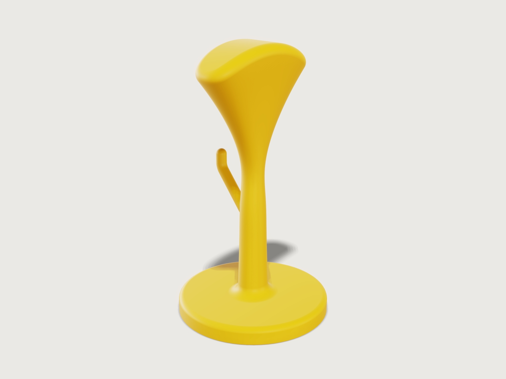

# Headphone stand

A one-piece headphone stand, printed upright in PETG without supports: a slim column that flares like a
calla lily into a wide saddle, curved across the top as a headband is, a cable hook swept out of its back,
and a round base made heavy by a steel disc embedded at a pause in the print. Its checks prove that it
prints: no face that looks down is flatter than 45°, and the plastic under and over the steel is thick
enough. They also prove that it stands: with 400 g of headphones it stands a tilt of 22.2° at the
defaults and more than 17° over the whole range, however full it is printed.



## What it shows

- **A loft through ten sections.** `feature.loft` runs from the column's root, inside the base, through
  its neck and flare to the saddle. Each section is a closed live spline (`sketch.spline` with `live`)
  through eight points written in the variables, on an offset `xy` sketch. The column tapers from
  30 × 27 mm to 22 × 21 mm at the neck. The flare then spreads to the saddle's 120 × 44 mm: it widens as
  the 1.5th power (`flare_power`) of the way up. Its height follows from `flare_angle`, so the flare's
  steepest side stays within 40° of upright at every saddle width. Towards the saddle the sections fill
  out from ellipses to rounded rectangles (`saddle_fullness`).
- **A saddle shaped like a headband.** `feature.extrude` with `cut` takes everything above an arc of
  radius 90 mm (`sketch.arc`) off the loft's top: the saddle's top is a cylinder across its width.
  `feature.fillet` rounds its rim with 8 mm, on an edge between a cylinder and the lofted spline face.
- **A base with a pocket.** `feature.revolve` turns the base's section. A fillet rounds its top edge, a
  chamfer makes the first-layer chamfer, and `feature.boolean` subtracts the pocket for the steel disc
  (`feature.cylinder`). The disc is a second body.
- **A swept hook.** `sketch.path` draws the hook's centre line in four tangent pieces: an arc inside the
  column, a line 50° up, an arc back to upright and a short line. `feature.sweep` carries a 10 mm circle
  along it, and `feature.sphere` with a union puts a ball on its tip.
- **One piece.** Unions, then fillets on edges against the lofted spline face: the column's root into
  the base (10 mm) and the hook's root (3 mm).
- **Material, outputs and checks.** `material.preset` and `body.material` give PETG and steel their
  densities. `variable.measure` gives the masses and the stand's centre of mass, and `variable.output`
  turns them into the angle the loaded stand can be tilted to. `assert.add` checks it with `draft`,
  `thickness`, `distance`, `centerOfMass`, `value`, `volumeBelow` and `count` (below).
- **Two parameters.** `variable.publish` makes the height and the saddle's width the knobs. The 3MF
  holds only the printed part (`file.export` with `bodies`, a 0.1 mm chord and 8° facets).

## The real thing

- **Use.** The headband rests on the saddle and the ear cups hang either side of the column. The saddle's
  top is an arc of radius 90 mm across its width, 44 mm deep (front to back), so a band rests on it all
  along its middle, as on a head, instead of on a peg that dents its cushion. The saddle is 120 mm wide
  at its shoulders, where its top meets the flare (227.1 mm up, 22.9 mm below the crown at 250 mm).
  At most 140 mm wide, it is no wider than the narrowest heads: head breadth is 5.51 in (140 mm) at the
  5th percentile of women and 6.06 in (154 mm) at the median of men in the 2012 US Army anthropometric
  survey (Gordon et al. 2014, as summarised by the
  [NC State Ergonomics Center](https://ergocenter.ncsu.edu/wp-content/uploads/sites/358/2026/02/01-Anthropometry-Summary-Tables.pdf)).
  Below the saddle there is 234 mm from the crown to the base's top for the cups.
- **Height and printers.** The default 250 mm fits printers with 250 to 256 mm of build height (Creality
  Ender-3 V3 250 mm, Bambu Lab X1, P1 and A1 256 mm); a Prusa Core One (270 mm) takes up to 270 mm, and
  a Prusa MK4 (220 mm) none of the range.
- **Cable hook.** A 10 mm rod comes out of the back of the column, rises at 50° for 55 mm and bends
  upright 41.0 mm behind the axis, ending in a ball 143.3 mm up. The ball's inside is 36 mm behind the
  axis, so a coiled cable hangs in a slot about 25 mm wide between the rod and the column. The rod's
  centre line starts on the axis halfway up the column (77.7 mm), so it follows the *Height*.
- **Base and weight.** The base is Ø 140 × 16 mm, its top edge rounded 5 mm. A steel disc Ø 100 × 8 mm
  (493.2 g; 3DCraft's steel at 7850 kg/m³) lies in a pocket Ø 100.6 × 8.2 mm, 0.3 mm clear round its
  edge, with a 2.4 mm floor under it and 5.4 mm of plastic over it. Cut the disc by laser or water jet
  from 8 mm plate, or saw it from ground flat bar, which is held close to its thickness. Hot-rolled plate
  may be well over its nominal thickness (EN 10029 class A allows −0.5/+1.2 mm at 8 mm), so measure the
  disc: the pocket takes 8.2 mm, and `weight_thickness` sets it.
- **Printing.** FDM in PETG, upright as modelled, without supports. 0.2 mm layers, 3 perimeters and 15 %
  infill suit it; variable layer height, or ironing, smooths the shallow crown of the saddle. Every face
  that looks down, but the bed face and the pocket's roof, is at least 45° from the horizontal. The
  flare's steepest side is 38.9° from upright at the saddle's ends, and the hook's rod 40°. The
  0.6 mm × 45° first-layer chamfer round the bottom takes up the elephant's foot. The pocket's top is at
  10.6 mm, so pause the print before the first layer over it (10.8 mm with 0.2 mm layers), drop the disc
  in and resume. That first layer of the roof bridges the whole 100.6 mm pocket, 0.2 mm above the disc,
  which only catches its sag; the layers over it print on it as on any bridge. PrusaSlicer pauses before
  the layer it is put on
  ([Prusa help: Insert pause or custom G-code at layer](https://help.prusa3d.com/en/article/insert-pause-or-custom-g-code-at-layer_120490/)).
  PETG is taken at 1.27 g/cm³, the density in the
  [Prusament PETG data sheet](https://storage.googleapis.com/prusa3d-content-prod-14e8-wordpress-prusament-prod/2023/10/c34f5f47-tds_prusament-petg_n_de.pdf)
  (ISO 1183).
- **Mass.** As a solid model the stand is 479 686 mm³ of PETG, 609.2 g, and with the disc 1102.4 g. A
  print with infill weighs less: not measured by the model.
- **Stability.** The load is 400 g of headphones counted at the top of the saddle. That is heavier than
  most over-ear headphones (the Sennheiser HD 800 S weighs about 330 g without its cable, by its
  [manual](https://www.manualslib.de/manual/972049/Sennheiser-Hd-800-S.html?page=12)), and a pair on the
  stand hangs lower than that. Modelled solid, the loaded stand has its centre of mass 116.2 mm up and
  tips at 30.8°. Counting all its plastic at the top of the saddle as well, the worst any infill can do,
  it still stands 22.2°, and 17.5° at the least stable corner of the range (310 mm, saddle 140 mm). The
  criterion is borrowed from the static stability test of IEC 62368-1 (8.6.2.2): equipment tilted up to
  10° in any direction must not overbalance.
- **Simplified, or left out.**
  - The sections are splines through eight points: close to ellipses and rounded rectangles, not
    exactly them.
  - No felt pads under the base, and no groove in the saddle for the band.
  - The column's root is rounded 10 mm, where 3DCraft refuses 12 mm (*Platform notes*). The hook's
    root is rounded 3 mm, which builds over the whole range of the parameters.

## Parameters

| Parameter | Range | Default |
|---|---|---|
| Height (desk to the top of the saddle) | 230 to 310 mm, steps of 10 | 250 mm |
| Saddle width (at its shoulders) | 100 to 140 mm, steps of 5 | 120 mm |

The flare grows with the saddle (87.6 mm tall at 120 mm wide) and the column takes up the rest of the
height. The hook stays halfway up the column.

## Checks

- **Prints upright without supports.** `measure.draft` against +z on every face of the stand except the
  bed face and the pocket's roof, which bridges over the steel: nothing below −45°. The least is the
  first-layer chamfer at −45.0°. The flare and the saddle's round-over reach −38.9° and the hook −40.0°.
  The least is exact on planes and bounded on the hook's cylinder and torus. On the lofted faces it is
  sampled, and on the base's round-over the bound lies far below what is found (−102.8° for 0°), so the check
  is *not proven* ([F-067](../../3DCRAFT-FEEDBACK.md#f-067), [F-102](../../3DCRAFT-FEEDBACK.md#f-102)).
- **Pocket floor at least 1.2 mm.** `measure.thickness` from the pocket's floor: 2.4 mm, exact between
  parallel faces.
- **Pocket roof at least 1.2 mm.** `measure.distance` from the pocket's roof to the base's top: 5.4 mm
  (proven at least 4.73 mm). The pocket's side wall is 19.7 mm and the rest of the stand is solid. A
  thickness of the whole stand finds the same 2.4 mm but proves nothing (*Platform notes*).
- **Centre of mass over the base.** The centre of mass of stand and disc lies within ±1 mm of the axis,
  side to side and front to back: 0.000 mm and 0.168 mm (the hook). On a part this nearly round about its
  axis these two say little.
- **Stands a 10 degree tilt with headphones, at any infill.** This is the check that proves the stand
  stable. The tilt at which it tips about the edge of its foot (radius 69.4 mm) has to be at least 10°,
  with 400 g at the top of the saddle and its disc, and with all of its plastic counted at the top of the
  saddle too. That is the worst for any infill, since less plastic, or plastic lower down, only lowers the
  centre of mass. The tilt is 22.2°. The output `tipping_angle` gives 30.8° for the model as a solid.
- **Base volume in closed form.** Everything below the base's top must equal the disc π R² h, less the
  rounded edge by Pappus (the spandrel (1 − π/4) r² at (10 − 3π)/(12 − 3π) r from the corner), less
  the chamfer's ring, less the pocket. That is 178 722.1 mm³, exact to 0.01 mm³.
- **Saddle top cut clean across.** No face of the loft's top cap is left in the stand. An earlier version
  of this model cut the saddle's top with a tool too narrow for the widest saddle. At 140 mm it left two
  loose pieces above the saddle's ends, and every other check passed.
- **Weight clears its pocket.** The disc, lying on the pocket's floor, keeps at least the smaller of
  the two clearances from the pocket's wall and roof: 0.2 mm, the gap over it.

`craft3d-cli check-range` passes eight and finds the print check holding (not proven, above) at 13 points (the defaults, the four corners and eight random
points), and at 45 points with 40 random ones. It does not try every combination of the two parameters.

## Files

- `headphone-stand.3dcraft`: the model, the stand and its steel disc.
- `build.json`: the 112 steps that build it.
- `exports/headphone-stand.3mf`: the stand alone, upright, as it is printed (43 880 triangles, within
  0.1 mm of the model and no facet turning more than 8°).

## Rebuild

```sh
tools/examples.py build headphone-stand
# or
craft3d-cli run --new '{"units":"mm"}' --script examples/10-headphone-stand/build.json --out stand.3dcraft
```

## Difficulty

**6 / 10** (the reviewer): a ten-section loft driven by coupled formulas, a cut and fillets on lofted faces, a
four-segment sweep, mass and stability outputs, and three kernel limits worked around.

## Platform notes

- **Tolerance.** The document's tolerance is set to 0.001 mm (`document.setTolerance`), two hundred
  times finer than a 0.2 mm layer. At the default 1e-6 mm the fillets on the lofted faces are fitted to
  that tolerance, and the stand opens in 1.6 to 1.8 s instead of 0.8 to 1.0 s, timed in turns on the
  same busy machine.
- **Sections as live splines.** The sections were first exact ellipses from formulas (`sketch.curve`).
  Fitted to the tolerance, they gave 35 to 86 control points each, and seven of them lofted and cut
  took 2.0 s to open; six eight-point live splines, lofted and cut the same way, take 0.13 s
  ([F-010](../../3DCRAFT-FEEDBACK.md#f-010)).
- **Duplicate face names.** The loft's side is two faces with one name
  (`F17:side(e9,…)` twice), where an extrusion of the same spline names the second `piece(1)/…`. The
  fillets take both edges through the pair, which is what is wanted here, but a query cannot tell the two
  faces apart ([F-064](../../3DCRAFT-FEEDBACK.md#f-064)).
- **Root fillet.** A fillet at the foot of the lofted column is refused from 12 mm up ("the rolling ball
  along this edge could not be followed"), on a column nowhere near that tight. It is refused from 14 mm
  on a round column. The root is rounded 10 mm ([F-065](../../3DCRAFT-FEEDBACK.md#f-065)).
- **Hook tip.** Rounding a rod's end to a full ball with `feature.fillet` is refused at every radius from
  half the rod's radius up. The refusal for a radius between half and the whole says that exactly the
  rod's radius gives a piece of a ball, but that radius is then refused as too large. The tip is a sphere
  joined to the rod instead ([F-066](../../3DCRAFT-FEEDBACK.md#f-066)).
- **Draft proof.** On spline faces `measure.draft` samples, so an assertion over them is not proven
  ([F-067](../../3DCRAFT-FEEDBACK.md#f-067)); on rounds the bound it proves is loose ([F-102](../../3DCRAFT-FEEDBACK.md#f-102)).
- **Wall thickness.** `measure.thickness` of the whole stand finds the 2.4 mm floor, proves `atLeast` 0
  and takes 8.6 s ([F-020](../../3DCRAFT-FEEDBACK.md#f-020)). From the pocket's roof alone it takes
  about 1 s, as its rays run up through the column to the saddle. So the floor's thickness and the
  roof's distance to the base's top are asserted.
- **One piece.** Nothing can assert that a body is in one piece: a cut that left two loose lumps in the
  stand passed every check, and only `document.inspect` (`shells`) showed them. The saddle check above
  guards that one case ([F-068](../../3DCRAFT-FEEDBACK.md#f-068)).
- **3MF size.** 3DCraft writes a 3MF uncompressed: 3.95 MB here; the examples' tool deflates it to
  0.81 MB ([F-080](../../3DCRAFT-FEEDBACK.md#f-080)). With 5° facets it would be 61 298 triangles and
  1.15 MB.
- **Names.** The last feature, the fillet at the hook's root, is named *Stand* for the part
  ([F-042](../../3DCRAFT-FEEDBACK.md#f-042)). The tool of the saddle's cut keeps the automatic name
  `Extrude1` ([F-002](../../3DCRAFT-FEEDBACK.md#f-002)).
- **Preview light.** The preview's key light comes from [225, 65], with the environment turned 45°, so
  the saddle's shadow falls behind the column onto the ground. From [260, 80] it fell on the base's top
  as a stain with stepped edges, from the default direction its shadow draws stair-stepped bands across
  the base's top, and from [200, 80] a jagged line across the column's root fillet
  ([F-043](../../3DCRAFT-FEEDBACK.md#f-043)). Unturned, the bright environment washed out the saddle's
  far rim.
