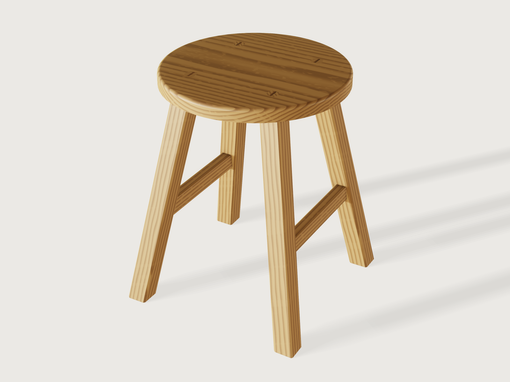

# Splayed-leg stool

A sitting stool in oiled oak: a round seat 340 mm across and 30 mm thick, on four square legs that lean
out 10° to the front and 10° to the side, each tenoned right through the seat and wedged with walnut, and
tied in pairs by two shouldered stretchers. Every leg, mortise and shoulder sits at the compound angle the
splay makes, and the model proves it: the seat, the legs and the stretchers each have their volume worked
out by hand, the stretcher mortises leave enough wood beside them in the leaning legs, and the stool
passes both parts of the stool stability test of IS 5416 (Part 2) at every point of its two parameters'
ranges that was tried.



## What it shows

- **Compound angles from two formulas.** The legs are splayed and raked by the same *Splay angle* φ, so
  each leans along its diagonal *sight line* by the resultant angle θ = atan(√2 tan φ), 14.0° at 10°.
  `datum.plane` through three points places the square end of a leg: its origin on the leg's axis below
  the floor, its two axes the world's x and y turned by θ about the horizontal line square to the sight
  line, every coordinate a formula of φ. `sketch.create` on that datum and `sketch.rect` draw the leg's
  38 mm square and its 19 mm through tenon, and `feature.extrude` runs both along the leaning axis.
- **Joinery by booleans.** The tenon's prism, turned four times by `feature.pattern`, cuts the four
  mortises through the seat (`feature.boolean`, subtract). The leg's prism less the mortised seat
  (`keepTool`) is the leg with its tenon standing in the mortise and its shoulder lying on the seat's
  underside, level, as a chairmaker scribes it. One `intersect` with a block from the floor to the seat's
  top cuts the foot level on the floor and the tenon flush with the seat.
- **Stretchers shouldered on a leaning leg.** A stretcher's stock and its tenon are extruded from the
  side elevation (`sketch.rect` on the yz plane, at the legs' axis). The tenon's prism cuts the mortises
  into the legs, and the stretcher less the mortised legs (`keepTool`) leaves a stretcher whose shoulders
  lie exactly on the legs' leaning faces and whose tenons fill the mortises: no shoulder angle is worked
  out by hand.
- **Wedges across the grain.** The seat is glued up with its grain along x; a wedge must spread its tenon
  along the grain, against end grain, or it splits the seat. `feature.pattern` turns the legs (a quarter
  turn swaps a square leg for its neighbour), but a quarter turn would lay two of the wedges along the
  grain, so the wedge stock is turned half a turn by `feature.pattern` and copied across by
  `feature.mirror`: all four wedges lie across the grain. The wedges are cut from the tenons
  (`intersect`, then `subtract` with `keepTool`), so tenon and wedge share their faces.
- **Legs in two bodies, for their grain.** A body has one grain: a solid wood pattern with one pith and
  one axis. Under one upright ring pattern the four leaning legs would each cross some twenty rings, short
  grain that reads as a leg about to snap. So the legs are split, by `intersect` with two pairs of
  quadrant blocks, into the two diagonal pairs, which lean in the same vertical plane; each pair's pith
  lies 4.2 m off, square to that plane, and its rings run straight along both legs.
- **Eased edges.** `feature.fillet` rounds the seat's top edge (6 mm) and the stretchers' long edges
  (3 mm); `feature.chamfer` bevels the seat's underside (6 mm up the edge, 12 mm under it, two distances),
  the legs' arrises (3 mm) and the rims of the feet (2 mm, eight edges each).
- **Materials.** `material.preset` oak, its wood pattern recoloured for an oiled finish, with little
  spread between its colours and little wobble, and laid along each part's grain (the seat's boards, the
  legs, the stretchers); walnut for the wedges. The preview is drawn at look rotation 180: tried at 0,
  90, 180 and 270, the Workshop light turns the oak orange at 0 (F-054), washes the seat grey at 90 and
  yellow at 270.
- **Outputs a maker uses.** `variable.output` gives the legs' angle along the sight line, a leg's length
  along its axis, the leg blank's length and a stretcher's length over its tenons; `variable.measure` the
  mass, the height of the centre of mass, the span of the feet on the floor and the volumes the checks
  use. The test forces are variables with their unit (`600 N`, `20 N`); `variable.output` works out the
  moment they leave (N m) and the tilt test.
- **Full-size drawings.** `file.export` writes the front and side views at 1:1 as SVG, hidden lines
  dashed: the chairmaker's full-size drawing, from which the bevel gauge is set to the splay and the rake
  and the stretchers' lengths are taken.

## The real thing

- **Sizes.** The seat height follows BS EN 1729-1; the other sizes are this design's own.
  - Seat height 450 mm, between the 430 mm and 460 mm seat heights of size marks 5 and 6 in BS EN 1729-1,
    the sizes for teenagers and adults (as tabulated in
    [Office Boffins' guide to the standard](https://officeboffins.co.uk/info/information/table-chair-height-guide)).
  - Seat Ø 340 × 30 mm, its top edge rounded 6 mm, its underside bevelled 6 × 12 mm so the edge looks
    lighter than the board.
  - Legs 38 mm square with 3 mm chamfered arrises, leaning 14.0° from upright along the diagonal, each
    463.8 mm long on its axis from the floor to the seat's top. Their tenons come up through the seat
    80 mm from its centre lines, 113 mm from its centre on the diagonal.
  - Through tenons 19 mm square, half the leg, leaving a 9.5 mm shoulder all round that covers the mortise
    and carries the seat. Walnut wedges 4 mm thick at the top and 20 mm deep, two thirds of the seat.
  - Stretchers 22 × 32 mm, 267.3 mm long over their tenons, centred 180 mm above the floor (0.4 of the
    seat height, so they follow it). Tenons 12.67 × 22 mm with 5 mm shoulders at top and bottom, 25.33 mm
    deep in the leg on the stretcher's centre line.
  - Two side stretchers brace the legs against racking along the stretchers only; across them the
    wedged seat joints do it alone. The traditional answer to that is an H-stretcher, a third stretcher
    between the two; this design leaves it out for a lighter look.
- **The rule of thirds.** The joiner's rule makes a tenon a third as thick as the piece it is mortised
  into, so the mortise leaves a third of the wood on each side of it
  ([Christopher Schwarz, *Tenons rule*, Popular Woodworking, 2006](https://popularwoodworking.com/techniques/tenons-rule-so-here-are-the-rules-on-tenons)).
  The stretchers are mortised into the legs, so their tenons are a third of the leg: 12.67 mm, a 1/2 in
  (12.7 mm) mortise chisel; the mortises are two thirds of the leg deep. In a leaning leg the rule's third
  is not all left: the mortise's cheeks are plumb, as the stretcher's tenon is, while the leg's sides lean,
  and the 3 mm arris chamfers come close to the mortise's mouth, so the wood beside the mortise is
  7.57 mm at its thinnest at the defaults (8.66 mm at 5°, 7.11 mm at 12°), from the edge of a cheek at the
  mouth to the nearest chamfer, against 12.67 mm at the middle of the face. The legs' tenons are mortised into the face of the
  seat, where the rule does not apply: they are half the leg, which keeps a broad shoulder on the seat.
- **Stock.** Boards of the standard surfaced thicknesses of the NHLA rules (as tabulated in
  [WoodBin's lumber dimensions](https://woodbin.com/ref/lumber-dimensions/)): the seat glued up from 6/4
  boards (1 5/16 in, 33 mm surfaced) and flattened to 30 mm, the legs ripped from 8/4 (1 3/4 in, 44 mm),
  the stretchers from 5/4 (1 1/16 in, 27 mm). White oak; offcuts of walnut for the wedges.
- **Cut list.** The finished sizes are the model's outputs; the leg blank runs along the leg's axis from
  its lowest corner at the foot to the highest corner of its tenon, 6.2 mm below the foot's centre and
  3.4 mm above the tenon's (the level cuts slope across the leg). The rough stock adds this example's
  allowances: 5 mm all round the seat, 26.7 mm of length on a leg and 27.7 mm on a stretcher, and 6 mm of
  width, for sawing and planing.

  | Part | Count | Finished | Blank | Rough stock |
  |---|---|---|---|---|
  | Seat | 1 | Ø 340 × 30 mm | Ø 340 × 30 mm | 350 × 350 mm, 6/4 boards glued up |
  | Leg | 4 | 38 × 38 mm, 463.8 mm on its axis, floor to seat top | 38 × 38 × 473.3 mm | 44 × 44 × 500 mm, 8/4 |
  | Stretcher | 2 | 22 × 32 mm, 267.3 mm over the tenons | 22 × 32 × 267.3 mm | 27 × 38 × 295 mm, 5/4 |
  | Wedge | 4 | 4 mm at the top, 20 mm deep along the leg, 19 mm wide | | walnut offcuts |
- **Stability.** IS 5416 (Part 2):1988, the Indian Standard after BS 4875 Part 2, tests a stool by standing
  two of its feet against stops, pressing down 600 N with a pad 50 mm in from the edge of the seat nearest
  those feet and pushing 20 N through the centre of the seat towards them, and then tilting it rearwards
  about those two feet until the far edge of the seat has moved 100 mm; it must not overturn (clause 7.5;
  [text](https://archive.org/details/gov.in.is.5416.2.1988)). The model checks both parts:
  - *Under the loads*: the push taken at the seat's top, the stool's own weight at its centre, the
    tipping line through the outer edges of the two feet on one side (the line the edge of the round seat
    comes nearest). The moment left against tipping is 32.21 N m at the defaults, and least, 4.17 N m, at
    the lowest and least splayed stool (400 mm, 5°).
  - *Tilted*: read as a tilt without the loads, since with them the pad's 600 N passes outside the feet
    after 7.2° of tilt, before the 11.87° the 100 mm needs at the defaults. Tilted so, the centre of mass
    (319.0 mm up) still lies 107.45 mm inside the tipping line, and the stool falls back; 61.86 mm at
    400 mm and 5°. Read instead as a tilt about the far feet with the loads on, it passes trivially:
    the 600 N and the 20 N both act towards the stopped feet and press the stool back down.

  The feet span 353.7 mm on the floor, wider than the seat as a splayed stool's should be; at the largest
  stool (650 mm, 12°) 471.8 mm, which is why the splay stops at 12°: more puts the feet out where they
  trip people.
- **Making it.**
  1. Glue up the seat with its grain running one way, flatten it to 30 mm, saw and spokeshave it round,
     round over the top edge and bevel the underside.
  2. Lay out the four mortises 80 mm from the centre lines, draw the sight lines along the diagonals and
     bore and chop the mortises at 14.0° from upright along them (or set a bevel gauge to the 10° splay and
     rake on the front and side drawings).
  3. Plane the legs 38 mm square and chamfer the arrises. Cut the through tenons with their shoulders
     angled so they sit flat on the seat (scribe them from the seat in a dry fit), and saw a kerf in each
     tenon across the seat's grain.
  4. Chop the stretcher mortises in the legs with a 1/2 in chisel, and scribe the stretchers' shoulders to
     the legs' lean.
  5. Glue each pair of legs to its stretcher, drive the tenons through the seat, wedge them with walnut,
     then saw and plane the tenons and wedges flush.
  6. Stand the stool on a flat surface, mark the feet level at the seat height, saw them and chamfer their
     rims. Oil.
- **Mass.** 4.09 kg, with the densities of the oak and walnut presets (750 and 640 kg/m³; white oak
  dried to 12 % averages 755 kg/m³, [The Wood Database](https://www.wood-database.com/white-oak/)).
- **Simplified, or left out.**
  - The mortises are straight: a maker often flares the top of a wedged through mortise so the wedge
    spreads the tenon into a dovetail. Here the wedge fills a V in a straight tenon.
  - Parts fit exactly: no glue lines, no draw-bore, no allowance for seasonal movement of the seat.
  - The wood pattern is procedural and a body has one grain frame
    ([F-083](../../3DCRAFT-FEEDBACK.md#f-083)): the legs are split into two bodies so their rings run
    along them, but both legs of a pair share one pith, and the tenons' ends show long-grain stripes,
    not end grain, so the through tenons read less than they would in oak.
  - The cut list above is the model's outputs, not `cut.list`, which lists only plates and sheet metal.
  - No H-stretcher (above).

## Parameters

| Parameter | Range | Default | What it does |
|---|---|---|---|
| Seat height | 400 to 650 mm, step 10 mm | 450 mm | the seat's top above the floor; the legs lengthen along their lean, the feet spread and the stretchers rise with it (0.4 of the height) |
| Splay angle | 5° to 12°, step 0.5° | 10° | how far each leg leans, seen from the front and from the side; the tenons stay where they come through the seat, the feet move out |

## Checks

- **Seat height.** The stool reaches from the floor to the seat height: 450 mm, to 0.001 mm.
- **Seat with four through mortises at the compound angle.** The seat's volume must be the cylinder
  π R² T, less the round-over (Pappus, with the centroid of a fillet's cross-section (10 − 3π)/(12 − 3π)
  of its radius in from the corner), less the 6 × 12 mm bevel (Pappus on its triangle), less four
  mortises a² T / cos θ (a square prism of side a cut by two level planes T apart along an axis leaning
  θ): 2 633 378.91 mm³, exact to 0.01 mm³. A wrong lean, a mortise not through, or one of a wrong size
  fails it.
- **Legs, through tenons and wedges in closed form.** Above 10 mm from the floor (clear of the feet's
  chamfers), the legs and wedges together must be four leg sections (38² − 2·3² mm²) and four tenon
  sections (19² mm²) between level planes, divided by cos θ, less the four stretcher mortises
  (12.67 × 22 × 25.33 mm, prisms whose ends are a leaning plane, the leg's face, and a plumb one, the
  plane where the stretcher's tenon ends, so their volume is their section times their depth on the
  centre line): 2 426 662.97 mm³, exact to 0.01 mm³.
- **Stretchers shouldered on the splayed legs.** Each stretcher's section (22 × 32 mm less its four
  rounds) between the two leaning leg faces, which lie 38 / (1 + cos θ) mm from the legs' axes along the
  stretcher, plus its two tenons: 329 924.87 mm³ for the pair, exact to 0.01 mm³.
- **Wood beside the stretcher mortises.** The least distance from the mortises' plumb cheeks to the
  leg's leaning sides and arris chamfers is at least 7 mm: 7.57 mm at the defaults, 8.66 mm at 5° and
  7.11 mm at 12°, at the mortise's mouth beside a chamfer (the rule of thirds' 12.67 mm, less what the
  lean and the chamfers take).
- **Four wedged through tenons.** Four wedge ends lie in the seat's top.
- **Shoulders clear of the seat bevel.** The legs come no nearer than 5 mm to the bevel under the seat's
  edge, so every shoulder bears on flat seat: 11.51 mm at the defaults.
- **Stable under the loads of the IS 5416-2 stool test.** 600 N × (d − (R − 50 mm)) + m g d − 20 N × H ≥ 0,
  with d the tipping line (half the feet's span, measured 0.001 mm above the floor), R the seat's radius,
  m the stool's mass and H the seat height: 32.21 N m.
- **Falls back when tilted as the IS 5416-2 stool test asks.** The tilt α about the tipping line that
  moves the seat's far edge 100 mm solves (R + d)(1 − cos α) + H sin α = 100 mm; then d cos α − z sin α,
  with z the measured height of the centre of mass, must be positive: 107.45 mm at the defaults
  (α = 11.87°).

`craft3d-cli check-range` proves all nine at 13 points: the defaults, the four corners of the two ranges
and eight random points; a run of 65 points, 60 of them random, passed as well. It does not try every
step of both ranges.

## Files

- `splayed-stool.3dcraft`: the model.
- `build.json`: the 119 steps that build it.
- `exports/splayed-stool-front.svg`, `exports/splayed-stool-side.svg`: the front and side views at 1:1,
  hidden lines dashed, to print as the full-size drawing.

## Rebuild

```sh
tools/examples.py build splayed-stool
# or
craft3d-cli run --new '{"units":"mm"}' --script examples/11-splayed-stool/build.json --out stool.3dcraft
```

The tool needs the 3DCraft build this repository is pinned to: see [Rebuild and check](../../README.md#rebuild-and-check)
in the README.

## Difficulty

**6 / 10** (the reviewer): datum planes at compound angles from formulas, booleans between several bodies
with kept tools for shoulders and wedges, the grain set per diagonal pair, closed forms across bodies, and a
two-part stability test from a standard.

## Platform notes

- **Cut list.** `cut.list` lists plates and sheet-metal parts only, so every part here is "not a plate":
  the seat for its round-over, a leg for its slanted ends and arrises, and the legs and the stretchers
  also because they lie two to a body (a pattern makes one body of its copies). The cut list above is
  made of outputs instead ([F-077](../../3DCRAFT-FEEDBACK.md#f-077)).
- **Rounded arrises, chamfered feet.** The legs were first drawn with rounded arrises. A chamfer round the
  rim of their level-cut feet is refused there (a chain of a flat edge into the slanted ellipse where the
  cut meets a round; [F-075](../../3DCRAFT-FEEDBACK.md#f-075)); a rounded rim works, but then every
  `volumeBelow` and `sectionExtent` of the legs takes about a second
  ([F-076](../../3DCRAFT-FEEDBACK.md#f-076)), which put the stool over its load budget. The arrises are
  chamfered instead, as many oak stools have them.
- **The tipping line.** `boxMax` and `extent` measure bodies, not faces, so the outer edges of the feet's
  contact faces are measured as the span of the legs' section 0.001 mm above the floor
  ([F-078](../../3DCRAFT-FEEDBACK.md#f-078)).
- **Grain.** A body has one grain frame, so pattern copies cannot each have their own
  ([F-083](../../3DCRAFT-FEEDBACK.md#f-083)): the legs are split into two bodies, one per diagonal pair,
  with two extra quadrant blocks and two `intersect`s.
- **Units.** Gravity is written `9.80665 N / (1 kg)`, since `9.81 m/s^2` is refused
  ([F-079](../../3DCRAFT-FEEDBACK.md#f-079)).

## Licence

[MIT](../../LICENSE), like everything in this repository; credit line in the
[README](../../README.md#licence).
