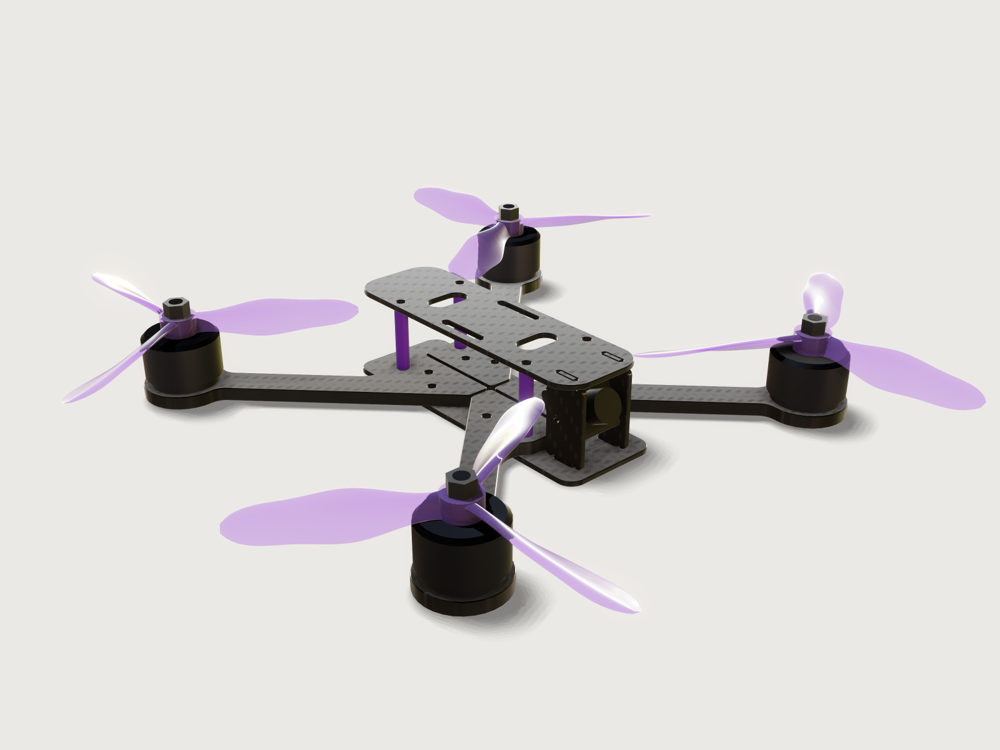

# 5-inch FPV drone frame

A true-X freestyle quadcopter frame for 5-inch props, the kind that is cut by the thousand on CNC routers
from carbon fibre sheet: four 5 mm arms between a 2 mm bottom plate and a 2 mm top plate on purple anodised
aluminium standoffs, a 30.5 mm flight-controller stack, motor mounts for both common bolt circles and a cage
for a 19 mm camera. It carries real props, 5.1 × 4.3 × 3 tri-blades lofted through airfoil sections at their
true pitch, and stand-ins for the motors and the camera, so that it can prove what a frame designer checks
before cutting: the props clear every part by at least 3 mm, and the router bit reaches every inside corner
of every part, and the props' blade roots hold the load of a full-speed spin. The arms grow with the prop
size, from 5 to 5.3 inch.



## What it shows

- **Plates and arms from sketches.** Every carbon part is one `sketch.path` of lines and tangent arcs plus
  its holes (`sketch.circle`, stadium slots as paths), extruded (`feature.extrude`); every point is a formula
  of the variables. The arm is drawn on a `datum.plane` turned 45° about the vertical (through three
  points), so it is laid out along its own axis and its root follows the frame's centre lines.
- **`sketch.pattern`.** The 30.5 mm stack holes and the standoff holes are 2 × 2 grids, the four motor slots
  a ring round the motor pad, the camera-plate slots, strap slots and windows pairs.
- **Edge breaks.** `feature.chamfer` with `chain` breaks every edge of every carbon part by 0.3 mm, outline
  and holes, top and bottom; the standoffs' ends are chamfered too.
- **Several bodies from one.** `feature.mirror` makes the other three arms from the front-left one, the
  right camera plate from the left one, and the props of the opposite hand; `feature.pattern` puts the four
  motors, the props' nuts and their swept cylinders round the centre and three blades round each hub.
- **Real props.** One blade is lofted (`feature.loft`) through six sections. Each lies on a `datum.plane`
  through three points: at its radius, square to the blade and turned to its pitch angle, atan(P / 2πr)
  capped at the root. On it the airfoil is a closed live `sketch.spline` through eight points in the plane's
  own axes, held by formulas from two tables (`table.set`): `blade_sections` gives each section's radius,
  chord and thickness, `blade_airfoil` the airfoil's points. The blade is patterned three times and joined
  (`feature.boolean`) to a hub with the motor shaft's bore, and an M5 nut (`sketch.polyline` hexagon, extruded) sits on top.
- **Prop clearance.** The cylinders the props sweep are bodies of their own, hidden (`feature.visible`);
  `measure.clearance` measures them against every part, and cuts prove the blades stay inside them.
- **A router check.** `feature.offsetProfile` grows each part's outline by the router bit's radius, the path
  of the bit's centre; Steiner's formula then proves that the bit reaches every corner (*Checks*).
- **Exports.** Each carbon part's outline goes to DXF from its sketch (`file.export` with `sketch`), at true
  size, for the CAM program.
- **Materials and outputs.** `material.preset` gives the carbon parts carbon fibre, its weave laid flat in
  each plate (`pattern.axis`), and the standoffs aluminium in purple; the props are polycarbonate
  (`body.material`); the motor and camera stand-ins get `body.appearance` only, so they carry no mass.
  `variable.output` gives the wheelbase and the blade root's stress, `variable.measure` the masses of the
  frame and the props.

## The real thing

- **Class and layout.** The sizes are those of the common 5-inch freestyle frame. The HGLRC MY5, for one,
  lists a 225 mm wheelbase, 5 mm arms, 2 mm top and bottom plates, a 30.5 × 30.5 mm M3 flight controller,
  16 × 16 mm M3 motors, a 19–20 mm camera, M3 × 28 mm aluminium standoffs and 140 ± 5 g with its hardware
  ([fpv24.com](https://www.fpv24.com/en/hglrc/hglrc-my5-5-inch-training-freestyle-fpv-frame-kit)). This
  frame is an original design in that class: true X, the four motors on the diagonals, four separate arms
  whose roots meet along the centre lines 1 mm apart.
- **Wheelbase.** The arms grow with the prop size so that neighbouring prop tips stay 30 mm apart:
  wheelbase = √2 (D + 30 mm), 225.62 mm for 5.1-inch props (D = 129.54 mm), 222.03 mm for 5 inch,
  232.81 mm for 5.3 inch.
- **Flight-controller stack.** 30.5 × 30.5 mm with M3 holes, the pattern of 5-inch quads, which flight
  controllers made for smaller frames reach with an adapter (the Matek
  [F722-mini](https://www.mateksys.com/?p=5370): "30.5 x 30.5mm/Φ3mm with Conversion Plate"). The stack
  bolts pass through the bottom plate and the arms' roots.
- **Motor mounts.** FPV motors are bolted on a bolt circle: Rotorama's motor guide gives Φ 16 mm M3 as the
  standard for 5–6-inch quads (2207, 2306 and 2506 motors) and Φ 19 mm M3 for larger long-range motors
  ([Rotorama](https://www.rotorama.com/t-motory)); shops sell them as "16 × 16" and "19 × 19". Each pad has four M3
  slots from the 16 mm to the 19 mm circle, at 45° to the arm, and a 7 mm centre hole for the shaft's end
  (a design value). The pad is Ø 30 mm.
- **Camera.** A micro FPV camera is 19 × 19 mm (the Caddx Ratel 2, for one:
  [Rotorama](https://www.rotorama.com/product/caddx-ratel-2)). It hangs between two 2 mm carbon plates
  19 mm apart on M2 screws through its sides, tilted up 25° here; the plates' tabs sit in 2.2 mm slots in
  both plates: 0.2 mm clearance, enough for carbon sheet's usual ±0.1 mm (measure the sheet and widen them
  if it is thicker).
- **Holes.** Close-fit clearance holes, 3.2 mm for M3 and 2.2 mm for M2, and a 2.5 mm tap drill for the
  standoffs' M3 thread ([Optimas](https://optimas.com/technical-resources/tapping-sizes/) table; the close
  fit is the fine series of ISO 273).
- **Standoffs and arm bolts.** Aluminium standoffs, Ø 5 mm × 25 mm, M3 inside, anodised purple; each
  stands on an arm's root. Every arm is held by three M3 bolts through the bottom plate: the stack bolt, the
  standoff bolt and a third at the root's front corner (x ±25 mm, y ±9 mm), which spreads the clamp into a
  triangle against the arm's 113 mm lever. It sits 8.5 mm from the root's inner edge, 2.7 times its hole's
  diameter, so that it does not shear out of the laminate.
- **Carbon.** 3K carbon fibre sheet (CFRP) at the preset's 1.6 g/cm³: the arms from 5 mm sheet, the plates
  from 2 mm. Mass of the frame (carbon parts and standoffs, without screws, battery pad and antenna mount):
  104.72 g, of which the four arms 17.82 g each, the bottom plate 14.51 g, the top plate 11.66 g, the camera
  plates 1.65 g each and the standoffs 3.96 g together. With 4 mm arms 90.31 g, with 6 mm arms 119.13 g.
- **Making it.** CNC routed with a Ø 2 mm carbide bit made for carbon, under dust extraction (carbon dust
  is a health hazard); the DXF files are the parts at true size and the CAM program offsets the path by the
  bit's radius. Every inside corner is round: the arm's root and pad fillets R10 and R6, the slot ends
  R1.1 to R4, relief notches R1.2 at the roots of the camera plates' tabs, so that the plates sit down on
  the sharp edge of the slots. The edges are broken 0.3 mm after cutting (sanded or chamfer-milled) so that
  the laminate does not fray. Cut list: 4 arms from 5 mm sheet (two are the others turned over), 1 bottom
  plate, 1 top plate and 2 camera plates from 2 mm sheet.
- **Props.** Tri-blade 5.1 × 4.3 × 3 ("5143") props in polycarbonate, sized after the HQProp BMS
  5.1x4.3x3: 5.1 in diameter, 4.3 in pitch, three blades, a 13 mm hub 6.8 mm high on a 5 mm shaft,
  4.3 g ([Rotorama](https://www.rotorama.com/vrtule/hqprop-bms-racing-5-1x4-3x3)). The diameter is the
  *Prop size* parameter; the pitch stays 4.3 in. Makers publish no planform, so the blade is our own: six
  sections, the first inside the hub, the second at the rim of the motor's bell, the others at 0.45, 0.75,
  0.95 and 1.0 of the radius:

  | Radius | 5 mm | 14 mm | 29.15 mm | 48.58 mm | 61.53 mm | 64.77 mm |
  |---|---|---|---|---|---|---|
  | Chord | 8.50 | 9.00 | 15.87 | 14.57 | 9.72 | 3.24 |
  | Thickness | 3.00 | 2.50 | 2.06 | 1.38 | 0.97 | 0.49 |
  | Pitch angle | 38° | 38° | 30.81° | 19.69° | 15.78° | 15.02° |

  The root is 8.5 to 9 mm wide and 2.5 to 3 mm thick, as on real props, and its pitch is washed out to
  38° (the helix would ask 73.95° and 51.15° there): a 9 × 3 mm root takes 6.57 of the hub's 6.8 mm height at
  38°; at 40° it would take 6.75 mm, too little room to keep it clear of the motor's bell. Outboard the angle is the helix's, atan(P / 2πr). The section is a
  flat-bottomed airfoil with a round nose and a thin trailing edge, its thickness ratio 0.35 and 0.28 at the
  root, 0.13 at 0.45 R, 0.095 at 0.75 R and 0.10 at 0.95 R (0.15 on the last, 3 mm wide section that closes
  the rounded tip). In polycarbonate at 1.2 g/cm³ (Makrolon 2405: 1.20 g/cm³, yield 65.0 MPa,
  [datasheet](https://quickparts.com/wp-content/uploads/2024/05/Makrolon-2405PC.pdf)) each prop, hub and
  blades in one piece, weighs 4.13 g (16.51 g for the four), 4 % less than the real 4.3 g. The props turn "props out": the front-left and rear-right
  counter-clockwise seen from above, the front-right and rear-left clockwise, each blade's leading edge
  facing its rotation and raised, so that all four push air down. Each is held by an M5 nyloc nut, DIN 985:
  8 mm across flats, 5.0 mm thick
  ([Würth](https://shop.wurth.ca/fasteners/nuts/nylon-insert-lock-nuts/metric-hexagon-nylon-lock-nuts/NYLON-LOCK-NUT-DIN985-A2-SS-M5-0.8-MC/391.5/)),
  on the motor's Ø 5 mm shaft.
- **Stand-ins, not part of the frame.** Generic 2306 motors (Ø 28 mm bell, 19 mm to the prop seat, a Ø 5 mm
  shaft 12 mm above it; a real
  one, the FlyFishRC Flash 2306, is 29.4 × 31.8 mm with its shaft:
  [megadron.pl](https://megadron.pl/en/products/fpv-flash-motor-2306-1750kv-6s-gray-purple-31201.html)), and a
  19 × 19 × 13 mm camera with a Ø 12 × 7 mm lens, and the props' nuts. They have no material and no mass.
  The blade roots sit 0.22 mm above the motors' bells; both turn together, so this is a fit rather than a
  running clearance, measured once and not asserted.
- **Left out.** The flight controller and ESC stack, video transmitter, receiver, antenna mount, battery,
  battery pad and all screws and their nuts; a middle (press) plate over the arm roots, which some frames
  add (the third bolt per arm takes its place here); a slot to lock the camera's angle (the M2 screws clamp
  it); a channel for the motor wires; the fillets that join a real prop's blades to its hub (see *Platform
  notes*).

## Parameters

| Parameter | Range | Default |
|---|---|---|
| Prop size | 5 to 5.3 in, in steps of 0.1 in | 5.1 in |
| Arm thickness | 4, 5 or 6 mm (carbon sheet) | 5 mm |

Below 5 inch, with the tips 30 mm apart, the props come within 3 mm of the top plate's corners (2.53 mm at
4.8 in). Above 5.3 inch the outer blade grows while the root stays sized to the hub, and the root's stress
at the motor's no-load speed comes near the polycarbonate's yield (64.2 MPa at 5.5 in): a bigger prop needs
a bigger root and a slower motor. So the range is the 5-inch class, 5 to 5.3 inch.

## Checks

- **The router bit reaches every corner** (one check for each of the four carbon parts). A part's outline
  grown by the bit's radius r is the area the bit's centre must not enter. When the bit reaches every point
  of the outline, that is when every inside corner has a radius of at least r and every slot or gap is at
  least 2r wide, its area is given by Steiner's formula, A + r L + π r² (1 − h), with A the outline's area,
  L its perimeter and h the number of holes. Where the bit cannot reach, the grown outline overlaps itself
  and its area is smaller: a sharp 90° inside corner leaves r² (1 − π/4), 0.215 mm² with the 1 mm radius of
  a Ø 2 mm bit. The model grows each outline with `feature.offsetProfile`, extrudes it as a hidden body
  as thick as the part, and asserts its volume equal to the part's thickness times Steiner's area, to
  0.001 mm³. A is measured as the part's section at mid-thickness, L as the area of its cut walls (the flat
  and cylindrical faces square to the plate) divided by their height, the thickness less the two edge
  breaks:

  | Part | A | L | holes | grown outline × thickness |
  |---|---|---|---|---|
  | Bottom plate | 4554.18 mm² | 655.423 / 1.4 = 468.16 mm | 14 | 9963.01 mm³ |
  | Arm | 2234.98 mm² | 1776.01 / 4.4 = 403.64 mm | 8 | 13083.14 mm³ |
  | Top plate | 3668.92 mm² | 758.775 / 1.4 = 541.98 mm | 10 | 8365.25 mm³ |
  | Camera plate | 521.72 mm² | 155.341 / 1.4 = 110.96 mm | 1 | 1265.35 mm³ |

  Each perimeter is also the length `file.export` reports for the part's DXF. The check caught a slip while
  the model was built: the camera plate's edge break had stopped at the tabs' sharp corners, which left
  part of its walls 2 mm high and its perimeter 30 mm too long.
- **Props clear the frame and camera by 3 mm.** The least clearance between the cylinders the four props
  sweep (the prop's diameter, 14 mm high about the hub's mid-height) and every carbon part, the standoffs,
  the camera and its lens is 3.72 mm, at the corners of the top plate; the camera plates are 6.98 mm away.
  At 5-inch props it is 3.31 mm, at 5.3-inch 4.54 mm.
- **Props sweep the designated diameter.** A cut through the front-left prop along its blade's axis reaches
  from the blade's root section, 5 mm from the shaft, to the tip at the radius: 64.77 − 5 = 59.77 mm. (The corners
  of the 3 mm-wide tip lie about 0.02 mm beyond the radius.)
- **Blades stay inside their swept cylinders.** Horizontal cuts at the cylinders' top and bottom find no
  blade of the front-left prop (area 0; the others are its mirror images); since every blade starts
  inside the hub, none can reach above or below them.
- **Blade angle at 75 % of the radius.** A hidden copy of the blade is turned back about its axis by the
  designation's angle there, atan(P / (2π · 0.75 R)) = 19.69°, so the chord of its section at 48.58 mm should
  lie level. A measure's direction cannot follow a formula, which is why the blade is turned rather than the
  direction. The section's height is then 1.424 mm against the airfoil's 1.384 mm (the spline's crest rises
  2.8 % above its points), and at most 3.5 % more (1.433 mm) is allowed. Turned 0.25° either way it measures
  1.430 mm, still inside; 0.5° one way or the other gives 1.437 and 1.467 mm, both failing: the check holds
  the blade's angle there to within half a degree, with 0.009 mm to spare.
- **Blade root holds the centrifugal load at the motor's no-load speed.** The stand-in motor's class, a
  2306 of 1750 KV (as the FlyFishRC Flash 2306 1750KV above) on a full 6S battery (25.2 V), turns at most 1750 × 25.2 = 44 100 rpm unloaded, a bound
  no loaded prop reaches. There a blade of 1.094 g, its centre of mass 31.83 mm from the axis, pulls on its
  root, cut where it leaves the hub (15.47 mm² at 6.5 mm), with 48.0 MPa, below polycarbonate's 65 MPa
  yield; 55.7 MPa at 5.3 inch. The bending from the thrust adds to it and is not computed.
- **Wheelbase from the prop size.** The motor centre holes of the front-left and rear-right arms are
  √2 (D + 30 mm) − 7 mm = 218.62 mm apart (wall to wall): the wheelbase is 225.62 mm.
- **Flight-controller holes on 30.5 mm centres.** The walls of two neighbouring stack holes in the bottom
  plate are 30.5 − 3.2 = 27.3 mm apart.
- **Motor slots reach the 16 mm and 19 mm bolt circles.** The inner ends of opposite slots are
  16 − 3.2 = 12.8 mm apart, so their inner arcs are centred on the 16 mm circle; the nearest points of
  their outer arcs are 19 mm apart, so those arcs are centred on the 19 mm circle (the outer walls reach
  19 + 3.2 = 22.2 mm).
- **Deepest cut within four bit diameters.** The arms, the thickest parts, may be at most 4 × 2 mm = 8 mm
  thick for a Ø 2 mm bit; they are 5 mm at the default and 6 mm at most.
- **Camera held by both plates.** The camera touches the left and the right camera plate (distance 0).
- **No parts overlap.** None of the 12 bodies of the frame, the camera, its lens and the motors has volume
  in common with another; they touch where they sit on each other. The props and their nuts are left out:
  the swept cylinders keep them clear of the frame, and their hubs and nuts sit on the motors' bells and
  shafts.

`craft3d-cli check-range` passes all 18 checks at 13 points: the defaults, the four corners of the range
and eight random points. The model opens in 2.29 s with 7.43 s of CPU time (the better of two runs, on a
machine busy with other work), within the complex tier's 4 s and 12 s; it has 240 steps.

## Files

- `fpv-drone-frame.3dcraft`: the model.
- `build.json`: the 240 steps that build it.
- `exports/fpv-drone-frame-arm.dxf` (cut 4 from 5 mm sheet), `exports/fpv-drone-frame-bottom-plate.dxf`,
  `exports/fpv-drone-frame-top-plate.dxf` (1 each from 2 mm sheet) and
  `exports/fpv-drone-frame-camera-plate.dxf` (cut 2 from 2 mm sheet): the outlines at true size, in each
  sketch's own axes, for the router.

## Rebuild

```sh
tools/examples.py build fpv-drone-frame
# or
craft3d-cli run --new '{"units":"mm"}' --script examples/12-fpv-drone-frame/build.json --out frame.3dcraft
```

## Difficulty

**7 / 10** (the reviewer): lofted freeform props through table-driven sections on formula datum planes,
with washout; Steiner router proofs over four parts; a 45° datum layout; clearances between many bodies and a
centrifugal-stress check; kernel limits navigated.

## Platform notes

- **Cut list.** `cut.list` and `cut.export` refuse a plate whose edges are broken: a 0.3 mm chamfer round
  a hole makes it "a countersink or a chamfered hole, not square to the plate". So the DXF files come from
  the sketches, one file per part, without the cut list's counts and sheet layout. Proposed finding, with a
  reproducer: [F-086](../../3DCRAFT-FEEDBACK.md#f-086).
- **Router reach.** 3DCraft has no measure of whether a round tool can cut a profile (its smallest inside
  radius and narrowest gap), and an offset cannot be offset again (which would give the uncut material
  directly). The Steiner check is the workaround; it costs five steps per part, 20 in all. Proposed
  finding: [F-087](../../3DCRAFT-FEEDBACK.md#f-087).
- **Edge breaks.** A chamfer's `chain` follows an outline only as far as it runs smoothly, so every edge
  break needs one pair of faces for each smooth run of each loop, on each face: 22 pairs for the top plate
  (11 loops), 18 for a camera plate, whose outline breaks into eight runs at the sharp corners of its
  tabs. Proposed finding:
  [F-088](../../3DCRAFT-FEEDBACK.md#f-088).
- **Joined props.** Joining each prop's blades to its hub with `feature.boolean` costs 0.4 s of
  regeneration and 0.5 s more to measure the trimmed freeform faces, about a third of the load time; it
  fits the complex tier's budget. The join has no fillet, which a real prop has: fillets at blade roots are
  limited ([F-008](../../3DCRAFT-FEEDBACK.md#f-008), [F-065](../../3DCRAFT-FEEDBACK.md#f-065)).
  Reproducer for the cost: [F-093](../../3DCRAFT-FEEDBACK.md#f-093).
- **Measures on lofted bodies.** The bounding box of one lofted prop takes 5.3 s and a distance to it 0.4
  to 13 s, while a planar cut of it takes 0.03 s. So the props are checked by cuts (`sectionExtent`,
  `sectionArea`), and the blade roots' gap above the motors (0.22 mm) is measured once and not asserted
  (0.7 s). Same reproducer.
- **A measure's direction is numbers only.** `sectionExtent`'s `axis` refuses expressions ("axis must be x, y,
  z, -x, -y, -z or [x, y, z]"), so a direction cannot follow a parameter; the blade-angle check turns a
  copy of the blade instead. Proposed finding:
  [F-094](../../3DCRAFT-FEEDBACK.md#f-094).
- **Steps.** 240: the frame itself takes 130, the router check 20, the props with their sections, tables,
  swept cylinders, nuts and checks 67, and the motor and camera stand-ins 23.
- **No electrical units.** 3DCraft has no volt, rpm or minute units, so the motor's 1750 KV is written
  `1750 / (60 s)` (revolutions per second per volt) and the battery's 25.2 V as a plain number; the stress
  formula checks its time dimension but not the volts.
- **No sketch fillet.** The tangent points of the arm's eight arcs are worked out by hand as formulas
  (seven helper variables) ([F-023](../../3DCRAFT-FEEDBACK.md#f-023)).
- **Preview.** Drawn at `rotation` 90, where the carbon reads as a grey weave rather than brown
  ([F-054](../../3DCRAFT-FEEDBACK.md#f-054)), with the key light high (`light` [200, 70]) because the default
  one draws stepped shadow bands on the ground ([F-043](../../3DCRAFT-FEEDBACK.md#f-043)), and with
  `reflections: false` because the screen-space reflections smear jagged patches onto the camera plates
  ([F-013](../../3DCRAFT-FEEDBACK.md#f-013)).

## Licence

[MIT](../../LICENSE), like everything in this repository; credit line in the
[README](../../README.md#licence).
