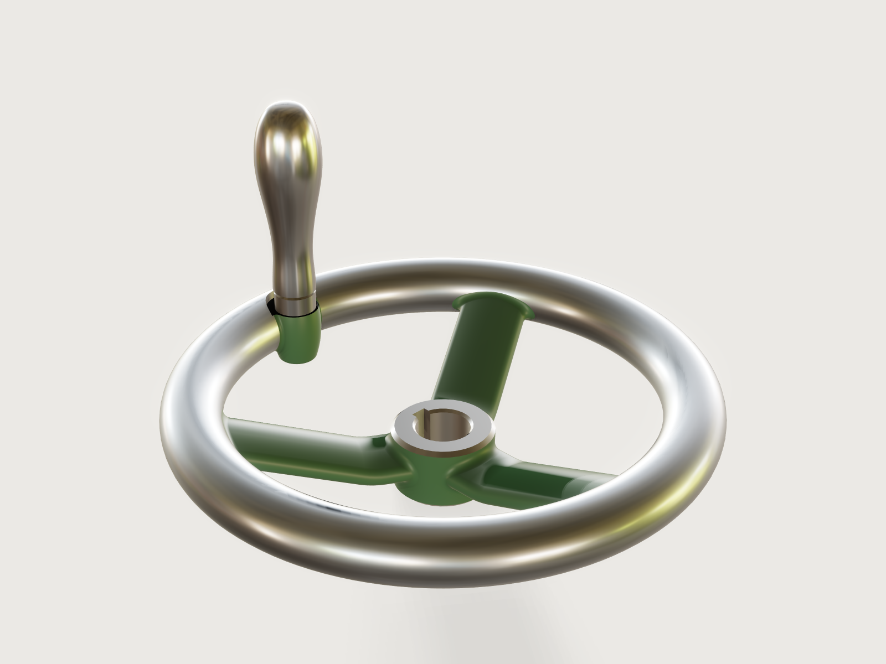

# Cast handwheel

The handwheel on a lathe's cross-slide or a valve spindle: a DIN 950 spoked handwheel in grey cast iron,
80 to 500 mm, with cranked oval spokes, a rim turned and polished, a bore with a DIN 6885-1
keyway and a DIN 98 revolving handle on a cast boss at the standard's radius, painted machine green.
Every size of the standard's series is one choice: the table rows drive the rim, the hub, the spoke count,
the boss and the handle, and the model checks itself against the standard, a closed form of its hub and
the weights the makers publish.



## What it shows

- **Tables of a standard drive the model.** `table.set` holds DIN 950's dimensions for the ten sizes
  (with the DIN 98 handle each size takes) and the DIN 6885-1 keyway for each bore. `variable.publish`
  with `choicesFrom` turns them into the *Diameter* and *Bore* choices; the bore's `min` and `max` are
  rows read from the size's row, so each diameter offers only its own bores.
- **Revolved hub, rim and boss.** `feature.revolve` turns the hub's half section (a 2° cone, both end
  faces chamfered, the bore chamfered at both ends), the rim's round section and the handle boss, a cast
  lug shaped as a barrel about its own axis.
- **The boss before the spokes.** The lug is joined to the rim; one more `feature.revolve` with `cut`
  spot-faces its seat across lug and rim and drills it through; one `feature.fillet` with `chain` then
  rounds the lug into the rim (running out on the spot face) and at its foot. All of this happens before
  the spokes join, where cuts and fillets are cheap.
- **Spokes by sweep and pattern.** `sketch.path` draws the oval spoke section as six tangent arcs and the
  spoke's centre line as a line, a bend and a line; `feature.sweep` carries the section along it, and
  `feature.pattern` repeats the spoke three or five times, the count read from the table.
- **Root fillets round every spoke.** One `feature.fillet` with `chain` rounds the six junctions of three
  spokes with the hub and the rim, each from one edge of the closed loop of edges between the spoke's six
  swept faces and the hub's cone or the rim's torus.
- **A conditional feature.** The fourth and fifth spokes of the big wheels get their root fillets in a
  second fillet with `when: spoke_count == 5`; for the three-spoke sizes it is inactive and passes the
  body on.
- **Machining.** `feature.thread` marks the boss's hole as an ISO metric thread (cosmetic);
  `feature.extrude` with `cut` broaches the keyway.
- **The handle.** One `feature.revolve` of a half section whose grip is a `sketch.spline` from control
  points: stud, collar and revolving grip of DIN 98.
- **Painted and machined faces.** `body.appearance` paints the hub, the spokes and the boss and polishes
  the rim; `face.appearance` makes the machined faces of the casting bright (hub faces and chamfers, bore,
  keyway, the spot-faced seat with its notch in the crown, and the hole) and paints the lug's cast
  fillets. `body.material` gives
  the casting grey cast iron's density, `material.preset` the handle steel.
- **A tolerance for the load budget.** `document.setTolerance` sets 0.00005 mm: at the default
  0.000001 mm the model opened in 1.6 s with 7.4 s of CPU time, over the 6 s budget (measured side by side
  on a busy machine); at 0.00005 mm it opens in 0.94 s with 4.67 s (`meta.json`), 22 % under it; at
  0.0001 mm the root fillets at the rim are refused ([F-107](../../3DCRAFT-FEEDBACK.md#f-107)).
- **Checks.** `extent`, `boxMax`, `distance` and `count` against the standards, `sectionArea` against a closed
  form, `measure.draft` for the draft, `variable.measure` for the masses (below).

## The real thing

- **Standard and sizes.** DIN 950 (*Handräder, gekröpft*, edition 2018-02) is the cranked spoked
  handwheel: the hub stands behind the rim and the spokes climb from one to the other. Its dimensions,
  according to DIN 950, are read from the Elesa+Ganter datasheet *DIN 950 Handwheels, Cast Iron / Aluminum* (2/2026,
  [PDF](https://elesa-ganter.be/technicaldatasheet/DIN%20950.pdf/en)), with the wheel diameter d1,
  the rim width b, the hub diameter d3 (an approximate, cast size), the hub length l1, the overall depth
  l2, the radius r of the handle's axis and the number of spokes. Blohm's B0328 sheet *Handräder DIN 950 aus
  Grauguss*
  ([PDF](https://www.blohm-gmbh.de/xs_db/DOKUMENT_DB/www/BLOHM/DataSheet/de/B03/B0328_Datasheet_26031_Handraeder_DIN_950_aus_Grauguss_mit_feststehendem_Ballengriff--de.pdf))
  agrees on d1, the bores, l1, l2 and the spokes, and gives d3 32 and 45 mm at 160 and 250 mm.

  | d1 | 80 | 100 | 125 | 140 | 160 | 200 | 250 | 315 | 400 | 500 |
  |---|---|---|---|---|---|---|---|---|---|---|
  | b | 14 | 15 | 16 | 17 | 18 | 22 | 26 | 28 | 32 | 34 |
  | d3 ≈ | 24 | 26 | 28 | 30 | 33 | 38 | 48 | 53 | 65 | 78 |
  | l1 | 16 | 17 | 18 | 19 | 20 | 24 | 28 | 33 | 38 | 45 |
  | l2 ≈ | 29 | 33 | 36 | 39 | 40 | 45 | 50 | 56 | 63 | 72 |
  | r | 27 | 36 | 47 | 52 | 62 | 80 | 101 | 132 | 171 | 220 |
  | spokes | 3 | 3 | 3 | 3 | 3 | 3 | 5 | 5 | 5 | 5 |
  | bores d2 | 10, 12 | 10, 12 | 12, 14 | 14, 16 | 14, 16 | 18, 20, 22 | 22, 24, 26 | 26, 28, 30 | 30, 32, 34 | 34, 36, 40 |
  | handle (DIN 98) | Ø16, M6 | Ø16, M6 | Ø20, M8 | Ø20, M8 | Ø25, M10 | Ø25, M10 | Ø32, M12 | Ø32, M12 | Ø32, M12 | Ø32, M12 |

  The 180 mm wheel Ganter also sells is left out: the datasheet calls it "beyond the DIN standard". Ganter
  offers 15 mm as a third bore of the 160 mm wheel; the bore table here keeps the even sizes only.
- **Keyway.** DIN 6885-1, hub keyway with width tolerance P9: key width and hub depth t2 over the bore
  for each bore, 3 × 1.4 (10 mm), 4 × 1.8 (12), 5 × 2.3 (14, 16), 6 × 2.8 (18 to 22), 8 × 3.3 (24 to 30),
  10 × 3.3 (32 to 36) and 12 × 3.3 (40); Blohm's sheet gives the same for the bores it lists (its
  T = d2 + t2). The bore is drawn at its nominal size; H7 is the reamer's.
- **Handle boss.** As the datasheet draws it, the handle sits on a boss inside the rim, its axis at r from
  the wheel's axis (80 mm at 200 mm), between two spokes. The boss is a cast lug on the rim's inner side,
  a barrel 0.6 times the collar's diameter in radius at the rim's mid-plane, reaching to just under the
  rim's crown and to 0.15 b below the rim's back (the least that leaves room for its foot round and its
  fillet into the rim), so that it stays inside the rim's turned envelope. Its seat is spot-faced 0.15 b
  below the crown (3.3 mm at 200 mm), 0.5 root-fillet radii wider than the lug: the cutter notches the
  edge of the crown there, as a spot-facing cutter must on a lug that stands this close to it. The collar seats on that face; the lug is
  drilled through at the tap drill.
- **Handle.** DIN 98 revolving handle, type E (threaded stud), zinc-plated steel, from Elesa+Ganter's
  *DIN 98 Revolving Handles* datasheet (3/2026,
  [PDF](https://elesa-ganter.be/technicaldatasheet/DIN%2098.pdf/en)): grip diameter (16, 20, 25, 32 mm),
  grip length (49, 61, 75, 95 mm), collar (Ø10 × 5.5, Ø13 × 6, Ø16 × 8, Ø20 × 10.5) and thread length
  (11, 13, 14, 21 mm). The stud is drawn at the thread's minor diameter, so it sits in the tap-drill hole
  without touching it; at 200 mm the hole is M10 × 1.5 (ISO 261 coarse pitch), drilled at D − P and marked
  as a 14 mm thread. The grip ends in a blunt dome. Its tip stands 79.7 mm in front of the rim's crown
  (DIN 950's l3 ≈ 80 mm: DIN 98's collar and grip less the 3.3 mm of the spot face).
- **Casting.** Grey cast iron EN-GJL-200 at 7200 kg/m³, sand cast in a two-part mould whose joint is not
  a plane but dished and profiled: it follows the spokes' widest line from z ≈ 13 mm at their roots on the
  hub to z = 34 mm at the rim (at 200 mm), where it runs round the rim's mid-plane and the boss's widest
  circle. Because the hub's cone is drafted wholly toward the drag, the joint climbs about 9.5 mm up each
  upper root fillet to the hub's front edge. Such a joint is made with a coped joint or a follow board.
  Above the joint the cope forms the spokes, below it the drag, and a round needs no draft where the joint
  runs along its widest place. The hub is the one wall that runs along the pull: a cone drafted 2° toward
  its back face, so it draws from the drag; its front lip stands out over the top of the upper root fillets
  by its 2° draft over the 0.55 to 0.8 mm of height between them, under 0.03 mm, inside the rapping
  clearance of a sand mould. A patternmaker would draft the hub both ways from the spokes' parting line
  instead; a crease there, or a barrel hub, cannot take the root fillets in 3DCraft today
  ([F-099](../../3DCRAFT-FEEDBACK.md#f-099), [F-100](../../3DCRAFT-FEEDBACK.md#f-100)). Every junction of
  spoke and hub or rim has a root fillet of 0.3 times the spoke's thickness (3.3 mm at 200 mm), the lug
  one of half that, into the rim and round its foot.
- **Pattern.** The model and its STEP export are the finished part, not the pattern: a pattern for grey
  iron needs about 1 % shrinkage allowance and machining allowance on the hub's end faces, the bore, the
  lug's seat and the outside of the rim.
- **Machining.** A lathe tool sweeps a full circle, so the rim can be turned only where nothing stands
  in its way: its outer flank, its crown and the outer part of its back. Its inner flank, between the
  spokes and round the lug, is left as cast and polished by hand or belt with the rest, so that the rim
  is bright all round, as DIN 950 wheels are sold ("rim turned and polished"). The hub is faced and
  chamfered at both ends, bored, chamfered in the bore and the keyway broached; the lug's seat is
  spot-faced, notching the crown's edge (the notch's sharp edges on the grip deburred by hand), and the lug drilled and tapped through. The casting is then
  painted machine green; the turned, machined and polished faces are left bright. The rim's colour is drawn a little cool (#b9c3cf) so that it reads as
  steel and not brass under the Workshop light ([F-054](../../3DCRAFT-FEEDBACK.md#f-054)).
- **Proportions not in the table.** DIN 950's table gives the outer sizes only. The rest is drawn to the
  datasheet's drawing and checked against the makers' weights: the rim is round in section, b across; the
  spoke is an oval 0.5 b thick and 0.65 × π d3 / n wide (25.9 × 11 mm at 200 mm), with edge arcs of 0.35
  times its thickness; it leaves the hub level, its top 1.2 root-fillet radii under the hub's front
  chamfer, bends up over a radius of 0.4 times its run and climbs straight at the angle that takes its
  centre line to the centre of the rim's section (19.1° at 200 mm, from 40.5° at 80 mm to 8.7° at 500 mm).
  The handle's profile is named in the model where it is a size (`stud_chamfer`, `collar_chamfer`,
  `grip_foot_radius`); the grip's spline has control points at 8, 20, 44, 66, 86, 97 and 100 % of its
  length, at 0.66, 0.54, 0.74, 1.055, 0.955, 0.66 and 0.38 of its radius, which gives the grip DIN 98's
  diameter (25.01 mm measured at 200 mm).
- **Weight.** The casting weighs 1.990 kg at 200 mm with the 20 mm bore; the handle 198.3 g. The model's
  handles run 2 to 7 % over DIN 98's weights (53.1, 103.2, 198.3 and 411.9 g against 51, 101, 191 and
  385 g). Against the catalogue weight of each size with its smallest keyed bore, the casting runs from
  10 % light (315 mm; 9 to 10 % at 100, 140 and 400 mm) to 4 % heavy (200 mm):

  | d1 | 80 | 100 | 125 | 140 | 160 | 200 | 250 | 315 | 400 | 500 |
  |---|---|---|---|---|---|---|---|---|---|---|
  | model, kg | 0.312 | 0.460 | 0.665 | 0.845 | 1.105 | 2.001 | 3.547 | 5.295 | 9.055 | 13.557 |
  | catalogue, kg | 0.302 | 0.506 | 0.695 | 0.930 | 1.081 | 1.920 | 3.794 | 5.900 | 10.000 | 14.800 |

- **Simplified, or left out.**
  - The spokes keep one section from hub to rim; cast spokes usually taper toward the rim.
  - The spoke section is parted by rounds, not by drafted flanks meeting at the parting line: such a
    crease cannot take the root fillets ([F-099](../../3DCRAFT-FEEDBACK.md#f-099)).
  - The handle is one body: DIN 98's revolving grip and its spindle are drawn as one, and the hexagon
    socket in the grip's end for tightening the stud (A/F 5 at Ø25) is left out.
  - No machining allowance, no cast marking, no cross hole for a dowel or set screw.

## Parameters

| Parameter | Choices | Default |
|---|---|---|
| Diameter | DIN 950 d1: 80, 100, 125, 140, 160, 200, 250, 315, 400, 500 mm | 200 mm |
| Bore | the bores DIN 950 lists for the diameter, each with its DIN 6885-1 keyway | 20 mm |

## Checks

- **Hub section in closed form.** A plane through the hub below the spokes (2.87 mm above its back face at
  200 mm) cuts the cone, the bore and the keyway. Its area must equal π (r² − (d2/2)²), with r the cone's
  radius at that height, less the keyway outside the bore: w (d2/2 + t2), with w the key width, less
  the strip of the bore's circle under the key, a √(d2²/4 − a²) + (d2/2)² asin(2a / d2) with a = w/2.
  At 200 × 20 mm: 715.865594 mm², exact to 0.01 mm². A wrong bore, keyway width or depth, or hub draft
  fails it.
- **Diameter d1 to DIN 950.** The casting's extent across is d1, to 0.01 mm (199.998945 mm at 200 mm).
- **Overall depth l2 to DIN 950.** The casting's highest point, the rim's crown, is at l2 above the hub's
  back face, to 0.01 mm (44.9999497 mm at 200 mm).
- **Hub length l1 to DIN 950.** The distance between the hub's end faces is l1, to 0.001 mm.
- **Keyway width to DIN 6885-1.** The distance between the keyway's walls is the key width, to 0.001 mm.
- **Spokes from the size table.** There are as many spokes as DIN 950 gives the size.
- **Hub drafted toward the drag.** `measure.draft` along −z: the hub's cone has at least 1° (it has 2°).
  The cone's draft is proven exactly.
- **Spokes release upward above their parting line, and downward below it.** `measure.draft` along +z
  over the upper faces of the first spoke's straight runs, and along −z over its lower faces: each is at
  least 0° (to 0.001°; it is exactly 0° on the parting line itself). Both are *not proven*: since 3DCraft
  `150f0015` the bound on these faces lies 0.67° to 0.71° below what is found (it was widened to hold along
  curved edges), and with exactly 0° at the parting line no slack is left ([F-102](../../3DCRAFT-FEEDBACK.md#f-102)). The other spokes are its
  copies turned about the axis, which leaves the draft as it is. The bend between the runs is left out:
  its faces measure 0° too, but the proven bound on them is far looser
  ([F-102](../../3DCRAFT-FEEDBACK.md#f-102)).
- **Weight within 15 % of the makers' catalogue.** The casting's mass lies within 15 % of the weight in
  the table (1.920 kg at 200 mm): 1.990 kg.

`craft3d-cli check-range` passes eight and finds the two spoke checks holding (not proven, as above) at 24 points: the defaults, the four corners, every other
choice of each parameter (each bore moved into its diameter's range) and eight random points. Every
diameter was also built here with its first and its last bore, all ten checks holding each time.
The share of each spoke face whose draft is under 1° is the narrow band along the parting line; the
checks do not measure it.

## Files

- `cast-handwheel.3dcraft`: the model, the casting and the handle as two bodies.
- `build.json`: the 107 steps that build it.
- `exports/cast-handwheel.step`: the exact geometry of both bodies as finished, for the pattern shop
  (which adds shrinkage and machining allowance) and the machine shop.

## Rebuild

```sh
tools/examples.py build cast-handwheel
# or
craft3d-cli run --new '{"units":"mm"}' --script examples/13-cast-handwheel/build.json --out handwheel.3dcraft
```

## Difficulty

**6 / 10** (the reviewer): two standard tables drive it through dependent choice ranges; a swept oval along a tangent-solved crank, a pattern, chain fillets with careful edge names, a conditional feature, a lug and seat ordered around kernel cost, closed-form and draft proofs; planar paths, no freeform surfacing.

## Platform notes

- **Root fillets across a crease.** A spoke whose drafted flanks meet in a crease at the parting line,
  as a pattern maker would draft it, cannot be filleted round its root: two fillets meeting at a vertex
  whose third edge is the convex crease are not built ([F-099](../../3DCRAFT-FEEDBACK.md#f-099)). The
  spokes are parted by rounds instead.
- **Fillets across a revolved face's seam.** A barrel-shaped hub (a revolved arc) is two faces split at
  the sketch plane, and a root fillet that crosses that split off-centre is refused
  ([F-100](../../3DCRAFT-FEEDBACK.md#f-100)). The hub is a cone, which is one face; the boss is a barrel
  too, but its sketch plane is its plane of symmetry, where its fillet crosses the split cleanly.
- **feature.draft on swept spokes.** Drafting the flat sides of a spoke swept along a bend is refused:
  their edges with the bend's cylinders would become ellipses ([F-101](../../3DCRAFT-FEEDBACK.md#f-101)).
  The draft is built into the hub's profile instead, and this example does not use `feature.draft`.
- **A loose draft bound on swept tori.** `measure.draft` finds 0° on a face swept along an arc but proves
  only a bound tens of degrees lower, so an assertion over the spokes' bends is not proven
  ([F-102](../../3DCRAFT-FEEDBACK.md#f-102)). The bend is left out of the spoke checks.
- **Cost of a cut through fillets.** Cutting across a boss filleted into a torus rim is slow
  ([F-103](../../3DCRAFT-FEEDBACK.md#f-103)): spot-facing the filleted lug took about 1.2 s, drilling it
  after the spokes had joined 1.1 s. The seat is cut into rim and lug before any fillet and before the
  spokes join, and the lug's fillet then runs out on the spot face; it does so only with the seat at
  least 0.5 root-fillet radii wider than the lug and the fillet at most half the root radius (larger
  ones are refused where the fillet ends on the spot face, at the small sizes first).
- **Preview.** Drawn with `reflections: false`: the screen-space reflections smear a patch onto the
  handle's grip ([F-013](../../3DCRAFT-FEEDBACK.md#f-013)); at `look.rotation` 90 and with the rim's
  colour cooled, the polished rim reads as steel under the Workshop light
  ([F-054](../../3DCRAFT-FEEDBACK.md#f-054)).
- **Names.** The tools of the two cuts keep their automatic names `Revolve1` and `Extrude1`
  ([F-002](../../3DCRAFT-FEEDBACK.md#f-002)); the casting is named after its last feature, the keyway cut
  *Handwheel* ([F-042](../../3DCRAFT-FEEDBACK.md#f-042)).

## Licence

[MIT](../../LICENSE), like everything in this repository; credit line in the
[README](../../README.md#licence).
