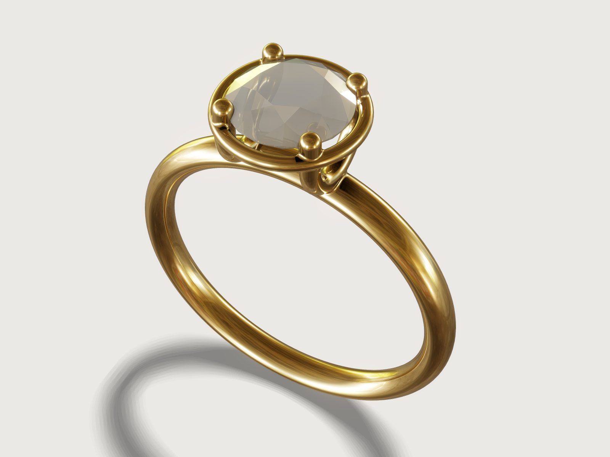

# Solitaire ring

The engagement ring every jeweller knows: one round brilliant in a four-prong basket on a plain band of
18 ct yellow gold. The ring comes in every ISO 8653 size from 44 to 72 and the stone in any weight from
0.25 to 2 ct, and both are real: the stone is cut facet by facet to Tolkowsky's proportions and sized from
its weight through its volume worked out by hand, so a 1 ct stone weighs exactly 0.2 g and measures what a
1 ct ideal-cut brilliant measures, and the ring fits a hidden ISO ring gauge of its size exactly.



## What it shows

- **A cube root in a formula.** The stone's volume is a closed form times the cube of its girdle radius
  (below). `variable.set` with `pow(…, 1 / 3)` solves it for the radius that gives the carat weight at
  diamond's density, so the *Carat* parameter sizes everything: the stone, the prongs, the gallery and
  where the stone sits.
- **57 facets from seven planes.** Each facet group is cut by one plane: `datum.plane` through three of
  the facet's corners, every coordinate a formula of the proportions, `sketch.rect` on it and
  `feature.extrude` outward make a cutter slab, `feature.pattern` turns it eight times by 45°, and
  `feature.boolean` subtracts the eight from the stone. The upper and lower girdle facets come in mirror
  pairs: `feature.mirror` with `keep` makes the second set of eight from the first. The bruted blank
  (`feature.cylinder`) ends exactly at the table, so the table is its top face trimmed by the stars and
  bezels, and the eight pavilion mains meet in a pointed culet: 33 crown facets, 24 pavilion facets and
  the girdle. `feature.transform` lifts the cut stone onto the ring.
- **A comfort-fit court shank.** `sketch.path` draws the shank's section as a four-centre oval, four arcs
  given by their centres, each meeting the next on the line through both centres so they run on smoothly,
  and `feature.revolve` turns it about the finger axis.
- **Prongs by sweep.** Each side's two prongs are one round wire bent in a U: `feature.sweep` of a circle
  along a line, a half circle and a line (`sketch.path` on the yz plane at the prongs' offset), turned
  half a turn by `feature.pattern` for the other side. The tips are balls (`feature.sphere`, four by
  `feature.pattern`) united with the wires (F-066).
- **Seats cut by the stone itself.** `feature.boolean` subtracts the diamond from the prongs with
  `keepTool`: each prong gets its seat, the girdle's notch with the crown's and pavilion's bearing, as a
  setter cuts it with a bur, and the stone stays.
- **A gallery.** `feature.torus` is the gallery wire under the girdle; `feature.fillet` rounds its
  joints with the prongs, and `feature.boolean` unions the head with the shank.
- **A conditional fillet.** A second `feature.fillet` rounds the joints where the prongs' U-bottoms run
  into the shank, switched on by its condition (`when`: `carat <= 1.2`) up to 1.2 ct (see Platform
  notes).
- **Rules as formulas.** `max(…)` keeps every wire at or above the casting minimum and the stone high
  enough for the gallery; `max(2.2 mm, …)` lets the shank grow with a large stone.
- **Materials.** `material.preset` steel, recoloured to 18 ct yellow gold, with `body.material` for the
  gold's density (F-017); `glass` with diamond's index of refraction for the stone, with `body.material`
  for diamond's density, given by an expression of the `diamond_density` variable.
- **A hidden ring gauge.** `feature.cylinder` of the size's circumference along the finger axis, hidden
  with `feature.visible`, is the ISO ring stick the size check measures against.
- **Outputs and checks.** `variable.measure` gives the gold's mass in grams and the stone's diameter and
  depth; `assert.add` checks the size, the stone's weight, the facet count, the trade's weight estimate,
  the shank's volume, the setting's clearances and the wires' casting minimum (below).

## The real thing

- **Ring size.** ISO 8653:2016 designates a ring size by the circumference in millimetres of the largest
  cylinder that fits in the ring ([ISO 8653:2016](https://standards.iteh.ai/catalog/standards/iso/799f4661-1465-4f4f-a23d-1a9ad8567517/iso-8653-2016));
  whole sizes, one millimetre apart ([Ring size](https://en.wikipedia.org/wiki/Ring_size)). Size 54 is
  an inner diameter of 17.19 mm; the parameter runs from 44 (14.01 mm) to 72 (22.92 mm).
- **The cut.** Marcel Tolkowsky's ideal round brilliant (*Diamond Design*, 1919): table 53 % of the
  diameter, crown angle 34.5°, pavilion angle 40.75°, which make a crown 16.2 % and a pavilion 43.1 % of
  the diameter high ([Brilliant (diamond cut)](https://en.wikipedia.org/wiki/Brilliant_(diamond_cut));
  [Pricescope](https://www.pricescope.com/wiki/diamonds/tolkowsky-ideal-cut-diamond)). The table is
  measured to the corners of its octagon, where the bezel facets meet it, and both angles are those of
  the bezel and pavilion main facets, as in Tolkowsky's section. What Tolkowsky left open is taken from
  today's grading:
  - a girdle 3 % of the diameter thick at the eight bezel positions, where GIA measures it ("at the
    eight junctions between the bezel and pavilion main facets"); the girdle facets cut valleys into it
    between them, as on a real stone, where GIA finds it "about 1.7% less" with normal proportions
    ([GIA Facetware help](https://gia.edu/facetware-help));
  - star facets reaching half way from the table's edge to the girdle (GIA's Facetware takes star
    lengths from 35 to 75 %), and lower girdle facets 75 % of the way from the girdle to the culet, the
    low end of the 75 to 80 % [Whiteflash](https://www.whiteflash.com/diamond-education/facets-the-lower-halves/)
    recommends;
  - no culet facet: the pavilion ends in a point, so the stone has 57 facets.

  At 1 ct the stone is 6.437 mm across and 4.006 mm deep, a total depth of 62.2 %.
- **Weight.** A metric carat is 0.2 g (4th General Conference on Weights and Measures, 1907;
  [Carat (mass)](https://en.wikipedia.org/wiki/Carat_(mass))); diamond's density is 3.515 g/cm³
  ([Rivista Italiana di Gemmologia, glossary](https://www.rivistaitalianadigemmologia.com/en/glossary/diamond/)).
  The stone's volume in closed form, for a girdle radius R:
  - crown: a 45° sector of it is six triangles in plan (half the table, a star, two half bezels and two
    upper girdle facets), each a prism whose volume is its area in plan times the mean height of its
    corners over the girdle: 0.6232 R³ in all;
  - pavilion: likewise two half mains and two lower girdle facets per sector: 0.8960 R³;
  - girdle: the cylinder 2π h R² less the 32 scallops the girdle facets cut, each the facet's slope times
    the first moment of a circular segment of half angle 11.25° about its chord,
    R³ ((2/3) sin³ α − cos α (α − sin α cos α)): 0.1874 R³.

  So V = 1.7066 R³, and R = (V / 1.7066)^(1/3) with V = carat × 0.2 g / 3.515 g/cm³.

  | Carat | Diameter | Depth | Prong wire | Gallery wire | Shank width | Culet over shank | Gold, size 54 |
  |---|---|---|---|---|---|---|---|
  | 0.25 | 4.055 mm | 2.524 mm | 1.000 mm | 0.800 mm | 2.200 mm | 0.987 mm | 2.878 g |
  | 0.5 | 5.109 mm | 3.180 mm | 1.000 mm | 0.800 mm | 2.200 mm | 0.842 mm | 2.933 g |
  | 1 | 6.437 mm | 4.006 mm | 1.094 mm | 0.800 mm | 2.200 mm | 0.684 mm | 3.055 g |
  | 1.5 | 7.369 mm | 4.586 mm | 1.253 mm | 0.800 mm | 2.358 mm | 0.604 mm | 3.392 g |
  | 2 | 8.110 mm | 5.047 mm | 1.379 mm | 0.827 mm | 2.595 mm | 0.559 mm | 3.838 g |
- **Shank.** A comfort-fit court shank, domed inside so it slides over the knuckle, 1.7 mm thick and
  2.2 mm wide, or 0.32 times the stone's diameter where that is wider (above 1.22 ct; 2.595 mm at 2 ct),
  so a large stone does not sit on a spindly band: comfort fit needs about 1.5 mm of thickness, and 1.5
  to 1.75 mm is the usual thickness of a plain band
  ([Whiteflash](https://www.whiteflash.com/blog/comfort-fit-vs-standard-fit-wedding-bands/)); a cast
  band wants at least 1 mm ([Materialise, designing for gold](https://www.materialise.com/en/academy/industrial/design-am/gold)). On a
  quarter-carat stone (4.05 mm) those minimums make the head look sturdy: 1 mm prongs and a 0.8 mm gallery, the
  price of a ring that casts.
  Its section is a four-centre oval: at 2.2 mm wide, arcs of 1.169 mm radius over the crown and under
  the finger, and of 0.4 mm at the edges.
- **Head.** A four-prong basket with the prongs on the diagonals, at the bezel positions, where the girdle
  is thickest:
  - prong wire 0.17 times the stone's diameter, 1.09 mm at 1 ct, where 1.0 to 1.3 mm is usual
    ([prong wire](https://skyjems.ca/pages/encyclopedia-prong-wire)), and never less than 1 mm (below
    0.76 ct): cast prongs and rods need at least 0.8 mm
    ([Materialise](https://www.materialise.com/en/academy/industrial/design-am/gold)), and the
    gallery, at least 0.8 mm itself, has to stay thinner than the prongs it passes through;
  - each prong's seat cut a third of the wire into it, at the girdle, as the setter's rule has it
    ([Rio Grande, Easy-Cut Prong Guide](https://products.riogrande.com/content/Instruction-Sheets/Easy-Cut-Prong-Guide-IS.pdf));
  - the tips are balls of the wire's diameter, centred on the prong's axis at the height where the crown
    meets the prong's inner face, so the ball's inner side just touches the crown;
  - the gallery is a wire 0.6 times the prong's but at least 0.8 mm, 0.1 mm outside the girdle and
    0.1 mm below it, through the outer half of each prong, its joints rounded with a fifth of the prong's
    diameter;
  - the stone sits high enough that the gallery and its fillets lie on the prongs' straight part, above
    the bend of the U, and its culet at least 0.5 mm above the shank, so it never reaches the finger: at
    1 ct and size 54 the culet is 0.684 mm above the shank and the table 6.39 mm above the finger.
- **Gold.** 18 ct (750 fine) yellow gold with equal parts of silver and copper, density 15.4 g/cm³
  ([LBMA, density of gold](https://www.lbma.org.uk/wonders-of-gold/items/density-of-gold)): the ring
  weighs 3.055 g at size 54 with a 1 ct stone, 2.622 g at size 44 and 3.836 g at size 72.
- **Making it.** The model is the finished ring with its stone set: its prongs carry the seats and the
  ball tips that hold the stone.
  1. Print the gold body (`exports/solitaire-ring-gold.3mf`) in castable resin, sprue it at the shank's
     underside and cast it in 18 ct yellow gold by lost wax. The seats come out of the cast, so check
     them with the stone.
  2. Clean up and polish the shank and the head; check the size on a ring stick.
  3. Open the prongs slightly, snap the stone into the seats, close the prongs and polish the tips.
  4. Polish, and stamp the fineness (750) inside the shank.
- **Simplified, or left out.**
  - Above 1.2 ct the prongs' U-bottoms meet the shank in a sharp crease, without the fillet a real head
    has there: there the fillet is refused where it runs onto the shank's rounded edges (see Platform
    notes).
  - The tips are drawn as balls lying on the crown, not as a setter bends and files them.
  - No casting shrinkage allowance, no sprue, no fineness stamp or maker's mark.
  - The stone is drawn as glass of diamond's index of refraction, only slightly transparent (0.15), with a
    clear coat and a metallic share of 0.55, so its star and bezel facets read: the studio look shows what
    lies behind glass but not a diamond's internal reflections, and a fully transparent stone reads as a
    lump of glass (see Platform notes). Its mass is diamond's.

## Parameters

| Parameter | Range | Default |
|---|---|---|
| Ring size | ISO 8653 sizes 44 to 72, whole sizes | 54 |
| Carat | 0.25 to 2 ct, in steps of 0.05 | 1 |

## Checks

- **Ring size to ISO 8653.** The hidden ring gauge is a cylinder of circumference *Ring size* on the
  finger axis; the clearance between it and the ring is 0: they touch and do not overlap, so the gauge is
  the largest cylinder that fits, as ISO 8653 defines the size.
- **Diamond weighs its carat.** The stone's mass, measured on its 58 faces with diamond's density, is
  carat × 0.2 g within a millionth: the closed form of its volume above is exact (0.2 g at 1 ct, a
  volume of 56.899 mm³).
- **Round brilliant of 57 facets.** The stone has 57 flat faces (and the girdle).
- **Weight by the trade's estimate.** The trade estimates a round brilliant's weight as diameter² ×
  depth × 0.0061, in millimetres ([Jewellery Business, *Zeroing in on diamond weight calculations*](https://www.jewellerybusiness.com/features/zeroing-in-on-diamond-weight-calculations/3/)).
  From the measured diameter and depth it must come within 3 % of the carat: 1.0125 ct at 1 ct.
- **Shank volume by Pappus.** Everything of the ring below the finger axis is half the shank, so its
  volume must be π times the radius of the section's centre times the four-centre oval's area,
  2γ r₂² + (π − 2γ) r₁² − 2 (r₂ − t/2)(w/2 − r₁), with w and t the shank's width and thickness, r₁ and r₂
  the edge and crown radii and γ = atan((w/2 − r₁) / (r₂ − t/2)) half the angle of a crown arc:
  83.5286 mm³ at size 54, within 0.001 mm³.
- **Gallery clear of the stone.** The gallery's faces are at least 0.1 mm from the stone: 0.307 mm at the
  defaults.
- **Culet above the shank.** The stone is at least 0.5 mm from the shank's faces, at its culet: 0.684 mm
  at the defaults.
- **Castable wire, 0.8 mm or more.** The thinner of the prong and gallery wires is at least 0.8 mm, the
  minimum Materialise gives for cast prongs and rods: 0.8 mm (the gallery) at the defaults. Asserted on
  the wires' diameters, not measured: `measure.thickness` is not reliable on such bodies
  ([F-020](../../3DCRAFT-FEEDBACK.md#f-020)).

`craft3d-cli check-range` proves all eight at 13 points: the defaults, the four corners of the two
ranges and eight random points.

## Files

- `solitaire-ring.3dcraft`: the model.
- `build.json`: the 120 steps that build it.
- `exports/solitaire-ring-gold.3mf`: the gold body alone, the finished ring with its seats and tips,
  meshed to within 0.02 mm of the model, for printing the casting pattern.

## Rebuild

```sh
tools/examples.py build solitaire-ring
# or
craft3d-cli run --new '{"units":"mm"}' --script examples/14-solitaire-ring/build.json --out solitaire-ring.3dcraft
```

## Difficulty

**6 / 10** (the reviewer): datum planes through formula points, a pattern and a mirror of the facet cutters,
booleans in sequence, a swept U-wire, fillets on persistent names (one of them conditional), a closed-form
volume solved with a cube root, and the gemology and setting knowledge behind them.

## Platform notes

- **Prong roots and the gallery's place.** A fillet cannot run over a smooth edge onto the next face
  ([F-095](../../3DCRAFT-FEEDBACK.md#f-095)). Rounding the joints where the U-bottoms run into the shank
  with a fifth of the prong's diameter does that, and is refused, at 1.25 ct for sizes 44 and 58 and at
  1.3 ct for sizes 44 and 72 among the points tried, while it builds at 1.2 ct for sizes 44, 58 and 72;
  so that fillet is switched on up to 1.2 ct only, and the larger stones keep a sharp root. For the same reason the gallery and its fillets must stay on the prongs' straight part,
  clear of the bend of the U, which is why the stone sits higher than the 0.5 mm culet clearance alone
  would put it.
- **Prong tips.** A rod's end cannot be rounded to a full ball by `feature.fillet`
  ([F-066](../../3DCRAFT-FEEDBACK.md#f-066)); the tips are spheres of the wire's radius united with the
  wires' ends.
- **Gold.** No precious-metal preset; the gold is the steel preset recoloured, with its density set by
  `body.material` ([F-017](../../3DCRAFT-FEEDBACK.md#f-017)). `body.material` takes diamond's density as
  an expression only after converting it to a plain number (`diamond_density * (1 m)^3 / (1 kg)`); the
  variable itself is refused as "a density, not a plain number" ([F-096](../../3DCRAFT-FEEDBACK.md#f-096)).
- **The stone's look.** Glass in the studio look refracts the picture behind it but has no internal
  reflection or dispersion, so a diamond cannot look like one
  ([F-097](../../3DCRAFT-FEEDBACK.md#f-097)); the stone is drawn mostly reflective (metallic 0.55,
  transmission 0.15) so its star and bezel pattern reads.
- **Preview.** The key light's shadow of a model this small draws in coarse steps on the ground
  ([F-043](../../3DCRAFT-FEEDBACK.md#f-043)): lit from the camera's side, the shadow showed as a stepped
  grey patch through the band's opening. With `look.light` 90°, 60° it falls to the left of the ring and
  the opening stays clean; its soft edge still shows faint steps at full size. Of the look turned 0, 90,
  180 and 270°, 180° shows the gold as a clean 18 ct yellow; at 0° it turns orange (F-054).
- **Load time.** An assertion that the stone is clear of the gold by `clearance` or `overlap` costs 2 to
  3 s at every load (the load goes from 0.8 s to 2.8 s with `overlap` and to 3.8 s with `clearance`); the
  checks use `distance` to the gallery's and the shank's faces instead, which costs too little to measure
  against the noise ([F-098](../../3DCRAFT-FEEDBACK.md#f-098)).

## Licence

[MIT](../../LICENSE), like everything in this repository; credit line in the
[README](../../README.md#licence).
