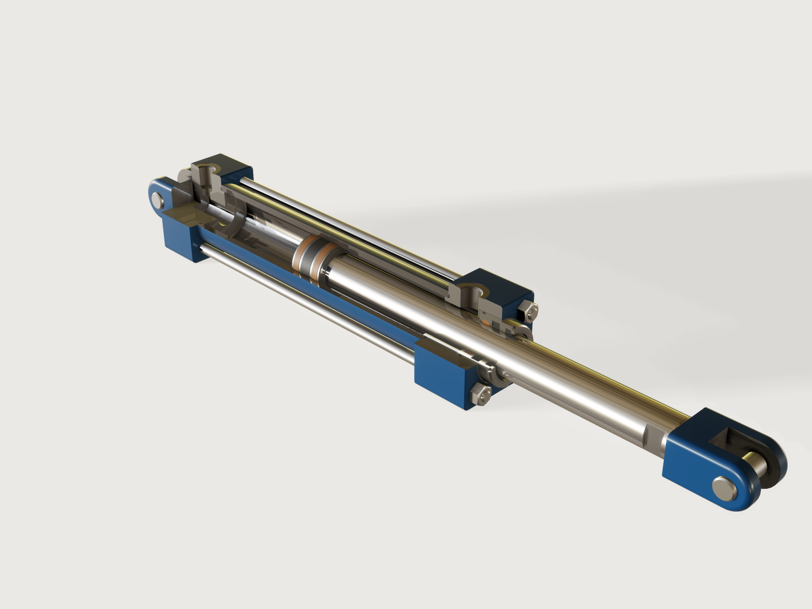

# Hydraulic cylinder

The workhorse of machine hydraulics: a double-acting tie-rod cylinder to ISO 6020-2 (the 160 bar compact
series), bore 40 mm with the 28 mm rod, a fixed clevis at the rear and a rod clevis at the front, stroke
200 mm. It is a model of fourteen bodies, and it moves: the *Extension* parameter slides the piston, the rod
and the rod clevis out of the cylinder, and a *Cutaway* switch takes a quarter out of the tube, the end caps
and the gland, as on a display cylinder, to show the piston with its seals and the gland with its rod seals.
The model measures the oil in both chambers and checks it against a closed form, and checks the pin-to-pin
length, the port spacing, the rod's buckling safety and the rod clevis's rating.



## What it shows

- **Several bodies, each a part.** The cap with its clevis, the tube, the head, the gland, the seals, the
  guide ring, the piston with its seal and wear rings, the rod, the rod clevis, the pins, the tie rods and
  their nuts: fourteen bodies, each named for its part.
- **Revolved half sections.** Tube, gland, seals, piston, wear rings and rod are each one `sketch.polyline`
  (or `sketch.rect`) turned by `feature.revolve`; their chamfers, grooves and lands are drawn in the section,
  so they cost no extra feature. One sketch with several closed profiles makes one body of several rings
  (the rod seal, the wiper and three O-rings are the body *Seals*).
- **Square heads from blocks.** `feature.block`, `feature.fillet` on the four long edges and
  `feature.chamfer` with `chain` round both faces; a `feature.cylinder` joined by `feature.boolean` adds the
  pilot that locates the tube, and `feature.revolve` with `cut` turns the bores, the oil gallery and the
  O-ring groove.
- **Tools made once, used twice.** The tie-rod holes are one `feature.cylinder` repeated four times round
  the axis by `feature.pattern` and subtracted. The port is one half section revolved about a construction
  line (spot face, mouth, tapping drill with its 118° point, passage) and repeated PJ + stroke along the
  axis, so one drilling makes both ports. The two clevis pins drill their own holes: they are subtracted
  from the cap and from the rod clevis with `keepTool`.
- **Clevises.** A side profile of lines and an arc (`sketch.arc`), extruded `symmetric`, rounded with
  `feature.fillet` and `chain`, then slotted with a `feature.block`; the rear clevis is joined to the cap.
- **Nuts.** A hexagon with its hole, extruded and intersected with a `feature.cone` for the 30° chamfer.
- **A moving rod.** Every moving part is drawn at `piston_x` and `shoulder_x`, which follow
  `travel = stroke * extension / 100`; the *Extension* parameter moves them without a transform.
- **A cutaway with conditional features.** The tube, the gland and the seals are revolved
  `if(cutaway, -270 deg, 360 deg)`; head and cap lose a quarter to one box made with `when: cutaway` and
  `feature.boolean` with `keepTool`; the tie rods and nuts are `feature.pattern` with `count` `4 - cutaway`.
  The cut faces then show each part's own finish.
- **Paint and bare metal.** `material.preset` gives the steel parts their bare finish, and `face.appearance`
  paints only the outside faces gentian blue, right after the feature that made them; every face a later
  feature cuts (bores, ports, tapped holes, the clevis slots and the cutaway) is bare steel, as on the real
  thing. The rod is hard chrome, tie rods, nuts and pins zinc, the gland bright steel, the seals black and the
  guide rings bronze-filled PTFE; `body.material` names the seals' and rings' materials and gives their
  densities.
- **Cosmetic threads.** `feature.thread` marks the rod end and the rod clevis as M14 × 1.5.
- **Oil as a solid.** A hidden body *Oil* is the bore between the pilots less the piston, its seal, its wear
  rings and the rod (`feature.boolean` with `keepTool`, `feature.visible` false); `variable.measure`
  takes its volume and `volumeBelow` at the piston seal's middle plane, which splits it into the two
  chambers.
- **Outputs and checks.** `variable.measure` and `variable.output` for the oil, the forces, the pin-to-pin
  length, the moving mass and the buckling safety; `assert.add` with `value`, `distance` and `count`
  (below).

## The real thing

- **Standard.** ISO 6020-2:2015 fixes the mounting dimensions of the 160 bar compact series (bores 25 to
  200 mm); bore 40 and rod 28 are ISO 3320 sizes. The dimensions are taken from two makers' ISO 6020-2
  catalogues: Parker Hannifin, *HMI/HMD Hydraulic Cylinders*, catalogue HY07-1150/UK (2018), and Atos,
  *CK series, ISO 6020-2*, table B137.

  | Code | What | Value (mm) | Source |
  |---|---|---|---|
  | E | head and cap square | 63 | Atos (63 ± 1.5); Parker 64 |
  | TG, DD | tie-rod square, thread | 41.7, M8 × 1 | both |
  | G, J | head length, cap length | 45, 38 | Parker (Atos: J 38) |
  | WF, WH | rod shoulder to head face, to gland boss | 35, 25 | both |
  | B | gland boss diameter | 42 | both (rod 28) |
  | Y, PJ | rod shoulder to head port; port to port | 62; 73 + stroke | both |
  | ZJ | rod shoulder to the cap's rear face | 153 + stroke | both |
  | XC, L | rod shoulder to the clevis pin; cap face to pin | 172 + stroke; 19 | both |
  | CB, CW, CD | clevis slot, cheek, pin (MP1) | 20, 10, 14 | Parker; Atos CB, CD |
  | MR, LR | clevis end radius (max), slot clearance radius | 17, 17 | Atos; Parker |
  | KK, A | rod end thread and length (rod 28, Parker code 2/7, Atos KK1) | M14 × 1.5, 18 | both |
  | NA, D | shoulder diameter, wrench flats | 26, 22 | Parker; both (Atos CH) |
  | EE | ports | G 3/8 | Parker |

  The rod clevis is the ISO 8133 one for M14 × 1.5 (Parker 143449): pin to face CE 38, pin CK 14, width
  CL 40, slot CM 20, CR 30 (read here as its height, so its end is rounded with 15 mm, within ER max 17),
  slot depth LE 19, thread depth AV 18, nominal force 26.4 kN. Both pins are Parker's 143479 for it,
  Ø 14 f8 and 45 mm long (EL min 45).
- **Rod 28 rather than 22.** ISO 6020-2 offers 18, 22 and 28 mm rods for bore 40 (Atos: standard,
  intermediate, differential). With a clevis at both ends the rod must not buckle at full extension.
  Taking the whole pin-to-pin length as the rod, pinned at both ends, its buckling load is Euler's above
  the slenderness π √(2 E / Re) and Johnson's parabola below it, with E 210 GPa and Re 305 MPa (the
  minimum yield strength of a chromed C45E bar, the common rod steel, after Ovako's white paper *Piston
  rods in hydraulic cylinders*); cylinder makers ask a safety of 3.5 against it (Bosch Rexroth, as
  summarised in a [KTU paper](https://epubl.ktu.edu/object/elaba:20079820/20079820.pdf)). A 22 mm rod at
  stroke 200 is safe only 3.16 times against the 20.1 kN push, the 28 mm rod 6.73 times. The 28 mm rod
  (area ratio 1.96, the classic 2 : 1 cylinder) is what a designer would pick here.
- **Ports.** G 3/8 to ISO 228-1 (19 threads per inch, minor diameter 14.950 mm) in ISO 1179-1 ports on
  top of head and cap: a Ø 25 spot face, the mouth countersunk to Ø 16.9 and the tapping drill 15.5 deep
  (dimensions according to ISO 1179-1:2013, Table 1: d3 16.7 to 16.9, spot face at least 23 (narrow) or
  24.5 (wide), tapping drill at least 15.5 deep; checked on 2026-11-10 against that table in the standard's
  public preview at [standards.iteh.ai](https://cdn.standards.iteh.ai/samples/60250/561ffb56c93146bc84ccdccb047bf4bd/ISO-1179-1-2013.pdf),
  and against Parker Hannifin's *4300 Catalog*, Table T26 *Port Detail — ISO 1179-1*, page T36
  ([a distributor's copy](https://www.hydradynellc.com/images/document/159_iso%201179.pdf)), which gives
  D3 16.8 and spot faces of 23 and 24.5 for G 3/8 but no drill depth). In the cap a Ø 9
  passage leads on into the pocket; in the head the tapping drill breaks straight into the Ø 34 gallery, so
  the drilling's point and passage fall in the gallery's space. The thread itself is not drawn
  ([platform notes](#platform-notes)).
- **Inside**, where the standard leaves the maker free; the sizes are typical, not one maker's:
  - a honed tube 40 × 50 (wall 5 mm) with a 20° lead-in at both ends of its bore, sitting on 3 mm pilots
    of head and cap and sealed by an O-ring in each face;
  - in the head, an oil gallery Ø 34 round the rod under the head port, and a steel gland screwed into a
    Ø 44 bore (its thread is not drawn) with the Ø 42 × 10 boss of the standard and four spanner slots
    4 × 2 in its rim (r 19 to 21, clear of the wiper's groove). From the inside out it holds a
    bronze-filled PTFE guide ring 5.6 × 2.5, a polyurethane U-cup 28 × 38 × 6.3 with its lips towards the
    oil, and a double-lip wiper in a 36 × 4.5 housing, with an O-ring on its outside. The land behind the
    U-cup, which carries the seal's pressure, is 4.64 mm, twice the others (2.32 mm): with a 9.7 mm guide
    ring and equal lands it would be 1.875 mm, which a strip estimate puts near 190 MPa of bending, too
    much for cast iron. So the guide ring is the narrower standard width, the land is doubled and the gland
    is steel;
  - in the cap, a Ø 16 pocket on the inner face, where the port's passage comes in;
  - a piston 29 mm long (what the ISO lengths leave between the pilots), screwed onto a Ø 20 spigot of the
    rod and secured with thread-locking compound and a pin, as Parker does (thread and pin not drawn), its
    lands 0.25 mm under the bore, with two wear rings 5.6 × 2.5 and a compact seal 9.4 wide between them;
  - the rod's shoulder chamfered to Ø 26 at 20°, a lead-in for the gland's seals;
  - tie rods M8 × 1 screwed into the cap, with M8 × 1 nuts (13 across flats, 6.8 high, ISO 8673; the
    chamfer starts at the bearing face's Ø 11.6 of ISO 4032) on the head, through Ø 9 holes (ISO 273,
    medium).
- **Seal housings.** The sections are the common catalogue sizes, not one maker's line:
  - **O-rings** have a 1.6 mm cord in grooves 1.2 deep and 2.3 wide, for 25 % squeeze, as the Freudenberg
    Simrit *Technical Manual* (2007, tables 2 and 3) gives for a 1.6 mm cord (radial t 1.2 ± 0.06,
    b1 2.3; axial h 1.20 ± 0.03, b4 2.2; widths + 0.2). ISO 3601-2's own tables were not checked.
  - **The rod seal**, 28 × 38 × 6.3, is a catalogue size (Hansa-Flex TS-L 28 × 38 × 6.3, polyurethane);
    that this housing is one of ISO 5597's was not checked.
  - **The guide and wear rings** are 2.5 mm strips in 5.6 mm housings, the narrowest of the widths that
    strip makers list (5.6, 9.7, 15 and 25 mm, Hansung GT Seal); ISO 10766's table was not checked.
  - **The wiper's** 36 × 4.5 housing is typical; ISO 6195 was not checked.
- **Making it.** Head and cap are machined from steel bar and the clevis from the cap's own stock; the
  tube is honed, the rod ground, induction hardened and hard chromed (as Parker describes its rods). The
  outside is painted RAL 5010 gentian blue (sRGB #004F7C; drawn as #003A60, a shade darker, because the
  gallery look's +0.5 stop and ACES lift it); the bores, the ports, the gland's seat and the clevis slots
  stay bare. The tie-rod nuts are tightened to 19 to 20.5 N m (Parker, for bore 40). The rod is drawn
  with roughness 0.1; its brown streaks are the Workshop environment's warm light in the chrome
  ([F-054](../../3DCRAFT-FEEDBACK.md#f-054)), kept to a minimum at the preview's rotation 180.
- **Numbers.** At stroke 200: push 20.11 kN and pull 10.25 kN at 160 bar; extending a full stroke takes
  251.33 cm³ of oil (cap end 0.15 cm³ retracted, 251.47 cm³ extended), retracting 128.18 cm³ (rod end
  128.32 to 0.15 cm³); moving mass (piston, seals, rod, rod clevis) 1.89 kg. With the cutaway off the
  cylinder weighs 6.08 kg, rod clevis and pins included, and 0.120 kg more per 10 mm of stroke, as Parker's
  table gives for bore 40, rod 28; without the rod clevis and pins it weighs 5.70 kg, about 1 kg less
  than Parker's style BB cylinder (4.3 kg at zero stroke + 2.4 kg).
- **Simplified, or left out.**
  - No cushions, air bleeds or cushion screws (all options at ISO 6020-2).
  - The G 3/8 port threads, the gland's and piston's threads and the piston's locking pin are not drawn.
  - Not drawn either: the static O-ring between piston and rod spigot, a deeper lead-in at the tube's
    ends (seal makers ask 2 to 3 mm for a compact piston seal; it is 0.5 mm here), the second chamfer of
    the nuts and the pins' retaining-ring grooves.
  - The O-rings are drawn at their free 1.6 mm cord, so each overlaps the face it seals by its 0.4 mm
    squeeze, as the tie rods overlap their tapping holes. The other seals are drawn as typical sections
    filling their grooves and touching the rod and the bore, without a real seal's squeeze.
  - The tie rods are drawn at Ø 8 into Ø 7 tapping holes, as CAD draws a screwed stud: the thread's depth
    is the overlap.
  - The buckling check takes the whole pin-to-pin length as the rod, which is safe (the tube is much
    stiffer than the rod), and ignores side loads and the clevis pins' play.
  - With the cutaway on, the volumes and masses of the cut parts are those of the cut parts; the oil, the
    moving mass and all checks use parts the cutaway leaves whole.

## Parameters

| Parameter | Range | Default |
|---|---|---|
| Stroke | 25 to 320 mm, in steps of 5 mm | 200 mm |
| Extension (%) | 0 (retracted) to 100 (fully extended) | 50 |
| Cutaway | on or off | on |

## Checks

- **Cap-end oil in closed form.** The part of *Oil* below the piston seal's middle plane equals
  π/4 · D² · travel plus the piston's dead volume on that side: the 0.25 mm gap over its two lands
  (2 × 2.1 mm) and the ring its 0.5 mm chamfer leaves (Pappus), to 0.01 mm³. At the defaults 125.810 cm³.
- **Rod-end oil in closed form.** The rest of *Oil* equals π/4 · (D² − d²) · (stroke − travel) plus the
  same dead volume. At the defaults 64.235 cm³. Both prove where the piston is, its length and the rod's
  diameter.
- **Pin to pin, ISO 6020-2 XC and ISO 8133 CE.** The gap between the two clevises' pin holes, plus the pin
  diameter, equals XC + stroke + travel + CE: 410 mm retracted, 510 mm at the defaults, 610 mm extended.
- **Ports PJ + stroke apart.** The distance between the two ports' tapping holes equals PJ + stroke less
  their diameter: 258.05 mm at the defaults.
- **Rod safe against buckling.** The safety against buckling at full extension (Euler and Johnson, as
  above) is at least 3.5: 6.73 at stroke 200, 4.31 at stroke 320, the longest stroke.
- **Rod clevis rated for the push force.** The push force at 160 bar, 20.11 kN, is within the rod clevis's
  nominal 26.4 kN.
- **Four tie rods, three in the cutaway.** The tie rods' Ø 8 faces number 4 − cutaway.

`craft3d-cli check-range` proves all seven at 17 points: the defaults, all eight corners of stroke,
extension and cutaway, and eight random points.

## Files

- `hydraulic-cylinder.3dcraft`: the model (cutaway on; switch it off for the cylinder as built).
- `build.json`: the 248 steps that build it.
- `exports/hydraulic-cylinder.step`: the cylinder as built (cutaway off, at the default stroke and
  extension), all fourteen parts, without the hidden *Oil*.

## Rebuild

```sh
tools/examples.py build hydraulic-cylinder
# or
craft3d-cli run --new '{"units":"mm"}' --script examples/15-hydraulic-cylinder/build.json --out cylinder.3dcraft
```

The tool needs the 3DCraft build this repository is pinned to: see [Rebuild and check](../../README.md#rebuild-and-check)
in the README.

## Difficulty

**8 / 10** (the reviewer): fourteen bodies coupled through 96 variables, a conditional cutaway through revolves, booleans and formula-count patterns, an oil solid giving closed-form chamber volumes, buckling checks and ISO 6020-2/8133 knowledge; no freeform, so not 9.

## Platform notes

- **Ports without threads.** `feature.thread` knows ISO metric threads only, so the G 3/8 ports (ISO 228-1
  pipe thread, 55° Whitworth form) are drilled to the thread's minor diameter but cannot be marked as
  threaded ([F-108](../../3DCRAFT-FEEDBACK.md#f-108)).
- **Painting the outside only.** `face.appearance` takes literal face names only
  ([F-025](../../3DCRAFT-FEEDBACK.md#f-025)), so the painted faces of the head (26), the cap and its clevis
  (37), the tube (3) and the rod clevis (12) are listed one by one; and it refuses a feature whose body a
  later feature has taken ("has no body", also F-025), so each list stands right after its feature in
  `build.json`.
- **The cutaway is modelled.** A preview cannot carry a `section`, and a section drawn in the studio look is
  flat grey ([F-031](../../3DCRAFT-FEEDBACK.md#f-031)) with every cap in one colour
  ([F-082](../../3DCRAFT-FEEDBACK.md#f-082)); the modelled cutaway shows each part's own finish.
- **Thread run-out.** The rod clevis's thread is marked 17 mm deep in its 19 mm hole, since a thread's
  run-out must fit inside the hole ([F-056](../../3DCRAFT-FEEDBACK.md#f-056)).
- **Names.** The four extrusions and revolutions made with `cut` or `join` keep automatic names
  (`Extrude1`, `Revolve1`; [F-002](../../3DCRAFT-FEEDBACK.md#f-002)); the other tools are primitives or
  sketches made apart and named. Each body's last feature is named for the part
  ([F-042](../../3DCRAFT-FEEDBACK.md#f-042)).
- **Chrome.** The rod's brown streaks come from the Workshop environment
  ([F-054](../../3DCRAFT-FEEDBACK.md#f-054)).

## Licence

[MIT](../../LICENSE), like everything in this repository; credit line in the
[README](../../README.md#licence).
