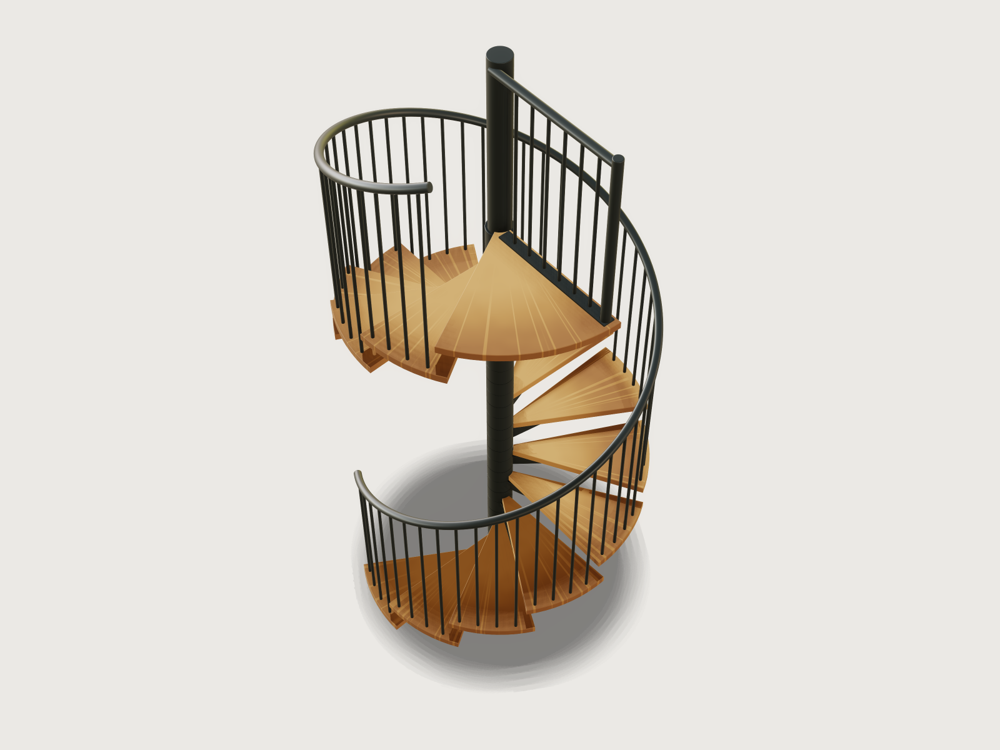

# Spiral staircase

A steel spiral staircase with oiled oak treads for a house: 15 risers of 186.67 mm from floor to floor at
2800 mm, Ø 1600 mm, round a Ø 114.3 mm column, each oak tread on a steel T-carrier stacked between spacer
tubes, with a handrail swept along a helix, a balustrade of round bars and a landing with its own guard.
The stair works itself out from two numbers, the floor-to-floor height and the diameter: how many
risers, how many treads to a turn, where the walking line runs and how wide the landing may be, all by
formulas from DIN 18065's rules. It proves the result with a 2000 mm
headroom gauge standing on every tread, the stair rule at the walking line, the railing's gaps and closed
forms of the oak, at every one of the parameters' 119 combinations.



## What it shows

- **The stair worked out by formulas.** `variable.set` turns the two parameters into the stair a designer
  would draw:
  - *Risers.* With twelve treads to a full turn, the tread above a nosing is eleven risers up (the tread a
    turn up reaches over it by the nosing overlap). So the rise must be at least (2000 + 40) / 11 =
    185.45 mm for 2000 mm of headroom under a 40 mm tread, and the height is split into the most risers that
    keep it so: `floor(floor_to_floor / rise_for_headroom)`. The landing is the top step, so there is one
    tread less than risers.
  - *Walking line.* The usable width runs from where the going is 50 mm (95.49 mm from the axis at 30°)
    out to the inside of the handrail. DIN 18065's walking area is the two tenths of it that start at its
    middle, and the walking line runs in the walking area's middle, at 60 % of the usable width.
  - *Treads per turn.* Twelve, or more on a wide stair: the whole number that brings the going on the
    walking line nearest to 630 mm less two rises, the stair rule's ideal.
  - *Landing.* As many tread angles wide as keeps 2000 mm of headroom over the treads under it, at most a
    quarter turn.
- **A handrail along a helix.** `datum.helix` follows the treads' screw (one turn rises twelve risers; its
  height is the fourteen treads' rise). `datum.plane` through three points lays the profile square to the
  helix at its start, and `feature.sweep` with the helix as `path` carries a 42.4 × 2.6 mm tube along it
  (two circles: the inner one is the bore). A plug drawn on the start plane is copied to the far end by a
  `feature.pattern` that turns and lifts it as the helix does.
- **Screw patterns.** `feature.pattern` with `angle` and `step` turns each copy one tread angle and lifts it
  one rise: once for the treads, once for their steel carriers, once for the rows of balusters and once for
  the hidden headroom gauges; a plain `step` stacks the spacer tubes, each one revolved section with its
  centring rings. Inside a tread the balusters (four at the defaults) are a screw pattern of their own (each
  a share of the tread angle and of the rise), so each one's top meets the rising handrail the same way; a
  level cut (`feature.boolean` subtract of a block) then gives them all the same foot under the tread. The
  number of balusters per tread is a formula of the 100 mm gap.
- **A T-section carrier.** On a `datum.plane` through three points at the bracket's root (x out along the
  tread, y up), `sketch.path` draws the 10 mm blade, its tip rounded R10 by an arc whose centre and
  tangent point are formulas of the blade's length and depths, so it stays tangent whatever the
  diameter; a 60 × 8 mm flat on the same plane is welded on top, and a `sketch.pattern` grid drills it
  for four screws into the tread.
- **Revolved sectors.** A tread and the landing are rectangles in a radial plane turned about the column's
  axis by `feature.revolve` with an `angle`, so their arcs are exact cylinders about the axis whatever the
  parameters (see Platform notes for why not sketched arcs). `feature.fillet` rounds all eight edges of
  their top and bottom by 3 mm; `feature.chamfer` breaks the collars' edges and the base plate's.
- **Baluster tops cut to the rail's slope.** The first baluster is cut by a datum plane through three
  points that holds the helix's tangent, 0.5 mm under the rail, before it is patterned: the cut follows
  every copy.
- **A landing guard on a line parallel to its edge.** The landing has a T-carrier like a tread's under
  its first tread angle and a second carrier, a 60 × 8 mm flat, along the guard line: `feature.boolean`
  subtract with `keepTool` lets it into a groove in the landing's underside, so it costs no headroom. The
  guard's base flat, balusters (`sketch.pattern` with a `step`) and post stand on a line 45 mm inside the
  landing's back edge; its rail, a `feature.cylinder` less a bore, is coped round the column by
  subtracting a cylinder 0.5 mm over it, and a bore cut from the post leaves it a capped tube.
- **Headroom proved by gauges.** A 2000 mm tall gauge over the walking area stands on the lower floor in
  front of the first tread, and the screw pattern stands a copy on every tread (15 in all).
  `assert.add` with `overlap` proves that none reaches into a tread, a carrier, the landing or its carriers.
  `feature.visible` hides them.
- **Materials.** `material.preset` steel, coloured anthracite and made a dielectric (metallic 0, roughness
  0.45) for the powder coat, on every steel body; oak for the treads and the landing. A body has one wood
  frame ([F-083](../../3DCRAFT-FEEDBACK.md#f-083)), and the fourteen treads turn round the column, so the
  oak's pattern has its pith on the column's axis: its medullary rays then run out from the column along
  every tread, as a tread's grain runs, and its rings are drawn 900 mm apart, wider than a tread.
- **Outputs.** `variable.measure` gives a tread's plan area, the treads' oak volume, the column tube's
  section and the masses of oak and steel; `variable.output` the step measure, the headroom, the column's
  mass per metre, the balusters' lengths and the handrail's length.

## The real thing

- **Which stair.** A Ø 1600 mm spiral stair has 653 mm of usable width: less than the 800 mm DIN 18065
  asks of the stair a house must have, so it is the second stair, one building law does not require: to a
  gallery, a loft or an upper room within a dwelling. For it DIN 18065:2020-08 (Table 1, buildings with
  no more than two dwellings and within dwellings, stairs not required by building law) asks a usable
  width of at least 500 mm, a rise of 140 to 210 mm and a going of 210 to 370 mm (as tabulated by
  [heimwerker.de](https://www.heimwerker.de/treppe-berechnen/) and
  [Baunetz Wissen, *Auftritt*](https://www.baunetzwissen.de/glossar/a/auftritt-3347851)), and the step
  measure 2 s + a must lie between 590 and 650 mm, 630 mm being the ideal
  ([Baunetz Wissen, *Steigungsverhältnis*](https://www.baunetzwissen.de/treppen/fachwissen/planungsgrundlagen/steigungsverhaeltnis-167510)).
- **Walking line and headroom.** On a stair up to 1000 mm wide the walking area is two tenths of the
  usable width, starting at its middle; the going and the step measure are taken on the walking line
  within it, and the clear headroom of at least 2000 mm is measured upright over the walking area
  ([Baunetz Wissen, *Spindeltreppen*](https://www.baunetzwissen.de/treppen/fachwissen/treppenformen/spindeltreppen-3375193)).
  On a winding tread the usable width stops where the going falls under 50 mm in a house (100 mm in other
  buildings; [Baunetz Wissen, *Auftritt*](https://www.baunetzwissen.de/glossar/a/auftritt-3347851)).
  Open stairs get a nosing overlap of at least 30 mm
  ([Baunetz Wissen, *Stufen*](https://www.baunetzwissen.de/treppen/fachwissen/treppenelemente/stufen-definition-begriffe-und-regeln-3352555)).
- **Railing.** 900 mm high over the nosings and over the landing, the German building codes' guard height
  for a fall of up to 12 m (TÜV SÜD, [*Geländer*](https://www.tuvsud.com/de-de/indust-re/bautechnik-info/allgemeine-bautechnik/treppen-bruestungen-gelaender/gelaender)),
  with no gap between bars a 100 mm sphere can pass. That meets the strictest of the common rules: the
  100 mm sphere of the UK's Approved Document K for guarding in dwellings
  ([NHBC, *Guarding to treads and risers*](https://nhbc.co.uk/binaries/content/assets/nhbc/tech-zone/nhbc-standards/tech-guidance/6.6/6.6-04_tgn-guarding-to-treads-and-risers-v1.pdf)),
  the 4 in (101.6 mm) sphere of the US IRC R312.1.3
  ([Jaspector, IRC 2021](https://www.jaspector.com/codes/irc-2021/ch03-building-planning/guard-height-baluster-spacing/))
  and the 120 mm of the German state building codes, which bind only buildings with more than two
  dwellings (TÜV SÜD, above). The open risers do not: see below.
- **Steel.** Tube sizes from EN 10220 (as tabulated by pipeflowcalculations.com for [DN
  100](https://www.pipeflowcalculations.com/tables/en10220-DN100.xhtml) and [DN
  125](https://www.pipeflowcalculations.com/tables/en10220-DN125.xhtml)): the column 114.3 × 4.0 mm (10.9
  kg/m), closed by an 8 mm disc welded flush into its top; the spacers 139.7 × 6.3 mm, centred on the column
  by a 10 mm ring bored Ø 115.3 mm welded into each end; the handrail and the landing guard's rail 42.4 ×
  2.6 mm; the guard's post 48.3 × 2.6 mm, capped 4 mm. The collars are 100 mm lengths of 139.7 × 12.5 mm
  tube bored to Ø 115.3 mm (1 mm over the column), a 12.2 mm wall that takes an M12 set screw, so collars
  and spacers give the column one outside diameter. Ø 16 mm round bar for the balusters; the carriers a 10
  mm blade under a 60 × 8 mm flat drilled Ø 7 mm for four screws; a 15 mm base plate with four Ø 18 mm
  anchor holes on a Ø 230 mm circle; a 60 × 8 mm flat under the guard, on which its post stands whole and
  closed. Steel S235, powder coated anthracite grey: RAL 7016, drawn with #293133, the screen value most
  often given for it.
- **Oak.** European oak treads 40 mm thick, glued up from staves with the grain running out from the
  column, CNC-routed to the sector, drilled Ø 17 mm for the four balusters, the edges of top and bottom
  rounded 3 mm, oiled. Density 750 kg/m³ (the preset's).
- **The stair at the defaults** (`output.list`, `variable.set`):

  | | |
  |---|---|
  | Risers | 15 of 186.67 mm: 14 treads and the landing |
  | Treads to a turn | 12, at 30°; each tread spans 33.53° with its nosing overlap |
  | Usable width | 653.31 mm, from 95.49 mm to 748.8 mm from the axis |
  | Walking area, walking line | 422.15 to 552.81 mm from the axis; walking line at 487.48 mm |
  | Going at the walking line | 255.24 mm; step measure 2 s + a = 628.58 mm |
  | Headroom behind a nosing | 2013.33 mm |
  | Landing | 60°, the stair turning 480° from the first nosing to the landing's back edge |
  | Balusters | 4 per tread, 56 on the stair, 84.72 mm apart in the clear; 936.11 to 1076.11 mm long at their axes |
  | Handrail | 6220.02 mm along its centre line, on a helix of radius 770 mm and pitch 2240 mm |
  | Landing guard | 6 balusters and a post, 82.98 mm apart in the clear, 97.33 mm from the column |
  | Oak | 87.24 kg (treads 77.53 kg, landing 9.71 kg) |
  | Steel | 340.97 kg: carriers 128.39, balusters 88.93, column 49.14, spacers 31.09, handrail 15.87 (plugs 0.05), landing guard 15.33, landing carriers 12.17 |
- **Making it.**
  1. Cut the column to length, weld on the base plate and the flush cap disc (nothing stands out beyond
     the tube's Ø 114.3 mm); drill the anchor holes. Cut the collars from 139.7 × 12.5 mm tube, bore them
     to Ø 115.3 mm and tap each for an M12 set screw; laser-cut the blades
     (`exports/spiral-staircase-bracket.dxf`) and the flats, weld each T-carrier to its collar and drill
     its flat; cut the spacers to the rise less the collar (86.67 mm, the bottom one 31.67 mm) and weld a
     centring ring into each end. Cut the
     balusters to their four lengths and the guard's parts. Bend the handrail tube on the helix (radius
     770 mm, pitch 2240 mm): 6.22 m long, it is bent from a 12 m length, or from two 6 m lengths spliced
     at a baluster. Powder coat everything.
  2. Rout and drill the oak treads and the landing, round their edges, rout the landing's groove for its
     flat, oil them.
  3. On site: anchor the base plate and stand the column. Slide on from the top the bottom spacer, then
     carrier and spacer in turn, each carrier turned one tread angle on from the one below and fixed with
     a set screw: the stack of spacers and collars sets the rises and carries the treads down to the base
     plate. Screw each tread to its carrier's flat from below.
  4. Fit the balusters through the treads and nut them underneath; lay the handrail on them and weld it.
     Fit the landing on its carrier and its let-in flat, fix its outer edge to the upper floor, bolt the
     guard's post through the landing into the flat and weld the guard's rail to the column. Welded on
     site after powder coating, the handrail's and the guard rail's joints need a touch-up of the coat.
- **Simplified, or left out.**
  - No fixings: the anchor bolts, the collars' set screws, the screws under the treads, the nuts under
    the balusters, the post's bolts and the welds are not drawn. The balusters stop 0.5 mm under the
    handrail (the weld) and pass through their holes 0.5 mm clear.
  - The landing's outer edge is fixed to the upper floor's edge, which is not drawn, nor is the floor
    opening.
  - The risers are open: 146.67 mm between a tread's top and the next tread's underside. That passes a
    100 mm sphere, which Approved Document K forbids in dwellings (NHBC, above), and is more than the
    120 mm DIN 18065 allows in non-residential buildings; there a riser bar under each nosing is needed.
  - The handrail's ends are cut square to the helix and closed by a 3 mm disc set half into the tube,
    not rounded (see Platform notes).
  - The tread's plan corners are square: a corner rounded into the outer arc cannot be rounded over
    (see Platform notes).
  - The wood is a procedural pattern with one frame for all treads (F-083), its rays standing for the
    long grain.
  - No structural calculation: the loads on the cantilevered treads, the collars and the column are not
    checked.

## Parameters

| Parameter | Range | Default |
|---|---|---|
| Floor to floor | 2400 to 3200 mm, in steps of 50 mm | 2800 mm |
| Diameter | 1400 to 2000 mm, in steps of 100 mm | 1600 mm |

Over the 119 combinations of their steps the stair has 12 to 17 risers of 185.71 to 200 mm, takes 12 to
17 treads to a turn and 3 or 4 balusters to a tread, and its landing is 60° to 90° wide. The going at the
walking line runs from 222.65 to 266.15 mm, the step measure from 595.26 to 638.31 mm and the headroom
behind a nosing from 2002.86 mm up; the usable width from 553.31 mm (Ø 1400 mm) to 829.43 mm (Ø 2000 mm).

## Checks

Sixteen assertions, all passed at the defaults. `craft3d-cli check-range` passed them at 13 points (the
defaults, the four corners and 8 random points), and all 119 combinations of the two parameters' steps,
set one after another with `param.set`, passed `document.check`.

- **One tread per riser below the landing:** the treads' top faces number `tread_count` (14).
- **First tread one rise up**, **last tread one rise below the landing**, **landing level with the upper
  floor:** the treads' box starts at rise − 40 mm and ends at floor to floor − rise, and the landing's top
  is at floor to floor, to 0.001 mm. With the screw pattern's step, every riser is the same.
- **Rise**, **going** and **usable width within DIN 18065:** 186.67 mm in 140 to 210 mm, 255.24 mm in
  210 to 370 mm, 653.31 mm at least 500 mm. These are the formulas the geometry is built from.
- **Stair rule at the walking line:** 2 s + a = 628.58 mm, between 590 and 650 mm.
- **Headroom over the walking area:** none of the 15 gauges, 2000 mm tall over the walking area from 1 mm
  behind a nosing to 1 mm before the next (at the walking area's inner edge), overlaps the treads, their
  carriers, the landing or its carriers. The flat landing is nearest the treads under its back edge, which
  are two risers higher than those under its front; the gauges standing there are checked against it too.
- **No part runs into another:** the column, spacers, treads, carriers, balusters, landing, its carriers
  and its guard have no volume in common.
- **Baluster gap on the stair** (84.72 mm), **on the landing** (82.98 mm) and **at the column**
  (97.33 mm): at most 100 mm, measured between the bars' faces. Over the 119 combinations they run from
  71.64 to 99.87 mm, 75.84 to 83.21 mm and 90.48 to 97.55 mm.
- **Tread outline in closed form:** a tread's section at mid-thickness is the sector, (span / 2)(R² − r²),
  less the four holes, to 0.01 mm²: 184784.21 mm².
- **Oak of the treads in closed form:** the fourteen treads hold the plan area times 40 mm less the
  round-overs: on each of the eight edges a fillet's section (1 − π/4) ρ² swept along the edge (Pappus on
  the two arcs, at the section's centroid, (10 − 3π)/(12 − 3π) ρ from the faces), less a centroid's
  distance at each of the mitred corners: 103 373 180 mm³, within 0.1 mm³ a tread (the mitres where an
  arc's round-over meets a straight one are curves, not planes; measured, the difference is 0.035 mm³ a
  tread).
- **Column tube to EN 10220:** the tube's section, 1386.07 mm², at 7850 kg/m³ weighs 10.881 kg/m, 0.18 %
  under the standard's 10.9 kg/m (allowed: 0.5 %).

Not asserted: the handrail's position and the baluster tops' clearance under it. Both are placed by the
formulas, but the measures on the swept tube are slow or not proven (Platform notes).

## Files

- `spiral-staircase.3dcraft`: the model.
- `build.json`: the 249 steps that build it.
- `exports/spiral-staircase.step`: the whole stair, exact, for the architect's and the fabricator's CAD.
- `exports/spiral-staircase-bracket.dxf`: the carrier's blade in 10 mm plate, R10 at its tip, its origin
  at the top of its root, for the laser cutter (15 off: 14 treads and the landing).

## Rebuild

```sh
tools/examples.py build spiral-staircase
# or
craft3d-cli run --new '{"units":"mm"}' --script examples/16-spiral-staircase/build.json --out stair.3dcraft
```

## Difficulty

**8 / 10** (the reviewer): one helical sweep with tangent datum planes and four screw patterns on top of 74 coupled formulas that derive the stair from DIN 18065 and the 100 mm sphere rule; headroom proven across bodies with gauge solids; five kernel limits worked around.

## Platform notes

- **Round-overs on sketched arcs after a parameter change.** A sketch arc drawn about a centre given as
  `[0, 0]` in a path of expressions is not held (2 degrees of freedom): after a parameter change the
  solver moves the centre (0.94 mm at Ø 2000 mm), so the tread came out 7 mm² too large; 3DCraft now warns
  when a re-solve moves a point given as a plain number ([F-112](../../3DCRAFT-FEEDBACK.md#f-112)).
  Held with `["0 mm", "0 mm"]`, the solver still leaves it 1.4e-11 mm off, and a 3 mm round-over of the
  landing is then refused "at the edge of tolerance", where a fresh build passes
  ([F-113](../../3DCRAFT-FEEDBACK.md#f-113)).
  Workaround: the treads and the landing are revolved, not sketched.
- **A round-over through a corner rounded into an arc is refused**
  ([F-114](../../3DCRAFT-FEEDBACK.md#f-114)):
  the treads' plan corners are left square.
- **An extrusion cannot end on a swept (rational) face**
  ([F-115](../../3DCRAFT-FEEDBACK.md#f-115)):
  the balusters are cut by a datum plane along the helix's tangent instead.
- **Joining the helical handrail to 42 balusters takes 7.9 s**
  ([F-116](../../3DCRAFT-FEEDBACK.md#f-116)):
  the balusters stay a body of their own, 0.5 mm under the rail.
- **Measures on a helical swept tube are slow and loose**
  ([F-117](../../3DCRAFT-FEEDBACK.md#f-117)):
  `boxMax` of the handrail takes 63 s (250 s of CPU) and is not proven (found 792.75 mm, the true 791.2 mm);
  its distance to the column costs 2 s at every load and is "not proven closely enough to be a value";
  its distance to the balusters (0.45 mm) is proven only above 0 mm. So neither is asserted.
- **A plan view of stacked rings is refused** ("too many overlapping triangles";
  [F-118](../../3DCRAFT-FEEDBACK.md#f-118)),
  and a projected view draws hidden bodies (the gauges) with no way to leave them out: no plan or
  elevation drawing is exported.
- **The end cap of a swept helix has no stable edge name.** Its edges lie between the cap and side pieces
  numbered by how many half turns the helix makes, so a rounded rail end cannot be written that survives
  a parameter change (as [F-088](../../3DCRAFT-FEEDBACK.md#f-088): no "every edge of a face"): the ends
  are plugged flat.
- The twelve extrusions made by `cut` and `join` keep automatic names ([F-002](../../3DCRAFT-FEEDBACK.md#f-002)).

## Licence

[MIT](../../LICENSE), like everything in this repository; credit line in the
[README](../../README.md#licence).
