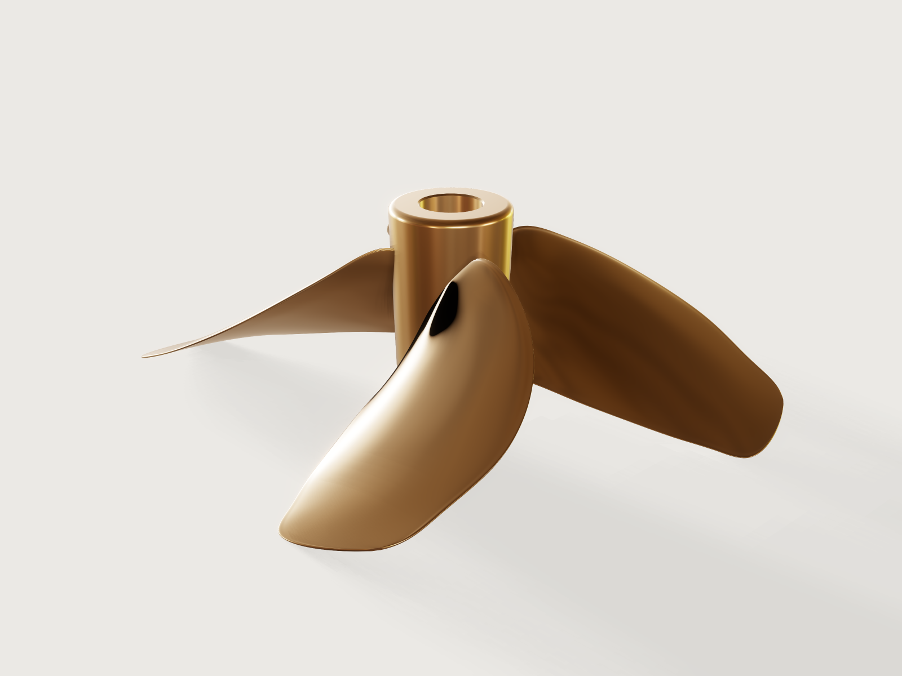

# Ship propeller

A four-blade fixed-pitch ship propeller of the Wageningen B-series, the systematic series ship designers
have chosen propellers from since the 1930s: a B4-55 of Ø 600 mm, pitch ratio 0.8 and 15° rake, cast in
nickel-aluminium bronze and bored to a 1:10 taper for a 50 mm shaft. From 0.2 R to the tip the blade
follows the series' published tables (outline, thicknesses and the section ordinates themselves), and the
model proves its expanded area ratio, its sections, its mass, its hub and its balance. Diameter, pitch
ratio and the series member (B4-40, B4-55, B4-70) are parameters.



## What it shows

- **A published series as a table.** `table.set` holds the B-series of Oosterveld and van Oossanen (1975)
  for r/R 0.2 to 1.0: Table 1's chord factor, the distances of the generator line and of the thickest
  point from the leading edge (a/c, b/c), the thickness coefficients A and B (t/D = A − B·Z), Tables 2 and
  3's ordinates V1 and V2 at the stations used, and the integrals of V2 that the checks use.
- **Sections from the series' formulas.** Every section but the small round tip is a closed
  `sketch.spline` with `live: true` through 18 points whose coordinates are formulas of the table: the
  face at V1·(t − te) and the back at (V1 + V2)·(t − te) + te above the pitch line (the paper's
  equations 2 and 3), the edges rounded off.
- **Expanded sections placed on the blade.** Each section lies on a `datum.plane` through three points:
  the point of the generator line at its radius r (raked 15° aft), a point along the chord turned from
  the plane of rotation by the pitch angle atan(P / 2πr), and one towards the back.
- **A loft and a pattern.** `feature.loft` through eleven sections makes one blade; `feature.pattern` sets
  four round the shaft.
- **A turned and keyed hub.** One revolved half section (`feature.revolve`) with the forward recess and the
  1:10 taper bore, `feature.fillet` on its ends, `feature.chamfer` on the bore's mouths, a keyway cut along
  the taper (`feature.extrude` with `cut`), joined to the blades with `feature.boolean`.
- **Helpers for cheap, exact checks.** The union keeps the hub as a body of its own (`keepTool`), a
  `feature.transform` keeps a copy of one blade, and the expanded blade outline is drawn from the table as
  on a propeller drawing; all three are hidden (`feature.visible`), and so is the outline's sketch, which
  lies below the propeller and would otherwise widen the view it opens in. Cutting them costs a fraction of
  cutting the whole propeller.
- **Material, outputs and checks.** `material.preset` and `body.material` (nickel-aluminium bronze, its
  density a variable); `variable.measure` and `variable.output` for the mass and the expanded area ratio;
  `assert.add` for the checks below.

## The real thing

- **The series.** M. W. C. Oosterveld and P. van Oossanen, *Further computer-analyzed data of the
  Wageningen B-screw series*, International Shipbuilding Progress 22 (251), 1975 (NSMB publication 479):
  Table 1 (dimensions of the four- to seven-bladed series), Tables 2 and 3 (V1 and V2), equations 2 and 3
  (the section's face and back).
- **Outline and thickness.** At each r/R the chord is c = factor · D · (AE/A0) / Z, the leading edge lies
  a/c · c ahead of the generator line, the section is thickest b/c · c behind the leading edge, and its
  thickness is t = (A − B·Z) · D. At the defaults the root (0.2 R) is 137.1 mm long and 21.96 mm thick.
- **Sections.** Back (V1 + V2)·(t − te) + te, face V1·(t − te), with P = 1 at the leading edge, 0 at the
  thickest point, −1 at the trailing edge. The spline passes through the back at P = ±0.95, ±0.8, ±0.4 and
  0, the face at ±0.95, ±0.6 and 0, both edges and the edges' rounds, so the inner sections keep the
  series' raised face edges (V1) and the outer ones their flat face and nearly circular back. The paper
  leaves the edge thickness te to the classification society and the foundry; here it is the series' own
  tip thickness, 0.0030 D (1.8 mm), rounded off.
- **What the table does not give.** Inside the hub a section at 0.75 of the hub's radius: the 0.2 R
  section scaled until it lies 2 mm inside the hub (to 0.712 of it at the defaults, its chord turned to
  the pitch angle there, 63.9°), so the blade root runs into the hub and the union finds where it meets
  it. Near the tip a section at 0.975 R: the outline between 0.9 R and the tip continued as a parabola,
  c ∝ √(1 − r/R) (chord factor 0.791), the thickness falling linearly to the series' 0.0030 D at the tip;
  the leading edge kinks slightly there. At R a small rounded end, 4 te long and te thick.
- **The root narrows at the hub.** A flat section on the plane that touches its cylinder at r reaches out
  to √(r² + w²), where w is how far it reaches across the blade (its chord turned to the pitch angle, and
  its thickness); the section that must lie 2 mm inside a hub of D/6, at 0.75 of the hub's radius, is
  therefore the series' 0.2 R section scaled to 0.712, and the loft narrows towards it. Cut in planes square to the blade, the blade has
  2076.5 mm² at 0.2 R but 1789.8 mm² at the hub's radius (13.8 % less), and its least second moment falls
  from 58 285 to 45 094 mm⁴ (22.6 % less): the most loaded section is the weakest, with a sharp corner
  where it meets the hub. On the real propeller the pattern maker fills the blade roots into the hub by
  hand (wax or filler on the pattern, as foundries do), which makes the root fillets and restores the
  section; this model has neither.
- **Placing the sections.** The series' sections are expanded: drawn flat, each belongs wrapped onto its
  cylinder. 3DCraft lofts flat sketches only, so each lies on the plane that touches its cylinder at the
  generator line, and away from that line it leaves both the cylinder and the pitch helicoid. The leading
  edge of the 0.2 R section stands 19.56 mm off its cylinder and 11.80 mm forward of the helicoid: the
  helix through it has a pitch of 583.4 mm, 21.5 % more than the 480 mm of the face. At 0.7 R the leading
  edge stands 17.35 mm off and 1.65 mm forward (506.4 mm, 5.5 % more). The sections are the series', but
  the blade's edges lie further from the shaft, and its outline seen along the shaft is wider, than on a
  blade whose sections are wrapped.
- **Pitch and rake.** The face pitch is P = 0.8 D = 480 mm at every radius, exactly so on the generator
  line and less so towards the edges (above); the four-blade members of the series have a pitch reduced
  towards the root, which is left out. The generator line is raked 15° aft.
  The propeller is right-handed: seen from aft it turns clockwise going ahead.
- **Hub and shaft.** The hub is Ø D/6 = 100 mm at its aft end, the series' boss: the series' chord
  factors integrate to π/2, the expanded area of the nominal ratio, from r/R = 1/6 (to within the 0.2 %
  the area check finds). The boss widens forward at a 2° draft, so its pattern draws from the sand (about Ø 104 mm where
  the blades meet it, Ø 111 mm at its forward end; the root cut "at the hub's radius" lies just inside it). It is
  long enough that the 0.2 R section's full chord and thickness, turned to the pitch angle at 0.75 of the
  hub's radius (the steepest the root gets), stay inside it by the end rounds and 5 mm: 158.5 mm. That
  the root stays inside is by this construction, not asserted: a cut of the blade costs load time, and at
  the aft end the raked outer blade passes the hub's plane far out. The bore is the metric 1:10 taper of
  ISO 4566 as propeller makers list it for a 50 mm shaft ([an
  example](https://cdn.shopify.com/s/files/1/0018/9595/6527/files/Taper-Dimensions.pdf)): 120 mm long, Ø
  50 mm to Ø 38 mm at the aft face, where the nut bears. Forward of it a relief counterbore of Ø 56 mm (3
  mm clear of the shaft all round), 38.5 mm deep, takes up the length the blade root needs beyond the
  taper. The keyway is for a DIN 6885-1 key 14 × 9 (shafts over 44 to 50 mm): 14 mm wide and 3.8 mm deep
  in the hub, along the taper. The hub's ends are rounded D/96, the bore's mouths chamfered 1.5 mm.
- **Material and making.** Nickel-aluminium bronze CuAl10Fe5Ni5-C (EN 1982, CC333G), 7.6 g/cm³, a usual
  alloy for cast propellers: sand cast, the blades ground and polished, the bore turned to the taper and
  the keyway slotted, then balanced. Mass at the defaults: 19.23 kg.
- **Left out.** The root fillets that join a real blade to its hub (3DCraft refuses them here, see
  *Platform notes*; the narrowed root above is what that leaves), the B4 series' root pitch reduction,
  the boss cap and the nut, and the manufacturing tolerances of ISO 484-2 (for Ø 0.8 to 2.5 m, so only
  the top of the range).

## Parameters

| Parameter | Range | Default |
|---|---|---|
| Diameter | 500 to 800 mm, in steps of 50 mm | 600 mm |
| Pitch ratio P/D | 0.6 to 1.2, in steps of 0.05 | 0.8 |
| Expanded area ratio | 0.40, 0.55 or 0.70 (B4-40, B4-55, B4-70) | 0.55 |

The bore stays that of a 50 mm shaft over the whole range.

## Checks

- **Expanded area ratio of the series member.** Four times the area of the expanded blade outline, drawn
  from the table from the hub's radius to the tip, over the disc's area πR²: 0.5492 against the nominal
  0.55, within 2 %.
- **Four blades.** The propeller has four blade tips.
- **Blade from its root section to the diameter.** The blade (its hidden copy) cut along its generator
  line reaches from its root section in the hub to the tip: 262.5 mm, R less 37.5 mm, so the propeller
  is Ø 600 mm.
- **Section at 0.7 R as the series' ordinates.** The blade's copy cut in the plane of its 0.7 R section has
  1227.44 mm²; the series gives 1229.33 mm²: (t − te) times the chord before and after the thickest point,
  each times the integral of V2 over it (Simpson's rule over Table 3), plus te times the chord and the
  edges' rounds. Within 2 %.
- **Bronze mass as the hub and four series blades.** 19.234 kg against 19.132 kg for the hub (measured
  on its own) and four blades whose volume is Simpson's rule over the series' section areas from 0.2 R to
  0.8 R, trapezoids from there to the tip and across the narrowed root; within 3 %.
- **Hub at its aft end: bore, taper and keyway.** The hub cut one and a half end rounds in from its aft
  face is exactly the closed form, 6707.21 mm²: its disc at that point of the 2° boss, less the bore at
  that point of the 1:10 taper, less the keyway (the 14 mm strip up to its 3.8 mm depth, less the circle
  segment that is bore already).
- **Hub at its forward end: counterbore.** Likewise at the forward end: the disc less the Ø 56 mm
  counterbore, 7112.10 mm².
- **Boss drawn from the mould.** `measure.draft` of the boss, pulled aft: at least 2° (2.000°, proven).
- **Balanced about the shaft axis.** The centre of mass lies 0.066 mm off the axis along x (the keyway's
  side) and on it along y, within a limit of 0.25 mm chosen here (not a figure of ISO 484-2); the foundry balances the finished propeller
  statically in any case.

`craft3d-cli check-range` proves all of them at the defaults, the eight corners of the parameter box
and random points in it (`tools/examples.py check`).

## Files

- `ship-propeller.3dcraft`: the model.
- `build.json`: the steps that build it.
- `exports/ship-propeller.step`: the exact geometry of the propeller, for the pattern shop and for
  machining the bore.

## Rebuild

```sh
tools/examples.py build ship-propeller
# or
craft3d-cli run --new '{"units":"mm"}' --script examples/17-ship-propeller/build.json --out propeller.3dcraft
```

The tool needs the 3DCraft build this repository is pinned to: see [Rebuild and check](../../README.md#rebuild-and-check)
in the README.

## Difficulty

**8 / 10** (the reviewer): eleven lofted sections whose points are formulas over a published series' table, planes turned to the pitch angle, many coupled formulas and several kernel limits worked round; one loft and one pattern, no G2 surfacing.

## Platform notes

- **No root fillets.** A rolling-ball fillet between a lofted blade and its hub is refused ("the rolling
  ball along this edge could not be followed") at every radius tried on this propeller, down to 0.5 mm.
  A minimal case, an elliptic fin on a cylinder, shows it is refused as soon as the radius passes the
  fin's edge radius of curvature, though the ball rolls on the convex side
  ([F-008](../../3DCRAFT-FEEDBACK.md#f-008)).
- **Sections on cylinders.** Loft sections can only be flat, so the expanded sections are laid on planes
  tangent to their cylinders ([F-007](../../3DCRAFT-FEEDBACK.md#f-007)).
- **Splines, not formula curves.** The catalogue asked for `sketch.curve`. Formula-curve sections fitted
  at this tolerance carry about a hundred control points each, and the loft through eleven of them took
  tens of seconds ([F-010](../../3DCRAFT-FEEDBACK.md#f-010)); live splines through the series' own
  ordinates, which is how the series gives its sections, loft in a fraction of a second.
- **Rounded edges.** With sharp edges (te = 0), as the paper's equations allow, the propeller took many
  times longer to open and some of its cuts were refused; rounded edges of 1.8 mm fixed both.
- **The section in the hub.** It sits at 0.75 of the hub's radius. At 0.8 the loft's edge lay 1.0 mm off
  its own face at P/D 0.7, and every cut of the blade was refused ([F-124](../../3DCRAFT-FEEDBACK.md#f-124)); inside the bore's reach, or with the root trimmed by a
  cylinder, the union was refused at some points of the range.
- **Tolerance.** The document's tolerance is 0.05 mm (`document.setTolerance`), finer than any foundry
  holds on a propeller, for the load time.
- **Load time.** Measuring the joined propeller's volume (its blade faces trimmed by the hub) is the
  largest single share of the time it takes to open, more than the pattern and the union together
  ([F-093](../../3DCRAFT-FEEDBACK.md#f-093); the pattern: [F-125](../../3DCRAFT-FEEDBACK.md#f-125)).
- **Measures on freeform bodies.** A planar cut of the whole propeller costs several times a cut of one
  blade, however far from the blades it lies, so the checks cut the hidden copy of one blade and the
  hidden hub
  ([F-076](../../3DCRAFT-FEEDBACK.md#f-076), [F-093](../../3DCRAFT-FEEDBACK.md#f-093)).
- **Preview.** Drawn with `reflections: false`: the screen-space reflections smear streaks onto the hub
  and the bore ([F-013](../../3DCRAFT-FEEDBACK.md#f-013)).
- **Names.** The blade's two side faces share one name ([F-064](../../3DCRAFT-FEEDBACK.md#f-064)); the
  keyway's cutting extrusion keeps the automatic name `Extrude1`
  ([F-002](../../3DCRAFT-FEEDBACK.md#f-002)).

## Licence

[MIT](../../LICENSE), like everything in this repository; credit line in the
[README](../../README.md#licence).
