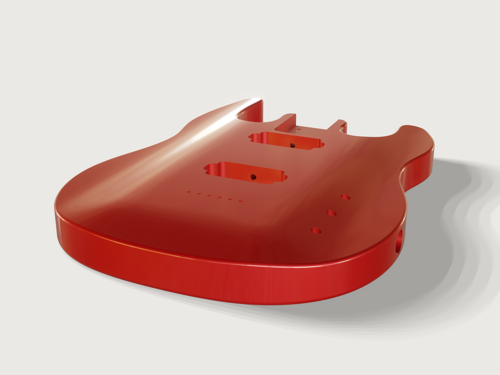

# Electric guitar body

An original double-cutaway solid body, ready for the CNC router: a carved top that falls away from a level
plateau, a bolt-on neck pocket, two humbucker routes, a rear control cavity with its cover recess, wiring
channels, an output jack and a string-through hardtail bridge. The bridge, its string holes and the bridge
pickup are placed by formulas from the scale length, so the same body takes a 24 in to a 27 in neck, and
the body checks its own pocket depths, router corners and bridge position.



## What it shows

- **A freeform outline.** One closed `sketch.spline` through 63 points, the tight parts placed on arcs:
  a double cutaway whose cutaways are open C-curves from the neck pocket out to two tapered horns that
  lean in, and a body end square to the neck. `feature.extrude` makes a blank 5 mm thicker than the body.
- **A carved top as a surface.** The carve is a Gordon surface (`feature.surface.network`) through
  11 curves across the body and 13 along it, each a cubic B-spline drawn from its control polygon
  (`sketch.spline` with `control`). Two tables (`table.set`) hold the carve's control factors across and
  along the body; the curves' heights are formulas of the body thickness and the carve depth, and the
  height where two curves cross is the B-spline's value at a knot, (P<sub>k-1</sub> + 4 P<sub>k</sub> +
  P<sub>k+1</sub>) / 6, worked out in 15 variables, so the two families meet exactly. The result is a
  level plateau, exactly flat where four control factors in a row are 1, and a smooth (C2) fall of
  10 mm to the rim with no overshoot. `feature.boolean` `intersect` cuts the blank with it.
- **Pockets by cuts.** `sketch.path` draws the neck pocket (straight sides, a 5 in heel arc and two
  1/4 in corners, tangent to each other by formulas), the two humbucker routes with their ears, the
  control cavity and the cover recess as stadiums; `feature.extrude` with `cut` routes them, from a sketch
  at each floor's height upward or from the back. `sketch.circle` places the string holes, the pot holes,
  the neck screw holes, the ferrule bores and the cover screw pilots.
- **Drilled channels.** `feature.cylinder` makes the drills: a 1/4 in channel from the neck pocket
  through the neck route into the bridge route, one drilled 20° up from the open control cavity into
  the bridge route, and the 7/8 in jack bore straight through into the cavity; `feature.boolean`
  unites and subtracts them.
- **Formulas from the scale length.** The 22nd fret lies at L (1 − 2<sup>−22/12</sup>) from the nut, the
  fretboard ends 1/4 in beyond it at the heel, so the nut, the saddle line, the string holes and the
  bridge pickup all follow L; the neck pickup keeps a 6 mm wall to the pocket.
- **Roundovers last.** `feature.fillet` with `chain` rounds the back edge (3/16 in) and the top edge
  (1/8 in) along the whole outline, the top one running out into the neck pocket's walls. They come
  after every cut, which keeps the cuts cheap: a boolean on a body with these long fillet faces costs more.
- **Finish and weight.** `material.preset` `car-paint` gives the candy-apple red with its clear coat;
  `body.material` gives red alder's density; `variable.measure` reports the mass.
- **Checks.** `assert.add` with `distance`, `value`, `count` and `continuity` measures (below), proven
  over the parameter range by `craft3d-cli check-range`.

## The real thing

- **Type.** An original double-cutaway solid body with a carved top and a bolt-on neck, built like an
  arched-top bolt-on: the neck heel, both pickups and the bridge sit on a level plateau 100 mm wide that
  runs from behind the bridge to the neck, so the neck needs no angle and a flat hardtail bridge works
  as on a flat-top body. The carve falls the full 10 mm from the plateau to the rim over 100 mm at the
  sides and runs out 3.55 mm above the rim at the tail. Outline 331 mm wide and 448 mm long; 45 mm thick
  at the plateau (about 1-3/4 in), 35 mm at the rim.
- **Outline.** The cutaways are open C-curves: from the body's square end at the pocket mouth, beside
  the pocket (14.2 mm of wood at y 345), down to their bottoms at 328 mm from the tail, which is the
  20.4th fret's place at 648 mm, so all 22 frets can be reached, and out to the horn tips. The horns
  taper from 74 mm (bass) and 73 mm (treble) at their roots to 42 mm and 43 mm near their tips and lean
  in; the bass tip ends 448 mm from the tail, by the 12th fret (452 mm). The body ends square to the
  neck at the pocket mouth, its corners rounded 12 mm. Sampled with `measure.curvature`, the outline's
  tightest inside curve is 16.2 mm and its tightest outside curve 8.9 mm (the end's corners).
- **Scale.** 648 mm (25.5 in), 22 frets. The saddle line lies at the scale length from the nut; the
  hardtail's saddles move back from it for compensation.
- **Neck pocket.** 2-3/16 in wide, 3 in long and 5/8 in deep, the common Fender-pattern pocket
  ([Warmoth](https://warmoth.com/guitar-body-neck-pockets);
  [StewMac](https://www.stewmac.com/video-and-ideas/online-resources/routing-and-templates/neck-pocket-routing-template-for-fender-instructions/):
  3 in long, 5/8 in deep, a 1/2 in bearing bit). The heel end is a 5 in arc with 1/4 in corners, as
  Fender's drawings are quoted on [unofficialwarmoth.com](https://unofficialwarmoth.com/threads/neck-pocket-dimension-for-front-of-heel.31172)
  (second-hand; check your neck). Four 3/16 in neck screw holes 1-1/2 in × 2 in apart, for the
  2 in × 2-1/2 in neck plate ([StewMac neck mounting plate](https://www.stewmac.com/parts-and-hardware/all-hardware-and-parts-by-instrument/electric-bass-parts/neck-mounting-plate)).
- **Bridge.** A string-through hardtail with 10.5 mm string spacing (52.5 mm across six strings), such
  as the [StewMac hardtail](https://www.stewmac.com/parts-and-hardware/all-hardware-and-parts-by-instrument/electric-guitar-parts/electric-guitar-bridges-and-tailpieces/non-trem-electric-guitar-bridges/stewmac-hardtail-bridge/)
  (plate 72.4 × 37.9 mm). Six 1/8 in string holes 25 mm behind the saddle line, a design value for that
  plate: set it to your bridge's drawing. On the back six 5/16 in ferrule bores, 11/32 in deep
  ([StewMac ferrules](https://www.stewmac.com/item/0173)). The three mounting screws are drilled at
  assembly with the bridge as the template.
- **Pickups.** Two humbucker routes 72 × 40 mm with 20 mm ears to 87 mm overall for the base plate's
  legs, corners of the 1/2 in bit's radius, as laid out in the
  [ProjectGuitar humbucker routing tutorial](https://www.projectguitar.com/tutorials/instrument-building/router-basics-humbucker-pickup-routing-with-pickup-ring-r73/)
  (a covered humbucker is 2.745 × 1.495 in with its screws 3.063 in apart:
  [pickup dimensions](https://killerrig.com/electric-guitar-pickup-dimensions-guide/)). 21 mm deep,
  what a short-leg humbucker takes ([thefretboard.co.uk](https://thefretboard.co.uk/discussion/comment/3352236)).
  The bridge pickup's centre is 42 mm ahead of the saddle line (a design value; makers differ). The neck
  pickup sits as close to the neck as a 6 mm wall to the pocket allows, centred 277.8 mm from the tail.
  The 24th-fret node, where many two-humbucker guitars centre it, is 290.3 mm from the tail, inside this
  route: a route centred there would run 6.5 mm under the end of the board.
- **Controls.** Neck volume, bridge volume and master tone, a blend with no pickup selector: the two
  volumes mix the pickups. Three long-shaft pots (3/4 in thread, 3/8 in-32, a 3/8 in hole, as CTS makes
  them for carved tops) in a line on the treble lower bout. They sit on the carve's slope, where the wood
  over the cavity is 9.06 mm, so each bushing stands about 10 mm proud of the top under its knob. The
  rear cavity is a stadium 50 mm wide, its ceiling 15.05 mm below the plateau (the 3/4 in thread less
  4 mm for washer, nut and a thread showing), under a 2 mm deep cover recess 6 mm wider all round with
  four 1/16 in pilot holes.
- **Output jack.** A 7/8 in bore on the widest point of the lower bout, straight through into the
  cavity as on a Telecaster, for an Electrosocket-type cup (7/8 in hole,
  [Philadelphia Luthier Tools](https://www.philadelphialuthiertools.com/electronics/jacks/jack-plates/electrosocket-jackplate))
  holding a Switchcraft jack, whose body reaches into the cavity. The cup's flange, 0.989 in across in
  [Montance's](https://montancesguitarwiring.com/products/jack-plate-for-telecaster-guitars-electrosocket-style-made-in-usa)
  listing, needs a flat: the bore is centred on the straight part of the side between the two
  roundovers, 27.06 mm tall at 45 mm and 26.06 mm at 44 mm, the thinnest body.
- **Wiring.** A 1/4 in channel drilled with a long bit from the neck pocket, along the floor, through the
  neck route into the bridge route; a second one drilled 20° up from the open control cavity into the
  bridge route's end, a line a straight drill can reach from below the back.
- **Material and finish.** Red alder, 450 kg/m³ ([The Wood Database](https://www.wood-database.com/red-alder/)),
  a common body wood under solid finishes. Candy-apple red is a translucent red over a metallic base
  under a clear coat, so the finish keeps the car-paint preset's metallic 0.4 and its clear coat. Mass of
  the routed body: 1.827 kg.
- **Making it.** Glue and plane a 50 mm alder blank. On a 3-axis CNC router: surface the plateau, rout
  the outline with a 1/2 in bit (its inside curves are larger than the bit), carve the top with a ball-nose cutter, rout the pocket and the routes from the
  top and the cavity and the recess from the back with the 1/2 in bit, in passes of 5/16 to 3/8 in;
  drill the string holes and ferrule bores, the pot and neck screw holes, the channels and the jack;
  round the back edge with a 3/16 in and the top edge with a 1/8 in roundover bit; sand, paint, clear coat.
- **Simplified, or left out.** Strap button pilots and the bridge's screw holes (drilled at assembly);
  the ground wire to the bridge; a pickguard or pickup rings; the route mouths and pocket edges are
  left sharp as routed, the finish eases them.

## Parameters

| Parameter | Range | Default |
|---|---|---|
| Scale length | 610 to 686 mm (24 to 27 in), step 1 mm | 648 mm (25.5 in) |
| Body thickness (at the plateau) | 44 to 50 mm, step 0.5 mm | 45 mm |

The scale moves the bridge along the body: the saddle line lies 138.97 mm from the tail at 610 mm,
128.31 mm at 648 mm and 117.65 mm at 686 mm; the bridge pickup follows it, the pocket and the neck pickup
stay. The thickness moves the plateau, the rim and every floor with it: the body weighs 1.781 kg at 44 mm
and 2.057 kg at 50 mm. It starts at 44 mm so that the jack's flange still sits on the straight side.

## Checks

- **Bridge placed by the scale length.** The least distance from the pocket's 5 in heel arc to the
  string hole nearest the centre line must equal the closed form
  √((s/2)² + (R + L·2<sup>−22/12</sup> − m + d)²) − R − r (string spacing s, heel radius R, scale L,
  board end margin m, string hole setback d, hole radius r), within 0.01 mm: 198.943 mm at 648 mm,
  188.281 mm at 610 mm, 209.605 mm at 686 mm.
- **Neck pocket floor** 29.125 mm above the back, and **Neck pocket 5/8 in deep**: 15.875 mm from the
  floor to the carved top.
- **Pickup routes as deep as the pickups need**: 21.000 mm from their floors to the top.
- **Long-shaft pots reach through the top**: the plateau less the cavity ceiling (measured from the
  cover recess's floor, 27.95 mm, plus the 2 mm recess) is 15.05 mm, no more than the pots' reach of
  15.05 mm (the check allows 0.01 mm).
- **Wood over the control cavity**: at least 5 mm everywhere between the cavity ceiling and the carved
  top (5.467 mm, where the carve is lowest over the cavity).
- **Wall between the neck pocket and the neck route**: at least 6 mm (6.000 mm).
- **No corner face of a radius under the bit**: no partial cylindrical face (a rounded corner, inside or
  outside; a full bore is not counted) of a radius below 1/4 in (counted: 0), and **Route and pocket
  corners cut by the 1/2 in bit**: 18 such faces of exactly 1/4 in radius (2 in the pocket, 8 in each
  route). A sharp inside edge has no face and is not counted: the only sharp edges in the routes are where
  the ears meet the main rectangle, outside corners of the wood that the bit leaves sharp.
- **Pickups spaced by the scale**: the gap between the two route floors equals its closed form in L:
  67.489 mm at 648 mm (56.825 mm at 610, 78.152 mm at 686).
- **Six string holes** of 1/8 in.
- **Back roundover tangent to the back**: `measure.continuity` proves the back edge's roundover meets
  the flat back with one tangent plane (G1) all along the edge.
- **Jack flange seats on the straight side**: the bore's measured height above the back (7.18 mm) less
  the back roundover, and the straight side's top (rim less top roundover) above the bore, the smaller
  of the two at least half the flange's overhang, (0.989 − 0.875) in / 2: 2.419 mm against 1.448 mm
  (1.919 mm at 44 mm).

`craft3d-cli check-range` proves all thirteen at 13 points: the defaults, the four corners of the range and
eight random points.

What is not asserted: that the plateau is level is true by construction (four control factors of 1 in a
row make a cubic B-spline exactly flat) and is seen in the pocket and route depths, which are measured
to the top; the outline's inside curves against the router bit are sampled, not proven
([F-087](../../3DCRAFT-FEEDBACK.md#f-087)).

## Files

- `guitar-body.3dcraft`: the model.
- `build.json`: the 211 steps that build it.
- `exports/guitar-body.step`: the exact geometry for CAM.

## Rebuild

```sh
tools/examples.py build guitar-body
# or
craft3d-cli run --new '{"units":"mm"}' --script examples/18-guitar-body/build.json --out guitar-body.3dcraft
```

The tool needs the 3DCraft build this repository is pinned to: see [Rebuild and check](../../README.md#rebuild-and-check)
in the README.

## Difficulty

**7 / 10** (the reviewer): a freeform spline outline, a Gordon network of 24 B-spline curves with knot formulas from tables, and pockets and angled drills tied to the scale length, built around kernel limits F-120 to F-122.

## Platform notes

- **Tolerance.** The document's tolerance is set to 0.01 mm (`document.setTolerance`), far below what
  wood holds or a router cuts: the model opens in 2.26 s (7.48 s of CPU); in a trial at 1e-4 mm it took
  3.67 s and 13.5 s of CPU, over the gallery's budget.
- **Jack check.** The flange check measures the bore's height above the flat back and takes the
  roundovers' radii and the rim height from the design: a `distance` from the bore to the two roundover
  faces proves the same directly but cost about 1.8 s of load time here.
- **Preview.** At full size the dark red on the treble slope still shows a very faint diagonal hatch,
  the mesh's triangles showing through the shading; the light at [180, 26] keeps it weakest ([F-062](../../3DCRAFT-FEEDBACK.md#f-062)).
- **The carve's curves.** A sheet from a grid of control points would be one step; here 24 curve
  sketches and 15 knot formulas make a Gordon network that is exact ([F-012](../../3DCRAFT-FEEDBACK.md#f-012)).
- **Continuity on the top.** `measure.continuity` refuses the top roundover's edge on the carved top
  ("neither a parameter line of the other spline face nor a curve recovered on it", owed) and reports
  `none`, 56 mm apart, for a roundover's edge on the extruded spline side
  ([F-121](../../3DCRAFT-FEEDBACK.md#f-121), [F-120](../../3DCRAFT-FEEDBACK.md#f-120)). The model asserts the back roundover's G1 on the flat back
  instead.
- **Plateau height.** `boxMax` of the body is not proven closely enough to be an output (found
  44.990 mm, at most 45.200 mm) and costs seconds ([F-122](../../3DCRAFT-FEEDBACK.md#f-122); see
  [F-093](../../3DCRAFT-FEEDBACK.md#f-093)): the depths are measured to the top face instead.
- **Names.** The seven extrusions made by `extrude` with `cut` keep automatic names
  ([F-002](../../3DCRAFT-FEEDBACK.md#f-002)).

## Licence

[MIT](../../LICENSE), like everything in this repository; credit line in the
[README](../../README.md#licence).
