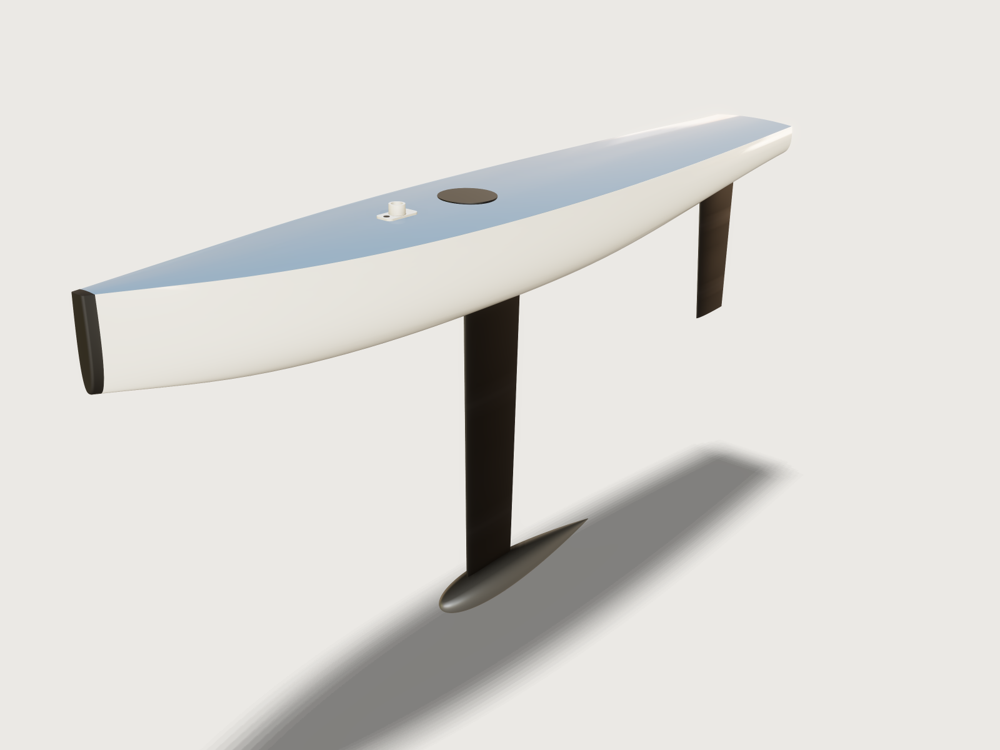

# RC yacht hull

The most sailed radio-controlled racing yacht: an International One Metre (IOM), designed here to the IOM Class
Rules 2026. A glass hull with a painted deck, lofted from a table of stations, a tapered carbon fin with a lead
bulb, a carbon rudder and the rubber bow bumper the rules ask for. The model floats itself at the class's minimum
weight of 4 kg in fresh water and proves what a class measurer checks: hull length, draft and hull depth at that
waterline, the keel and rudder masses, the keel's width, the bumper, and that the boat floats level and stable
upright.



## What it shows

- **A hull lofted from a table of stations.** `table.set` holds seven stations from the bow to the transom: per
  station its place, the sheer (half-breadth and height of the deck edge) and the control points of the section
  below it (topside, bilge and keel). Each station is a sketch on a plane across the hull: a cambered deck as a
  `sketch.spline` of degree 2 and the section as a cubic `sketch.spline` by `control` points, every coordinate a
  cell of the table. An eighth section, the bumper's nose at the bow, carries every control point of station 1
  on along the line from station 2, so the bumper continues the hull's lines. `feature.loft` passes through the
  eight sections: the closed *Hull envelope*.
- **One form, cut in two.** `feature.block` and `feature.boolean` (intersect, `keepTool`) cut the envelope at
  station 1 into the *Hull form* aft of it and the bumper's 10 mm forward of it; the bumper's nose is rounded
  3 mm (`feature.fillet`).
- **A laminate, not a solid.** `feature.plate` lays 0.6 mm of laminate behind the hull form's surface
  (`side: in`): the hull, the deck set inside the sheer (joint `under`) and the transom, three bodies. Hull and
  deck end on the plane of station 1 (joint `onto`), so no glass reaches into the bumper's 10 mm. Their masses
  and centres are those of the laminate.
- **Sections from a formula.** The fin's and the rudder's sections are `sketch.curve`s of the NACA four-digit
  thickness form, written with x = c·t² so that its √x becomes a polynomial in t. Fin and rudder are ruled
  `feature.loft`s from a root to a tip section, trimmed to the hull's outside by `feature.boolean` (subtract,
  with `keepTool`).
- **A bulb sized by its mass.** The bulb is the same thickness form turned about its chord
  (`sketch.curve`, `feature.revolve`), 42 mm in diameter. Its volume is 25π·D²·L·∫f², so its length is the bulb
  mass over lead's density over 25π·D²·∫f²; the integral is written out from the NACA coefficients. The *Bulb
  mass* parameter sets the length: 265.8 mm at 2300 g.
- **Deck fittings on a curved deck.** A `datum.plane` tilted to the deck's slope at the mast carries the
  sketches of a mast step, its deck limit mark and a hatch cover; each is extruded down `upTo` the deck's face,
  so it sits on the cambered, sloping deck, as separate small bodies (no boolean into the deck). The step is a
  plate and a tube joined by `feature.boolean`, its corners rounded; the hatch cover's top edge is rounded 1 mm.
- **Hydrostatics.** The hidden envelope (`feature.visible` false) is what floats. `variable.measure` with
  `levelFor` finds the waterline at the class's 4 kg; `sectionExtent` the waterline's length and beam;
  `centroidBelow` and `sectionInertia` the centre of buoyancy and the waterplane's moment, from which an output
  works out the metacentric height GM = KB + I/V − KG; `floatingTrim` (the measure of `measure.floating`) finds
  the trim the yacht settles at.
- **A mass budget.** `variable.measure` takes the mass and centre of mass of the seven modelled parts; variables
  carry what is not modelled (rig, radio and fittings, rudder stock), and an output works out the corrector
  weight that brings the boat up to 4000 g.
- **Materials.** `material.preset` for the white gelcoat, the painted deck, the carbon of fin and rudder, the
  lead, the elastomer, the acetal mast step and the black hatch cover; `body.material` gives each part its density from a variable (`laminate_density`,
  `carbon_density`, `lead_density`, `elastomer_density`), so a cored fin is one number away.
- **Checks.** Thirteen `assert.add` (below): the class rules, two closed forms and how the boat floats.

## The real thing

- **Class rules.** IOM Class Rules 2026 (Release 2, in force from 1 March 2026, International One Metre
  International Class Association):
  - C.4.1, with the boat floating in fresh water: draft 370 to 420 mm, hull depth at most 60 mm, hull length at
    most 1000 mm;
  - C.4.2: the boat weighs at least 4000 g; C.4.3: corrector weights are fixed in or on the hull;
  - C.6.4: the keel, without its fasteners, weighs 2200 to 2500 g; the rudder with its stock at most 75 g;
  - D.2.1: no fibre stiffer than glass in the hull and deck (so they are glass; the fin and rudder may be
    carbon);
  - D.2.2(c): the forward 10 mm of the hull is elastomer; D.2.2(d): the rudder is aft of the keel;
  - E.3.1: no appendage material denser than lead, 11340 kg/m³;
  - E.4.1: above its lowest 60 mm the keel is at most 20 mm wide.

  The terms are those of the Equipment Rules of Sailing 2025–2028: draft (C.6.4(e)) from the waterplane to the
  lowest point of the boat, hull depth (D.3.3) from the waterplane to the lowest point of the hull, hull length
  (D.3.1) from the hull's foremost to its aftmost point.
- **Sections.** The NACA four-digit thickness distribution of Abbott and von Doenhoff, *Theory of Wing
  Sections* (Dover, 1959), eq. 6.2: y = 5·t·c·(0.2969√x − 0.1260x − 0.3516x² + 0.2843x³ − 0.1015x⁴), its
  trailing edge 2.1 % as thick as the section. The fin is NACA 0007, 90 mm in chord where it meets the hull and
  75 mm at the bulb, the proportions of a commercial IOM fin (Sails etc, *370-IOM fin*: 90 mm at the hull
  tapering to 75 mm, 7 % thick). The rudder takes Sails etc's IOM blade (200 × 81 mm, 6.5 % thick) as its
  pattern: the same form at 6.5 %, 81 mm in chord at the design waterline tapering to 60 mm at its tip, 195 mm
  below it, the tip's leading edge 10 mm aft.
- **The hull** is an original design, not a copy of a class boat: 1000 mm long, the sheer falling from 75 mm
  above the design waterline at the bow to 43 mm at the transom, round-bilged sections, the deck cambered by
  6 % of its half-breadth and painted grey-blue. At 4 kg its waterline lies 0.49 mm above the design waterline;
  there it is 994.2 mm long and 157.8 mm wide, the hull 54.5 mm deep, the transom just clear of the water.
- **The keel.** Its depth (the bulb's underside below the design waterline) is 415 mm, a draft of 415.5 mm at
  the 4 kg waterline. The fin's leading edge is 443 mm from the bow, placed so that the yacht floats level; the
  bulb's thickest station sits under the middle of the fin's foot. The fin's 90 mm chord is at station 4's keel,
  54 mm below the design waterline; its root section, inside the hull, carries the taper on to 92.5 mm.
- **Masses** (glass/epoxy laminate with gelcoat 1800 kg/m³, by the rule of mixtures for E-glass about 2550 and
  epoxy about 1150 kg/m³ at 45 % fibre; solid carbon/epoxy 1600 kg/m³; lead 11340 kg/m³; elastomer
  1150 kg/m³): hull, deck, transom and bumper 443.0 g together, fin 168.8 g, bulb 2300.0 g, rudder 65.5 g. The
  keel weighs 2468.8 g, the rudder with its 8 g stock 73.5 g, within the class's 75 g; a cored blade, as many
  are, is lighter. A glass hull with gelcoat weighs about 320 g on the IOM class forum; this one's hull skin is
  281 g.
- **Not modelled, but weighed.** The rig, 300 g (an A rig can be built to 280 g, says the IOM class forum),
  its centre of gravity taken 550 mm above the design waterline at the mast, 350 mm from the bow; radio gear and
  fittings, 400 g on the hull floor 420 mm from the bow (the winch, two servos and battery of one boat on the
  forum weigh 172 g; the rest is the fin box, rudder tube, servo tray, deck fittings and hatch); the rudder
  stock, 8 g. A corrector weight of 314.7 g on the fin box makes up the 4000 g. These are estimates; they move
  the centre of gravity, so the trim and GM below depend on them.
- **Deck fittings.** A mast step for the A rig's 11.0 mm round mast (Sails etc, *IOM rig plan* RP-IOM: mast
  1800 mm, Ø 11.0 mm): a 40 × 20 × 2 mm acetal plate with a Ø 16 mm tube 10 mm tall, bored 11.4 mm for the mast's
  heel, at 350 mm from the bow. On its plate, forward of the tube and on the centre plane, the deck limit mark of
  D.1.5: a black dot 6 mm across (the rule asks at least 5 mm). Over the fin box, at station 4, a round hatch
  cover 60 mm across and 1.5 mm thick; the class does not size hatches, and I found no maker's size to cite, so
  it is a design choice large enough to reach the fin bolt. Their few grams are in the 400 g of fittings, so
  they change no number below.
- **Making it.** The hull's outside (the STEP export) is milled as a plug, and a female mould is taken off it in
  two halves split on the centre line: the topsides tumble home a little below the sheer, so a one-piece mould
  would lock the hull in, while each half draws sideways. The hull is laid up in it, gelcoat first, then glass
  and epoxy to about 0.6 mm. The deck is laid up over a cambered former, painted, and glued inside the sheer
  onto a clamp strip; the transom is part of the hull moulding (two plates here, because a plate does not turn
  a sharp corner). The bumper is a block of elastomer glued to the stem and sanded to the hull's lines. The fin
  and rudder are moulded carbon/epoxy in moulds split on the chord plane. The bulb is cast in lead in a mould
  split on its horizontal centre plane, which a body of revolution leaves without undercuts, and slotted for the
  fin's foot.
- **Simplified, or left out.**
  - The fin ends on the hull's outside: its tang in the fin box, the box itself, the rudder's stock and tube
    are not modelled (their mass is in the allowances).
  - The bulb is not slotted for the fin. The fin's foot runs 3 mm into it and overlaps it by 687 mm³, so the
    model counts 7.8 g of lead that the slot would take away (and 0.7 cm³ of displacement, which moves the
    waterline by 0.006 mm).
  - The envelope that floats has the bumper before its nose is rounded. The rounding takes 183 mm³ off the
    bumper, most of it above the water; a rounded nose in the envelope makes the hydrostatic measures two to
    three times slower.
  - No rig, sheet and jib fittings, or registration number (C.5.2); the hatch is a cover only, its opening in
    the deck is not cut.
  - The rudder's tip is square: a 2 mm rounding across a leading edge whose nose radius is a few tenths of a
    millimetre there is refused, rightly.

## Parameters

| Parameter | Range | Default |
|---|---|---|
| Bulb mass | 2100 to 2320 g, in steps of 10 g | 2300 g |
| Keel depth (the bulb's underside below the design waterline) | 375 to 418 mm | 415 mm |

The total stays 4000 g: a heavier bulb leaves less corrector weight. At 2100 g and 375 mm the keel weighs
2247.8 g and the corrector 535.7 g; at 2320 g and 418 mm the keel weighs 2490.4 g and the draft is 418.5 mm.

## Checks

- **Hull length within IOM C.4.1.** The envelope's length along x is at most 1000 mm (999.96 mm found on its
  mesh; the bumper's nose and the transom are planes at 0 and 1000 mm).
- **Draft within IOM C.4.1.** The bulb's lowest point lies between 370 and 420 mm below the 4 kg waterline.
- **Hull depth within IOM C.4.1.** The hull's lowest point is at most 60 mm below that waterline (54.5 mm).
- **Weighs the class minimum with its corrector (C.4.2).** The modelled parts and the allowances leave a
  corrector weight of at least 0 g (314.7 g at the defaults).
- **Keel mass within IOM C.6.4.** Fin and bulb weigh 2200 to 2500 g (2468.8 g).
- **Rudder mass within IOM C.6.4.** Blade and stock weigh at most 75 g (73.5 g).
- **Fin within the keel width of IOM E.4.1.** The fin is at most 20 mm wide anywhere (6.3 mm at its root).
- **Bulb within the lowest band of IOM E.4.1.** The bulb is at most 60 mm tall, so above the keel's lowest
  60 mm there is only fin.
- **Bumper is the forward 10 mm (IOM D.2.2).** At the 4 kg waterline, where a collision strikes, the elastomer
  bumper's section is 10 mm long.
- **Bulb mass from the density of lead.** The revolved bulb, weighed by the kernel with lead's density, weighs
  the *Bulb mass* within 0.01 g: the closed form of the NACA body of revolution (∫f² = 0.0055077) holds
  (2300.0007 g).
- **Fin section to NACA 0007.** Halfway down the fin, its section's area equals 10·t·c²·∫f with the chord there,
  83.76 mm, and ∫f = 0.0685083: 336.43 mm², measured 336.45 mm².
- **Floats level.** Floating free, the yacht trims less than `trim_max`, a quarter of a degree, 4.4 mm over the
  hull's length (0.003° at the defaults).
- **Stable upright.** GM = KB + I/V − KG is positive: KB −43.91 mm, I/V 45.37 mm, KG −200.23 mm, GM 201.7 mm.

How the waterline and the trim are found: the fin, bulb and rudder lie wholly below the water, so their buoyancy
is a fixed force at their centroid. The 4 kg waterline is the level at which the envelope holds 4000 cm³ less
the appendages' 349.2 cm³ (`levelFor`); and the yacht floats exactly as the envelope alone would under the
yacht's weight less the appendages' buoyancy, acting at the point where the two balance
(`floatingTrim`). Floating the envelope with the appendages takes several times longer for the same answer.

`craft3d-cli check-range` proves all thirteen at 13 points: the defaults, the four corners of the two ranges
and eight random points.

## Files

- `rc-yacht-hull.3dcraft`: the model.
- `build.json`: the 221 steps that build it.
- `exports/rc-yacht-hull.step`: the hull, deck, transom, bumper, fin, bulb and rudder, for the plug, the fin and
  rudder moulds and the bulb's casting pattern (the deck fittings are bought or made apart).

## Rebuild

```sh
tools/examples.py build rc-yacht-hull
# or
craft3d-cli run --new '{"units":"mm"}' --script examples/19-rc-yacht-hull/build.json --out rc-yacht-hull.3dcraft
```

The model is built at a tolerance of 0.02 mm (`document.setTolerance`), fine for a 1 m hull and its moulds and
lighter to load than the default. It opens in 2.7 s (8.2 s of CPU) and the file is 146 KB.

## Difficulty

**8 / 10** (the reviewer): a lofted hull from a table of offsets with a faired bumper section, plated with joints, NACA sections from formulas, and a mass and hydrostatics budget coupled across seven bodies with class-rule knowledge.

## Platform notes

- **The laminate is plated, not shelled.** `feature.shell` of the lofted hull takes 18 to 29 s (and was refused for
  thinner bows, [F-009](../../3DCRAFT-FEEDBACK.md#f-009)); `feature.plate` lays the same laminate in 0.2 s per
  face ([F-126](../../3DCRAFT-FEEDBACK.md#f-126)).
- **The fin's foot is let into the bulb.** An extrusion `upTo` the bulb's face is refused ("a rational
  freeform face as the end of an extrusion"), and subtracting the bulb from the fin costs 0.5 to 1 s; the fin's
  foot overlaps the bulb instead ([F-115](../../3DCRAFT-FEEDBACK.md#f-115)).
- **Floating the appendages costs.** `measure.floating` of the hull with fin and bulb takes several times as long
  as of the hull alone, though the appendages are wholly below the water; the model floats the envelope under
  the net weight ([F-128](../../3DCRAFT-FEEDBACK.md#f-128)).
- **A rounded edge slows the hydrostatics.** A 3 mm fillet on the 10 mm bumper, joined into the envelope, makes
  `levelFor` and `measure.floating` of it two to three times slower, so the envelope takes the bumper before its
  nose is rounded ([F-129](../../3DCRAFT-FEEDBACK.md#f-129)).
- **A plane under a spline body's bottom is refused.** `measure.below` and `measure.levelFor` refuse a plane that
  passes between a spline body's lowest point and its control net ("nothing ... was found below the plane, yet it
  may reach ... below it"); the bumper alone could not be floated ([F-127](../../3DCRAFT-FEEDBACK.md#f-127)).
- **No box outputs on the bulb.** `variable.measure` of `boxMin` or `extent` of the revolved bulb is unknown
  ("not proven closely enough to be a value"), so the draft is asserted as a bound on the bulb's `boxMin` and
  reported as the waterline plus the keel depth ([F-057](../../3DCRAFT-FEEDBACK.md#f-057)).
- **Preview.** Rendered at `look.rotation` 180 with the key light high (`light` [60, 84]): at rotation 0 the
  warm key light tints the white gelcoat cream ([F-054](../../3DCRAFT-FEEDBACK.md#f-054)), at 270 the carbon
  reads gold. The carbon's solid texture is set with `wrap: false`: wrapped round the fin's axis it draws a
  bright streak across it. Its clear coat is turned down to 0.2: at 0.5 the rudder mirrors the warm light
  and reads brown beside the black fin.

## Licence

[MIT](../../LICENSE), like everything in this repository; credit line in the
[README](../../README.md#licence).
