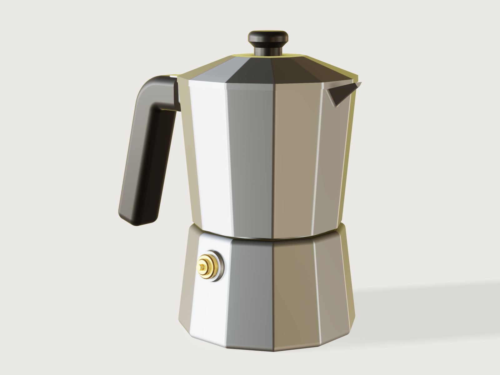

# Moka pot

A stovetop espresso maker of the classic kind, but an original twelve-sided design: a boiler, a funnel
with its coffee basket, a filter plate and gasket, a collector with its column and spout, a hinged lid, a
brass safety valve and a black handle, ten parts in all, for 3, 4 or 6 cups. Its sizes come from the physics
of brewing rather than from a drawing: the boiler's floor is placed so that the water for the cups ends
just under the safety valve, the basket holds the coffee for that water, and the collector holds all of it
below the column's mouth. The model proves the capacities, the drafts of its die-formed walls, that the pot
stands on a 10° slope empty and brewed, that the lid opens to 90° on its hinge and that no two parts collide.



## What it shows

- **Twelve-sided castings from one line.** Each twelve-sided outline is one `sketch.line` repeated as a
  closed ring by `sketch.pattern` (`chain` with `angle`), so a facet keeps its name (`side(e3[9])`) and a
  size change moves all twelve.
- **Draft where the die forms the wall.** `feature.draft` narrows the boiler's facets upward by 7° (the die
  is drawn up off them), flares the collector's facets and its chamber's by 5°, and tilts the column, the
  handle lug's sides and the valve boss by 1.5° (the boss about its own base face). `measure.draft` proves
  them as assertions (all but the valve boss's, which is drafted but not asserted), each against the direction its die part is drawn; the lid's band is drawn with the
  same 1.5°.
- **Cores you can measure.** The boiler's cavity is a sand core: a twelve-sided prism tilted with the
  outside so the wall stays 3 mm, rounded, with the neck on top, subtracted by `feature.boolean` with
  `keepTool`. The collector's chamber is a drafted metal core with the column as a blind hole. Both cores stay
  as hidden bodies (`feature.visible`), and `volumeBelow` and `levelFor` on them measure what the boiler and
  the collector hold.
- **Sizes from the physics.** The boiler's depth solves the volume of a twelve-sided frustum for the water
  (`pow(…, 1 / 3)`, corrected once for the funnel's tube and the rounds); the column's height does the same
  for the collector.
- **Revolved sheet and turned parts.** The funnel, the gasket, the valve (with its plunger), the knob and
  the collector's turned bore are half sections turned by `feature.revolve`; the bore is cut in the same step
  (`cut`).
- **Perforations by pattern.** The 217 holes of the filter plate and the 91 of the funnel's floor are a
  hexagonal lattice: a seed circle, a `sketch.pattern` grid of one sixth with `skip`, and a `sketch.pattern`
  of that pattern six times round (`patterns`).
- **Lofts.** A ruled `feature.loft` between two similar triangles makes the spout's beak, a second one
  raised by the wall thickness cuts its pour channel through the rim, and `feature.fillet` rounds its keel
  and root. The lid is a ruled loft through three twelve-gons (its band and its low pyramid), rounded, then
  hollowed by `feature.shell`.
- **A working hinge.** The lid's ear is a full 4 mm plate whose outer edge is an arc about the pin
  (`sketch.path` with an arc by its centre), in a slot that reaches beyond that arc. A hidden copy of the lid
  turned 90° about the pin (`feature.transform` with `keep`) is checked against the collector and the
  handle.
- **A swept handle.** A rounded section carried by `feature.sweep` along a line, an arc and the grip line at
  the *Handle angle*, its end rounded, its socket cut by subtracting the collector (`keepTool`).
- **A threaded joint.** `feature.thread` marks the boiler's collar M68 × 2 and the collector's bore with
  the mating internal thread, and the valve and its tapped hole M10 × 1 (cosmetic threads).
- **Tables.** `table.set` holds the three sizes (cups, gasket, thread, base) and `variable.publish` turns
  them into the *Cups* choice; a second table holds the bought-in valve's dimensions.
- **Outputs and checks.** `variable.measure` and `variable.output` for the water, the basket, the collector,
  the mass, the centre of mass and the tipping angles; `assert.add` with `value`, `draft`, `distance`, `count`
  and `overlap` (below).

## The real thing

- **Product standard.** EN 13248:2002, *Cookware — Coffee makers for domestic use with an independent
  heat source*, covers pots like this one (steam pressure above 0.5 bar, under 2 L). The model answers its
  clauses as follows:
  - §4.2.2, no cutting edges: the lid ends in a 3 mm band instead of a knife edge, the castings' vertical,
    base and shoulder edges are rounded 3 or 4 mm, the faced rim and skirt edges are square, and the spout's
    lip is 2 mm thick and rounded on its keel.
  - §4.2.4, handle and knob temperatures: both are phenolic resin, which conducts heat several hundred
    times less than aluminium; the handle sits on a lug at the collector's rim, far from the flame, holds
    the hand at least 30 mm from the boiler, and its socket touches the metal only on the lug. Their
    temperatures are not computed.
  - §4.2.6: the funnel's tube ends 3 mm above the boiler's floor, at least the 2 mm asked (asserted).
  - §4.2.10, stability: the pot must not tip on a 10° slope toward its handle, empty or brewed (asserted;
    10° is the slope of EN 60335-1 clause 20.1 for appliances, used here by analogy).
  - §4.2.13: the collector holds more than the brew (asserted: all the water fits below the column's mouth).
  - §4.2.14: the working pressure lies between 0.5 and 2.5 bar; a moka pot brews at 1 to 2 bar (Wikipedia,
    citing L. Navarini et al., Applied Thermal Engineering 29, 2009). The safety valve is a bought-in brass
    valve, M10 × 1, opening at 2 to 3.5 bar (a maker's sheet citing the standard: De Vecchi Giuseppe srl,
    technical sheet 9V3816, "Pressione di apertura della valvola di sicurezza: 2 ÷ 3,5 Bar (secondo UNI EN
    13248:2004)"); its spring is not modelled.
- **What sizes it.**
  - *Water.* A moka pot's cup is a 50 mL serving: Bialetti's Moka Express factsheet, as cited by Wikipedia's
    *Moka pot* article, gives "one to eighteen 50 ml servings". So 3 cups are 150 mL of water, filled to just
    under the safety valve. The valve's tapped hole is placed so that its lowest point is the fill line, and
    the floor so that the cavity holds 150 mL below that line besides what the funnel's tube displaces. The
    same article's size table gives the brewed volumes of Bialetti's aluminium pots, 130, 185 and 250 mL for
    3, 4 and 6 cups, less than the water, as it must be.
  - *Coffee.* About 1 part coffee to 10 parts water by mass (Wikipedia, citing Serious Eats), so 15 g for
    3 cups. Medium-roast ground coffee has a bulk density of 0.33 g/cm³ (E. Nakilcioğlu-Taş and S. Ötleş,
    *Physical characterization of Arabica ground coffee with different roasting degrees*, Anais da Academia
    Brasileira de Ciências 91(2), 2019, Table II), so the basket holds 45.45 mL levelled at its rim: as wide
    as the neck allows (Ø 57.75 mm inside at 3 cups) and 17.41 mm deep. The coffee stays dry until it brews:
    the funnel's cone and basket end above the fill line, and only the tube reaches into the water.
  - *Proportions.* The base is the width of Bialetti's aluminium pots in the same table: 90, 95 and 105 mm
    for 3, 4 and 6 cups, here across the flats. The pot is 150, 163 and 183 mm tall to the knob (theirs 160,
    180 and 215 mm), and its collector rim (86, 92, 101 mm across flats) is never wider than its base.
  - *Gasket and thread.* The gaskets are the trade's spare-part sizes from the same table: 50 × 65 mm for
    3 cups, 55 × 71 for 6. The table gives no aluminium gasket for 4 cups; 3- and 4-cup aluminium pots share
    the 50 × 65 gasket in Bialetti's spare-part kit (EAN 8006363034043, sold for both), so 4 cups use it too. The joint thread is a fine 2 mm
    pitch of ISO 261:1998, Table 2, whose tap bore (D − P) clears the gasket: M68 × 2 for 3 cups, M72 × 2
    for 4 and M80 × 2 for 6 (68 is a second-choice size, 72 and 80 first choice; all three list a 2 mm pitch).
    The boiler's thread is 10 mm long, five turns.
- **How the castings are made.** Boiler, collector and lid are cast in aluminium (an alloy for food contact
  to EN 601) in steel dies, and turned where they seal or screw:
  - *Boiler.* Like cast moka boilers generally (US patent 6,026,556 describes them so) it is a frustum with
    the small end up, so its cavity is wider than its neck: the cavity is a sand core in the gravity die,
    broken out through the neck after casting, and needs no draft; the wall follows the outside at 3 mm. The outside is formed by a die drawn upward, so the facets narrow upward by
    7°. The valve boss is formed by a side slide drawn along its axis, square to the facet. The collar is
    turned and threaded, the rim faced, the valve hole drilled and tapped.
  - *Collector.* The outside, flared by 5°, is formed by a die drawn downward, together with the underside of
    the spout and of the handle lug, whose sides are drafted 1.5°; the chamber and the column by a metal core
    drawn upward (the column narrows upward by 1.5°). The skirt's bore, the gasket seat and the recess under
    the base are turned, the thread cut, the column drilled from below, and the lug's end, slot and pin hole
    milled and drilled; the slot's milled corners are drawn square.
  - *Lid.* A 3 mm band drafted 1.5°, then a low twelve-sided pyramid rising 10 mm to a plateau for the knob,
    3 mm thick, its seat on the rim faced flat. Its hinge ear is not drafted; its flat sides would come from a
    side slide or be milled.
- **The other parts.** The funnel is pressed from 0.8 mm aluminium sheet to EN 602: a basket with a
  perforated floor (91 holes of Ø 1.5 mm), a 15° cone below it and the tube (in practice the cone and the tube
  are pressed apart and crimped to the basket; here they are one body). The filter plate is 1 mm aluminium with
  217 holes of Ø 1 mm inside the gasket's bore. The gasket is food-grade silicone, 4 mm thick. The valve has a
  round Ø 12 mm flange (a hexagon is left out) and a plunger. Handle and knob are black phenolic resin,
  moulded without draft here.
- **Putting it together.** Screw the valve into the boiler; press the filter plate into the collector's seat
  and push the gasket in under it; drop the funnel into the boiler and fill it; screw the collector on. The
  lid's ear goes into the lug's slot before the Ø 3 mm stainless pin is pressed in, and the handle's socket is
  pushed over the lug and screwed; the knob is screwed on from inside the lid. The holes for the two screws
  are not modelled.
- **Simplified, or left out.**
  - The threads are cosmetic; the valve's spring and seat and the two screws are not modelled.
  - The collector's rim and the bottom edge of its skirt are left sharp, as faced on the lathe: a chained
    round there costs about 1.4 s at every load (Platform notes).
  - The pin is drawn at its nominal size in the lug and in the ear, without the ear's running clearance.
  - The tipping check takes the brewed coffee as all the water, in the collector, which is the worst case.

## Parameters

| Parameter | Range | Default |
|---|---|---|
| Cups | 3, 4 or 6 | 3 |
| Handle angle | 0° to 30° from the vertical, in 5° steps | 15° |

| Cups | Thread | Gasket | Base | Water below the valve | Basket | Collector below the mouth | Tipping, empty / brewed |
|---|---|---|---|---|---|---|---|
| 3 | M68 × 2 | 50 × 65 | 90 | 149.996 mL | 45.45 mL, 17.41 mm deep | 165.1 mL | 26.97° / 26.20° |
| 4 | M72 × 2 | 50 × 65 | 95 | 199.994 mL | 60.61 mL, 20.29 mm deep | 220.3 mL | 26.92° / 25.85° |
| 6 | M80 × 2 | 55 × 71 | 105 | 299.992 mL | 90.91 mL, 23.84 mm deep | 330.7 mL | 27.48° / 25.85° |

## Checks

- **Water below the valve for the cups.** The hidden boiler core's volume below the fill line, less the
  funnel's (`volumeBelow` of both), equals cups × 50 mL within 0.5 %: 149.996 mL at 3 cups. The fill line
  comes from the frustum in closed form; the check measures the real cavity with its rounds.
- **Basket holds the dose.** The basket's depth (the distance from its floor to the gasket) and its bore
  (from the area and the span of the basket wall's section halfway down) are measured, and the capacity
  worked out from them, less its rounded floor corner, equals the dose's volume within 0.5 %: 45.45 mL.
- **Collector holds all the water below the column's mouth** (EN 13248 §4.2.13): at least the water,
  165.1 mL.
- **Funnel ends at least 2 mm above the boiler's floor** (§4.2.6): the distance between the tube's end and
  the floor, 3 mm.
- **Stands on a 10° slope, empty and brewed** (§4.2.10). The centre of mass of the ten parts
  (`centerOfMass`; the aluminium parts at 2700 kg/m³, the pin steel, the valve brass, the gasket silicone,
  handle and knob phenolic) and, brewed, of the pot plus the water at the level `levelFor` finds in the
  chamber (`centroidBelow`), against the edge of the base's flat toward the handle: 26.97° empty and 26.20°
  brewed at 3 cups and 15°. The empty pot weighs 584.6 g.
- **Drafts**, each against the direction its die part is drawn, at least 1°, on planes where the proof is
  exact:
  - the boiler's facets toward the die drawn up: 7°;
  - the collector's facets and rounds and the handle lug's sides toward the die drawn down: the least is
    1.5°, at the lug;
  - the chamber's facets, its rounds and the column toward the core drawn up: the least is 1.5°, at the column;
    *not proven*, because the bound on the chamber's rounds is −61.9° (Platform notes);
  - the lid's band and facets toward the die drawn up: the least is 1.5°, at the band.
- **Lid opens to 90°.** The lid turned 90° about the pin overlaps neither the collector nor the handle. By
  hand, at 30°, 45°, 60° and 90° it keeps 0.5 mm from the collector and 4.6 mm or more from the handle, and
  it stops on the collector at about 98° (the reviewer's sweep: 0.15 mm at 96°, touching by 100°).
- **Handle clears the boiler for the fingers.** By analogy with EN 12983-1:2023 clause 7.3, which asks
  30 mm between a pan's handle and its base: the handle stays at least 30 mm from the boiler everywhere,
  46.4 mm at 15°.
- **Safety valve clear of the collector.** At least 2 mm between the valve and the collector's skirt, so it
  can vent and be reached: 10.6 mm.
- **Holes.** The filter plate has 217 holes and the funnel's floor 91.
- **No collisions.** No two of the funnel, gasket, filter plate, lid, knob, handle, pin and valve overlap,
  and neither the boiler nor the collector overlaps any of the first seven. Left out are the two screwed
  pairs (boiler and collector, boiler and valve), because cosmetic threads overlap their bores by design
  (Platform notes); the valve and the collector are the clearance check above.

`craft3d-cli check-range` passes sixteen and finds the chamber's draft check holding (not proven, as above) at 15 points: the defaults, the four corners, the other two
sizes and eight random points.

## Files

- `moka-pot.3dcraft`: the model.
- `build.json`: the 281 steps that build it. That is over the gallery's guide of 250 for a complex example:
  ten parts, the physics that sizes them, and the checks of stability and of the hinge that the product's
  standard asks for take the rest.
- `exports/moka-pot.step`: the ten parts as exact geometry, for the die maker and the toolroom.

## Rebuild

```sh
tools/examples.py build moka-pot
# or
craft3d-cli run --new '{"units":"mm"}' --script examples/20-moka-pot/build.json --out moka-pot.3dcraft
```

## Difficulty

**8 / 10** (the reviewer): ten coupled bodies, closed-form physics, measured sand cores, centre-of-mass stability, a hinge swing check and kernel limits worked around; no freeform surfacing.

## Platform notes

- **Draft on rounded corners.** `measure.draft` finds the draft on the balls where three rounds meet at a
  drafted corner but proves far less (−6.0° for 1.5°), so a draft assertion over a whole cast body with its
  rounds stays unproven; the drafts are asserted on the planes, where they are exact
  ([F-102](../../3DCRAFT-FEEDBACK.md#f-102)). The chamber's check includes its rounds, so it is reported not proven (found 1.5°, bound
  −61.9°); the column's cone itself is proven exactly.
- **Rounded rims.** Subtracting a core from a drafted twelve-sided blank whose rim was rounded with a chained
  fillet takes about 1.4 s instead of a few hundredths, so the collector's rim and skirt are left sharp
  ([F-132](../../3DCRAFT-FEEDBACK.md#f-132)).
- **Screwed joints.** Cosmetic threads overlap their mating bores and cannot be checked for a fit
  ([F-111](../../3DCRAFT-FEEDBACK.md#f-111), [F-014](../../3DCRAFT-FEEDBACK.md#f-014)).
- **Corner chains.** A fillet's `chain` stops at the twelve-gon's corners, so the boiler, the cores and the
  lid need their edge pairs written out ([F-088](../../3DCRAFT-FEEDBACK.md#f-088)).
- **The handle's end.** Its round takes the section's corner radius: a radius between half of it and all of
  it is refused ([F-066](../../3DCRAFT-FEEDBACK.md#f-066)).
- **The valve boss's draft.** A datum plane made from the facet's name lies on the facet as it was before
  the draft, so the boss is drafted about its own base face instead; 3DCraft now warns and names the
  drafted face ([F-133](../../3DCRAFT-FEEDBACK.md#f-133)).
- **Names.** The funnel's perforation and the collector's bore are cut in the same step (`cut`), so their
  tools keep the automatic names `Extrude1` and `Revolve1` ([F-002](../../3DCRAFT-FEEDBACK.md#f-002)).
