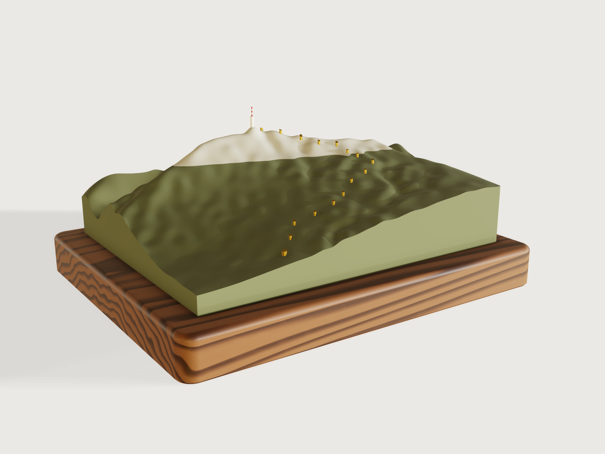

# Mont Ventoux relief

Mont Ventoux, the Giant of Provence, at 1:70 000, with the climb from Bédoin that ended stage 7 of the
Tour de France Femmes 2026: a relief 3D-printed in two colours as the mountain looks, forest green up to
Chalet Reynard and pale limestone above, sixteen brass pins at the climb's kilometres, the summit tower in
white and red, on a walnut base. One parameter turns the same terrain into a stack of laser-cut contour
layers. It is the one example built from outside data: `make.py` reads SRTM's elevation and IGN's road
and tower and writes them into steps as numbers; everything that is geometry (the scales, the terrain
surface, the solid, the pins' placement, the colour change, the tower's fit, the layers, every check) is
done by 3DCraft.



## What it shows

- **A terrain from a grid of heights.** One `sketch.spline` per column of the 37 × 29 grid, with
  `live: true`: its through-points are expressions (`1910 m * vertical_scale` at the summit), fitted
  again at every regeneration, so the exaggeration is a parameter. Each column is closed down to sea
  level by a `sketch.polyline`, and `feature.loft` of the 37 columns is the solid at once: no boolean.
- **Data in the model's own frame.** Positions are metres from the grid's origin in Lambert-93 divided by
  `map_scale`; heights are metres times `vertical_scale`. `make.py` writes numbers only.
- **Pins placed by the terrain.** `sketch.circle` at each kilometre in one sketch, `feature.extrude`, a
  `feature.transform` copy of the terrain raised by the pins' protrusion and `feature.boolean`
  `intersect`: each pin ends 2 mm above the ground under it. `feature.offsetProfile` gives the holes
  their clearance.
- **Two colours, split at a height.** Two blocks meeting at the forest's edge, each drilled with
  `feature.extrude` and `cut`, then each intersected with the terrain (`keepTool`): the forested slopes
  and the bald summit are two bodies that meet on one flat face, where the printer changes filament.
  `feature.chamfer` breaks the bottom edge for the first layer.
- **A landmark fitted to the ground.** The summit tower is a `feature.revolve` of one polyline about its
  own axis line; `feature.boolean` `subtract` of the terrain (`keepTool`) shapes its foot to the summit;
  `face.appearance` paints every other band of the mast red.
- **Two products from one terrain.** A choice parameter and `when` on 44 steps; in the laser-cut
  product `vertical_scale` is `if(product == 2, sheet_thickness / contour_interval, ...)`, so the 3 mm
  sheet sets the exaggeration. Slabs (`feature.block`, copied by `feature.transform` from a white and a
  grey one) intersected with the terrain make one body per contour layer, and `file.export` with `face`
  and `origin: model` writes each layer's underside as a DXF of its own, all in the map's frame.
- **Woodwork.** `feature.fillet` on the base's corners and, chained, round its top edge;
  `feature.chamfer`, chained, breaks the bottom edge.
- **Materials and checks.** `body.appearance` with every field set, `material.preset` (walnut, a brass
  tuned from steel), `body.material`, `assert.add` with volume, box and count measures on the terrain
  and on two thin `feature.cylinder` probes cut by it, and `feature.visible` to hide the source terrain
  and the probes.

## The real thing

- **The climb.** Tour de France Femmes avec Zwift 2026, stage 7, La Voulte-sur-Rhône to Mont Ventoux,
  7 August 2026: "Mont Ventoux (15.7km at 8.8%)", climbed from Bédoin, and the first finish of the
  women's race on the Giant of Provence ([commentary](https://www.letourfemmes.fr/en/news/2026/stage-7/commentary-from-marion-rousse-22/1296943),
  [stage report](https://www.letourfemmes.fr/en/news/2026/stage-7/kasia-the-real-giant-of-provence/1301373)).
  IGN's road, the D974, measured back 15.7 km from its highest point (1897.9 m, at the finish beside the
  summit tower) starts the climb at 544.4 m: to that highest point it climbs 1353.5 m, 8.6 %; to the
  summit's 1910 m it is 1366 m, 8.7 %, where the race gives 8.8 % by its own measure. The checks compare
  the relief with the summit, 1910 m.
- **Data.** Elevation: SRTM, 1 arc-second, from the Mapzen terrain tile N44E005; road and tower: IGN BD
  TOPO (sources, dates and licences in [`data/SOURCES.md`](data/SOURCES.md)). The grid has nodes every
  350 m in Lambert-93 (EPSG:2154), 12.6 × 9.8 km, one node on SRTM's highest cell. Each node is the
  elevation smoothed by a Gaussian of σ = 87.5 m, so that ravines narrower than the grid do not alias
  into bumps; the summit node alone keeps SRTM's 1910 m (smoothed it would be 1874 m). SRTM's heights are
  good to 6.2 m over Eurasia at 90 % (Rodríguez, Morris and Belz, *A Global Assessment of the SRTM
  Performance*, PE&RS 72(3), 2006); the mission asked for 16 m, which is what the start's check allows.
  `make.py fetch` also writes the climb's kilometres (`data/kilometres.csv`).
- **Scales.** 1:70 000 in plan (a node every 5 mm: the relief is 180 × 140 mm) and, printed, 2.1 times
  that vertically: the summit stands 57.3 mm above the relief's underside, which is sea level.
- **The printed relief.** Printed flat on its underside, 0.2 mm layers, from `exports/ventoux-relief.3mf`
  (meshed within 0.2 mm), in Bambu Lab PLA Matte: Dark Green up to the forest's edge and
  Bone White above, one filament change at 42.57 mm (at 2.1×). The colours are filamentcolors.xyz's
  measurements of the printed filaments (swatches [4360](https://filamentcolors.xyz/swatch/4360/), #656A4D,
  and [4885](https://filamentcolors.xyz/swatch/4885/), #D4D1C3), drawn matte and not metallic; density
  1.31 g/cm³ (Bambu Lab's data sheet, ISO 1183). The 3MF holds the two colours as two separate objects
  ([F-045](../../3DCRAFT-FEEDBACK.md#f-045)), and a slicer would put the bald summit down on the bed on
  its own: assemble them into one object with two parts before slicing, and give each part its filament.
  The forest's edge is Chalet Reynard, 6.2 km before the top, "which
  marks the moment on which the Mont Ventoux road quits the forest and enters a moon-like, fully exposed
  landscape" (the stage report): IGN's road is at 1419.1 m there. Solid it would weigh 995 g of green
  and 21 g of white; three walls and a sparse infill take a fraction of that. The bottom edge is
  chamfered 1 mm against the first layer's squash. The sixteen holes are blind, printed vertically down
  to a 3 mm floor, 0.1 mm wider all round than the pins: Ø 1.7 mm for 1.5 mm brass rod (CW508L), Ø 2.7 mm
  for the 2.5 mm rod at the start of the climb. Ream them to size (printed holes come out small), push
  each rod in until it bottoms, glue it and cut it 2 mm proud of the ground; the model's pin tops follow
  the slope, a cut rod is square.
- **The summit tower.** A symbol at ten times the map's scale, from IGN's building: Ø 14.4 m (its
  162.3 m² footprint), 44.8 m tall on the ground at 1893.5 m, its antenna's top at 1975.5 m. On the
  model it is Ø 2.05 mm and 11.7 mm tall with a Ø 0.6 mm mast, too fine for the FDM print: it is printed
  on its own in resin (`exports/ventoux-tower.3mf`), painted white with three red bands and glued on the
  summit, its foot shaped to the ground.
- **The walnut base.** 210 × 170 × 22 mm, the grain along its 210 mm length, a 15 mm border round the
  relief, corners rounded 8 mm, the top edge rounded over 3 mm with a router, the bottom edge broken
  1 mm; oiled. The relief is glued on.
- **The laser-cut layers** (*Product*: Laser-cut layers). One 3 mm sheet per contour interval from sea
  level, so the sheet sets the exaggeration: 2.1× at 100 m, 1.4× at 150 m, 1.05× at 200 m. At 100 m
  there are 17 outlines and 20 sheets: layer 1 is the whole map, sea level to 400 m, four sheets (the
  lowest ground is at 338 m); layers 2 to 17 start at 400 m to 1900 m, the last a cap under the summit
  tower. Cut from 3 mm cast acrylic, white and pale grey in turn, from `exports/layers/ventoux-layer-01.dxf`
  to `-17.dxf`. Each file is one layer's underside in the map's frame, seen from below (its y runs south).
  The outlines are the parts' edges: offset them by half the kerf, about 0.08 mm for the 0.15 mm kerf of
  3 mm cast acrylic. To register the stack, load each file with the next one (they share one origin),
  mirror both with the same mirror (y → −y, about the shared origin, not each about its own centre), then
  cut the layer and engrave the next layer's outline on its top face as the glue guide, the trade's usual
  way; do not turn the pieces over; two dowel holes drilled through the four full sheets of layer 1 and
  into the base hold the bottom true. The model shows each layer as the slice of the terrain it stands for; cut from
  flat sheet, the stack steps at every contour (see the platform notes).
- **Laser pieces to leave out.** The rule: leave out every island narrower than the 3 mm sheet and do
  not cut holes narrower than it; keep the rest. Measured on the DXFs at the defaults of each interval
  (width × length of the piece):

  | Interval | Leave out | Do not cut | Keep (fragile) |
  |---|---|---|---|
  | 100 m | layer 5 (700 m): a 1.5 × 6.6 mm sliver on the map's north edge and a 1.7 × 2.8 mm island (a knoll of 689 m that the spline lifts over 700 m); layer 9 (1100 m): 1.4 × 2.3 mm; layer 15 (1700 m): 2.5 × 5.0 mm; layer 17 (1900 m): the 2.2 × 2.7 mm summit cap, glue the tower on layer 16 | layer 10 (1200 m): hole 1.3 × 2.4 mm | layer 5: 3.1 × 4.1 mm (a knoll of 698 m, lifted likewise); layer 16: 3.4 × 5.5 mm |
  | 150 m | layer 6 (1050 m): slivers 0.8 × 12.8 and 0.1 × 3.1 mm | layer 7 (1200 m): hole 1.3 × 2.4 mm | layer 11: 3.4 × 5.6 mm |
  | 200 m | | layer 6 (1200 m): hole 1.3 × 2.4 mm | layer 9: 3.4 × 5.7 mm |

  Narrow notches in an outline are cut as drawn; the kerf rounds them.
- **Simplified, or left out.**
  - The road is marked by its kilometre pins, not drawn between them (see the platform notes).
  - Kilometres are measured along IGN's road with its rise, from the climb's start; they are not the
    D974's own kilometre stones, which count from Bédoin.
  - The grid holds what 350 m apart can: valleys and ridges narrower than about 700 m are rounded. Below
    the summit ridge the relief runs under the road: the km 15 pin's top stands 56.12 mm high, ground at
    1804 m where IGN's road is at 1831 m.
  - The forest's edge is drawn level at Chalet Reynard's height; on the mountain it climbs and falls
    with exposure.
  - No lettering on the base (a text costs a font of 332 KB in the file, F-037).

## Parameters

| Parameter | Range | Default |
|---|---|---|
| Vertical exaggeration (printed relief) | 1 to 3, in steps of 0.1 | 2.1 |
| Contour interval (laser-cut layers, one 3 mm sheet each) | 100, 150 or 200 m | 100 m |
| Product | Printed relief, Laser-cut layers | Printed relief |

## Checks

- **Terrain volume from the data's mean height.** The terrain from sea level up must hold the map's area
  times the data's mean height (1026.9 m by the trapezoidal rule over the grid), times the vertical
  scale, within 0.1 %, the room between straight lines and a cubic surface through the same nodes:
  776 585.5 mm³ against 776 336.4 mm³ at the defaults, a mean height of 1027.2 m.
- **Summit at the data's height.** A probe at the summit node reaches 1910 m within 2 m: its top is
  57.302 mm, 1910.1 m.
- **Start of the climb at the road's height.** A probe at the climb's start reaches IGN's 544.4 m
  within SRTM's 16 m: its top is 16.221 mm, 540.7 m. With the summit, the climb on the relief is
  1369 m against 1366 m from IGN's start to the summit.
- **Sixteen kilometre pins** (km 0 to 15) and **a hole for every pin, through both colours**: 16 holes
  in the forested slopes and, for km 10 to 15 above the forest's edge, 6 more through the bald summit.
- **One layer per contour** (laser-cut layers): as many contour layers as the interval gives up to the
  summit, 17 at 100 m.

`craft3d-cli check-range` proves them at 18 points: the defaults, the eight corners of the parameter
box, each product and eight random points; it does not try every value.

## Files

- `ventoux-relief.3dcraft`: the model. It opens in 2.87 s (10.66 s of CPU) and is 888 KB
  (`meta.json`, `stats`).
- `build.json`: the 250 steps that build it, written by `make.py`.
- `make.py`: `make.py fetch` downloads the data and writes `data/`; `make.py` writes `build.json` from
  `data/` alone.
- `data/elevation.csv`, `data/route.csv`, `data/kilometres.csv`, `data/tower.csv`: the extract;
  `data/SOURCES.md`: where it comes from.
- `exports/ventoux-relief.3mf`: the relief in its two colours, to print.
- `exports/ventoux-tower.3mf`: the tower, to print in resin.
- `exports/layers/ventoux-layer-01.dxf` to `-17.dxf`: the laser-cut layers at the defaults, one file each.

## Rebuild

```sh
python3 examples/21-ventoux-relief/make.py fetch   # once: the data (about 15 MB of downloads)
python3 examples/21-ventoux-relief/make.py         # build.json, offline
tools/examples.py build ventoux-relief
```

## Data and licences

Elevation: SRTM data courtesy of the U.S. Geological Survey, through the Mapzen terrain tiles (the
attribution the tiles ask for is in `data/SOURCES.md`). Road and tower: IGN – BD TOPO®, Géoplateforme,
Licence Ouverte / Open Licence 2.0, extracted 2026-11-07.

## Difficulty

**8 / 10** (the reviewer): data-driven lofted terrain from live splines, GIS preparation outside 3DCraft, 44 conditional features for two products, booleans across several bodies, and kernel limits worked around (F-135 to F-140).

## Platform notes

- **The road between the pins.** A band along the road, intersected with the terrain, costs 4.8 s and
  56 s of CPU at load; projecting its outline onto the terrain (`feature.surface.trim`) is cheap but is
  refused at some exaggerations, and `feature.plate` refuses the projected patch. The road is marked by
  its kilometre pins instead ([F-136](../../3DCRAFT-FEEDBACK.md#f-136), [F-135](../../3DCRAFT-FEEDBACK.md#f-135), [F-140](../../3DCRAFT-FEEDBACK.md#f-140)).
- **The grid's size.** A live spline point costs about 670 bytes in the `.3dcraft` file, so the 1 MB
  budget holds 37 × 29 nodes (350 m) and no finer ([F-138](../../3DCRAFT-FEEDBACK.md#f-138)).
- **Contour interval 250 m** is refused at some exaggerations: a slab whose face passes within the
  tolerance of a saddle of the terrain ([F-137](../../3DCRAFT-FEEDBACK.md#f-137)). The range stops at
  200 m.
- **The layers as flat sheets.** A contour's region is there (a flat face), but it cannot become a sketch
  or be extruded, so the stack is shown as slices of the smooth terrain ([F-139](../../3DCRAFT-FEEDBACK.md#f-139)).
- **Laser pieces by hand.** The layer DXFs cannot leave out pieces below a size nor carry the next layer's
  outline to engrave, so the pieces to leave out are listed above and the guide comes from overlaying two
  files ([F-142](../../3DCRAFT-FEEDBACK.md#f-142)); a top view of the stack as a contour template is
  refused, "too many overlapping triangles" ([F-118](../../3DCRAFT-FEEDBACK.md#f-118)).
- **Two colours, not marble.** Procedural marble draws closed vein loops that read as contour lines on a
  map ([F-144](../../3DCRAFT-FEEDBACK.md#f-144)); the relief is shown in its two filaments instead.
- **Measures on the terrain.** `boxMax` of the terrain or a pin is never a value: its proof is 21 times
  the tolerance wide ([F-122](../../3DCRAFT-FEEDBACK.md#f-122)), so the checks bound the measures instead of reading them. Each
  `measure.section` of the terrain costs about 1.2 s of CPU ([F-076](../../3DCRAFT-FEEDBACK.md#f-076)), so the contours are not measured.
- **Splines through expressions.** `live: true` takes expressions as through-points, which this example uses
  for the exaggeration.
