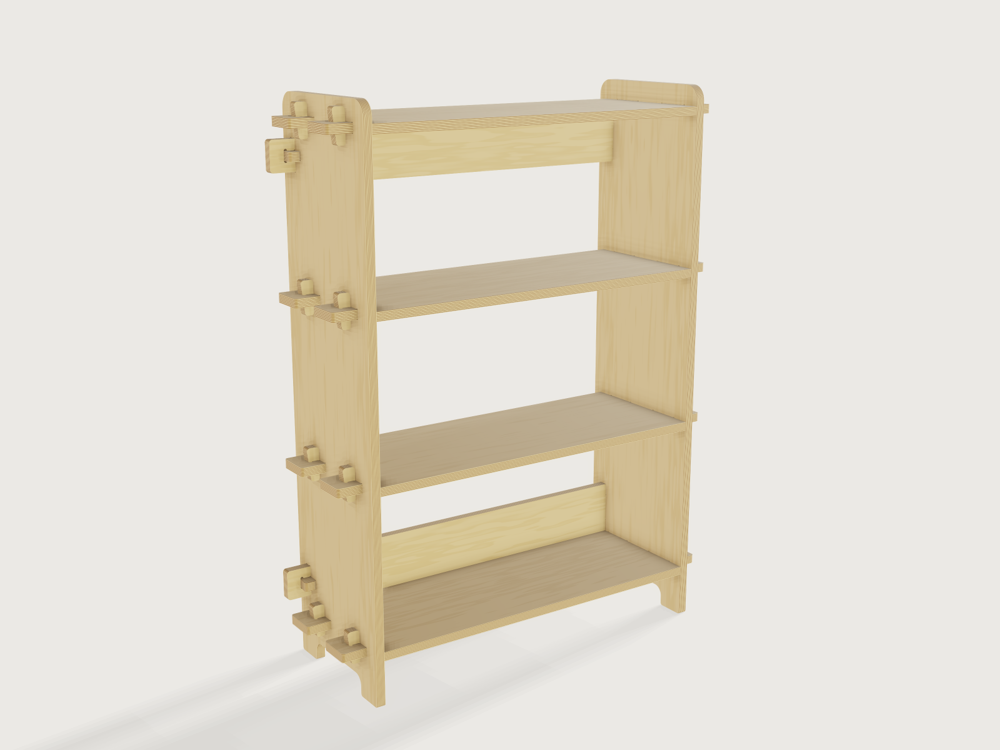

# Flat-pack bookcase

An open bookcase of 18 mm birch plywood, 750 wide, 1100 high and 300 mm deep, routed on a CNC router from
one 2500 × 1250 mm sheet and put together by hand without screws, glue or tools. Each shelf ends in two
tenons that pass through the sides and are locked by tapered wedges, tusk tenons as on a trestle table; two
back rails, tenoned and wedged the same way, keep it square. Every part is one sketch with its mortises and
the cutter's reliefs drawn in as holes, every part is a plate that `cut.list` lists, and the mortises follow
the sheet's measured thickness. The model proves its joints, its parts, its fit on the sheet and its shelves'
sag, and exports the router's sheet as DXF.



## What it shows

- **One sketch per part.** Each part is one `sketch.path` of lines and arcs given by their centres, every
  point a formula of the variables, with its mortises as further closed paths inside the outline: holes in
  the sketch, extruded once (`feature.extrude`), never cut afterwards. The side's shelf mortises are one
  mortise in a 2 × `shelf_count` grid (`sketch.pattern` with `count2`), the rail mortises a pair; a shelf's
  wedge mortises are a right-hand and a left-hand mortise, each repeated front to back.
- **Reliefs for a round cutter.** A router cutter cannot cut a sharp inside corner, so every inside corner
  gets a relief of the cutter's radius plus 0.1 mm: a dogbone (a half circle through the corner, on the
  diagonal) at the four corners of every mortise in the sides and at the near end of every wedge mortise;
  a T-bone (a half circle cut along the long wall) at the far end of every wedge mortise, so that the wall
  the wedge bears on stays straight across its whole width; and a T-bone (a half circle into the tenon) at
  the root of every tenon, where it is hidden inside the side and the shoulder still seats flat against
  the side. Their radius follows the *Cutter diameter* parameter.
- **Every part a plate.** Side, shelf, back rail and wedge are each extruded once; the copies are separate
  bodies, made by `feature.transform` (shelves, rails, wedges) and `feature.mirror` (the right side, the
  right-hand wedges), so that `cut.list` sees each as a plate (a `feature.pattern` of separate plates is one
  body that is not a plate, see *Platform notes*). The fourth and fifth shelves and their wedges are
  conditional features (`when`), so the shelf count adds and removes whole parts.
- **Cut list and router file.** `cut.list` lists 28 parts at the defaults, four distinct ones:

  | Part | Count | Length × width | Holes |
  |---|---|---|---|
  | Side | 2 | 1100 × 300 mm | 10 |
  | Shelf | 4 | 850 × 280 mm | 4 |
  | Back rail | 2 | 850 × 110 mm | 2 |
  | Wedge | 20 | 65.6 × 24.5 mm | 0 |

  `cut.export` writes them all, at true size and each on a layer of its own, in rows on one 2500 mm long
  sheet: the router's DXF.
- **Interference.** `document.interference` checks all 378 pairs of the 28 bodies: 54 touch (every
  shoulder on a side, every tenon on the floor of its mortise, every wedge on a side's face and on the far
  end of its mortise, the rails against the top and bottom shelves), none overlap and none is unknown. The
  same check runs at every load as an `overlap` assertion; `measure.clearance` keeps the rails' wedges clear
  of the shelves' wedges.
- **A range that follows another parameter.** The width's upper end is a formula of the measured sheet
  thickness: the widest width, in 10 mm steps, whose shelves still meet the sag limit (*Shelf sag* below).
- **Materials.** `body.appearance` draws the plies of the panel's edges as a wood pattern whose pith lies
  100 m away, so its rings are flat layers parallel to the faces, dark and light bands for the alternating
  face-grain and cross plies (a real panel has a glue line between every pair of plies); `face.appearance` gives the two faces of each part the plain, softly waved figure of rotary-cut birch
  veneer, its pith 5 to 20 m away; `body.material` gives birch plywood's density.
- **Outputs.** `variable.measure` measures the clear span between the sides, the plywood's volume, the mass,
  the centre of mass and the parts' lengths on the sheet; `variable.output` works out the shelf's sag, the
  tipping angle, the potential energy, the wedge's reserve of drive and the sheet layout from them.

## The real thing

- **Plywood.** Finnish or Baltic birch plywood, 18 mm nominal, 13 plies of 1.45 mm birch veneer, the
  phenolic bond of EN 314-2 class 3 (the dark glue lines of the edges), face grades S/BB (EN 635 classes II
  and III, the S face outward), sheet 2500 × 1250 mm with the face grain along the 2500 mm side.
  Sources: the *Handbook of Finnish Plywood* (Finnish Forest Industries Federation, 2002: §1.2 bond, Table
  2-1 grades "B=I, S=II, BB=III and WG=IV", Table 2-4 sizes, "the grain of the face veneer runs parallel to
  the first dimension stated"), and the [Riga Ply datasheet](https://cdn.shopify.com/s/files/1/0222/7290/1216/files/Riga-Ply-datasheet-EN-feb-2023.pdf)
  (Latvijas Finieris, 2022: 18 mm, 13 plies, 1.45 mm veneers).
- **Thickness.** A sheet sold as 18 mm is not 18 mm. The *Handbook* (Table 2-3) gives EN 315's limits for
  18 mm sanded birch plywood as 17.1 to 18.7 mm, and the Finnish mills' own as 17.1 to 18.1 mm; its design
  tables use a mean of 17.6 mm (Table 3-2). That is the default here, and the *Measured sheet thickness*
  parameter spans EN 315's limits. Measure the sheet with calipers in several places and enter the
  largest: every part is that thick, and every mortise is that plus a fit clearance of 0.4 mm (0.2 mm a
  side), a slip fit for hand assembly.
- **Cutter.** A ¼ in (6.35 mm) two-flute solid-carbide compression spiral, such as Amana Tool 46170 (cutting
  length ⅞ in, 22.2 mm, the bottom 7 mm cutting upward and the rest downward, overall length 2½ in;
  [ToolsToday](https://global.toolstoday.com/cnc-compression-spiral-bits-for-mdflaminate-2-flute.html)),
  which leaves both faces of the veneer clean and cuts the sheet's full thickness, less than three times its
  diameter. The reliefs are 3.275 mm in radius.
- **Making it.**
  - Load `exports/flat-pack-bookcase-sheet.dxf` into the CAM program and set the parts 10 mm in from the
    sheet's edges; the drawing is the parts at true size, so the program puts the cutter outside the
    outlines and inside the holes. The reliefs are drawn: the cutter plunges into each one as it goes round
    the corner.
  - Feeds and passes: about 18 000 rpm and 3 m/min, in two passes, the first about 9 mm deep, past the
    bit's 7 mm up-cut tip so that the down-cut flutes shear the top veneer, the second through. Amana's
    chart for its ¼ in two-flute compression spirals in Baltic birch
    ([PDF](https://www.amanatool.com/pub/media/productattachments/Solid-Carbide-Spektra-Compression-Spirals-for-Baltic-Plywood_v3.pdf))
    gives, at 18 000 rpm, 150 to 180 in/min (0.004 to 0.005 in, 0.10 to 0.13 mm, per tooth) one diameter
    deep and 25 % less two diameters deep; they are starting values, to be tuned on the machine.
  - Order: the holes before the outlines, and the small parts first. The wedges, 65.6 × 24.5 mm, move under
    vacuum: leave them an onion skin (a few tenths of a millimetre at the bottom of the last pass, cut free
    with a knife) or tabs.
  - Edge finish: round over the exposed edges 2 to 3 mm with a round-over bit or by hand (the sides' front,
    top and feet, the shelves' front edges and the wedges' heads); keep crisp what must bear (the shoulders,
    the mortise walls and the wedges' straight and sloped edges); ease the tenons' ends by about 1 mm. Oil
    everything, with a second coat on the plywood's edges, whose cross plies take it up. The model shows
    every edge sharp, as the router leaves it: `cut.list` refuses a plate with broken edges
    ([F-086](../../3DCRAFT-FEEDBACK.md#f-086)).
- **The joint.** Each shelf has two tenons at each end, 70 mm wide, 35 mm in from its front and back edges,
  that pass through the side and stand 50 mm proud of it. In each tenon a wedge mortise runs from 2 mm inside
  the side's outer face to 22 mm outside it, and the tenon goes on 28 mm beyond it. The wedge, cut from the
  same sheet, tapers 1 in 8: driven through the mortise, it bears on the side's face with its straight edge
  and on the far end of the mortise with its slope, across the whole 17.6 mm of its thickness (the far wall
  is straight for 18.0 mm), so it pushes the tenon out and pulls the shelf's shoulder hard against the
  inside of the side. Because the mortise starts 2 mm inside the side, the wedge never reaches its near end:
  2 mm of draw are in reserve, and with the 1 in 8 taper the wedge can be driven 16 mm further if the joint
  ever works loose. It stands 26 mm proud of the tenon to be struck and 22 mm past it to be knocked out. A
  rail's wedge lies along the side 5 mm short of its back edge, so at its full 16 mm of further drive it
  would stand 11 mm past the back edge, against the wall.
- **Putting it together.** Every tenon points the same way, across the bookcase, so the second side goes on
  all of them at once.
  1. Lay one side flat on two battens, outer face down, high enough for the tenons to pass through.
  2. Stand the four shelves and the two back rails in its mortises; they rest on their shoulders.
  3. Lower the other side onto their upper tenons, all ten at once, and tap it down evenly until every
     shoulder seats.
  4. Drive that side's eight shelf wedges first, then put in and drive its two rail wedges, from the front
     towards the back.
  5. Stand the case up on its feet and drive the first side's wedges the same way: the shelves' wedges
     downward from above, then the rails'.

  The shelf wedges go in before the rail wedges because the lower rail's wedge starts 10.6 mm behind the
  bottom shelf's back wedge, 20.2 mm above its head, where a wide mallet would hit it; to tighten that shelf
  wedge later, knock the rail's wedge out first, or use a drift.
- **Racking.** The shelves alone would let the case lean sideways: their tenons are only a sheet thick in
  the plane of the racking. The two back rails, 110 mm high, under the top shelf and on the bottom shelf,
  are each wedged with their shoulders, 25 mm above and 25 mm below their 60 mm tenon, tight against both
  sides, which keeps the corners square. (This is not computed.)
- **Standing.** Each side ends in two feet, 60 mm long, with a 40 mm high arch between them, so the case
  stands on four short feet rather than on two full-length edges that rock on any bump in between. On a floor
  whose four contact points are out of plane it still rocks, as anything on four feet does; a felt pad under
  the short foot settles it.
- **Fix it to the wall.** Empty, the bookcase tips forward over its front feet when tilted 14.9°, or when
  pulled forward at the top with 27.3 N (its 20.18 kg act 156.5 mm behind the front edge, 569.7 mm up).
  Screw an anti-tip strap to the top back rail and to the wall, as for any bookcase this tall. EN 14749:2016
  sets stability requirements (§5.4) for storage furniture; the US CPSC's review of it (Federal Register
  2022-24587, §V.D) gives its scope as furniture "with a height >=600 mm" and "a potential energy …
  exceeding 60 N-m". This case, empty, has 112.8 N·m; its tests (EN 16122) are not attempted here.
- **Shelf sag.** The [Sagulator](https://woodbin.com/calcs/sagulator/) (woodbin.com) says "A fully loaded
  bookshelf weighs 20-40 pounds (9-18 kg) per running foot". The shelf is designed for the middle of that,
  30 lb per running foot (44.65 kg/m), simply supported across the clear span of 714.8 mm (the wedged
  tenons' end fixity ignored), with birch plywood's mean bending modulus along the face grain, 10 048 N/mm²
  for 18 mm, 13-ply panels (*Handbook*, Table 3-2). It sags 1.164 mm, within the Sagulator's target of
  "0.02″ per foot or less" (span/600, 1.191 mm). The Sagulator derives that target from the sag the eye
  notices, "1/32″ (0.03″) per running foot", and from wood shelves sagging "an additional 50% over time":
  after creep the shelf sags 1.746 mm, still under the 1.861 mm (span/384) that would show. The limit
  decides the widest bookcase: 730 mm on a 17.1 mm sheet, 750 mm on 17.6 mm, 800 mm on 18.7 mm.
- **Weight and sheet.** 1.686 m² of plywood, 54.0 % of the sheet, 20.18 kg at the *Handbook*'s mean
  density of 680 kg/m³ (Table 3-1).

## Parameters

| Parameter | Range | Default |
|---|---|---|
| Width (over the sides) | 600 mm to the widest that meets the sag limit for the sheet (730 to 800 mm), in 10 mm steps; a thinner sheet lowers the maximum, so set the sheet and the width together (or let the width be clamped) | 750 mm |
| Shelves (top and bottom included) | 3 to 5 | 4 |
| Measured sheet thickness | 17.1 to 18.7 mm, in 0.05 mm steps | 17.6 mm |
| Cutter diameter | 5 to 8 mm, in 0.05 mm steps | 6.35 mm |

The height (1100 mm), depth (300 mm, shelves 280 mm) and the joint's proportions are fixed. Over the tenons
the bookcase is 100 mm wider than over the sides (850 mm at the default width). The shelves are spaced
evenly between the bottom one, 90 mm above the floor, and the top one, 40 mm below the top: 458.6 mm clear
between shelves with three shelves, 299.9 mm with four and 220.5 mm with five (room for paperbacks, not for
a 240 mm hardcover).

## Checks

At the defaults (26 assertions, all passed):

- **Every part is a plate of the measured sheet.** 56 faces, two for each of the 28 parts, are a measured
  17.6 mm from the face opposite them.
- **Each part in closed form.** The volume of the side (5 456 124.12 mm³), the shelf (3 818 560.30 mm³),
  the back rail (1 508 070.55 mm³) and the wedge (23 937.63 mm³) equals the sheet thickness times its area
  worked out by hand: the outline less its rounded corners, the feet's arch, the T-bones (π r² / 2 each),
  the mortises with their dogbones (r² (π/2 − 1) each), and, for the wedge, a trapezoid less four corners
  rounded at 90°, 90° and 90° ± atan(1/8), R² (cot(θ/2) − (π − θ)/2) each. A missing relief or a mortise
  of the wrong size fails it.
- **Every mortise is the sheet plus the clearance.** The shelf and rail mortises in the side, and the wedge
  mortises in a shelf and a rail, measure 18.0 mm across (17.6 + 0.4); a shelf's tenon, resting on the floor
  of its mortise, clears its top by 0.4 mm.
- **Every inside corner relieved for the cutter.** 200 cylindrical faces of the relief's radius: four
  reliefs in each mortise of the sides, shelves and rails, and a T-bone at each side of every tenon's root.
  The relief's radius (3.275 mm) is at least the cutter's (3.175 mm), and the sheet (17.6 mm) is no deeper
  than four cutter diameters (25.4 mm).
- **The wedge draws.** The wedge touches the side's face (0 mm) and the far end of its mortise (0 mm), and
  stands 2 mm off the near end, which lies inside the side. The far end is straight across its whole width:
  its face is 316.8 mm², 18.0 × 17.6 mm.
- **Wedges clear of each other.** The rails' wedges are at least 22.8 mm from the shelves' wedges, and start
  10.6 mm behind the bottom shelf's back wedge.
- **Shelf sag within span/600**: 1.164 mm against 1.191 mm.
- **No two parts overlap**, and the bookcase **stands on four feet** (four faces at floor level).
- **The parts fit one sheet.** Laid with the grain along the sheet, the two sides end to end take
  2236 mm of the 2500 mm; the shelves follow two by two, the rails side by side in one place, and with the
  sides' row that takes 1200 mm of the 1250 mm width; the end of one row of shelves holds 63 wedges, of
  20 needed; and the plywood's area, 1 686 442 mm², is less than the sheet's. `cut.export`'s own layout, a
  plain row after row in the cut list's order, also fits the sheet at the defaults (2488 × 1042.5 mm), but
  not at five shelves (1300.8 mm high): there the CAM program nests the parts, as the layout knows no sheet
  height ([F-162](../../3DCRAFT-FEEDBACK.md#f-162)).

`craft3d-cli check-range` proves all 26 at 25 points: the defaults, all 16 corners of the four parameters'
ranges (the width moved into its range where a thin sheet narrows it) and 8 random points.

## Files

- `flat-pack-bookcase.3dcraft`: the model.
- `build.json`: the 182 steps that build it.
- `exports/flat-pack-bookcase-sheet.dxf`: all 28 parts at the defaults, at true size, each on its own layer,
  laid out in rows on a 2500 mm long sheet, for the CAM program.

## Rebuild

```sh
tools/examples.py build flat-pack-bookcase
# or
craft3d-cli run --new '{"units":"mm"}' --script examples/22-flat-pack-bookcase/build.json --out bookcase.3dcraft
```

## Difficulty

**7 / 10** (the reviewer): 28 plate bodies from four hand-built paths with dogbones and T-bones, about 60 coupled formulas, conditional parts, checks across bodies (interference, clearance, cut list, nesting) and expert joinery; no freeform.

## Platform notes

- **A pattern of plates is not a cut list.** `cut.list` treats the copies a `feature.pattern` makes as one
  body whose top "is not one flat face", so it is not a plate, and `document.interference` cannot check the
  copies against each other. Every shelf and wedge is therefore its own feature: 16 `feature.transform`
  and 13 `feature.mirror` steps, those of the fourth and fifth shelf conditional
  ([F-160](../../3DCRAFT-FEEDBACK.md#f-160)).
- **No helper bodies beside a cut list.** A hidden body is still listed by `cut.list` and checked by
  `document.interference`, and their `bodies` lists refuse a feature switched off by its condition, so a
  model whose parts depend on a parameter cannot keep a helper body out of them. That rules out the drone
  frame's router check, a hidden body grown by the cutter's radius measured against Steiner's formula
  ([F-087](../../3DCRAFT-FEEDBACK.md#f-087)); here the reliefs are counted and their radius compared with the
  cutter's instead, which does not prove that no other sharp inside corner exists
  ([F-161](../../3DCRAFT-FEEDBACK.md#f-161)).
- **Arrises not broken.** `cut.list` and `cut.export` refuse a plate with broken edges
  ([F-086](../../3DCRAFT-FEEDBACK.md#f-086)), so the parts keep the router's sharp arrises; the outlines'
  corners are rounded in the sketches instead (feet, top corners, tenon ends and wedges).
- **A turned copy keeps the source's grain.** A solid texture stays where it was in the model when
  `feature.transform` moves or turns a copy ([F-083](../../3DCRAFT-FEEDBACK.md#f-083)): the rails' wedges,
  turned 90° from the shelves', would show their plies across their thickness, so they get an appearance of
  their own, and the face veneer's pith is set far away by hand so that every moved shelf and rail shows the
  same figure.
- **Ply lines at one thickness.** A pattern's `scale` is a plain number, not an expression (as its origin
  and axis are, [F-041](../../3DCRAFT-FEEDBACK.md#f-041)), so the glue lines are drawn every 2.708 mm, two
  plies of the default 17.6 mm sheet, and do not divide the edge evenly at other thicknesses.
