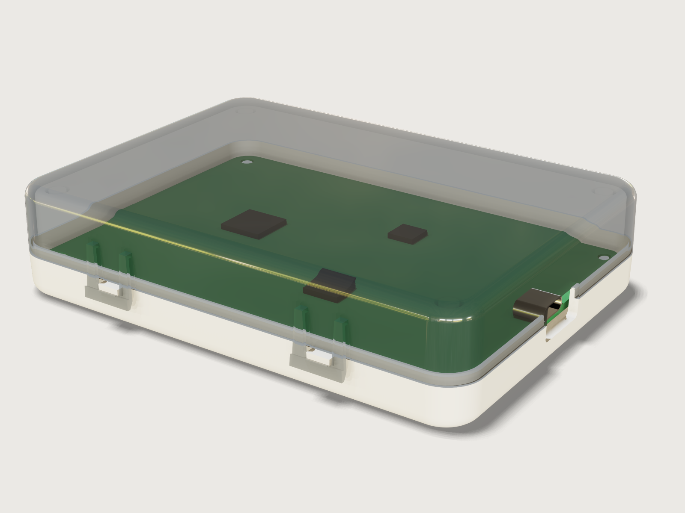

# Snap-fit enclosure

An original two-part enclosure for a 100 × 70 mm circuit board, designed to be injection-moulded in two
straight-pull tools without a single slide or lifter: a matt white ABS base and a translucent smoke-grey
polycarbonate lid, closed by four U-shaped snap latches and no screws. The latches hang from the lid's long
walls and snap under lugs on the base, so the lid's top and the base's floor stay closed. The halves meet
at a stepped lip, the board sits on four cored posts and is pressed onto them by crush ribs on four
hold-downs in the lid, and a USB-C plug reaches the board's receptacle through an opening split by the
parting line. The model checks its own tooling: every face of each half draws in the direction its tool
half opens, and every retaining face of a latch has a column along its pull that the part never enters.



## What it shows

- **Two drafted shells.** Each half is a rounded block (`feature.block`, `feature.fillet` on the plan
  corners), drafted about the parting plane, a `datum.plane` (`feature.draft`: the base narrows downward
  at 1.5°, the lid upward at 1°), rounded along its far edges and hollowed open at the parting plane
  (`feature.shell`). The drafted corners become cones, the shell follows them, and the wall stays 2 mm.
- **A stepped lip at the parting line.** A drafted cutter (`feature.extrude`, `feature.fillet`,
  `feature.draft`) takes the outer half of the base's wall above the parting plane, leaving a lip with a
  lead-in chamfer (`feature.chamfer` with `chain`); a second one takes the inner half of the lid's wall
  (`feature.boolean`).
- **U-latches for straight-pull tools.** Each latch is a leg profile (with its root block) and a bar
  profile (with its retaining incline and lead-in) extruded across it, its faces drafted toward the tool
  half that forms them (1.5°, and 3° on the shut-off faces at the window), mirrored (`feature.mirror`) and
  repeated by two `feature.pattern`s. Behind each leg the lid's wall is recessed by a drafted cutter so
  that the core can draw the slot, and the leg stands 1.1 mm off the wall so that the core's blade there
  keeps at least 1 mm of steel. The base's lugs are drafted profiles repeated the same way.
- **Proof that the tools open.** 3DCraft has no measure of undercuts along a pull, so hidden helper bodies
  (`feature.visible`) stand in for it: a column above each bar's retaining face, below each lug's, and
  down each slot; assertions say that no part enters them (`overlap`).
- **Posts and hold-downs.** A revolved post section with its locating pin, cored from below; a revolved
  hold-down tube with three radial crush ribs (`feature.extrude`, `feature.draft`, a circular
  `feature.pattern`); each repeated twice by `feature.pattern`.
- **The USB-C opening at the parting line.** A notch in each half (`feature.extrude` with `cut`), drafted
  in the sketch, its inner corners rounded (`feature.fillet`).
- **Face sets per tool half.** `set.define` keeps four named sets: the faces each half's cavity forms, by
  the features that made them (`madeBy`) and their names, and its core set, everything else.
- **The board.** An FR-4 board with rounded corners and four mounting holes, three chips and a USB-C
  receptacle shell with its mouth (`sketch.path` with arcs).
- **Materials and outputs.** `material.preset` and `body.material` (ABS, polycarbonate, steel),
  `body.appearance` (solder mask, chips); `variable.measure` for the masses, `variable.output` for the
  latch strain, release force and mating force.

## The real thing

- **Sources.**
  - [L] LANXESS, *Engineering Plastics: Part and Mold Design, A Design Guide* (2007, the Bayer guide
    reissued): walls p. 18 and p. 44, corners p. 19 and p. 28, ribs Table 2-1 (p. 23), bosses p. 25–26,
    draft p. 30, snap fits p. 82–84 with Fig. 4-9, lips p. 89.
  - [S] Bayer MaterialScience, *Snap-Fit Joints for Plastics, A Design Guide* (2005): Table 1 (p. 9),
    Table 2 and Fig. 15 (p. 12), the mating force (p. 14), Table 3 (p. 15) and the worked example (p. 16).
  - [C] Covestro, *Engineering Polymers: Part and Mold Design, Thermoplastics* (2015): Table 2-1, p. 25.
  - [U] USB-IF, *USB Type-C Cable and Connector Specification*, Release 2.5 (March 2026): Figs. 3-1, 3-3
    and 3-82. The plug overmold's limits of 12.85 × 7.0 mm came in with an Engineering Change Notice to
    Release 2.2, which replaced 12.35 × 6.5 mm.
  - IEC 60529 (the IP code); JLCPCB's published PCB capabilities for the ±10 % board thickness tolerance
    (1.44 to 1.76 mm at 1.6 mm).
- **Walls.** 2 mm nominal, inside the 0.060 to 0.160 in [L] gives as typical (p. 44). The edge rounds are
  1 mm inside and one wall larger (3 mm) outside, as [L] p. 19 asks for a constant wall; the plan corners
  are 5.5 mm inside and 7.5 mm outside, small enough that the posts clear them, and the board's corners
  are rounded 4.5 mm to keep 1 mm all round. Behind each latch leg the lid's wall is 1.875 mm (0.94 of
  nominal). The lip under it, 2.2 mm high, is 0.717 mm there against its 0.9 mm elsewhere: a short
  skirt at the end of the flow, filled from the 1.875 mm wall above it (the 25 % of [L] p. 18 limits
  added thickness and does not cover it).
- **Draft.** [L] p. 30: at least ½°, 1° where the design permits, and 1° more per 0.001 in of texture
  depth. The base's matt (textured) outside and its inside have 1.5°, the lid's glossy outside and inside
  1°, the latches 1.5°, the shut-offs at the latch windows 3°, the hold-down tubes and the recesses behind
  the legs the ½° minimum.
- **Walking the tools.** Both halves are pulled straight, along z.
  - *Base.* The cavity forms the outside, the lugs and the cores under the posts, and is drawn downward;
    the core forms the inside, the lip and the ledge, and is drawn upward. Each lug's retaining face, its
    underside, looks down past the base's wall, which narrows downward, so the cavity draws it.
  - *Lid.* The cavity forms the outside, each latch's outer faces and window and the bar's retaining face,
    which looks up between the legs past the lid's wall, and is drawn upward. The core forms the inside,
    the groove, the hold-downs and each latch's inner face, lead-in and root undersides, and is drawn
    downward. The slot behind each leg is closed above by the leg's root, so the core draws it downward:
    the lid's wall behind each leg is recessed and drafted the other way (a parting line stepped up to
    the root), and core and cavity shut off at the leg's window faces at 3°. The core's steel in that slot
    is a blade 1.8 to 2.5 mm wide and 7 mm tall; with the leg 1.1 mm off the wall it is 1.04 mm thick at
    its thinnest, just under the root, against a 1 mm minimum (the mould maker's review: thinner steel
    bends under injection pressure and cannot be cooled; no design guide here gives a number, and [L]
    p. 23 asks twice the wall between short ribs for cooling).
  - 3DCraft has no measure of undercuts along a pull, so three sets of hidden columns stand in for it
    (Checks).
  - Gates, runners and ejector pins are not modelled.
- **The latches.** A U-shaped arm for a lid, as in [S] Fig. 15 and [L] Fig. 4-9, in polycarbonate. Two
  legs, 2.5 mm wide and h = 0.8 mm thick (0.4 of the wall), hang l = 8.2 mm from their roots, 7 mm above
  the parting plane, to the lug's lower edge; a 1.5 mm bar joins them, 1.1 mm off the base's wall, and
  reaches y = 0.8 mm under the lug (which stands 1.9 mm off the wall).
  - Strain, [S] Table 1, design 1: ε = 1.5 y h / l² = 1.43 % (at most 2.14 %, at a 3 mm wall). [S] Table 2
    allows 4 % for Makrolon PC in a single assembly and 60 % of that, 2.4 %, for frequent separation.
  - The lead-in is 30° to the pull over 0.9 mm (as in [S]'s example). The retaining faces are inclined
    20° to the horizontal, 70° to the pull: self-locking, so pulling the lid cannot open it, once
    μ tan 70° ≥ 1, that is for μ ≥ 0.36; [S] Table 3 gives 0.45 to 0.55 for PC.
  - Forces, with the secant modulus of 1815 N/mm² from [S]'s example and μ = 0.5: P = b h² E ε / (6 l) per
    leg gives 1.69 N to spring one latch open, and W = P (μ + tan α) / (1 − μ tan α) gives 2.55 N to push
    it shut.
- **Tolerances, not line to line.** The incline turns a vertical stack error δ into 2.75 δ along the lug:
  ±0.1 mm moves the bar ±0.27 mm and leaves at least 0.53 mm of its 0.8 mm hold. On the tight side the
  legs' spring pulls the lid onto its ledge; on the loose side the crush ribs push the lid up against
  the latches, so it does not rattle. The board is held the same way (next).
- **The board.** 100 × 70 × 1.6 mm, corners rounded 4.5 mm, four Ø 3.2 mm holes 4 mm from its edges. It
  sits on four posts of Ø 6 mm, 4 mm high, each with a Ø 3 mm locating pin: twice the pin across, the low
  end of the 2.0 to 2.4 times in [L] p. 25. The post's wall is 0.4 of the nominal wall over a core from
  below, drafted with the post about the floor's top so the wall stays 0.8 mm (ABS: 40 % for minimal
  sink, [L] Table 2-1); its foot is rounded 0.4 mm. Four hold-down tubes of the lid come down over the
  posts: Ø 5.2 mm, cored to the ceiling ([L] p. 26), 0.8 mm thick there (0.4 of the wall, the high-gloss
  value for PC in [C] Table 2-1), drafted ½° a side, 0.55 mm thick at their ends. Each stops 0.21 mm above
  the nominal board (0.05 mm above the thickest) and carries three radial crush ribs, 0.6 mm wide at the
  tube and 0.15 mm across their flat tips, that reach 0.16 mm into the nominal board, down to the
  thinnest board's top, and crush as the lid closes. These are bosses, not ribs: the ribs of the earlier
  version (14.4 mm deep, 0.55 mm at their ends) are gone.
- **The USB-C opening.** The plug's overmold is at most 12.85 × 7.0 mm ([U] Fig. 3-3); [U] Fig. 3-82 asks
  0.05 mm round it in an enclosure's opening. The opening is 13.35 × 7.5 mm at its narrowest, 0.25 mm clear
  on every side, its inner corners rounded 1 mm. The receptacle is drawn with the specification's shell
  opening, 8.34 × 2.56 mm ([U] Fig. 3-1); its 0.3 mm shell, 7.35 mm length and 0.6 mm overhang past the
  board's edge are assumed, and a real board takes them from its receptacle's drawing. The parting plane
  runs through the receptacle's axis.
- **IP rating: IP20** (IEC 60529). The 7.5 mm high opening keeps out a 12.5 mm sphere and the test finger
  (first numeral 2) but not a 2.5 mm wire (so not 3); the lip has 0.1 mm side clearance and no seal, so no
  water protection is claimed (second numeral 0).
- **Opening it.** Hook a thumbnail or a small screwdriver under the bar of each latch on one side, pull it
  out about 1 mm until it clears the lug, and tilt that side up a little; do the same on the other side
  and lift the lid off. Closing is a push down. There is no overtravel stop: pulled 2.2 mm out (1.5 mm at
  a 3 mm wall) the legs reach the 4 % single-assembly limit, so lift the bar only as far as the lug.
- **Materials.** Base: ABS, matt white, 1040 kg/m³ (3DCraft's ABS preset), 21.84 g. Lid: polycarbonate
  tinted smoke grey, 1200 kg/m³ (Covestro Makrolon 2405, ISO 1183-1), 28.79 g.
- **Size at the defaults.** 106.0 × 76.0 mm at the parting line (the latches stand 2.7 mm off the long
  walls), 24.0 mm high; the parting plane is 9.18 mm above the bottom.
- **Simplified, or left out.**
  - The parting line's outer edges and the latch edges are left sharp; the tubes' roots on the ceiling
    are not rounded.
  - The board carries three chips and the receptacle; other parts and the tracks are not modelled.

## Parameters

| Parameter | Range | Default |
|---|---|---|
| Board length | 60 to 160 mm, in 5 mm steps | 100 mm |
| Board width | 40 to 100 mm, in 5 mm steps | 70 mm |
| Inside height (floor to ceiling) | 17 to 24 mm, in 1 mm steps | 20 mm |
| Wall thickness | 2 to 3 mm, in 0.25 mm steps | 2 mm |

The latches stand at a quarter and three quarters of the board's length; their legs, the posts' and
tubes' walls, the lip and the corner radii follow the wall. The inside height starts at 17 mm so that the
latch roots, 7 mm above the parting plane, stay below the lid's edge round at a 3 mm wall; the wall starts
at 2 mm so that the tubes keep at least 0.48 mm at their ends (at a 24 mm inside height).

## Checks

- **Sections in closed form, two heights per half.** A plane through the base 5.115 mm up cuts the drafted
  wall ring and the four posts: its area must be the outer rounded rectangle less the inner one
  (4ab − (4 − π) r² each, every side and corner radius at that height from the draft) plus four post
  circles, 795.614818 mm², exact to 0.001 mm²; a second plane, 3.9 mm up, also cuts the posts' cores,
  739.459846 mm². The lid's ring narrowing upward plus four tube annuli, at 18.99 and 19.995 mm:
  728.969865 and 729.719266 mm². The two heights per half pin the drafted corners' radius at both, so they
  prove the cones' draft too.
- **Walls at the nominal thickness.** The least distance between the outer flat faces of each half and the
  inner faces behind them is 2 mm to 0.001 mm, proven. Behind the latches the wall is at least 0.75 of
  nominal (1.875 mm found) and the lip keeps at least three quarters of its 0.9 mm (0.717 mm).
- **Core steel behind the latch legs at least 1 mm.** The distance from each leg's inner face to the
  recessed wall behind it: 1.039 mm.
- **Each half draws off its tools.** `measure.draft` over the four named sets in their own pulls: the
  base's cavity faces downward at least 1.5° (its texture's draft), the lid's cavity faces upward at least
  1°, both cores at least ½°. The least found is 1.5°, 1.5°, 1° and ½° (on the tubes and the recesses).
- **The retaining faces are open to their tools.** Three sets of hidden columns: one rising from each bar's
  retaining face to above the lid, one down the slot behind each leg from under its root, one falling from
  each lug's retaining face to below the base. None of them overlaps the part that has to draw past it;
  a die-lock, material over a retaining face, would fail them.
- **Latch strain within polycarbonate's limit.** 1.5 y h / l² ≤ 0.6 × 4 %: 1.43 % against 2.4 %.
- **Latch roots 7 mm above the parting plane.** The distance from the roots' undersides to the base's
  ledge, proven; the strain formula's l = 8.2 mm adds the lug's 1.2 mm face by construction.
- **Four latches.** There are four retaining faces on the base.
- **Plug overmold fits the opening.** Across, at least 12.85 + 2 × 0.05 mm (13.401 mm, measured above the
  rounded corners); in height, from the base's notch to the lid's, at least 7.0 + 2 × 0.05 mm (7.5 mm).
- **Hold-downs crush the board as designed.** The crush ribs' tips are 1.44 mm above the board's
  underside, 1.6 − 0.16 mm, to 0.001 mm; the lid overlaps the nominal board, and only by those ribs
  (0.184 mm³).
- **No other parts overlap.** Base, lid, chips and receptacle have no volume in common, and the board none
  with the base, chips or receptacle; they touch where they should (lid on the ledge, bars under the lugs,
  board on the posts, chips and receptacle on the board).

`craft3d-cli check-range` proves all 25 at 25 points: the defaults, all sixteen corners of the four
ranges and eight random points.

**What the draft checks do and do not prove.** `measure.draft` is exact on the flat faces, which are most
of each half. It samples the cones (the drafted corners, the post and pin cones, the post cores, the
hold-down tubes and the lip chamfer's corner pieces), so all four sets report `proven: false` and the
assertions pass without a warning ([F-067](../../3DCRAFT-FEEDBACK.md#f-067)). On the rounds the bounds it
proves are far below what it finds ([F-102](../../3DCRAFT-FEEDBACK.md#f-102)):

| Set | Least found | Lowest proven bound | Where |
|---|---|---|---|
| Base, cavity side | 1.5° | −63.1° | the corner pieces of the bottom round |
| Base, core side | 1.5° | −92.4° | the posts' root rounds (−61.3° on the inner rounds) |
| Lid, cavity side | 1° | −65.4° | the corner pieces of the top round |
| Lid, core side | ½° | −61.3° | the corner pieces of the top round |

The cones' draft is checked by the closed-form sections at two heights; the rounds are tangent to cones
and planes of known draft, so their least draft is the cones'. `measure.thickness` is not used: on a
drafted wall it finds the 2 mm but proves nothing; the walls are proven by the distances and the sections.

## Files

- `snap-fit-enclosure.3dcraft`: the model.
- `build.json`: the 290 steps that build it.
- `exports/snap-fit-enclosure.step`: the base and the lid, exact, for the toolmaker.

## Rebuild

```sh
tools/examples.py build snap-fit-enclosure
# or
craft3d-cli run --new '{"units":"mm"}' --script examples/23-snap-fit-enclosure/build.json --out enclosure.3dcraft
```

## Difficulty

**8 / 10** (the reviewer): two drafted shells, straight-pull U-latches with a stepped parting line and their own tooling proofs, about 110 coupled formulas, closed-form sections, and kernel and measure limits to work around.

## Platform notes

- **No undercut check along a pull.** The draft of each face can be measured, but nothing checks that a
  face is not shadowed by other material along the pull ([F-166](../../3DCRAFT-FEEDBACK.md#f-166)); the hidden
  columns stand in for it.
- **Draft proofs.** The draft assertions pass on sampled cones and on rounds with weak proven bounds,
  without a warning ([F-067](../../3DCRAFT-FEEDBACK.md#f-067), [F-102](../../3DCRAFT-FEEDBACK.md#f-102)).
- **Wall thickness.** `measure.thickness` of a drafted, shelled tray finds 0.00004 mm at its rim and proves
  0 ([F-020](../../3DCRAFT-FEEDBACK.md#f-020)).
- **Edge rounds over rounded corners.** A round along the rim of a box with rounded corners is refused once
  its radius reaches half the corners' radius (a horn or spindle torus)
  ([F-165](../../3DCRAFT-FEEDBACK.md#f-165)); here the edge round, one wall plus
  1 mm, stays under half the plan corner at every wall in the range.
- **Names.** The three notches cut by `feature.extrude` with `cut` keep the automatic names of their tools,
  `Extrude1` to `Extrude3`, and their faces are named after those tools
  ([F-002](../../3DCRAFT-FEEDBACK.md#f-002)).
- **Steps.** 290 steps, over the guide's 250: about 27 of them build the columns and checks that stand in
  for the missing undercut check.
- **Base and lid as two bodies.** The halves are built as two shells rather than one shelled box cut at the
  parting line and split with `body.split`: a cut that separates two lumps needs a gap all the way round,
  while the lid must sit on the base's ledge.
