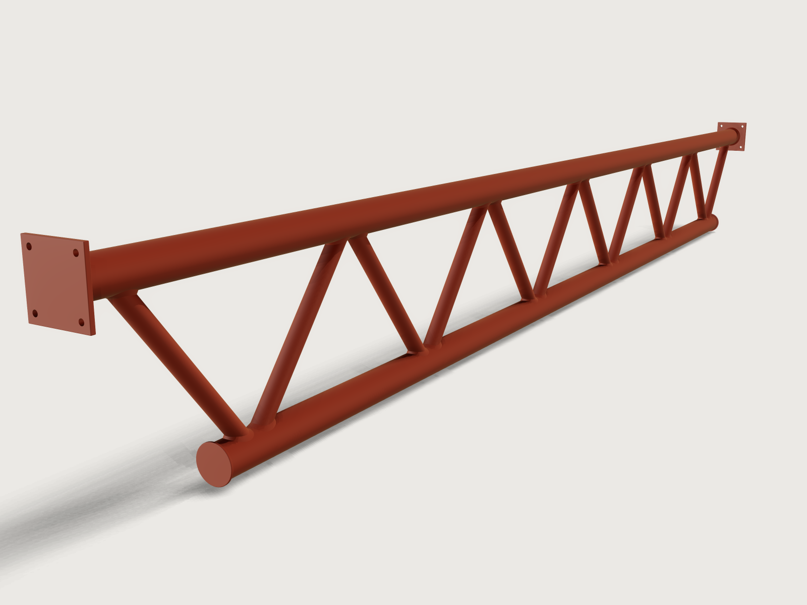

# Welded tube truss

A 6 m Warren truss of round steel tubes, of the kind that carries a canopy or a mezzanine roof: two EN
10219-2 hollow-section chords, twelve diagonals with no verticals, gap K-joints set out to EN 1993-1-8,
and end plates that bolt to the supports. Each diagonal is coped by subtracting the chord's outside
cylinder from it, so it sits on the chord with no root gap, and is fillet-welded all round with a weld
sized for full strength. Every diagonal is the same part, and its coping template is the coped tube laid
flat. The truss checks its own set-out against the code's validity ranges and its steel against closed
forms.



## What it shows

- **A standard's sizes in a table.** `table.set` holds four pairs of EN 10219-2 sections (chord and
  diagonal) with their tabulated masses; `variable.publish` with `choicesFrom` makes them the *Section pair*
  choice. *Span*, *Depth* and *Panels* are public too; the depth's range is a formula of the span, and the
  panel count's range a formula of both, chosen so that the diagonals set out on the chord axes lean 30°
  to 55°.
- **The joint set-out in formulas.** The diagonals' angle is solved in closed form (`atan2` and `asin`)
  from the span, depth, panel count, the sections and the weld size; the gap and the eccentricity follow
  from it.
- **Coped tubes by subtraction.** The chords are tubes (`feature.extrude` of two circles); each chord also
  has a solid cylinder of its outside diameter (`feature.cylinder`). One diagonal is extruded from a
  section on a datum plane square to it (`datum.plane` at an angle, then at a distance), from one chord's
  axis to the other's, and coped at both ends by subtracting the two solid cylinders (`feature.boolean`
  with `keepTool`). `feature.mirror` makes the falling diagonal, `feature.pattern` repeats the pair along
  the span.
- **A coping template.** `feature.unfold` lays the coped diagonal's outside flat, both copes and the
  length on one sheet, exported 1:1 as DXF to wrap round the tube and mark it.
- **Weld beads.** The solid diagonal is united with the solid chord, a copy of the union
  (`feature.transform` with `keep`) gets `feature.chamfer` on the joined saddle edge, and the union is
  subtracted from it again: what is left is the bead, a body of its own. It is turned 180° about the
  diagonal's middle for the weld at the other end (`feature.transform`), mirrored and patterned with the
  diagonals. The end plate and cap plate welds are made the same way on circular edges.
- **Plates.** The end plates are `sketch.rect` with four bolt holes on a datum plane centred on the
  chord (`datum.plane` through three points), extruded, every edge rounded with `feature.fillet`; the cap
  plates are a half section with rounded corners (`sketch.path` with arcs) turned by `feature.revolve`.
- **Material, outputs and checks.** `material.preset` (steel, 7850 kg/m³) in a matt red-oxide primer;
  `variable.output` and `variable.measure` give the bar list, the masses and the weld metal; `assert.add`
  checks the volumes in closed form, the counts and the code's limits (below).

## The real thing

- **Use and layout.** A parallel-chord Warren truss: the top chord runs continuously between two end
  plates that bolt to the supports (a column flange or a bracket), the bottom chord stops short of the
  supports, and the diagonals alternate rising and falling with no verticals. The span is measured between
  the top chord's end nodes, the depth between the chord axes (a tenth of the span by default). *Panels*
  counts the panels of the top chord; each has two diagonals. The model sets out the geometry the joint
  rules need; it carries no load case, so the member and joint resistances of EN 1993-1-8 Table 7.2 are
  the structural engineer's to check for the actual loads.
- **Sections and steel.** Cold-formed circular hollow sections to EN 10219-2 in S355J2H (EN 10219-1:
  yield strength 355 MPa up to 16 mm, tensile strength at least 470 MPa from 3 mm); plates S355J2 to
  EN 10025-2. Both chords have the same section; the diagonals are about half the chord's diameter.
  Diameters, walls and masses per metre as tabulated for BS EN 10219-2:2006
  ([roymech](https://roymech.org/Useful_Tables/Sections/Cir_Sect.html)):

  | Section pair | Chords | kg/m | Diagonals | kg/m |
  |---|---|---|---|---|
  | 1 | 88.9 × 5.0 | 10.3 | 48.3 × 3.2 | 3.56 |
  | 2 (default) | 114.3 × 6.3 | 16.8 | 60.3 × 4.0 | 5.55 |
  | 3 | 139.7 × 6.3 | 20.7 | 76.1 × 4.0 | 7.11 |
  | 4 | 168.3 × 6.3 | 25.2 | 88.9 × 5.0 | 10.3 |

- **Execution.** EXC2 to EN 1090-2, which asks for welds of ISO 5817 quality level C.
- **Set-out of the K-joints.** Every diagonal's axis passes through the middle of its half panel at half
  the depth, so all twelve diagonals are the same part (a rising one turned 180° about the vertical is a
  falling one). The diagonals are first set out on the chord axes (no eccentricity, which designers
  prefer: Steel Industry Guidance Note SN48). Where that would leave less than 2 (t1 + leg) between their
  heels, enough for the two weld toes to stay t1 + t2 apart, they are turned about that middle point
  until the gap is exactly that, and the nodes take an eccentricity e = p/4 · tan θ − h/2 (positive away
  from the diagonals). At the defaults: diagonals at θ = 50.93° to the chords, gap 28 mm, e = +7.93 mm.
- **EN 1993-1-8:2005 (with AC:2009), section 7, CHS joints.** The model asserts the conditions of 7.1.2
  and the validity range of Table 7.1 for welded joints between CHS braces and CHS chords: at least 30°
  between a diagonal and a chord and between adjacent diagonals (7.1.2(3); 78.1° between the diagonals
  at the defaults), a gap of at least t1 + t2 (7.1.2(5)), 0.2 ≤ d1/d0 ≤ 1.0, 10 ≤ d0/t0 ≤ 50,
  d1/t1 ≤ 50, and Class 2 or better in compression (EN 1993-1-1 Table 5.2: d/t ≤ 70 ε², 46.3 for S355).
  The eccentricity stays within −0.55 d0 ≤ e ≤ 0.25 d0 (5.1.5(5)), so its moments need not be taken into
  the joint's design, though the chord still carries them.
- **Weld size.** EN 1993-1-8 7.3.1(4) asks that a brace's weld per unit length of perimeter be at least
  as strong as its wall. For a fillet weld at right angles the directional method (4.5.3.2) gives
  a ≥ √2 · βw · (fy / fu) · (γM2 / γM0) · t
  (Stroetmann et al., *Steel Construction* 15 (2022), eq. (1)). With βw = 0.9 for S355 (Table 4.1),
  γM2 = 1.25, γM0 = 1.0 and the hollow section's own fu = 470 MPa, that is a ≥ 1.20 t: 4.81 mm for the
  4.0 mm wall of the diagonals, so **a5 all round**. (CIDECT Design Guide 1, 2nd edition 2008, quotes
  1.10 t for S355, the same rule with fu = 510 MPa; the section's own, lower fu is on the safe side.) The
  throat is rounded up to 0.5 mm, the step weld sizes are written in on drawings (a3.5, a4.5): rounding
  to whole millimetres would make it a7 instead of a6.5 on the 5.0 mm diagonals of section pair 4, with
  no strength gained. The end plates are welded with the same rule to the 6.3 mm chord wall, a8 (7.57 mm
  required), and the cap plates with a seal weld of the 3 mm minimum throat (EN 1993-1-8 4.5.2(2)). On
  the drawing (ISO 2553) each diagonal end gets an arrow to the joint, the fillet symbol with *a5*, the
  weld-all-round circle and *135* in the tail: MAG welding with a solid wire, ISO 4063 process 135.
- **The angle round a saddle, and what the bead is.** Round a tube welded to a tube the angle between the
  fusion faces changes: θ = 50.9° at the toe, 121.8° at the flanks and 129.1° at the heel. EN 1993-1-8
  4.3.2.1 counts a fillet weld as one only between 60° and 120°: below that it is a partial-penetration
  butt weld, above it the resistance has to come from tests. The model draws the deposit as one
  flat-faced bead with equal legs of 2a = 10 mm: its throat, leg · cos(angle / 2), is at least a5 wherever
  the faces meet at 120° or less, and more at the toe. Where they open wider, from just before each flank
  round the heel (about half the perimeter), the drawn bead is under a5: 4.86 mm at the flanks and
  4.30 mm at the heel. That whole zone is where the shop drawing details the weld as EN 1090-2 Annex E
  does for branch joints in hollow sections (a prepared brace end and a butt weld), and where fabricators
  vary the preparation locally (SCI Guidance Note 5.01); the model does not draw it.
- **Coping and fit-up.** Each end of a diagonal is coped to the chord's outside, so it sits on the chord
  with no root gap all round (EN 1011-2 limits the root gap of a fillet weld to 3 mm, and EN 1090-2 7.5.8
  asks for a larger leg when there is one). A CNC tube profile cutter cuts the saddle from the members'
  STEP, radially or with a variable bevel; a radial cut along the outer saddle line leaves the heel's
  inner corner proud of the chord, so the heel is ground to fit. By hand, saw the blank first, either
  with both ends mitred parallel to the chords (each cut at θ = 50.9° to the tube's axis, the two cuts
  parallel), 647.8 mm on every line of the tube, or square-cut 674.6 mm long, from toe to toe along the
  axis (the toes at the two ends lie on opposite sides); add 2 to 3 mm for the grinding. Then wrap the
  coping template round it with its straight edges meeting, mark both ends, cut with plasma or oxy-fuel
  and grind to the line and to the chord. Both lengths are outputs in closed form,
  (h − 2 √(R² − r²)) / sin θ and (h − 2R + 2r cos θ) / sin θ; the square-cut one is not asserted against
  the model, as a measure's axis cannot be the diagonal's
  ([F-094](../../3DCRAFT-FEEDBACK.md#f-094)), but it is the template's length from toe to toe.
- **Printing the template.** The template is the tube's outside, 1:1. The DXF lays it at an angle (44° at
  the defaults, where it spans 591 × 584 mm): turn it in the drawing program so its straight seam edges
  run along the paper, print it at 100 % on a 610 mm roll or tiled, and check its width, 189.4 mm
  (π × 60.3), before cutting it out. Its seam falls where the unfold puts it, not on the crown or a
  flank ([F-073](../../3DCRAFT-FEEDBACK.md#f-073)).
- **Torch access.** The gap leaves 8.0 mm of bare chord between the two weld toes (measured), and the
  diagonals open at 78.1° above it, so both heels can be reached from above. At the supports the end
  diagonal's weld stays 107.0 mm clear of the end plate's weld (measured): the end plate sits one chord
  diameter outside the end node.
- **End plates and caps.** End plates 210 × 210 × 15 mm: the bolt square, the chord plus two holes rounded
  up to 5 mm (155 mm), plus three hole diameters, rounded up to 10 mm. Four Ø18 mm holes for M16 bolts
  (EN 1090-2 6.6.1, normal round holes), each centre 27.5 mm from the edges (at least 1.2 d0 = 21.6 mm,
  EN 1993-1-8 Table 3.3); the bolts sit outside the chord and its weld. The plates are cut by plasma or
  laser from the DXF (the outline and holes centred on the plate), with the machine's kerf compensation,
  and the holes drilled (EN 1090-2 6.6.3 also admits thermally cut holes that meet its requirements).
  The DXF is the cutting line, so its corners are sharp; the 2 mm rounds of the model, on every edge and
  corner, are ground after cutting so the primer holds on them. The bottom chord's ends are closed with
  Ø132 × 8 mm cap plates (the chord plus two seal-weld legs each side, rounded up to 1 mm), their rims
  rounded 2 mm the same way. With the diagonals closed by the chord walls and every chord end welded shut,
  no member is open: water cannot get in, and the insides need no coating.
- **Order of work and distortion.** Saw the chords, cut the diagonals and the plates. Fit up on a flat
  table in a jig that holds the chords at the set-out depth, tack each diagonal, and check the gaps. Weld
  the joints from mid-span outwards, alternating top and bottom chord, and turn the truss over to weld
  the back of each joint, so the shrinkage of each weld is balanced by the next and the truss stays
  straight. Weld each diagonal all round in two halves, starting and stopping between the crown and the
  saddle, not at them, where the stresses concentrate (Stroetmann et al. 2022, 2.2), overlapping the
  stops. Weld the end plates last, after checking the length between them, so the shrinkage of the truss
  does not shift the bolt holes. Then blast clean and prime.
- **Bar list and mass** (at the defaults; outputs of the model):

  | Part | Off | Size | Length |
  |---|---|---|---|
  | Top chord | 1 | CHS 114.3 × 6.3 | 6228.6 mm |
  | Bottom chord | 1 | CHS 114.3 × 6.3 | 5297.6 mm |
  | Diagonals | 12 | CHS 60.3 × 4.0 | 647.8 mm, ends mitred parallel to the chords (674.6 mm square-cut) |
  | End plates | 2 | 210 × 210 × 15 | |
  | Cap plates | 2 | Ø132 × 8 | |

  Both chords together are 11 526.2 mm, so at the defaults they come out of one 12 m bar. The mitred
  diagonal blanks nest end to end, each cut shared with the next, so the twelve take 7773.3 mm of tube
  (12 × 647.8 mm; add the saw's kerfs). Counted that way, the tube bought weighs 236.8 kg at the standard's nominal masses; the finished members and plates weigh 247.6 kg, and
  the weld metal 285.8 cm³, 2.24 kg.
- **Simplified, or left out.**
  - No load case, member resistance or joint resistance (EN 1993-1-8 Table 7.2); no precamber.
  - The weld bead is one flat-faced, equal-leg shape all round; the per-zone preparations, the weld's
    convexity, its penetration and its starts and stops are not drawn; the copes are drawn as the ideal
    fit, without the heel's grinding allowance.
  - The welds are bodies of their own that touch the members; the members are bodies of their own too
    (top chord, bottom chord, diagonals, end plates, cap plates), as a fabrication's cut list has them.
  - Bolts, the supports and any shop marks are not drawn.

## Parameters

| Parameter | Range | Default |
|---|---|---|
| Span | 4800 to 7200 mm, steps of 300 mm | 6000 mm |
| Depth | span / 14 to span / 8, steps of 50 mm | 600 mm |
| Panels | 4 to 8, limited so the diagonals set out on the chord axes lean 30° to 55° | 6 |
| Section pair | the four pairs of the table | 114.3 × 6.3 / 60.3 × 4.0 |

## Checks

24 assertions, all proven:

- **Steel in closed form.** The top and bottom chords are tubes: area times length, exact to a millionth.
  The coped diagonals: a tube cut by a cylinder of radius R at each end has the volume (h · A − 2 ∫∫ √(R²
  − w²) dA) / sin θ over the tube's annulus (w across the chord); the integral is summed as the series of
  √(1 − x) to eight terms, and the twelve diagonals agree with it to 2 × 10⁻⁵ (12.6 mm³ in 5 391 533 mm³
  at the defaults). The end plates are rounded boxes less four holes, the cap plates turned discs with
  rounded rims (Pappus): exact to a millionth.
- **Welds in closed form.** The end plate and cap plate welds are triangles of legs z turned round the
  chord: 2 π z² (R + z / 3) for the pair.
- **Counts.** Two diagonals per panel (12), a weld at each end of each (24).
- **The gap, measured.** The distance between two diagonals at a K-joint equals the set-out gap within
  0.01 mm (27.999995 mm) and is at least t1 + t2 (EN 1993-1-8 7.1.2(5)); the distance between their weld
  beads equals the gap less two legs (7.99997 mm), which proves the beads' legs along the chord.
- **The code's limits.** The angles of 7.1.2(3), the eccentricity of 5.1.5(5), the ratios of Table 7.1 and
  the cross-section class (EN 1993-1-1 Table 5.2), as above.
- **Weld size.** The bead's throat at 120° between the faces is at least the full-strength throat (5.0 mm
  against 4.81 mm); the end plate weld is too (8 mm against 7.57 mm).
- **The table against the geometry.** The top chord's measured volume per metre, at 7850 kg/m³, and the
  diagonal's section give the standard's masses per metre within the table's rounding (0.05 kg/m).
- **Bolt edge distance.** Measured from hole to plate edge, at least 1.2 d0 (EN 1993-1-8 Table 3.3).

`craft3d-cli check-range` proves them at 28 points: the defaults, all 16 corners of the ranges (the
depth's and the panel count's ranges follow the span), each choice of *Section pair* and eight random
points. It does not try every combination.

## Files

- `welded-truss.3dcraft`: the model.
- `build.json`: the 186 steps that build it.
- `exports/welded-truss-members.step`: the chords, diagonals and plates as exact geometry, for a tube
  profile cutter and for other CAD programs (the weld beads are left out: they are the welder's, and their
  B-spline faces would add 4.9 MB).
- `exports/welded-truss-coping-template.dxf`: the coped diagonal's outside laid flat, 1:1, to wrap round
  the tube.
- `exports/welded-truss-end-plate.dxf`: the end plate's cutting line and bolt holes, centred on the
  plate.

## Rebuild

```sh
tools/examples.py build welded-truss
# or
craft3d-cli run --new '{"units":"mm"}' --script examples/24-welded-truss/build.json --out welded-truss.3dcraft
```

## Difficulty

**7 / 10** (the reviewer): simple cylinders, but the diagonals' angle solved in closed form from coupled formulas, weld beads made by a chamfer on a union, a coped tube unfolded to a 1:1 template, EN 1993-1-8 checks across several bodies, and three kernel limits worked around.

## Platform notes

- **Tolerance.** The document's tolerance is 0.001 mm (`document.setTolerance`), a thousandth of what a
  fabricator measures. At the default 1e-6 mm a weld bead's chamfer face is fitted so finely (some 20 000
  STEP entities) that moving and patterning the beads makes the model far too slow to open ([F-148](../../3DCRAFT-FEEDBACK.md#f-148),
  below).
- **Weld beads made once.** A chamfer round a tube-to-tube saddle costs much more than the booleans around
  it, so one bead is made and copied rather than 24 chamfers on the united truss; its STEP is large for
  the same reason ([F-148](../../3DCRAFT-FEEDBACK.md#f-148): a chamfer round a saddle edge is slow to copy and large to
  export).
- **Welds kept apart.** A bead made this way cannot be united with the coped diagonal it was made
  against: the same tube-to-tube intersection, made twice, lands at the edge of tolerance ([F-149](../../3DCRAFT-FEEDBACK.md#f-149)). The welds are bodies of their own, as a weldment's
  cut list would have them anyway.
- **Cap plates turned.** A 2 mm round on the rim of a disc of about 92 mm radius or more is refused at
  this tolerance ([F-147](../../3DCRAFT-FEEDBACK.md#f-147)), so the cap
  plates are a turned section with the rounds drawn in.
- **Coping template.** The unfold cuts the tube open on a line of its own choosing and lays the band by
  its first edge ([F-150](../../3DCRAFT-FEEDBACK.md#f-150)), so the template lies at an angle and its seam is not on the crown or a flank
  ([F-073](../../3DCRAFT-FEEDBACK.md#f-073)); it has no crown or flank lines to align it by
  ([F-085](../../3DCRAFT-FEEDBACK.md#f-085)).
- **Preview.** Drawn with the key light at [330, 55] (`look.light`): from the default direction the
  contact shadows draw saw-toothed patches on the diagonals just above the welds, lower lights a
  stair-stepped shadow of the end plate on the top chord, and some a blocky shadow on the floor
  ([F-026](../../3DCRAFT-FEEDBACK.md#f-026), [F-043](../../3DCRAFT-FEEDBACK.md#f-043)).
- **Names.** Each body is named after its last feature ([F-042](../../3DCRAFT-FEEDBACK.md#f-042)); the
  measured gaps find their faces by feature ids, as face queries do not take feature names
  ([F-134](../../3DCRAFT-FEEDBACK.md#f-134)).
