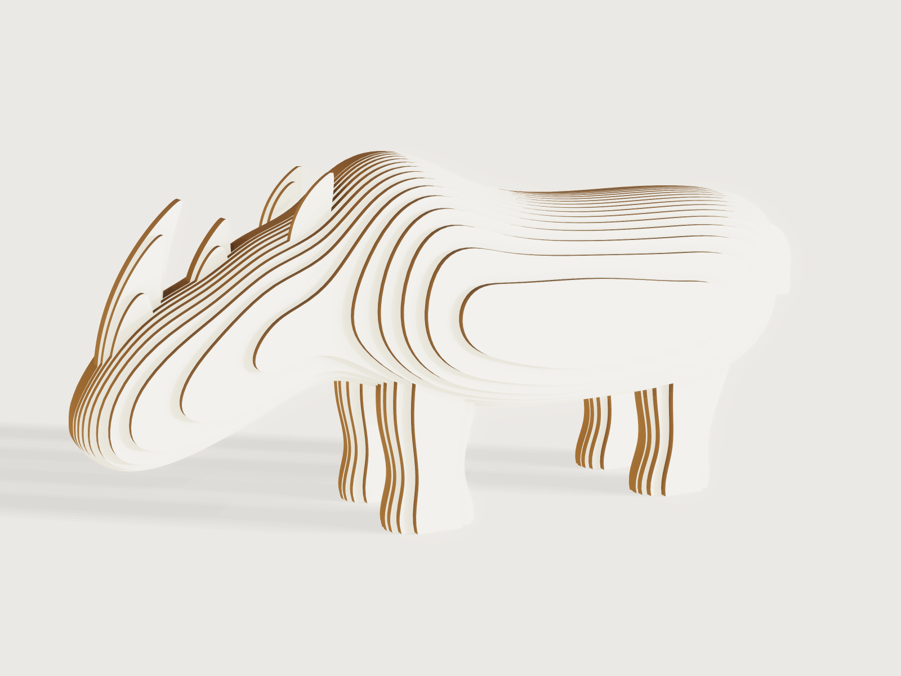

# Layered cardboard rhino

An original, stylised rhinoceros, 300 mm from rump to upper lip, built the way layered cardboard sculptures
are: the animal is modelled once as a smooth freeform figure, cut into straight-walled layers of
white-faced corrugated board parallel to its plane of symmetry, and glued up side by side. There are no
dowels: every layer but the middle pair has its place engraved on its inner neighbour, so the stack lines
up by eye. The model writes the laser files for every layer, cut and engrave apart and on one origin, and
proves the stack: the layer count, every layer one flat piece with straight walls, every mark in place,
the glue area, and that the rhino stands on its feet.



## What it shows

- **A lines plan in tables.** `table.set` holds the figure as a lines plan, the way a hull is drawn:
  `body_lines` has 16 stations along the body, each with its top, its bottom, its widest point and a
  shoulder and a belly point between them; `front_leg`, `hind_leg`, `ear`, `front_horn` and `rear_horn`
  hold horizontal sections (height, centre, two radii), and `tail` the tail's root, reach, bend and radius. Every coordinate is multiplied by `figure_module`, the *Length* divided by
  the 311.5 modules from rump to lip, so the whole figure scales with one parameter.
- **A freeform figure from live splines and lofts.** Each station is a closed `sketch.spline` with
  `live: true` through eight points written as expressions; `feature.loft` makes the body (16 stations),
  each leg, the ear and both horns, and `feature.sweep` of a circle along a `sketch.path` (a line, a
  tangent arc and a line) makes the tail; six `feature.boolean` unions make one solid, `Rhino`. Only the
  left half is ever used: the legs and the ear are modelled on the left side, and the right half of the
  stack is the left half mirrored.
- **Sections as sheets.** A rectangle parallel to the plane of symmetry, half a board from it
  (`feature.fill`, its size derived from the figure's length and height), repeated one board apart by
  `feature.pattern` (`count` = `layer_pairs`, a formula), and intersected with the figure
  (`feature.boolean`): one flat face per layer, the figure's section at the middle of that layer.
- **Straight-walled layers.** `feature.plate` gives each section face the board's thickness, half to each
  side (`side: mid`), with square rims: a prism of the section, walls square to the board, which is what
  a laser cuts. `cut.list` sees all 30 bodies as plates of 3 mm.
- **The other half by mirroring.** `feature.mirror` with `keep` copies every left layer to the right;
  `when` conditions switch the layers beyond the count off for thicker boards and smaller rhinos.
- **Alignment marks.** `feature.transform` makes a copy of the figure moved one board inward; the
  sections intersected with it (`feature.boolean`) give, in each layer, the part of its outer neighbour
  that lies on it: the neighbour's outline clipped to the layer. A `feature.block` keeps the outermost
  layer out of it, since it has no outer neighbour; `feature.mirror` gives the right half's marks.
- **Two-tone board.** `body.appearance` colours the cut edges kraft brown, `face.appearance` the two faces
  of each layer white; `body.material` gives the board its density from the data sheet's grammage.
- **Laser files.** `file.export` of each layer's outward face and of its mark, both with `origin: model`,
  so the cut file and the engrave file of a layer share one origin, for the left and the right half;
  `cut.export` lays the 15 distinct parts out on a sheet.
- **Checks.** `variable.measure`, `variable.output` and `assert.add` (below).

## The real thing

- **The board.** Ball & Doggett, Claycote flute range, technical specification sheet (updated 07.25,
  [PDF](https://ballanddoggett.com.au/wp-content/uploads/2024/06/tech_data_sheet_claycote-flute-range.pdf)):
  Claycote B Flute (2 Sided), SKU 142648, single B flute, 3 mm, 569 g/m², white clay coat on both
  faces, sheets of 1240 × 2450 mm; and Claycote E/B Flute, SKU 149373, twin cushion E and B flutes,
  4.5 mm, 826 g/m², white clay coat on both faces, same sheet. Between the white liners the cut edge
  shows the brown fluting. The model's density is the grammage over the thickness (190 kg/m³ for B flute).
- **The layers.** As many whole boards as fit in the barrel's half-width (47 modules, 45.3 mm at
  300 mm): `layer_pairs = floor(47 modules / board)`, 15 a side on B flute, 10 a side on E/B flute. The
  count is even and the plane of symmetry lies between the two middle layers, so the stack is 90 mm wide on
  B flute against the barrel's 90.5 mm. Each layer's outline is the figure's section at
  the layer's middle plane.
- **The marks.** The two middle layers are identical and are glued face to face on their outlines. Every
  other layer goes onto a mark engraved on the outward face of its inner neighbour, so layers 1 to 14 of
  each half carry one mark each, on one face only, and the outermost layers carry none and show clean
  faces. The mark is a fine, low-power vector score exactly on the neighbour's outline, and it is accepted
  as visible: after gluing it shows as a hairline in the inside corner of each step, more so because the
  kerf makes the neighbour slightly smaller than its line. An outline inset by a margin, which the
  neighbour would cover, would need an offset of the spline outlines, which 3DCraft cannot make (see the
  platform notes). Where the neighbour runs past the layer's edge (the feet of the inner leg layers, the
  ear, the legs' front and back where they widen towards the leg's middle), the mark follows the layer's
  own edge; that part of the score lies on the cut line and goes with the cut. The marks cover 98.6 % of
  the area of the layers that are placed on them (97.7 % on E/B flute).
- **Mirrored halves.** Every file is drawn as the layer is seen from its marked face, which is the face
  that lies up on the laser bed: the left half's files show the rhino's left side, head to the left, and
  the right half's files (`rhino-right-…`) are their mirror images, head to the right. `cut.list` counts
  each left and right layer as one part, count 2, because turned over they are the same outline; with
  the marks on one face only they are not interchangeable, so each half has its own files.
- **Layer numbers.** The files are numbered by layer (01 the middle, 15 the outermost), but the numbers
  are not engraved: engrave each with the laser software's text tool inside the mark, where the
  neighbour hides it, or write it in pencil. Engraving them from the model (a `sketch.text` per layer cut
  out of the marks) worked, but at a quiet moment the model then opened in 4.91 s with 11.4 s of CPU,
  against 3.81 s and 10.1 s without, over the 4 s budget, so the numbers were taken out again (see the
  platform notes).
- **Kerf.** A CO2 laser cuts a kerf of about 0.21 mm in 3 mm cardboard (Fab Lab Amsterdam, Fab Academy
  2018, [group assignment](https://fabacademy.org/2018/labs/fablabamsterdam/lasercut/group1.html)) to
  0.35 mm (Fab Lab Kannai, Fab Academy 2020, VLS2.30, 30 W,
  [computer-controlled cutting](https://fabacademy.org/2020/labs/kannai/computer-controlled_cutting.html)).
  The files are at true size without kerf compensation: every layer comes out 0.1 to 0.18 mm smaller all
  round, all alike, so the stack keeps its shape.
- **Making it.** Lay each per-layer file with its y axis along the flutes, so they run up the legs
  (`rhino-parts.dxf` turns every part, so this does not hold for it). Score the mark
  first at low power (test on a scrap: it should brown the clay coat, not cut it), then cut the outline.
  Cut every left file and every right file once. Glue with PVA in
  a thin film: the middle pair face to face, then outwards, each layer on its mark, the left and the right
  half in turn, and press each under a flat weight. The feet are the bottom edges of layers 5 to 11 of each
  half: 28 flat soles on the ground. Each leg's sides are straight up and down (its sections all have the
  same width across the board), so a layer either carries a leg to the ground or misses it. The board
  weighs 295.5 g (0.519 m² of B flute at 569 g/m²); one of each part fits within 1240 × 434 mm of the
  1240 × 2450 mm sheet (`rhino-parts.dxf`), so the 30 parts take less than half a sheet.
- **Slits.** No notch in an outline is narrower than the board where it matters: the horns stand apart
  on the head (about 10 mm between them in the middle layer), and the tail leaves the rump straight back
  before it bends down, so it meets the rump at about a right angle with a gap of about 11 mm below.
- **It stands.** The stack's centre of mass lies 131.1 mm from the rump, between the hind feet's centres
  at 55.9 mm and the front feet's at 168.5 mm, and on the plane of symmetry.
- **Simplified, or left out.** The figure is stylised, its proportions drawn by eye after the white
  rhinoceros (a long head carried low, a hump over the shoulders, two horns): no toes, skin folds or eyes.
  The horn tips are thinner than half a board, so the middle layers end them in a point; the tail is a
  round bar with a flat end. The
  smooth figure is a step of the history that the sections take up; the stack is the model.

## Parameters

| Parameter | Range | Default |
|---|---|---|
| Length (rump to upper lip) | 200 to 300 mm, in steps of 10 mm | 300 mm |
| Board | B flute, 3 mm; E/B twin flute, 4.5 mm | B flute, 3 mm |

The length stops at the default because the layers' white faces are coloured face by face, which needs
every layer to exist at the defaults (see the platform notes).

## Checks

- **Layer count.** Twice `floor(47 modules / board)`: 30 layer bodies.
- **Every layer one flat piece.** Exactly two flat faces square to the stack's axis per layer: 60. A
  layer in two pieces would have four.
- **Straight walls.** The left half's volume equals the board's thickness times the area of its layers'
  outward faces (778.917 cm³ = 3 mm × 2596.389 cm², to a millionth), which holds only when every layer
  is a prism. Measuring the right half's faces as well costs about 0.5 s of load.
- **Right half the mirror of the left.** The stack's volume is twice the left half's, to a billionth
  (1557.834 cm³); the right layers are the left ones mirrored (`feature.mirror`).
- **Every placed layer has its mark.** 28 mark faces, one on each of layers 1 to 14 of each half.
- **Glue area.** Together, the marks cover at least 90 % of the area of the layers placed on them: 98.6 %.
  Layer by layer the share is lowest where a leg begins, since the layer inside a leg's first board has no
  leg under it; the check is on the whole stack.
- **Feet on the ground.** As many flat soles as cutting planes cross the four feet: 28.
- **Fits on one sheet.** The boards' total area is at most one sheet's: 0.519 m² against 3.038 m².
- **Stands on its feet.** The centre of mass lies between the hind and the front feet's centres:
  131.1 mm, between 55.9 and 168.5 mm.
- **No layer grazes a leg, the tail or the ear tip.** The legs' sides, the tail's sides and the ear
  tip's edges lie at least 0.05 mm from every cutting plane (0.113 mm at the defaults). A plane that grazes such an edge leaves a sliver
  no laser can cut, and 3DCraft refuses the boolean at the edge of its tolerance.
- **No cutting plane or joint on a limb's centre plane.** The legs' and the ear's planes of symmetry lie at
  least 0.05 mm from every cutting plane and every joint between layers (0.445 mm at the defaults);
  otherwise two neighbours' outlines would coincide over a stretch, which the boolean refuses.

`craft3d-cli check-range` proves them at 14 points (the defaults, the four corners, the other board and
eight random points); before handing in, every one of the 22 combinations of length and board was built
and checked.

## Files

- `layered-cardboard-rhino.3dcraft`: the model. It opens in 3.38 s with 8.3 s of CPU and is 384 KB (`meta.json`, `stats`).
- `build.json`: the 201 steps that build it.
- `exports/layers/rhino-left-01-cut.dxf` to `-15-cut.dxf`: each left layer's outline, seen from its
  marked face, with the model's origin; `rhino-right-01-cut.dxf` to `-15-cut.dxf` the same for the right
  half.
- `exports/layers/rhino-left-01-engrave.dxf` to `-14-engrave.dxf` (and `rhino-right-…`): the mark
  engraved on that layer, where layer 02 to 15 goes; it shares the cut file's origin.
- `exports/rhino-parts.dxf`: the 15 distinct parts side by side within the sheet's 1240 mm (`cut.export`),
  each to cut twice, without the marks.

## Rebuild

```sh
tools/examples.py build layered-cardboard-rhino
# or
craft3d-cli run --new '{"units":"mm"}' --script examples/25-layered-cardboard-rhino/build.json --out rhino.3dcraft
```

## Difficulty

**8 / 10** (the reviewer): a table-driven lines plan built as live-spline lofts plus a swept tail, 30 conditional and mirrored plate bodies, marks from a shifted boolean and their mirror, tolerance limits handled with clearance formulas, and process proofs across bodies.

## Platform notes

- **A straight-walled layer from a section.** A section face cannot be extruded nor become a profile
  ([F-139](../../3DCRAFT-FEEDBACK.md#f-139)), but `feature.plate` of the face with square rims is exactly
  the layer a laser cuts, and `cut.list` takes it as a plate.
- **Marks and numbers in the cut file.** `cut.export` cannot carry an engrave layer, so the marks are
  separate files from `file.export` of faces, one pair per layer
  ([F-142](../../3DCRAFT-FEEDBACK.md#f-142)). Numbers cut out of the marks as text take a sketch and an
  extrusion per layer and 1.1 s of load (text booleans are slow,
  [F-034](../../3DCRAFT-FEEDBACK.md#f-034)), so they are left out.
- **No kerf on spline outlines.** `cut.export` refuses a kerf on a part whose outline holds splines, and
  no command offsets a spline outline, so the files carry no kerf compensation and the marks are not
  inset ([F-170](../../3DCRAFT-FEEDBACK.md#f-170)).
- **Face colours and conditions.** `face.appearance` refuses a face of a layer that is switched off at
  the moment and takes no condition, so the length range ends at the default, where every layer exists;
  its colour takes no expression either ([F-171](../../3DCRAFT-FEEDBACK.md#f-171)).
- **No symmetry check.** `measure.symmetry` of the two outermost layers takes about 7 s and of the whole
  stack it runs out of 3 GB, so the stack's symmetry is by construction (`feature.mirror`) and a volume equality,
  not measured ([F-172](../../3DCRAFT-FEEDBACK.md#f-172)).
- **Tolerance.** The document's tolerance is 0.005 mm, a lever for the load time, far below the kerf.
  Coarser tolerances were refused at some sizes while it was built.
- **The edge of tolerance.** Two neighbours' feet share the line z = 0, and booleans refuse edges between
  half and twice the tolerance apart ([F-137](../../3DCRAFT-FEEDBACK.md#f-137)), so the copy that gives the marks is lifted by 0.05 mm (`mark_lift`);
  the marks lie that much above the true outline, well inside the kerf. The two clearance checks above
  keep the cutting planes away from the configurations the boolean refuses; `feature.plate` also refuses
  some outlines where two curves meet at a smooth join (`the edge across a corner could not be traced`, [F-169](../../3DCRAFT-FEEDBACK.md#f-169)),
  which the final geometry avoids at every length and board.

## Licence

[MIT](../../LICENSE), like everything in this repository; credit line in the
[README](../../README.md#licence).
