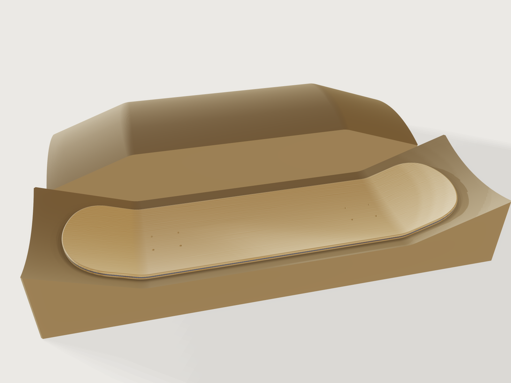

# Skateboard deck and press mould

An original street deck, 8.0 × 31.75 in with a 14.25 in wheelbase, laid up as the trade does it from seven
1/16 in hard-maple veneers with a dyed centre core. The deck has a radial concave and 20° kicks. It is
pressed in a two-part MDF mould, then cut to shape, drilled for the trucks and rounded at the rails. The
model shows the finished deck back in the lower mould half, where it was pressed, with the upper half
turned face up beside it. Its checks prove the layup, the gap the closed mould leaves, the truck
pattern and the kick, and they check the concave and the veneer's curvature in the bends against closed
forms.



## What it shows

- **Inches.** `build.json` starts with `document.setUnit` (inches, numbers kept), so it builds the same
  deck in a document opened in millimetres.
- **A deck top made of swept arcs.** One `sketch.path` draws the deck top's centre line in the
  zx plane: tail kick, a 3 in bend, the flat between the trucks, a bend, the nose kick. A `datum.plane`
  through three points stands square to the path at the tail end. On it, each layer's cross-section is two
  concentric arcs of the radial concave, and `feature.sweep` carries it along the path. In the flat and
  the kicks every top and bottom face is an exact cylinder. In the bends the concave's 16.25 in arc
  turns about a 3 in axis, a spindle torus, which 3DCraft holds as a freeform face; its curvature
  matches the torus's closed form (asserted). The rails are planes and cylinders, the round-overs
  splines. The layers and the mould faces are concentric sweeps of one centre line.
- **The layup as five bodies.** Seven ply bodies with one round-over across them load in 13.8 s (see
  *Platform notes*), so each face veneer and the core under it, which run the same way (long grain), are
  one body, rounded on its own; the glue line between those two plies is not drawn. The two crossbands
  and the dyed centre core are bodies of their own. Each body is the sweep between its own two radii, so
  the five bodies stack without a gap.
- **Cut and drilled from the pressed stack, as in the shop.** One sketch holds the outline (straight
  rails, 5 in tip arcs blended by 3 in corner arcs) and the eight truck holes (`sketch.circle` and a 2 × 2
  `sketch.pattern` per truck). One vertical `feature.extrude` of that sketch cuts every layer through
  `feature.boolean` intersect with `keepTool`, as a template-guided router and a drill press cut the
  pressed blank.
- **Rounded rails.** `feature.fillet` with `chain` runs a 5/64 in round-over round the top and the bottom
  face pairs.
- **The press mould.** Each half is a `feature.block` with chamfered outer edges (`feature.chamfer`). The
  upper half is cut by a sweep that reaches below the deck top. The lower half is cut by a sweep that
  reaches below the deck bottom. So the mould faces are the deck's own top and bottom surfaces, carried
  out to the mould's edges. `feature.transform` with `keep` turns a copy of the upper half face up beside
  the lower half, 4 in behind it, so both mould faces show; the closed half is hidden (`feature.visible`)
  and kept for the checks.
- **Parameters, materials and checks.** Four public parameters (`variable.publish`). Maple by
  `material.preset`, with the grain along or across per body. The density comes from a formula of the
  wood's specific gravity in `body.material`. Mass and volume are outputs (`variable.measure`), and
  `assert.add` holds the checks below, among them `measure.developability`'s curvature and
  developability. The grain is drawn as straight, slightly wavy lines (the pattern's pith far to the side);
  it cannot follow the bends.

## The real thing

- **Size.** Street decks are 7.5 to 8.25 in wide. Length is measured tip to tip, and the wheelbase between
  the inner truck holes
  ([Skate Warehouse deck guide](https://www.skatewarehouse.com/learning-center/Skateboard_Deck_Buying_Guide.html)).
  This deck is 8.0 × 31.75 in in plan, with a 14.25 in wheelbase.
  - The nose is 1/4 in longer than the tail: 6.75 in against 6.5 in, outer hole to tip. A professionally
    shaped deck pairs a 7 in nose with a 6.75 in tail
    ([Paul Schmitt via Braille](https://www.brailleskateboarding.com/blogs/news/how-to-make-a-skateboard-shape-with-paul-the-professor-schmitt)).
  - The flat between the trucks runs on 1/2 in past the outer holes, under the baseplate, before the kick
    bends up.
- **Layup.** Seven plies: face, core, crossband, centre core, crossband, core, face. Plies 3 and 5 run
  across the deck, all others along it
  ([Ripped Laces](https://rippedlaces.com/skateboarding/how-skateboard-decks-are-made/)). The veneers are
  1/16 in hard maple, as in a 7-ply 1/16 in build
  ([AESDES deck project](https://www.aesdes.org/2025/05/01/skateboard-deck-project-the-how-photos-coming-soon-issues-uploading/)).
  - The stack is 7/16 in.
  - The centre core is dyed ultramarine and shows as a blue line on the rails. It is drawn a clear blue,
    because the renderer's tone curve shifts a true ultramarine to violet.
- **Truck holes.** The new-school pattern is 1-5/8 in across by 2-1/8 in along. Warehouse Skateboards
  rounds it to 42 × 55 mm
  ([trucks guide](https://www.warehouseskateboards.com/help/Skateboard-Trucks-Buying-Guide)). The holes are
  13/64 in, for #10-32 truck bolts, and are drilled straight
  ([Ripped Laces](https://rippedlaces.com/skateboarding/how-skateboard-decks-are-made/)).
- **Kick and concave.**
  - A flat deck kicks about 18°, a steep one up to 24°
    ([Freedom Skateshop](https://freedomskateshop.at/en/blogs/skate-tech/nose-tail-kick)). This one kicks
    20°.
  - The concave is radial: a 16.25 in arc across the deck, 1/2 in deep at the rails, carried on through
    the bends and the kicks. Powell Peralta's moulds measure about 0.45 in
    ([Freestyle KB concave reference](https://freestylekb.com/wiki/index.php/Concave_Reference)).
- **Pressing.**
  - **Gluing.** The cores and crossbands are glued on both sides and the faces on their backs, then the
    stack goes into the mould. A home build uses Titebond III, a PVA wood glue, under a vacuum bag at
    about 12 psi for about 10 hours (AESDES).
  - **The press.** Factories press the stack in a hydraulic press between mould plates shaped to the
    deck, for 1 to about 4 hours. The deck then rests 7 to 10 days while the glue cures (Ripped Laces).
    PS Stix presses five decks at a time
    ([Skatepark of Tampa](https://skateparkoftampa.com/blogs/articles/paul-schmitts-skateboard-deck-factory-ps-stix)).
  - **The mould.** It is 36 × 10.5 in and reaches 2.125 in beyond the deck at each end and 1.25 in at
    each rail (outputs), room for the oversize veneer blank the deck is cut from. Each half would be glued
    up from MDF sheets and milled with a ball-end cutter to `exports/skateboard-deck-mould.step`.
  - **The cutter's limit.** The lower half's face is concave both ways: across the deck and, in the bends,
    along it. Its tightest radius is in the bends at the mould's long edges: 2.7287 in at the defaults (an
    output, from `measure.developability`'s curvature, asserted against the torus's closed form). It is
    3.44 in on the centre line and 3.04 in under the rails. Over the range it is smallest at a width of
    7.5 in with a 5/8 in concave: 2.478 in. A ball-end mill under 2.4 in in radius reaches every part of
    both faces.
- **Shaping.**
  - The shop cuts the blank to a template and drills it. It then rounds the rails with a router
    round-over bit and sands them, with a balloon drum sander in factories (Ripped Laces; PS Stix routes
    each board in about 12 seconds).
  - No standard rail radius is published. The AESDES build softens its edges with a 3/16 in round-over.
    That reaches three plies deep, through the face pair and the crossband.
  - Here each face pair carries its own round-over, so the radius has to stay within the pair's 1/8 in.
    At the nose and tail the cut meets the kicked top at an acute angle (70° at a 20° kick), and the
    round-over reaches about 1.43 times its radius down the cut edge there.
  - At the defaults the kernel builds 0.090 in and refuses 0.092 in and 3/32 in. At a 24° kick it builds
    0.085 in and refuses 0.090 in. The model uses 5/64 in (2 mm), which builds at all 25 check-range points,
    the 16 corners of the ranges included.
  - So the rail's corner stands up to (3/16 − 5/64)(√2 − 1) = 0.045 in (1.1 mm) fuller than the 3/16 in
    round-over.
- **Mass.** The deck weighs 1.263 kg (109.27 in³) in hard maple at 12 % moisture. The density is 705.6 kg/m³
  = 0.63 × 1.12 × 1000 kg/m³. Sugar maple's specific gravity is 0.63 at 12 % moisture (Wood Handbook,
  FPL-GTR-282, Table 5-3a). At that moisture the same table runs the hard maples from black maple, 0.57,
  to sugar maple, 0.63; a
  [summary of it](https://forestsource.io/resources/document/strength-and-mechanical-properties) gives hard
  maple's range from green to dry as 0.52 to 0.63. The 1.12 is the water the wood holds at that moisture. The glue lines are not weighed.
- **Simplified, or left out.**
  - The face and core plies of each pair are one body.
  - There is no grip tape and no graphic.
  - The mould has no guide pins to register its halves.
  - The veneer blank is not drawn: each layer's sweep is the pressed veneer, and the cut consumes it.

## Parameters

| Parameter | Range | Default |
|---|---|---|
| Width | 7.5 to 8.5 in, step 1/8 in | 8 in |
| Wheelbase | 13.75 to 14.75 in, step 1/8 in | 14.25 in |
| Concave depth | 3/8 to 5/8 in, step 1/16 in | 1/2 in |
| Kick angle | 18° to 24°, step 1° | 20° |

## Checks

- **The layup.** The two faces of each body, between the trucks, are 2 plies apart for the face pairs and
  1 ply apart for the crossbands and the centre core: 0.125, 0.0625, 0.0625, 0.0625 and 0.125 in. The top
  of the top pair and the bottom of the bottom pair are 0.4375 in apart, seven plies. Each body's
  material names its plies and grain ("Hard maple, crossband veneer, cross grain").
- **The mould closes on the stack.** With the upper half closed, its face and the lower half's face are
  0.4375 in apart, exactly the stack. That is proven between the trucks and along the nose kick, where
  the faces are coaxial cylinders.
  - The bends are swept along the same centre line, but `measure.distance` there finds 0.4375 in and
    proves only about 0.432 in, so they are not asserted.
  - The top face bears on the closed upper half and the bottom face on the lower half (distance 0).
- **Truck holes.** Each of the five layers has the eight holes: 40 hole faces.
  - The inner holes' walls are 14.046875 in apart: the wheelbase less one hole.
  - The new-school pattern's walls are 1.921875 in apart along and 1.421875 in across.
- **Kick angle.** Between two vertical sections in the straight nose kick, the centre core's section
  rises by the run times tan 20°: 0.34906585 rad.
- **Concave depth.** The centre core's section at mid-length is 0.556618732 in tall, so its top rises
  0.494118732 in from the centre line to the rails. A circle with that rise over the deck's width has a
  radius of 16.4375 in. Less the three plies above the core, the top's radius is 16.25 in, and the top
  stands 0.5 in higher at the rails than at the centre: the concave depth, asserted. It is measured on the
  core because the round-over takes the top's own rail corner away.
- **Centre core section in closed form.** Its area at mid-length is 0.505051363 in²: the integral of the
  ring between radii R + 3t and R + 4t across the width, with R = ((w/2)² + d²)/(2d).
- **Where the veneer has to stretch.** The centre core's largest Gaussian curvature,
  0.0219084203 per in², lies in a bend at the rails and is the spindle torus's there: the closed form c / (r² (c − R + ρ)), with
  r = R + 3t, c = √(r² − (w/2)²) and the bend radius ρ = 3 in. Its flat and kick faces (cylinders) are
  developable, asserted. Both come from `measure.developability`, which samples each face rather than
  proving a bound. It also reports the stretch a flat veneer needs over each bend face, 0.0113 and
  0.0115 in. The stretch cannot be an output (`variable.measure` has no stretch measure), so it is quoted
  here, not asserted.
- **The mould can be milled.** The lower half's tightest radius, 2.7287 in, matches the torus's closed
  form at the mould's edge.

`craft3d-cli check-range` proves every check at 25 points: the defaults, the 16 corners of the four
ranges and 8 random points. Both rail round-overs build at all of them.

## Files

- `skateboard-deck.3dcraft`: the model.
- `build.json`: the 143 steps that build it.
- `exports/skateboard-deck-mould.step`: both mould halves, closed, for CAM.
- `exports/skateboard-deck-template.dxf`: the outline and the eight truck holes at full size: the cutting
  template and the drilling pattern.

## Rebuild

```sh
tools/examples.py build skateboard-deck
# or
craft3d-cli run --new '{"units":"in"}' --script examples/26-skateboard-deck/build.json --out deck.3dcraft
```

The tool needs the 3DCraft build this repository is pinned to: see [Rebuild and check](../../README.md#rebuild-and-check)
in the README.

## Difficulty

**7 / 10** (the reviewer): concentric arc sweeps along a line-and-arc path on a perpendicular datum plane, five laminated bodies cut with keepTool booleans, rail rounds at the kernel's limit, two mould halves from offset sweeps, and closed-form checks of a torus curvature, a section integral and the milling radius, on real deck-making knowledge.

## Platform notes

- **Five bodies, not seven.** Seven ply bodies with one round-over across them load in 13.8 s. The rail
  is filleted on the stack, and every later boolean on a body with that long spline round-over costs 6 to
  12 s, even when it cuts nothing
  ([F-152](../../3DCRAFT-FEEDBACK.md#f-152),
  in the family of [F-132](../../3DCRAFT-FEEDBACK.md#f-132)).
  - Rounding each face pair on its own keeps the load at 1.42 s (3.72 s of CPU), but caps the radius at
    the pair's 1/8 in.
  - That fillet's refusal at 0.092 in is geometric, but its error does not say so, nor give the largest
    radius that fits, as the fillet's documentation promises
    ([F-155](../../3DCRAFT-FEEDBACK.md#f-155)).
- **A sweep, not a network surface.** The brief asked for the top from a network or Coons surface,
  trimmed by the outline and thickened. Each route was refused or too slow:
  - **Line–arc network.** Trimmed along z, it did not converge
    ([F-135](../../3DCRAFT-FEEDBACK.md#f-135)).
  - **Thickening the trimmed top.** The plate is refused
    ([F-140](../../3DCRAFT-FEEDBACK.md#f-140)).
  - **A straight run in a spline profile.** A spline with unevenly spaced control points is refused as
    crossing itself
    ([F-153](../../3DCRAFT-FEEDBACK.md#f-153)).
  - **A network of evenly spaced splines.** Each further ply, an offset of an offset, takes 1.9 s
    ([F-154](../../3DCRAFT-FEEDBACK.md#f-154)).
  The sweep is also the better model: exact cylinders in the flat and the kicks, and in the bends freeform
  faces whose curvature matches the spindle torus's closed form ([F-159](../../3DCRAFT-FEEDBACK.md#f-159)).
  Cutting the outline after pressing is what the shop does anyway.
- **Mould gap in the bends.** `measure.distance` proves the gap between the bend faces only to about
  0.432 in (as [F-030](../../3DCRAFT-FEEDBACK.md#f-030)), so the gap is asserted where it is proven.
- **Names.** The face-up copy of the upper half is a second body; the closed half is kept, hidden, for
  the checks.
- **Stretch.** The stretch `measure.developability` reports cannot be an output or an assertion
  ([F-156](../../3DCRAFT-FEEDBACK.md#f-156)).
- **Grain.** The wood pattern's rings are straight-axis cylinders, so the grain cannot follow the bends;
  it is drawn straight along (or across) the deck ([F-083](../../3DCRAFT-FEEDBACK.md#f-083)).
- **Interference.** `document.interference` answers "unknown" for the layers' and the mould's contacts on
  the concentric sweeps ([F-157](../../3DCRAFT-FEEDBACK.md#f-157)); the closed mould is proven by `measure.distance`, not by interference.

## Licence

[MIT](../../LICENSE), like everything in this repository; credit line in the
[README](../../README.md#licence).
