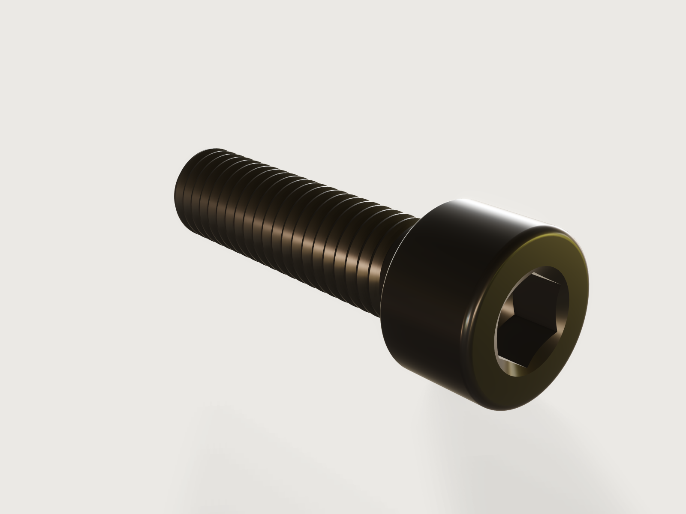

# Socket head cap screw

The most used fastener in machine building: an ISO 4762 hexagon socket head cap screw, M3 to M12 in the
standard's lengths, with a real rolled ISO metric thread. It is the simplest example here and already
complete: tables of the standard drive every size and length, and the screw proves itself against volumes
worked out by hand and against the ISO thread profile, at every size, every length of M8 and random
points across the standard's range.



## What it shows

- **Tables of a standard drive the model.** `table.set` holds ISO 4762's dimensions for M3 to M12 and its
  series of nominal lengths. `variable.publish` with `choicesFrom` turns their rows into the *Size* and
  *Length* choices; the length's `min` and `max` are rows read from the size's row, so each size offers
  exactly its own lengths. Every dimension follows from `iso_4762[size]`.
- **One revolved half section.** `sketch.polyline` and `feature.revolve` turn the shank, the head, the tip
  chamfer and the 120° countersink at the socket's mouth in one feature.
- **Fillets.** `feature.fillet` for the underhead fillet (the standard's minimum radius), the rounded top
  edge of the head and the rounded bearing edge.
- **A punch, made the way the socket is made.** The socket is cold headed by a hexagon punch with a 120°
  conical point. The model builds that punch, a hexagonal prism (`feature.extrude`) intersected with a cone
  (`feature.revolve` with `intersect`), and subtracts it from the head (`feature.boolean`). The countersink
  cuts into the hexagon's flats as on a real screw.
- **A modelled thread.** `feature.thread` with `modeled: true` cuts an ISO 68-1 thread with the coarse pitch
  of ISO 261, with a quarter-turn run-out. It takes its size from the shank's diameter, so it follows the
  *Size* parameter.
- **Material and outputs.** `material.preset` gives steel's density; the finish is black oxide.
  `variable.measure` reports the volume, the volume under the head and the mass.
- **Checks.** `assert.add` with measures and formulas (below).

## The real thing

- **Standard.** ISO 4762:2004 (formerly DIN 912), Table 1, plain head. Per size the table holds the thread
  diameter d, the coarse pitch P (ISO 261), head diameter dk and height k, the socket width's band s min to
  s max, the minimum key engagement t, the thread length b, the minimum underhead radius r, the bearing
  face's minimum diameter dw, the longest length threaded to the head, and the size's first and last length.

  | Size | M3 | M4 | M5 | M6 | M8 | M10 | M12 |
  |---|---|---|---|---|---|---|---|
  | P | 0.5 | 0.7 | 0.8 | 1 | 1.25 | 1.5 | 1.75 |
  | dk | 5.5 | 7 | 8.5 | 10 | 13 | 16 | 18 |
  | k | 3 | 4 | 5 | 6 | 8 | 10 | 12 |
  | s min to max | 2.52–2.58 | 3.02–3.08 | 4.02–4.095 | 5.02–5.14 | 6.02–6.14 | 8.025–8.175 | 10.025–10.175 |
  | t min | 1.3 | 2 | 2.5 | 3 | 4 | 5 | 6 |
  | b | 18 | 20 | 22 | 24 | 28 | 32 | 36 |
  | r min | 0.1 | 0.2 | 0.2 | 0.25 | 0.4 | 0.4 | 0.6 |
  | dw min | 5.07 | 6.53 | 8.03 | 9.38 | 12.33 | 15.33 | 17.23 |
  | threaded to the head up to | 20 | 25 | 25 | 30 | 35 | 40 | 50 |
  | lengths | 5–30 | 6–40 | 8–50 | 10–60 | 12–80 | 16–100 | 20–120 |

  The lengths are the standard's series: 5, 6, 8, 10, 12, 16, 20, 25, 30, 35, 40, 45, 50, 55, 60, 65, 70,
  80, 90, 100, 110 and 120 mm.
- **Thread length.** b, as the standard gives it; the lengths ISO 4762 lists as threaded to the head are
  threaded to two pitches under it here.
- **Socket.** Modelled in the middle of its tolerance band (6.08 mm at M8), exactly t min deep at full
  width, with the punch's 120° point under it and a 120° countersink at its mouth, 1.1 times the hexagon's
  corner across.
- **Tip.** Chamfered at 45° to just below the thread's minor diameter d3 = d − 1.226869 P, as ISO 4753 asks
  of a chamfered end.
- **Head edges.** The top edge is rounded with 0.08 d. The bearing edge is rounded with 0.4 (dk − dw min),
  so the bearing face keeps more than dw min.
- **Making it.** The head and its socket are cold headed and the thread is rolled; the screw is then
  hardened and tempered to property class 12.9 and black oxided. The finish is drawn as the dark, satin
  oxide layer it is, not as bare metal. Mass at M8 × 30: 16.96 g.
- **Simplified, or left out.**
  - The thread is the basic profile of ISO 68-1: no tolerance class 6g, and a flat root rather than a
    rolled thread's round one.
  - The run-out is a quarter turn ending in a small notch, where a real thread fades out over up to two
    pitches.
  - The property class marking "12.9" and the maker's mark that ISO 898-1 puts on the head are left out, and
    so is the optional knurl.
  - The wall under the socket is not asserted. Read to the end of the full hexagon, as the standard's
    w min must be, it is k − t (4 mm at M8 against w min 3.3); the punch's point reaches 1.97 mm above
    the bearing face.

## Parameters

| Parameter | Choices | Default |
|---|---|---|
| Size | M3, M4, M5, M6, M8, M10, M12 | M8 |
| Length | the standard's lengths for the size | 30 mm |

## Checks

- **Head volume in closed form.** Everything above the bearing face (the total volume less `volumeBelow`
  the plane x = 0) must equal the head cylinder, exact to 0.01 mm³. From that cylinder come off:
  - the two rounded edges (Pappus, with the centroid of a fillet's cross-section at (10 − 3π)/(12 − 3π) of
    its radius from the corner);
  - the hexagonal prism down to t;
  - the punch's point. A hexagon of inradius a cut by a 120° cone through its corners leaves
    a³ (8/3 − ln 3)/√3;
  - the part of the countersink outside the hexagon (the circle-and-hexagon overlap, integrated in closed
    form).

  At M8 × 30: 901.349 mm³.
- **Thread to the ISO 68-1 basic profile.** The volume under the head must equal the plain shank, less the
  tip chamfer, plus the underhead fillet, less the basic profile's groove (area 45√3/256 P² per pitch, at its
  centroid's radius) along the thread length. The tolerance is one pitch of groove, which is what the
  run-out and the chamfered start account for. At M8 × 30: 1259.38 mm³ measured against 1255.89 mm³, within
  11.13 mm³. A screw without a thread, or with one half a profile too deep or too shallow, fails it.
- **Socket width within ISO 4762.** The distance between opposite flats lies between s min and s max.
- **Head height to ISO 4762.** The head's top is at k.

`craft3d-cli check-range` proves all four at 32 points: the defaults, every size at 30 mm, every length
of M8, the four corners of the range and eight random points. It does not try all 99 combinations of size
and length.

## Files

- `socket-head-cap-screw.3dcraft`: the model.
- `build.json`: the 49 steps that build it.
- `exports/socket-head-cap-screw.step`: the exact geometry, thread included, for other CAD programs.

## Rebuild

```sh
tools/examples.py build socket-head-cap-screw
# or
craft3d-cli run --new '{"units":"mm"}' --script examples/socket-head-cap-screw/build.json --out screw.3dcraft
```

## Difficulty

**4 / 10** (the reviewer): the socket is a punch built from a prism intersected with a cone and then
subtracted, two coupled tables drive choices limited per size, and the closed form integrates over a
hexagon; the modelled thread stays within the kernel's limits.

## Platform notes

- **Load time.** The modelled thread is what makes this screw look real, and it costs: the model opens in
  4.8 s at M8 × 30 on an idle machine and in 9.0 s on one core (as on the web), and the longest screws
  threaded to the head (M8 × 35, M3 × 20) take 7 to 8 s with other work running; with a cosmetic thread
  it opens in 0.04 s but draws a smooth shank ([F-004](../../3DCRAFT-FEEDBACK.md#f-004)).
- **Tip chamfer.** A thread on a tip chamfered 0.75 P deep is refused for M3 to M6; the ISO 4753 chamfer
  used here is not ([F-006](../../3DCRAFT-FEEDBACK.md#f-006)).
- **Preview.** The preview is drawn with `reflections: false`: the screen-space reflections smear a patch
  onto the thread ([F-013](../../3DCRAFT-FEEDBACK.md#f-013)).
- **Names.** The cone that shapes the punch keeps the automatic name `Revolve1`
  ([F-002](../../3DCRAFT-FEEDBACK.md#f-002)).
